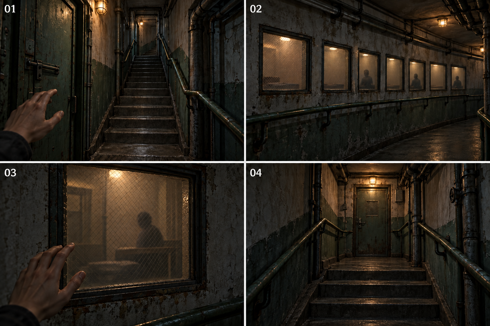
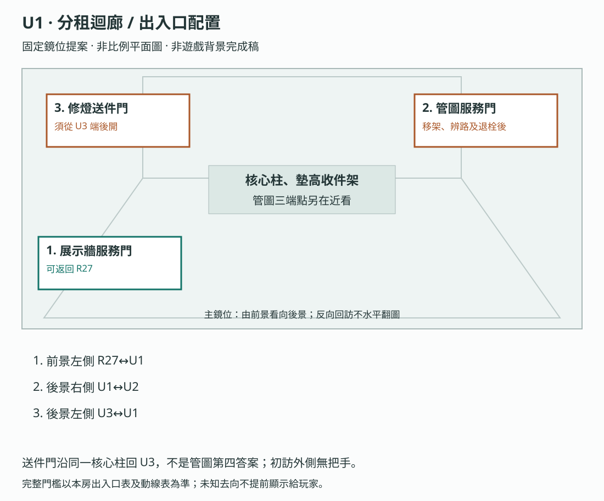
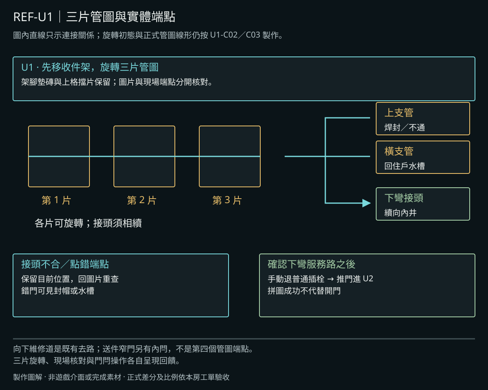
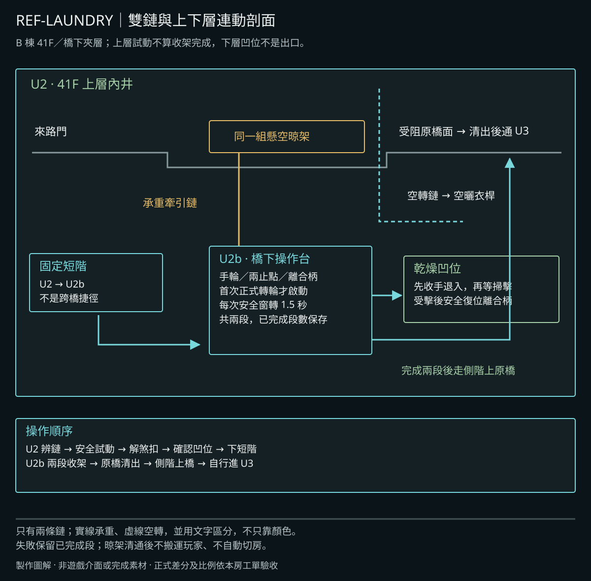
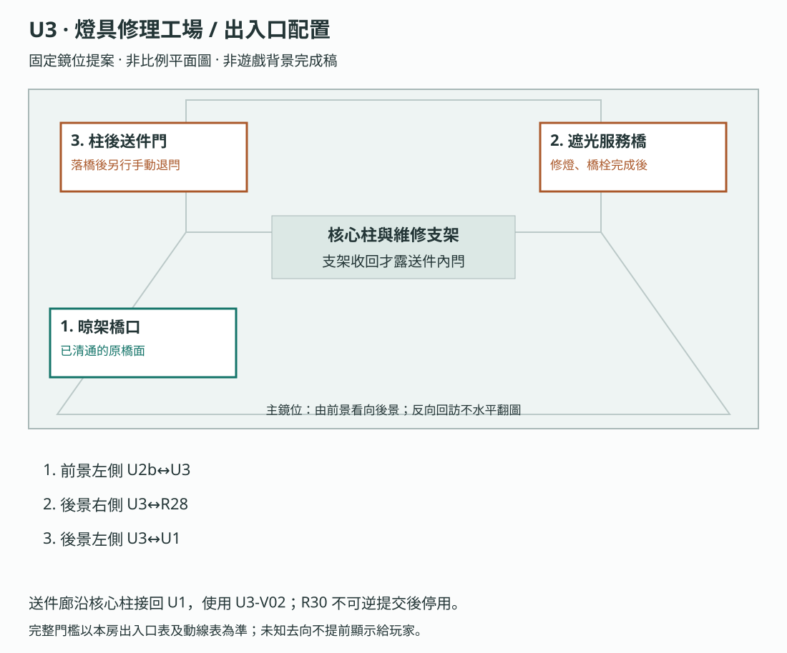
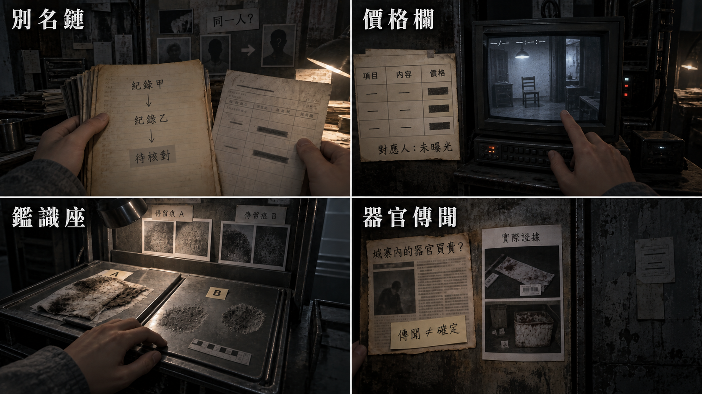
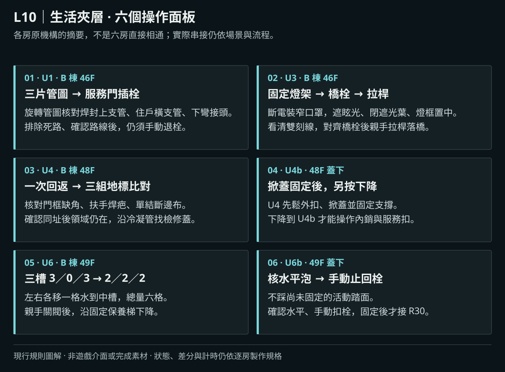
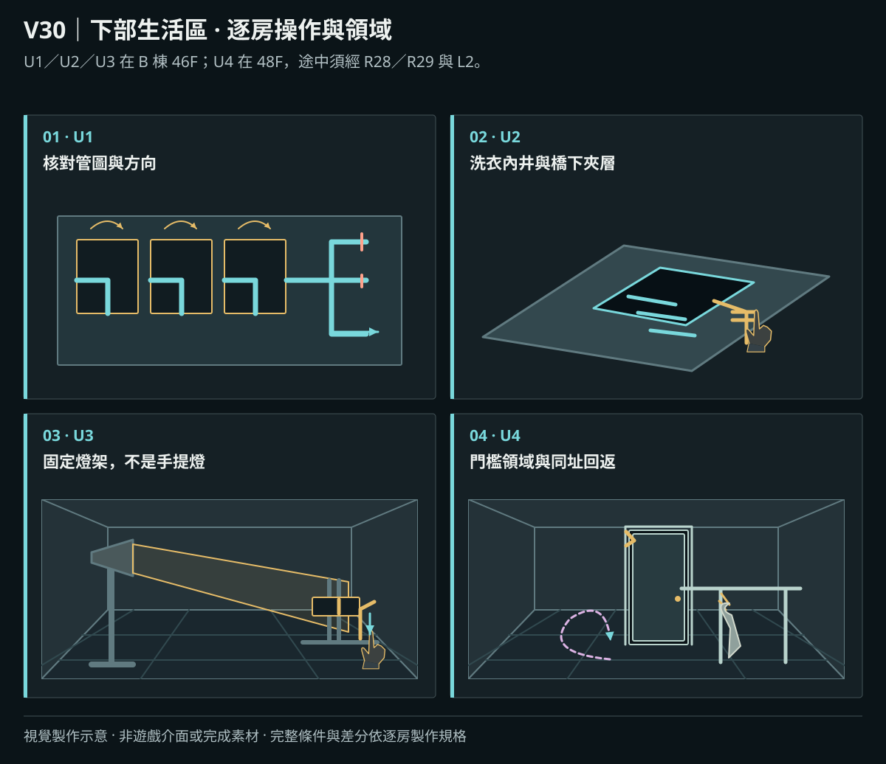
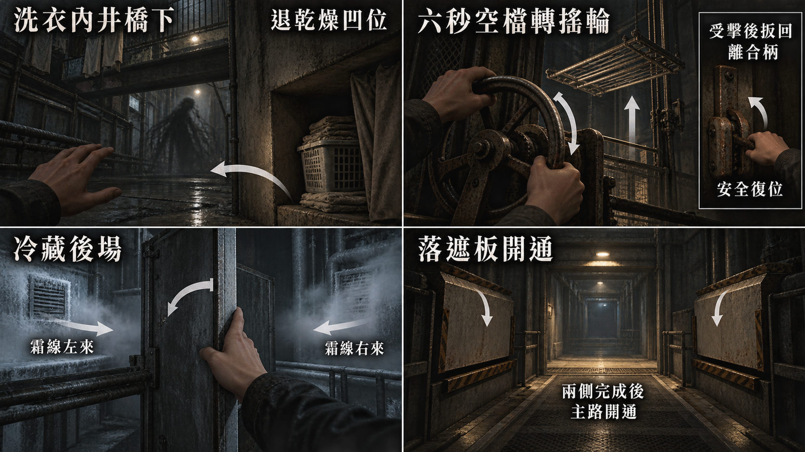

# 製作規格：第六幕

[總目錄](../09_劇本/09-14_全劇本與關卡整合稿.md#book-specs) · [本幕劇本](../09_劇本/09-09_正式劇本_第六幕.md#act-6) · [上一幕規格：第五幕](10-06_製作規格_第五幕.md#spec-act-5) · [下一幕規格：第七幕](10-09_製作規格_第七幕.md#spec-act-7) · [共用附錄](../09_劇本/09-15_正式劇本_共用附錄.md#book-appendices) · [示意圖目錄](10-11_製作規格_示意圖目錄.md#catalog-group-6)

[M1](#node-m1-spec)、[R27](#node-r27-spec)、[U1](#node-u1-spec)、[U2](#node-u2-spec)、[U2b](#node-u2b-spec)、[U3](#node-u3-spec)

<a id="spec-act-6"></a>

## 第六幕 · 展示與暗巷：製作規格

<!-- production:ordered:v3 -->

[共用製作規則](../09_劇本/09-15_正式劇本_共用附錄.md#production-reading-contract)

[本幕概覽](#spec-act-6-overview) · [場景流程](#spec-act-6-rooms) · [跨幕共用規則](#spec-act-6-shared) · [圖解對照](#spec-act-6-references) · [幕尾交接](#spec-act-6-delivery)

<a id="spec-act-6-overview"></a>

### 本幕概覽與前置

承接第五幕阿彪退場，保留 R23–R25 安全整理後，由玩家確認進入 M1；經七窗、展示廊與生活夾層，於 U3 完成既有落橋及通行條件後銜接 R28。

| 本幕 | 範圍與完成條件 |
| --- | --- |
| 主流程 | M1 → R27 → U1 → U2 → U2b → U3；44F→45F 七窗、45F 展示及 46F 生活工場 |
| 玩法 | 逐窗查看、生活物件與編號對照；R27 以剪扣舊牌／退回封套分清私物與人員去向，接入原第三鏈；實讀 U1 分租改管覆核籤、U3 檢修校驗牌並核對現物；選填查共用工具，或從修補拖鞋與留條還原一件照料小事 |
| 情緒落點 | 七窗與展示廊反差，經不安的生活夾層後，在 U3 回收修理桌承諾 |
| 幕尾 | 完成 U3 原通行條件，沿服務橋前往 R28；已開捷徑、來源與資源持續保存 |

以下來源總覽涵蓋第六至八幕；本文件的逐房規格只到 U3。R28 起見第七幕，U6 起見第八幕。拆幕不重置存檔、供電、恐慌、倒數或選擇；既有 `act6.*` 為相容存檔鍵，不是現在的幕別。


<a id="s-0607-21"></a>

<a id="h-0607-1041"></a>

<details>
<summary>前置設定與跨場景規則</summary>

<a id="s-0607-0"></a>
<a id="doc-0607"></a>
<a id="s-0607-1"></a>

<!-- import:s-0607-1:begin -->
<a id="h-0607-1"></a>

#### 第六至八幕 · 上層探索總覽

**篇章定位：下部中後段。** 房內證據規格與穿插探索共同構成流程；[U1–U6 場景原文](../09_劇本/09-15_正式劇本_共用附錄.md#doc-0610)包含每個機關、攻擊窗口與出口條件。

> 「詐騙只是表層。真正的商品，是人。而簽字的人，是你。」

R27–R31 原核心房維持無戰鬥；穿插的 U1–U6 探索區在 U2b／U5 各有一段躲避與環境擊退。壓力來自證據密度、資料正在被遠端刪除，以及整套系統在此刻重新回應主角的內控帳號。玩家早已能懷疑她就是內控主管；全段要確認的是她長期做過什麼，而不是把身分當成唯一反轉。

> Godot 4.x 的互動 ID、資料鍵、三組調查板、倒數保護、唯一解凍與存讀驗收，見 [08-08 Godot 逐房製作包 · R27–R31](../09_劇本/09-15_正式劇本_共用附錄.md#doc-0808)。
<!-- import:s-0607-1:end -->

<a id="s-0909-0"></a>
<a id="s-0909-1"></a>

<!-- import:s-0909-1:begin -->
<a id="h-0909-1"></a>

#### 第六至八幕的來源與承接

> 前接 [第五幕](../09_劇本/09-08_正式劇本_第五幕.md#doc-0908)。依 [06-07](#doc-0607)、[下部探索](../09_劇本/09-15_正式劇本_共用附錄.md#doc-0610)、[08-08](../09_劇本/09-15_正式劇本_共用附錄.md#doc-0808)、[主支線](../09_劇本/09-15_正式劇本_共用附錄.md#doc-0305)、[回憶支線](../09_劇本/09-15_正式劇本_共用附錄.md#doc-0306) 與 [09-00](../09_劇本/09-15_正式劇本_共用附錄.md#doc-0900) 展開。原件欄位沿正式資料，不另造姓名、密碼或死因。
<!-- import:s-0909-1:end -->

<a id="s-0909-2"></a>

<!-- import:s-0909-2:begin -->
<a id="h-0909-5"></a>

#### 全段邊界

| 項目 | 演出契約 |
| --- | --- |
| 路線 | M1 → R27 → U1 → U2 → U2b → U3 → R28 → R29 → U4 → U4b → U5 → U6 → U6b → R30 → R31 |
| 後開回程 | U3 落橋完成後，從工場側手動開啟 U3↔U1 柱後送件廊；只連已探索區，不改首次必經順序 |
| 目標 | 通過夾層找核心，查明封門、震損與現時回返如何讓出口持續受阻 |
| 時長 | 第六至八幕合計沿用原 90–133 分鐘待測基準；重分層與跨棟後須重新量測。M1 與各房不另重複加算，不把此數字當成單幕時長 |
| 節奏 | 七窗／展示反差 → 找路與避襲 → 安全記憶 → 刪除選擇 → 簽名停頓 → 回返與封阻 → 短機關喘息 → 沉降 → 鑑識與解凍 |
| 揭露上限 | 人口交易、長期核可、本人身分、封門與震損路線、冷備份重新可讀；P1 肉身與怨念封鎖核心留終幕 |
| 資源 | 必要來源與機械操作支援 0 穩定度；R27 最後一般安定點一次 +25，上限 100；R31 起零玩法消耗，不等於設備免供電 |
| 破例 | M1 與 R31 各附等效摘要；真正暫停、保存與中途替換未呈現部分可用 |
| 歷史 | 除 R31 十二秒外，全幕記憶皆靜止；UD 是現時黑影，不能寫成小花歷史動作 |


---
<!-- import:s-0909-2:end -->

<a id="s-0607-4"></a>

<!-- import:s-0607-4:begin -->
<a id="h-0607-32"></a>

#### 00 — 全段概覽

| 項目 | 規格 |
| --- | --- |
| 區域 | 45F 展示；46F 生活工場；47F 交易與簽核；48F 門牌與冷藏；49F 水箱與運送；50F 備份內室。七窗只在 44F→45F 的封閉夾道 |
| 節點 | 第六幕 6 個、第七幕 5 個、第八幕 4 個，共 15 個主節點，包含 M1、U2b／U4b／U6b；過渡次場景另依圖像製作單 |
| 預估時長 | 三幕原合計 90–133 分鐘為重分層前待測基準；終幕另計，各新幕實際時長待灰盒量測 |
| 玩法比重 | 目標：探索與實體解謎 45%／躲避與擊退 15%／證據推理 25%／敘事演出 15%；待測 |
| 全段揭露 | 第五層：園區販售人口；主角長期簽核交易、主動提價並設定逃生選擇；她不是旁觀者 |
| 必要證據 | `E5-01`～`E5-06`＋`E5-08` 冷備份滅證失敗／重新掛載 |
| 選填證據 | `E5-07` 器官傳聞鏈、E-05／E-06／E-09／E-10 回收 |
| 對抗 | 核心房無戰鬥，U2b／U5 兩段環境應對；讀取心跳、遠端刪除、舊簽核佇列、路線封閉與外部握手構成現在式壓力，主線證據永不永久遺失 |
| **身體 OS** | R27「太亮了。」／R28「手指不聽話。」／R29 描完簽名後「眼睛很酸。」／R30 固定制動桿後「站穩了。」／R31 接上鑑識座等待時「……可以坐一下。」——**只關於身體，不評論任何東西**；破例、鎖定與解凍維持零 OS |
| **玩家可執行的加害** | **R29「最後一筆」是全作唯一一次玩家能以主角職務執行舊流程的機會；永遠可略過，略過不受懲罰也不被表揚** |
| 出口 | 完成「我不是旁觀者」第五層鎖定與唯一一次解凍，轉入終幕 |

<a id="h-0607-48"></a>

##### 流程

```text
[R27] 展示廊：名字、編號與價格
   ▼
[U1–U3] 分租廊 → 洗衣內井 → 燈具工場：找路、避襲、開橋
   ▼
[R28] 交易接洽室：通報者／器官傳聞／遠端刪除
   ▼
[R29] 簽核檔案室：主角連續簽名與提價備註
   ▼
[U4–U6] 門牌迴廊 → 冷藏後場 → 水箱夾層：驗證回返、擊退、改道
   ▼
[R30] 運送通道：封門、震損與滯留本地的求救
   ▼
[R31] 備份內室：帳號與逃生紀錄鑑識＋第五層鎖定＋解凍
   ▼
轉身看見小花 → 終幕
```

<a id="h-0607-68"></a>

##### 全段揭露預算

- R27 只確認人被編號與定價；不在同房揭露主角簽名。
- R28 的遠端刪除只威脅選填個人證詞；玩家保住哪一份，會在最終「訊號與紀錄」留下對應內容，其餘顯示可驗證的刪除缺口。
- R29 先確認跨月簽核與提價；鎖定後**至少 20 秒不跳新 UI**，讓證據沉澱。
- 20 秒餘波結束後，R29 的「最後一筆」佇列才恢復。它是全段唯一一個**要求玩家做決定而不是做推理**的節點，因此必須與簽名鎖定分開呼吸，不可同框出現。
- R30 處理封門、震損、雙路線與滯留求救，不增加外部行動的指揮或動機支線。
- R31 最後才把帳號、逃生時序、身分與唯一解凍合在一起。

---
<!-- import:s-0607-4:end -->

<a id="s-0607-2"></a>

<!-- import:s-0607-2:begin -->
<a id="h-0607-12"></a>

#### 全段的恐怖解謎主線

玩家帶著「為什麼突破管制後仍逃不出去」進入全段。安全的展示、交易與檔案房負責核對真相；其間的分租迴廊、洗衣內井、燈具工場、門牌迴廊、冷藏後場與水箱夾層，承擔連續的找路、機關與怨影應對。兩類場景共同構成全段，不能只交付五間閱讀房就算完成。

找出管路 → 避開晾架下的拉扯並收架 → 以燈具照出橋栓、落橋 → 回到核心房查證 → 親自驗證回返 → 看霜線來向轉隔板、封住孔口 → 平衡水位並扣止回栓 → 核對剖面、制動通路 → 進備份內室取得維修索引。每步只使用原場景的線索、操作與完成條件，詳見[下部探索節點](../09_劇本/09-15_正式劇本_共用附錄.md#doc-0610)。

安全房不插入新敵襲；必要推理、沉降前兆、回憶與責任停頓仍完整保留。封鎖核心的最終答案由終幕核對，全段只建立可以驗證的路線與懸念。
<!-- import:s-0607-2:end -->

<a id="s-0607-3"></a>

<!-- import:s-0607-3:begin -->
<a id="h-0607-20"></a>

#### 全段逃生計畫

| 階段 | 玩家處境與行動 |
| --- | --- |
| 當下打算 | 找到控制封鎖的核心與可用維修通道。 |
| 看得見的阻礙 | 公共逃生路線已斷，必須核對權限與單人維修路徑；R30 有沉降危險。 |
| 解謎／躲避／擊退 | 穿過 U1–U6，完成兩段環境應對與一次回返驗證；沿原檔案查明權限，完成五點剖面與制動，在 R31 取得主線必得維修索引。 |
| 可驗證的進展 | R30 制動提供通行窗口，R31 索引讓 R32 的既定來源可查；不要求交出全部選填資料。 |
| 已查明後的短提示 | 「普通樓梯走不通。沿維修路線到核心，查清楚門為什麼打不開。」 |

全段玩法重點是組合既學過的辨路、受力、遮擋與來源核對；已備妥的機關不重做，卻仍需親手完成下一個操作位置。逐節點操作見[全程玩法對照](../09_劇本/09-15_正式劇本_共用附錄.md#core-gameplay-nodes)。

<!-- import:s-0607-3:end -->

</details>

<!-- scene-image-routes-6:begin -->
<a id="image-routes-act-6"></a>

### 本幕連線與接景圖

按遊玩順序列出主場景與接景圖；通行條件見各列動線，交付依[共用製作規則](../09_劇本/09-15_正式劇本_共用附錄.md#production-reading-contract)。

| 原動線 | 接景方式 | 畫面節點／圖號 | 操作與條件來源 |
| --- | --- | --- | --- |
| R27→U1 | 逐鏡過渡 | [T-R27-U1-01](#subscene-t-r27-u1-01-spec) | [門檻、方向與回訪](#node-r27-nav) |
| U1→U2 | 兩端接景 | [U1-V01](#node-u1-images) → [U2-V01](#node-u2-images) | [門檻、方向與回訪](#node-u1-nav) |
| U3→R28 | 逐鏡過渡 | [T-U3-R28-01](#subscene-t-u3-r28-01-spec) | [門檻、方向與回訪](#node-u3-nav) |
| M1→R27 | 兩端接景 | [M1-V01](#node-m1-images) → [R27-V01](#node-r27-images) | [門檻、方向與回訪](#node-m1-nav) |
| U2→U2b | 兩端接景 | [U2-V01](#node-u2-images) → [U2b-V01](#node-u2b-images) | [門檻、方向與回訪](#node-u2-nav) |
| U2b→U3 | 兩端接景 | [U2b-V01](#node-u2b-images) → [U3-V01](#node-u3-images) | [門檻、方向與回訪](#node-u2b-nav) |
| U3→U1 | 出口接景 | [U3-V02](#subscene-u3-v02-spec) | [門檻、方向與回訪](#node-u3-nav) |
<!-- scene-image-routes-6:end -->

<a id="spec-act-6-rooms"></a>

### 依流程逐場景製作

<a id="node-m1-spec"></a>

### M1 · 管理維修脊柱

[正式場次](../09_劇本/09-09_正式劇本_第六幕.md#node-m1-script)

[進場與動線](#node-m1-nav) · [出入口位置](#node-m1-access) · [操作與示意](#node-m1-level) · [圖像示意](#node-m1-visual) · [製作細節](#node-m1-pack) · [圖像製作單](#node-m1-images) · [離場與次場景](#node-m1-exit)

<a id="node-m1-nav"></a>

**進出、動線與回訪**

<a id="s-0609-43"></a>

<!-- import:s-0609-43:begin -->
<a id="h-0609-433"></a>

#### M1 管理維修脊柱

進行目的：七窗側身通行與選擇觀察；完成後抵達展示廊

支線／收集：依原房選填調查；無新增支線掛點。

房內順序：原 F1–F5 與阿彪處置完成，安全退回 R25 確認進入；R23／R24 回訪為選填 → 七窗側身通行與選擇觀察；完成後抵達展示廊 → lower.m1.complete = true

| 方向 | 類型 | 可移動條件 | 移動演出提案 | 回訪規則 |
| --- | --- | --- | --- | --- |
| R25 → M1 | 跨幕 | F1–F5 完整與阿彪處置完成；安全整理／回訪後，由玩家在 R25 管理門確認進入 | 阿彪處置後由 R26 厚門回 R25，可安全回訪 R24／R23；回到 R25 稽核門端自行確認，從管理門框切入肩側窄脊柱，再逐段上行。 | 單向通行；安全回訪 R23／R24 是選擇，不是強制重跑門檻。 |
| M1 → R27 | 主線 | lower.m1.complete = true | M1 七窗折返夾道由 44F 上行至 45F，經原門禁核驗進入同層 R27 展示廊；不直接去 50F。 | 單向通行；不新增返回脊柱的路線 |
<!-- import:s-0609-43:end -->
<!-- navigation:m1:end -->

<a id="node-m1-access"></a>
#### 主場景出入口

<!-- scene-access:M1:begin -->
| 動線 | 顯示名稱 | 畫面位置與辨識物 | 通行狀態 |
| --- | --- | --- | --- |
| R25→M1 | 來路：管理門框 | 肩側窄脊柱下端的管理門，連續扶手接回剛離開的控制室。 | 單向承接離幕確認，不提供回 R25 的操作。 來路顯示 R25 同一閉門器已收、原鎖舌扣住及無驗證面板的護板；回看有物件回饋，不只移除熱點。 |
| M1→R27 | 出口：第七窗後門框 | 七個觀察窗之後，前方扶手接到上端出口。 | 完成本段原通行流程後自行前往 R27；觀察窗不是可進房間，文字過濾不阻礙出口。 |
<!-- scene-access:M1:end -->

<a id="node-m1-level"></a>

**關卡、解謎與失敗回饋**

<a id="s-0607-5"></a>

<!-- import:s-0607-5:begin -->
<a id="h-0607-79"></a>

#### M1 — 管理維修脊柱

<a id="h-0607-81"></a>

##### M1 空間與畫面製作定位

| 項目 | 畫面與製作要求 |
| --- | --- |
| 樓層定位 | 44F → 45F |
| 樓棟定位 | B 棟 |
| 樓層與環境 | 由 44F 管理門到 45F 展示廊。七窗排列於兩層之間的折返夾道，不代表七層；窗後隔間仍封閉，與可探索的 45F–49F 各區分隔。 原光源、材質與證據焦點依本房規格。 |
| 入口方向 | 由 R25 承接；以來路門框／扶手作背向定位，前進方向依下列出口地標。左右方位沿既有構圖，不將反向回訪鏡頭誤當另一扇門。 |
| 可見出口 | R25 門框接肩側窄道，逐段上行後由展示廊門框進 R27。首次全景就交代入口輪廓或可查看的遮擋，不靠無標示的畫外點擊換房。 |
| 阻擋與開放條件 | 往 R27：lower.m1.complete = true |
| 畫面中的解謎要素 | 七扇觀察窗與可走踏點；窗內觀察為選擇，不新增門鎖。關鍵標記可近看，與裝飾物有可辨的材質或輪廓差異，不只靠顏色或聲音。 |
| 完成後變化 | 玩家沿踏點逐段上行至 R27 展示廊門框；觀察窗只保存已看內容，不要求看齊七窗、不另加解鎖提交。 |

<a id="h-0607-94"></a>


| 項目 | 規格 |
| --- | --- |
| 入口／目標 | 原 F1–F5 與阿彪處置完成；經 R23–R25 安靜退場，在 R25 確認進入；七窗側身通行與選擇觀察；完成後抵達展示廊。 |
| 鏡位與操作 | 從 R25 門框切到貼近肩側的窄脊柱鏡位，沿既有七扇窗逐段前進；首次通行保持原約 2 分 20 秒、不能加速與偏轉角度限制。玩家可在路經時選擇觀察窗內；不新增門鎖、證據或第二次屍體演出。 |
| 保存／回訪 | 完成既有七窗段後寫 lower.m1.complete，入口核驗完成的門開向 R27。原窗位觀察紀錄仍決定 R27 編號回饋，通過不等於全部看過。進入脊柱後單向，不回 R26。 |
| 出口 | lower.m1.complete = true；玩家自行點擊前往 R27。 |
| 時長歸屬 | 與原區共用時間配額，不增加主線分鐘、不追加遭遇或演出次數。 |
| 素材 | 獨立鏡位構圖、前後方向地標與本地操作差分；可共用原區材質，但不能只複製節點名稱充數。新增構圖與鏡位銜接仍待製作。 |

<a id="h-0607-105"></a>

##### M1 七窗演出規格

> **全作唯一一段呈現可辨識屍體的內容。** 規則見 [00-02 破例制度](../09_劇本/09-15_正式劇本_共用附錄.md#doc-0002)。
>
> 位置：下部第五幕阿彪結束後、進入 R27 之前的過場路徑。玩家在 R25 集齊 F1–F5 後，必須穿過 44F→45F 的七窗封閉夾道才能抵達 45F 展示廊。

<a id="h-0607-111"></a>

##### 阿彪與七窗之間的間隔

R26 的臉部破例後，保留約 3–5 分鐘 R23–R25 安全退場／回訪的節奏估計；不自動觸發新目標、證據、攻擊、小花聲音或 OS，也不以強制等待湊時長。既有選填來源仍由玩家自行決定是否回看。原 F1–F5 與阿彪提交完成後，玩家在 R25 稽核門端自行確認，寫安全檢查點後進脊柱。七窗段仍約 2 分 20 秒，完成後直接抵達 R27；整段屬下部，不是下部開機即播的序場，也不重播 R22 的布結伏筆。

<a id="h-0607-115"></a>

##### 這段路是什麼

那條只容單人側身通過的管理維修脊柱，在 44F 與 45F 之間折返，沿七個封死隔間的牆走。七扇窗是隔間窗位，不是一窗一層，也不通往後續生活工場。

而那些牆上有**觀察窗**——L-48 協定要求封死的房間必須保留一個可視檢查口，這樣封鎖執行者可以確認房間裡沒有東西需要處理。

窗還在。

<a id="h-0607-1122"></a>

進入本段時，R25 管理門已關閉；肩側窄道與連續扶手接續原來路，不再次演關門。

<a id="h-0607-123"></a>

##### 呈現規範

| 項目 | 規格 |
| --- | --- |
| 數量 | 沿途 **7 扇觀察窗**。玩家不必全部看——**但路徑必須經過每一扇，而且窗在視線高度。** |
| 移動 | 側身通過。**移動速度固定，玩家無法加速、無法跑、無法把鏡頭轉開超過 40 度**（脊柱太窄了，轉不過去）。 |
| 光源 | 窗內客觀上全黑；沿既有窗位觸發固定感知顯影一到兩秒，不是可移動燈具。與留光槽完全分離，已用完三槽或從未留光也呈現相同內容，不搬動舊標記、不新增第四槽。 |
| 玩家看到 | 第 1、2、4、6 扇：空房間、翻倒的床、抓痕、堆在門後的東西。<br>第 3、5、7 扇：**有人。** |
| 那三扇的內容 | L-48 封鎖至今約十二日，不從姿勢判死亡時刻。不迴避狀態。**不做特寫、不做動態、不做音效、不做主角反應鏡頭。** 經過固定窗位，感知顯影一秒半，過去。 |
| 姿勢 | 全部在**門邊**。七扇窗，三個人，都在門邊。 |
| 聲音 | 玩家自己的呼吸、衣料摩擦鋼板、遠處滴水。**沒有配樂或額外驚嚇音效。** |
| 主角 OS | **全程無。** 她一句話都沒說。 |
| 長度 | 約 **2 分 20 秒**。無法跳過。 |
| 不呈現 | 蛆、腐爛的動態演出、臉部特寫、任何獵奇構圖。**這不是恐怖片的屍體，這是被鎖在房間裡、沒能走到門外的人。** |

<a id="fig-v39"></a>

##### V39｜維修脊柱的七扇窗

**適用與限制：**01 管理門後窄道、02 七窗視線、03 指定窗位遠景、04 展示廊門口。B 棟 44F→45F 全程在樓體包覆內；3／5／7 窗有靜止人影，1／2／4／6 為空。人物與遮蔽依 M1-C01 工單；七窗近看可略過，概念不代替逐窗正式圖。

<a id="illustration-note-v39"></a>


<!-- illustration-info:V39:begin -->
**圖號：** V39　**類型：** 探索、場景配置　**圖像形式：** 概念／構圖參考

**場景編號：** [M1](#node-m1-spec)

[用途、功能與圖像目錄](10-11_製作規格_示意圖目錄.md#catalog-v39) · [原圖檔](../../assets/07_視聽與介面/assets/current_design/V39_current.png)
<!-- illustration-info:V39:end -->

[完整圖說與操作對照](#h-0607-1122) · [圖像目錄](../09_劇本/09-14_全劇本與關卡整合稿.md#book-illustrations)

<a id="h-0607-138"></a>

##### 為什麼是「在門邊」

玩家走過七扇窗，會發現三個人都在同一個位置。

> 沒有旁白解釋。沒有調查板欄位。沒有證據。
>
> 玩家可以感到：**他們曾試圖靠近門。** 抓痕、物件與姿勢支持逃生嘗試，不足證明每人一直敲門、何時死亡或具體死因。
>
> 而現在，玩家正在門的另一側走過去。用一條她們沒有的路。

<a id="h-0607-148"></a>

##### 出口那一刻

脊柱的盡頭是 45F 的門。既有門禁核驗後自動開門，通往 R27 展示廊——**明亮、乾淨、像廉價投資展間**。

> 這個落差是刻意的。玩家剛剛走過三個死在門後的人，下一秒站在一面貼滿照片與價目的牆前面。
>
> **那面牆上有些照片，玩家剛剛才看過本人。**

<a id="h-0607-156"></a>

##### 後續差異（強制）

- 完成 R27 別名鏈後，第 3／5／7 窗各自依實看或等效摘要確認更新對應編號：`已確認位置`。**不要求三窗全看，不因單純路過補記；不寫姓名。**
- 終幕只將已確認的對應者由 `下落待確認` 改為 `位置已確認／狀態未經司法認定`。遠景或摘要呈現死亡狀態，不提供法醫死因、死亡時間或司法身分認定。
- E-09「封鎖後者」的對講機回聲，在此之後不再錯位——它固定在其中一扇窗的位置。

⚠️ 這一段**沒有任何獎勵、成就、額外證據或結局優勢**。它唯一的功能是讓玩家在看見頂層展示板之前，先知道那些編號是什麼。

---

<a id="h-0607-166"></a>

##### M1 鏡位切換與光源動態

<a id="h-0607-168"></a>

###### 穿越維修脊柱

| 項目 | 場景演出規格 |
| --- | --- |
| 形式與節奏 | 低動態定點切換與聲音接續。 |
| 鏡頭與動作 | 沿原無事件退場路徑留出呼吸，再以既有窗框遮擋切換視點；見到原規定殘跡時允許停留。 |
| 操作與資訊邊界 | 不把 R26 後 3–5 分鐘無事件路徑變成新增驚嚇蒙太奇；不在鏡頭移動時塞入新屍體或快速獵奇特寫。 |


##### 操作與呈現補充

- [s-0909-5](../09_劇本/09-09_正式劇本_第六幕.md#s-0909-5)：破例只發生在原窗口遠景。三人與展示編號的對照沿同一資料表；畫面不顯新增姓名或「三人全部看過」獎勵。

<a id="h-0607-177"></a>

###### M1 出口與回訪

| 目的節點 | 條件 | 移動與辨向 | 回訪邊界 |
| --- | --- | --- | --- |
| R27 | lower.m1.complete = true | M1 七窗折返夾道由 44F 上行至 45F，經原門禁核驗進入同層 R27 展示廊；不直接去 50F。 | 單向通行；不新增返回脊柱的路線 |
<!-- import:s-0607-5:end -->

<a id="node-m1-visual"></a>

**跨房圖像參照：** [V25（M1 適用格）](10-06_製作規格_第五幕.md#fig-v25)

<details>
<summary>狀態、素材與驗收（製作細節）</summary>

<a id="node-m1-pack"></a>

**狀態、素材與驗收**

<a id="node-m1-images"></a>

#### 場景節點與靜態圖製作單


<!-- scene-images:M1:begin -->
| 畫面節點／圖號 | 用途 | 必畫內容 | 狀態與拆圖 | 來源 |
| --- | --- | --- | --- | --- |
| M1-V01 | 主場景 | 肩側窄脊柱、連續扶手、七個觀察窗與上行出口。 | 七窗不是七間可進房；四空、三具遺體維持原來源限制，不加搜索物品或可拿遺物。 下端管理門與 R25-C02 共用閉門、護板及回看差分，門已在跨幕時合攏，不於進場再播一次。 | [本場景](../09_劇本/09-09_正式劇本_第六幕.md#node-m1-script) |
| M1-V02 | 演出底圖 | 七窗通行各段 | 窗 1～7 各有靜態構圖與共同扶手，沿原約 2 分 20 秒通行；低動態版沿原節奏規則。第一人稱互動只讓肩側扶手、窗框與光線隨視點移動；窗內人物與物件維持靜止，原 40 度視角偏轉及逐窗選看／摘要確認保留。正常版與低動態版同窗位進度；不做一段自動觀看全部窗戶的影片，不自動記下未看的觀察。 | [M1-01](../09_劇本/09-09_正式劇本_第六幕.md#s-0909-5) |
| M1-C01 | 近看 | 第 3、5、7 窗遠看 | 三張獨立遠景，不製作可放大身體傷口的細節圖；其他四窗只沿通行畫面。 | [M1-01](../09_劇本/09-09_正式劇本_第六幕.md#s-0909-5) |
| M1-D01 | 介面 | 七窗文字摘要 | 與原演出資訊一致，摘要不生成額外證據。 | [M1-02](../09_劇本/09-09_正式劇本_第六幕.md#s-0909-6) |
| M1-C02 | 近看 | 管道對講聲源 | 完成條件（通路操作）：沿已放行的七段步道實際走到驗證口，確認 F1–F5 與阿彪處置有效，再自行通過前往 R27；七格窗內的個別觀察可略過。 固定設備與管線局部，E-09 原反應沿原聲音，不增加可拿對講機。 | [M1-03](../09_劇本/09-09_正式劇本_第六幕.md#s-0909-7) |
<!-- scene-images:M1:end -->

<!-- scene-image-access-art-m1:begin -->
**出入口交圖：**M1-V01 對照[本場景出入口表](#node-m1-access)分層交付，沿同一地標對位；依[出入口共用契約](../09_劇本/09-15_正式劇本_共用附錄.md#scene-access-contract)驗收。
<!-- scene-image-access-art-m1:end -->

</details>

<a id="node-m1-exit"></a>

#### 離場通路與次場景

<!-- production-subscenes:m1 -->

沿[本場景動線](#node-m1-nav)的原出口與分支交接；不新增中間探索場景。

<a id="node-r27-spec"></a>

### R27 · 展示廊

[正式場次](../09_劇本/09-09_正式劇本_第六幕.md#node-r27-script)

[進場與動線](#node-r27-nav) · [出入口位置](#node-r27-access) · [操作與示意](#node-r27-level) · [圖像示意](#node-r27-visual) · [製作細節](#node-r27-pack) · [圖像製作單](#node-r27-images) · [離場與次場景](#node-r27-exit)

<a id="node-r27-nav"></a>

**進出、動線與回訪**

<a id="s-0609-44"></a>

<!-- import:s-0609-44:begin -->
<a id="h-0609-447"></a>

#### R27 展示廊

進行目的：沿展示廊尋找核心通路；人名／編號／價格、人口交易揭露、最後一般安定感知

支線／收集：必要查看剪扣識別牌與私物退回封套，在原第三鏈分清物品退庫與人員接收；原稱呼核對仍選填，不新增第四鏈或全局支線。

| 方向 | 類型 | 可移動條件 | 移動演出提案 | 回訪規則 |
| --- | --- | --- | --- | --- |
| R27 ↔ U1 | 主線 | 三條別名鏈合併並取得 E5-01；act6.r27.e501_seen = true | T-R27-U1：由 45F 的 R27 原門端起行，經 45F → 46F 的展示牆後服務梯，最後親自進入 46F 的 U1。保留原門檻與方向；可逐圖移動，近看選填，不增解鎖題。 | R30 沉降前可循已開通路回訪；遇正式遭遇鎖場停用 |
| M1 → R27 | 主線 | lower.m1.complete = true | M1 七窗折返夾道由 44F 上行至 45F，經原門禁核驗進入同層 R27 展示廊；不直接去 50F。 | 單向通行；不新增返回脊柱的路線 |
<!-- import:s-0609-44:end -->
<!-- navigation:r27:end -->

<a id="node-r27-access"></a>
#### 主場景出入口

<!-- scene-access:R27:begin -->
| 動線 | 顯示名稱 | 畫面位置與辨識物 | 通行狀態 |
| --- | --- | --- | --- |
| M1→R27 | 來路：脊柱窄門 | 展示廊進場側的窄門，核心梁與原扶手交代剛才的高度。 | 單向進場，不開放退回七窗通道。 |
| R27↔U1 | 出口：展示牆服務口 | 45F 門端，去路可辨45F → 46F 展示牆後服務梯的連續扶手及固定梯口；目的房在 46F，不把兩端畫成同層相鄰門。 | 三條別名鏈合併、取得 E5-01 後可到 U1；沉降前可依已開路線返回。 |
<!-- scene-access:R27:end -->

<a id="node-r27-level"></a>

**關卡、解謎與失敗回饋**

<a id="s-0607-6"></a>

<!-- import:s-0607-6:begin -->
<a id="h-0607-184"></a>

#### R27 — 展示廊：商品是人

場景像廉價投資展間：牆面照片、能力標籤、語言、健康狀態、價格區間。畫面避免裸露與傷口；恐怖來自行政語言的冷靜。

<a id="h-0607-188"></a>

##### R27 空間與畫面製作定位

| 項目 | 畫面與製作要求 |
| --- | --- |
| 樓層定位 | 45F |
| 樓棟定位 | B 棟 |
| 樓層與環境 | 45F 展示區；M1 上端入場，展示牆旁的服務梯連至 46F 分租迴廊。 原光源、材質與證據焦點依本房規格。 |
| 入口方向 | 由 M1 承接；以來路門框／扶手作背向定位，前進方向依下列出口地標。左右方位沿既有構圖，不將反向回訪鏡頭誤當另一扇門。 |
| 可見出口 | 展示牆邊服務口通 U1。首次全景就交代入口輪廓或可查看的遮擋，不靠無標示的畫外點擊換房。 |
| 阻擋與開放條件 | 往 U1：三條別名鏈完成並合併為 E5-01（act6.r27.e501_seen）；姓名收集與安定點不列門檻 |
| 畫面中的解謎要素 | 人名、編號、價格與對照來源；先辨認內容再進行關聯。關鍵標記可近看，與裝飾物有可辨的材質或輪廓差異，不只靠顏色或聲音。 |
| 完成後變化 | 人名、編號與價格核對保存結果，玩家由展示牆邊服務口進 U1；選填稱呼核對不增加逃生門票。 |

<a id="h-0607-201"></a>


**空間第一印象：**整潔冷白展示面與巨大暗梁。突然空曠，留下原安靜時間，背景不塞滿租戶彩蛋，讓玩家感到尺度失衡。


<a id="h-0607-214"></a>

###### R27 生活與管制觀察

沿既有 E-10 交易物流回收，對上早期床號、工位及帶離編號；最終接收缺口仍在。材料證明轉運風險，不證明已死或器官摘除。


<a id="h-0607-850"></a>
<a id="h-0607-1083"></a>
<a id="h-0607-228"></a>

##### 名字對號謎題

玩家以展示終端的本地對照附件，以及前五幕已保存的觀察，把三條「生活端 → 工作／帳號端 → 物流／展示端」別名鏈拉回人物欄。下部獨立開局也可在本房讀取必要編號；姓名仍只從已核實的個人來源恢復：

- 牲口棚未領走的床位牌。
- 產線紅線名單中的低標者。
- 貨梯識別牌與一個已撤銷帳號。

三條鏈各以共享校驗尾碼、入園日期與轉運章為判斷依據。展示索引附原床位／工作名單／貨梯編號對照摘錄，逐頁標示來源與日期，玩家須親自查看並連線；不是自動補收上部物件、支線或真名。錯配只指出目前兩張資料不能支持同一人，保留已完成鏈，不扣資源。三條鏈均核對後，玩家主動合併到人物欄，才寫入主線成果。

**名冊回到現場：**R27-D01 的待核列可暫留側欄，玩家自行收頁，在 R27-C01 展示牌近看同列的原編號與價目，再回名冊核日期、轉運章及尾碼。第三列的同一近看另有[剪扣識別牌與私物退回封套](#returned-belongings-r27-spec)，將「退庫」主體核對為私物，不能據此把人員接收補成已完成。新來源融入原第三鏈，不新增第四鏈、刷卡或觀看次數門檻；日期及轉運欄依原來源頁查看，不把所有資料重印在牌上。收頁不代交鏈，重開保留已核欄及草稿；三鏈原子合併、E5-01 與十二秒收束保持原規則。

**已見記憶回查：**同一筆記側頁提供已見床位／工位／貨梯的原靜格或既有摘要，僅供玩家理解生活位置如何被改成編號。使用原來源 ID 與已見條件，未見不生成縮圖、不補看過旗標；獨立下部開局及零選填路線靠本房完整摘錄與現場退回封套即可核對。回查有來源地點及「已見片段」標籤，不能把上部凝固人物疊入 R27 現時全景。重看免費、不給新線索，不替代日期、尾碼及轉運章判定；不自動播放聲音或解開新記憶。依[後段回查契約](../09_劇本/09-15_正式劇本_共用附錄.md#core-gameplay-return-contract)保存焦點。

完成後取得 `E5-01` 人口展示／估價表。UI 將「樣本」一詞劃掉；已確認者改顯示人的名字，未完成選填支線者顯示 `姓名未知／下落待確認`，不播放成功音。

第一條別名鏈完成後，展示索引右下角增加一次沒有來源名稱的低亮讀取心跳，隨後歸零；不閃紅、不顯具名帳號或敵人圖示。系統只保存時間與節點雜湊，不能判定是舊排程還是仍在線的外部讀取者。連線閉合動效提案為 160 ms，「樣本」改寫沿用灰線語法，無勝利音。

未完成選填支線時，系統以「姓名未知」保留證據，絕不要求玩家把所有受害者收集齊才可推主線。

**卡面與名冊範圍：**卡面保留來源及可證明程度，連線表示證據關係，並非起因／過程／結果三格。未核對的卡片配置只示版面，不作完整答案表、不新增制度編號。第 3／5／7 窗依各窗實看或等效摘要分別增加「已確認位置」，維持「位置已確認／狀態未經司法認定」；不能把這個條件回饋預套到所有人。

<a id="returned-belongings-r27-spec"></a>
###### 故事觀察：剪扣識別牌與私物退回封套

**必要性與來源：**<span class="collectible-required">`OBS6-07` 剪扣識別牌與私物退回封套〔必要〕</span>是一組新增現場原件，父圖固定 R27-C01，父熱點固定 `R27_H03/returned_personal_envelope`。放在第三列展示牌原附件夾內，不新增全景、房間或第四條鏈；已開口的舊封套內留一面剪去掛扣的貨梯識別牌、斷扣和衣物領回副票。舊牌為附檔中保留的歷史標識，不是玩家從 R14 搬來的原片，也不是腕帶晶片或現時憑證。切斷的掛扣、空簽名欄與留存的領衣副票，使一個被撤掉的編號仍對到有人留下的私物；不建立新人物或悲劇旁支。

**逐字字稿與既有值：**封套題頭「私物退回」，下一行「舊貨梯號：」後排第三鏈既有貨梯編號原值。正文為「退庫內容：剪扣舊牌一組、衣物領回副票一張。／收存：展示附件庫。／本人領回簽認：」；簽認格保持真正空白。副票為「衣物留存，憑票領回」，其領回格同樣空白。牌面保留同一舊貨梯號及原件既有欄位；從正式第三鏈原始資料綁定，不另造一個編號／尾碼／日期，不把「原編號」字樣或變數占位出貨。封套不追加日期、人物簽名、收件人或接收地。原物流摘錄的人員接收回執仍然缺失，原日期、入園日、校驗尾碼、轉運章和展示狀態不改寫。

**讀取與玩家核對：**使用 `observations.obs6_07.read_parts`、`observations.obs6_07.seen`、`observations.obs6_07.draft`、`observations.obs6_07.verified`，初始空／false／空／false。read_parts 只收 `cut_badge` 與 `envelope_and_clothing_stub` 兩個可讀焦點；每個實際展開原件／等效全文即免費保存該焦點和摘記，兩焦點齊才 seen。看到封套紙角、一般展示牌或只有本地編號摘錄，不代發本組 seen，也不要求另按記錄。玩家在原鏈 C 側欄把封套「退庫」對回私物清單，再把原物流欄的空接收回執留為「待確認」；draft 保存兩項已放下的配對，拖曳中不保存、可撤回。把退庫對到人員已獲釋時，顯示「這張簽收記的是什麼？」並提供原件回查，不自動改成正解。普通原件讀取不是 verified。

**原流程完成觸發：**原 `R27_H06` 鎖定第三鏈時，同時檢查本組 seen、draft 的 `returned_subject = personal_items`／`person_receipt = unconfirmed`，以及原共有編號、日期、尾碼與轉運章的合法關係。全部成立後，沿原鏈 C 提交同次寫 `observations.obs6_07.verified = true` 與 `act6.r27.alias_chain_c_locked = true`，筆記附記「舊牌和領衣副票退回庫中；人員接收仍沒有可核對的回執」。不另彈確認、不生成第四鏈、E 碎片或新訊號槽；只有三鏈原合併才生成 E5-01。封套同號只支持這組私物所屬的原編號，不單獨證明整條身分鏈；物品退庫也不證明本人已領回、獲釋、被接收、死亡或獲救。姓名仍只讀原本已核實的個人來源，沒有則保留未知。

**舊檔與中止：**未完成第三鏈的存檔缺欄位取空／false，可在本房補讀及核對；只看一焦點、錯配、收頁、失焦與存讀保留合法摘記及已落下草稿，不代鎖鏈。舊檔已合法鎖定 C 或 E5-01 時保留原成果和通路，不撤原三鏈、不補未讀 seen／verified、不要求回頭過門；R30 前安全回訪可另讀本組並在原鏈側欄核對，完成同樣的兩項關係及原 C 資料核驗後可補本組 verified，但不重發 E5-01、不重播十二秒收束。過 R30 後只回查已有摘記，不補來源。全程零穩定度、文字替代及無前段選填均可完成；不將紙本觀察當成已上傳原件。

**美術與驗收：**沿 R27-C01 增封套開口、剪扣舊牌、斷扣、領衣副票及兩焦點可讀局部；空領回格不得畫成不可辨污漬，文字替代要明示「未填」。R27-D01 原鏈 C 側欄增兩項處置配對、錯配回查及核對附記，不擴主板格數；字稿、局部與 UI 狀態均計新增工時。測只看一焦點、只憑同號、把退庫誤接到人員已回來、缺原日期／尾碼／章記、兩關係正確但未鎖 C、原三鏈合併、已鎖 C 舊檔補查、已生成 E5-01 舊檔、半讀／存讀、零姓名／零穩定及 R30 邊界；原十二秒收束中不插新來源提示。

<a id="h-0607-931"></a>
<a id="h-0607-244"></a>

##### 時態錯位 T-6a · 被改過的價格

| 項目 | 內容 |
| --- | --- |
| 第一次 | 展示牆上某一張照片旁是紅叉（已售出）與一個價格。 |
| 回訪（完成任一條別名鏈後） | **同一張照片、同一個紅叉、同一個欄位**：價格欄浮出一道被劃掉的舊價與一個新價。新價旁邊是一組識別碼縮寫——玩家在 R29 才會知道那是誰的。 |
| 物件數量 | 不變。 |
| 物理讀法 | 紙張受潮，使原本被覆蓋的壓痕浮現。 |
| 訊號讀法 | 這個人被重新定價過一次。 |
| 邊界 | 本房**不得**點名主角（見揭露預算：R27 只確認「人被定價」）。縮寫要到 R29 簽名比對完成後才可讀。 |

**價格差分交付：**正式美術只使用核定價格、幣別與姓名。濕紙壓痕、墨水濃淡及細微反光保留「覆蓋痕跡重現／訊號重新定價」兩種讀法，不加跳臉、物件增生或確定超自然宣告。「初見／回訪」只作製作標題，不加入遊戲場景。

---

<a id="h-0607-257"></a>

##### 最後一般安定感知 · 展示層低壓維修座

- 完成第一條別名鏈後，展示牆側面的維修座解除保護；在安全角落定神 2.5 秒，穩定度 **+25 點、上限 100**。
- 每輪一次，保存 `act6.r27.grounding_used`。這是全作最後一個一般安定感知節點；R28–R30 不再放插座，避免證據高潮被資源巡查切碎。
- 0 點 進入 R27 仍可完成別名鏈：展示終端替必要比對頁供電；終端本地帳號只負責驗證，不消耗玩家凝神穩定度。
- 讀取心跳只隨第一條別名鏈完成出現一次；安定感知不重播、不新增讀取事件，也不把合理資源行為懲罰成敵襲。

---

##### 操作與呈現補充

- [s-0909-10](../09_劇本/09-09_正式劇本_第六幕.md#s-0909-10)：本房只回答「這些編號指向誰」；保留可回查原件，不再彈出人口交易總結。主角跨月簽核留 R29，當晚選擇留 R31，不將三次揭露擠成同一頁。
- [s-0909-11](../09_劇本/09-09_正式劇本_第六幕.md#s-0909-11)：展示玻璃只保留正常幾何反射，不增加第十次鏡像者或提前在「內控核准」欄疊上主角。
- [s-0909-13](../09_劇本/09-09_正式劇本_第六幕.md#s-0909-13)：人物鍵與真名依既有資料表，不用占位姓名出貨；未做不列缺額、不加結局分。

<a id="h-0607-218"></a>

###### R27 出口與回訪

| 目的節點 | 條件 | 移動與辨向 | 回訪邊界 |
| --- | --- | --- | --- |
| U1 | 三條別名鏈合併並取得 E5-01；act6.r27.e501_seen = true | T-R27-U1：由 45F 的 R27 原門端起行，經 45F → 46F 的展示牆後服務梯，最後親自進入 46F 的 U1。保留原門檻與方向；可逐圖移動，近看選填，不增解鎖題。 | R30 沉降前可循已開通路回訪；遇正式遭遇鎖場停用 |
<!-- import:s-0607-6:end -->

<a id="s-0607-15"></a>

<!-- import:s-0607-15:begin -->
<a id="h-0607-822"></a>

#### R27 選填：把稱呼核對到一個人

使用本房既有人物索引及別名鏈，不新增陌生死者或另造姓名。選取一位既有資料中同時具有園區稱呼與可讀入園姓名的受困者；對應人物鍵由正式資料表指定，排除 E-10、C-07、主角與 R29「最後一筆」才能取得的姓名。可讀姓名欄不可使用占位文字出貨。

玩家在安全查閱狀態查看既有入園登記及同一人物的班表數位副本，比對工號、姓名與稱呼，選擇「新增核對附註」。兩來源一致才提交；不一致可取消或保留未確認。約 30–60 秒為預估閱讀時間，不是倒數或強制等待。查閱不與安定點互斥，不消耗穩定度。

附註只建立可追溯的別名關聯，顯示兩份來源與核對狀態，不改寫姓名原件、不補死因、不補已抹除的訊號。這是同一名冊人物的資料修正，不是新增收集卡。若本房主線別名操作已完成同一對應，即視為完成，不要求玩家重做。

沒有道具、成就、路線、技能或結局加分；可見結果只有那一行從「稱呼／姓名未核對」變成來源支持的姓名關聯。忽略仍可離開、通關及求援。這件事的代價是停下來查證的時間，不能宣稱它等同於冒生命危險。

附註由有電的展示終端以既有本地註記功能寫入並保留來源，後續只按 A–E 分支資料規則外送或留存，不自動上傳。若設備不可用，仍可在筆記建立暫定關聯；只有完成本地寫入才有正式附註。
<!-- import:s-0607-15:end -->

<a id="node-r27-visual"></a>

**跨房圖像參照：** [V26（R27 適用格）](#fig-v26)

<details>
<summary>狀態、素材與驗收（製作細節）</summary>

<a id="node-r27-pack"></a>

**狀態、素材與驗收**

<a id="s-0808-9"></a>

<!-- import:s-0808-9:begin -->
<a id="h-0808-249"></a>

#### R27 — 展示廊／商品是人

<a id="h-0808-251"></a>

##### R27-房間資料

| 欄位 | 值 |
| --- | --- |
| `room_id` | `R27` |
| `scene` | `room_r27.tscn` |
| `entry_from` | `M1`＋`lower.m1.complete`；M1 由 R25 管理門進入 |
| `exit_to` | `U1`；沿 U1→U2→U2b→U3 才抵達 R28 |
| `backgrounds` | `r27_real.webp`、`r27_scan.webp`；不製作完整凝固層 |
| `board_id` | `BOARD_TRADE_IDENTITY` |
| `main_goal` | 證明展示欄裡的樣本編號對應前面遇過的具體生活者 |
| `must_exit_when` | `act6.r27.e501_seen = true` |

<a id="h-0808-264"></a>

##### R27-三條別名鏈

每條鏈固定三個制度欄位；玩家要證明欄位指向同一人，不必先知道姓名。

| 鏈 | 生活端 | 工作／帳號端 | 物流／展示端 | 可恢復姓名條件 |
| --- | --- | --- | --- | --- |
| A | 牲口棚未領床位牌 | 低標名單編號 | 展示卡「可訓練／低服從」 | 已取得對應生活物件或刻痕姓名 |
| B | 產線座位與撤銷帳號 | 視訊組工作評級 | 展示卡「多語／高信任轉化」 | 已取得人物卡或記憶卡署名 |
| C | 貨梯識別牌碎片 | 共用物流編號 | 展示卡「可移交／健康待評」 | 已取得 `E2-12`；否則只顯示編號 |

鏈的正確性由共享的校驗尾碼、入園日期與轉運章共同支持，不能只靠照片長相配對。R27_H03 本地展示附件提供三鏈必要的原床位／工作名單／貨梯編號對照摘錄，標明來源與日期，須親自查看並連線；第三鏈另核同熱點所屬現場剪扣舊牌與退回封套的處置主體，不自動補收上部支線或真名。有效預設前情與最少主線匯入均可核對三鏈。

<a id="h-0808-276"></a>

##### R27-互動表

| ID | 物件／觸發 | 玩家操作 | 回饋 | 寫入狀態／證據 | 成本 |
| --- | --- | --- | --- | --- | --- |
| `R27_H01` | R25 五燈入口的舊編號參照 | 不再建立 R27 熱點 | 五燈熄滅與門端覆寫只在 R25 的 ACT5-03；其後經 M1 才到展示廊。不在 R27 複製五燈門、重驗通行碼或重播開門 | `r27.override_entry_seen` 僅舊檔相容，不再觸發；通行仍依 R25／M1 原狀態 | 0 |
| `R27_H02` | 展示廊低壓維修座 | `GROUND` | 第一條別名鏈後解鎖；定神 2.5 秒，凝神穩定度 +25 點、上限 100 點，價目螢幕仍輪播；每輪一次 | `act6.r27.grounding_used = true` | 0 |
| `R27_H03` | 展示卡索引 | `LOOK` | 照片、語言、健康、服從、價格與移交欄並列 | `r27.catalog_seen` | 0 |
| `R27_H04` | 別名鏈 A | `LINK_ALIAS` | 校驗尾碼與日期對上；若有姓名則恢復，否則寫 `姓名未知` | `act6.r27.alias_chain_a_locked` | 0 |
| `R27_H05` | 別名鏈 B | `LINK_ALIAS` | 撤銷帳號與展示卡共用登入雜湊 | `act6.r27.alias_chain_b_locked` | 0 |
| `R27_H06` | 別名鏈 C | `LINK_ALIAS` | 貨梯牌、物流表與展示欄共用移交編號，原日期／尾碼／章記核對有效；新增退回封套必須實讀並將退庫歸於私物、人員接收留待確認，同次鎖原鏈，不加新確認鍵 | `act6.r27.alias_chain_c_locked`、`observations.obs6_07.verified` | 0 |
| `R27_H07` | 三鏈合併 | `BOARD` | 「樣本」逐列被劃掉；已知者顯示姓名，未知者顯示 `姓名未知／下落待確認` | `E5-01`、`act6.r27.e501_seen`、`act6.r27.board_locked` | 0 |
| `R27_H08` | 展示照玻璃反射 | 關閉人物板 | 僅普通幾何反射，撤除核准欄疊影；不列鏡像者事件、不提前提示簽名責任 | `r27.reflection_seen` 僅舊檔相容，不再觸發 | 0 |
| `R27_H09` | 第一條別名鏈鎖定後的讀取心跳 | 自動記錄／`LOOK` 回看 | 展示終端右下角出現一次未知節點讀取；只留下時間、節點雜湊與 `READ`，無法判定是活人、殘留程序或外部監看者 | `act6.r27.external_read_heartbeat_state = saved` | 0 |

<a id="h-0808-290"></a>

##### R27-姓名顯示規則

~~~text
if personal_name_confirmed:
    顯示：姓名／園區別名／所有制度編號
else:
    顯示：姓名未知／已確認為同一人／下落待確認
~~~

- 不顯示 `1/3 姓名完成` 或收集率。
- 缺少選填證據時不開回訪強制門；人物板只標出可回訪來源。
- 再玩時仍只按本輪已核實來源顯示姓名，不以帳號收藏補發未讀線索；`E5-01` 的主線結論不改變。

<a id="h-0808-303"></a>

##### R27-驗收

- [ ] 從最少主線存檔進入時，三條別名鏈仍有足夠日期、尾碼與章記完成。
- [ ] 未取得 `E2-12` 時，鏈 C 以未知姓名完成，不生成假名或死亡狀態。
- [ ] 玩家完成後能說出「展示卡上的價格屬於前面生活過、工作過的人」。
- [ ] 「樣本」劃除沒有勝利音、成就跳窗或收集率。
- [ ] R27 不以人體傷勢、裸露或器官圖示製造刺激。
- [ ] 讀取心跳能被注意與保存，但不揭露對端身分，也不鎖門或傷害玩家。
<!-- import:s-0808-9:end -->

<a id="node-r27-images"></a>

#### 場景節點與靜態圖製作單


<!-- scene-floor-locations:R27:begin -->
| 次場景／主圖 | 樓層定位 | 樓棟定位 | 移動方式 |
| --- | --- | --- | --- |
| T-R27-U1-01 | 45F → 46F | B 棟 | 步道 |
<!-- scene-floor-locations:R27:end -->

<!-- scene-images:R27:begin -->
| 畫面節點／圖號 | 用途 | 必畫內容 | 狀態與拆圖 | 來源 |
| --- | --- | --- | --- | --- |
| R27-V01 | 主場景 | 展示人像、價格覆層、展示名冊、低壓維修座及分租廊服務口；第三列附件夾露出已開口私物封套。 | 人名／價格覆層與未知已讀回執依原來源；三條鏈完成才開原出口。封套輪廓導向原 C01，不在全景代讀內文。 | [本場景](../09_劇本/09-09_正式劇本_第六幕.md#node-r27-script) |
| R27-D01 | 文件 | 三組別名對應名冊 | 成功條件（主線必要）：逐一比對三條化名鏈的入園／轉移紀錄、登入校驗與現場名牌；第三鏈另須查看剪扣識別牌與私物退回封套，分清物品退庫與人員接收。確認屬於同一人的紀錄並合併，取得 E5-01；必要來源可在本房讀到，未收齊先前選填資料仍可完成。 各組入園、轉運、日期與校驗尾碼分頁可比；已見片段側頁沿原圖裁切並標來源，無來源時只呈本地摘錄，交待核／草稿／回景恢復態，不靠背記。原第三鏈側欄另交私物／人員處置配對與附記，不增第四鏈。 | [R27-01](../09_劇本/09-09_正式劇本_第六幕.md#s-0909-10) |
| R27-C01 | 近看 | 展示人像、價格覆層、第三列剪扣識別牌與私物退回封套／衣物領回副票 | 各原人像清晰、價格與姓名分層；既有編號／價目與 D01 同列來源對位，交待核列側欄及收頁／回景焦點差分，不能把三編號當三個人。新增 OBS6-07 同組兩焦點：剪去掛扣的貨梯舊牌／斷扣、已開口封套／領衣副票全文，兩處領回簽名欄可辨空白；原編號綁第三鏈既有資料，不另造姓名、日期或權限。實讀與處置配對接原鏈 C，不新增圖號；新增局部、字稿和 UI 差分另列成本。 | [R27-01](../09_劇本/09-09_正式劇本_第六幕.md#s-0909-10) |
| R27-D02 | 介面 | 未知讀取回執 | 原可知欄保留，不能揭露讀取者身分。 固定在展示索引右下角，與原 R27_H09 同位置。 | [R27-02](../09_劇本/09-09_正式劇本_第六幕.md#s-0909-11) |
| R27-C02 | 近看 | 同一張價目 | 選填回看版與首訪版同來源，不新增一份收藏。 | [R27-03](../09_劇本/09-09_正式劇本_第六幕.md#s-0909-12) |
| R27-C03 | 操作近看 | 低壓維修座 | 一輪可用／已用差分，三鏈完成狀態與安定互不代替。 | [R27-04](../09_劇本/09-09_正式劇本_第六幕.md#s-0909-13) |
| T-R27-U1-01 | 過渡場景 | 展示牆後服務梯：展示牆後服務梯，來路扶手與下一段梯口同框；門楣保留 45F → 46F 標記，封板遮住舊公共梯。 | 來路 R27-V01；去路 U1-V01。既有門檻；兩端樓層牌、門框與連續扶手可對位；管線用於辨向，不踩管壁。 取得 E5-01 後，沿展牆旁固定梯上到 46F 分租廊。 主圖交上下段踏點、封閉口與通行差分；不新增未編號可走房間。 | [通路正文](../09_劇本/09-09_正式劇本_第六幕.md#ascent-t-r27-u1-01-script) |
| T-R27-U1-01-C01 | 過渡近看 | 45F 展板背框、46F 收件架與同一立管 | 兩端樓層牌、門框與連續扶手可對位；管線用於辨向，不踩管壁。 未完成原房條件不能出發；近看可直接關閉，沒有新密碼、收集或消耗。 每個列名焦點交清晰局部；關閉回 T-R27-U1-01，不自動移至下一房。 | [通路正文](../09_劇本/09-09_正式劇本_第六幕.md#ascent-t-r27-u1-01-script) |
<!-- scene-images:R27:end -->

<!-- scene-image-access-art-r27:begin -->
**出入口交圖：**R27-V01 對照[本場景出入口表](#node-r27-access)分層交付，沿同一地標對位；依[出入口共用契約](../09_劇本/09-15_正式劇本_共用附錄.md#scene-access-contract)驗收。
<!-- scene-image-access-art-r27:end -->

##### 原熱點對應圖號

<!-- hotspot-images:R27:begin -->
| 原熱點／操作 | 圖號 | 對應內容／邊界 |
| --- | --- | --- |
| R27_H01 | R25-C02 | 已撤除的 R27 舊入口；僅參照 R25 原五燈圖，不在此房建立熱點或重播。 |
| R27_H02 | R27-C03 | 展示廊低壓維修座 |
| R27_H03 | R27-C01、R27-D01 | 展示卡索引；`returned_personal_envelope` 為 C01 既有附件夾的 OBS6-07 子焦點，分舊牌與封套／領衣副票兩份實讀，原鏈 C 側欄續接處置核對。 |
| R27_H04 | R27-D01 | 別名鏈 A |
| R27_H05 | R27-D01 | 別名鏈 B |
| R27_H06 | R27-D01 | 原別名鏈 C；保留編號／日期／尾碼／轉運章判定，另核 OBS6-07 已實讀及私物退庫／人員接收待確認兩關係，同次 verified 與原鎖鏈。 |
| R27_H07 | R27-D01 | 三鏈合併 |
| R27_H08 | R27-V01 | 普通反射底圖；撤除的核准疊影不製作，不恢復舊事件。 |
| R27_H09 | R27-D02 | 第一條別名鏈鎖定後的讀取心跳 |
<!-- hotspot-images:R27:end -->

</details>

<a id="node-r27-exit"></a>

#### 離場通路與次場景

<a id="transition-r27-u1"></a>
##### T-R27-U1 · 展示牆後服務梯

**起行與到達：**三條別名鏈合併並取得 E5-01；act6.r27.e501_seen = true。原條件允許時可原路回訪。 到目的門口由玩家親自進房，才啟動房內事件。


<!-- production-subscenes:r27 -->

<!-- scene-image-subscenes-r27:begin -->
<a id="subscenes-r27"></a>
#### 次場景節點

歸 R27 管理，以下按正向動線排列；回訪依[原門檻](#node-r27-nav)。

<a id="subscene-t-r27-u1-01-spec"></a>
##### T-R27-U1-01 · 展示牆後服務梯

**樓層：**45F → 46F · B 棟

**類型：**可查看過渡。**正向連接：**R27-V01 → **T-R27-U1-01** → U1-V01。

**近看：**T-R27-U1-01-C01；關閉回 T-R27-U1-01。

[正文](../09_劇本/09-09_正式劇本_第六幕.md#subscene-t-r27-u1-01-script) · [圖像製作單](#node-r27-images) · [原門檻與回訪](#node-r27-nav) · [通路正文](../09_劇本/09-09_正式劇本_第六幕.md#ascent-t-r27-u1-01-script)
<!-- scene-image-subscenes-r27:end -->

沿[本場景動線](#node-r27-nav)的原出口與分支交接；不新增中間探索場景。

<a id="node-u1-spec"></a>

### U1 · 分租迴廊

[正式場次](../09_劇本/09-09_正式劇本_第六幕.md#node-u1-script)

[進場與動線](#node-u1-nav) · [出入口位置](#node-u1-access) · [操作與示意](#node-u1-level) · [圖像示意](#node-u1-visual) · [製作細節](#node-u1-pack) · [圖像製作單](#node-u1-images) · [離場與次場景](#node-u1-exit)

<a id="node-u1-nav"></a>

**進出、動線與回訪**

<a id="s-0609-45"></a>

<!-- import:s-0609-45:begin -->
<a id="h-0609-459"></a>

#### U1 分租迴廊

進行目的：移收件架露出舊管圖 → 實讀背側分租改管覆核籤 → 旋圖並核對接頭形刻與現場端點 → 排除兩條死路 → 手動打開洗衣服務門

支線／收集：必要記下管圖背側分租改管覆核籤並完成現物核對；上格工具轉交籤仍為選填，開始「共用鉗的去向」場景觀察，不代替必要管路核對。可另在原 C01 親手扶正上格避水擋片，保存回訪可見的整理差分；不新增來源或通行前置。

房內順序：可先翻上格轉交籤、保存一個待查去向 → 移收件架露出舊管圖及背側覆核籤 → 實讀籤文、旋圖並核對形刻與現場端點 → 排除兩條死路 → 手動打開洗衣服務門；選填不替代管圖操作

| 方向 | 類型 | 可移動條件 | 移動演出提案 | 回訪規則 |
| --- | --- | --- | --- | --- |
| R27 ↔ U1 | 主線 | 三條別名鏈合併並取得 E5-01；act6.r27.e501_seen = true | T-R27-U1：由 45F 的 R27 原門端起行，經 45F → 46F 的展示牆後服務梯，最後親自進入 46F 的 U1。保留原門檻與方向；可逐圖移動，近看選填，不增解鎖題。 | R30 沉降前可循已開通路回訪；遇正式遭遇鎖場停用 |
| U1 ↔ U2 | 主線 | lower.u1.route_known = true；只檢查當前離房完成態，不要求先解完目的房 | 沿 分租迴廊 已解開的出口通往 U2；保留門框、管線與高差地標。 | R30 沉降前可循已開通路回訪；遇正式遭遇鎖場停用 |
| U3 ↔ U1 | 捷徑 | U1、U3 均已到訪；lower.u1.route_known、lower.u2.bridge_clear、lower.u3.bridge_open、lower.u3.return_latch_open 均成立；無遭遇鎖場且未提交 R30 不可逆前進 | U3-V02 柱後送件廊：沿同一核心柱、低梁與送件護條走回 U1 收件架旁窄門；反向仍沿相同地標，不水平翻圖。 | 開閂只可在 U3 完成落橋後手動進行；開通後雙向，原路保留。R30 提交或 return_route_state = sealed 均停用，不重設機關或重播遭遇 |
<!-- import:s-0609-45:end -->
<!-- navigation:u1:end -->

<a id="node-u1-access"></a>
#### 主場景出入口

<!-- scene-access:U1:begin -->
| 動線 | 顯示名稱 | 畫面位置與辨識物 | 通行狀態 |
| --- | --- | --- | --- |
| R27↔U1 | 來路／返回：展示牆服務門 | 46F 門端，來路可辨45F → 46F 展示牆後服務梯的連續扶手及固定梯口；起點房在 45F，不把兩端畫成同層相鄰門。 | 沿已開通路回 R27，不返回 M1。 |
| U1↔U2 | 出口：管圖服務門 | 收件架後可查的管圖所指服務口，以門旁下彎接頭及插栓定位。 | 移架、完成管圖辨路並退開原插栓後到 U2；重複住宅門號不是任選出口。 |
| U3↔U1 | 後開捷徑：修燈送件門 | 核心柱另一側、收件架旁的窄門，外側只有護板；與管圖三端點分開。 | 初訪不能從此側開啟。走完內井、收架及工場落橋後，從 U3 手動退閂才可往返；R30 不可逆前進後停用。 |
<!-- scene-access:U1:end -->

<!-- access-layout:U1:begin -->
<a id="node-u1-access-layout"></a>
##### 出入口配置草圖



**構圖提案：**送件門沿同一核心柱回 U3，不是管圖第四答案；初訪外側無把手。 各門端位置對應上表；數字只供製作辨識，不是玩家介面或解謎提示。
<!-- access-layout:U1:end -->

<!-- illustration-info:ACCESS-U1:begin -->
**圖號：** ACCESS-U1　**類型：** 探索、場景配置　**圖像形式：** 出入口草圖

**場景編號：** [U1](#node-u1-spec)

[用途、功能與圖像目錄](10-11_製作規格_示意圖目錄.md#catalog-access-u1) · [原圖檔](../../assets/scene_access/u1.svg)
<!-- illustration-info:ACCESS-U1:end -->

<a id="node-u1-level"></a>

**關卡、解謎與失敗回饋**

<a id="s-0610-5"></a>

<!-- import:s-0610-5:begin -->
<a id="h-0610-43"></a>

#### U1 — 分租迴廊

<a id="h-0610-45"></a>

##### U1 空間與畫面製作定位

| 項目 | 畫面與製作要求 |
| --- | --- |
| 樓層定位 | 46F |
| 樓棟定位 | B 棟 |
| 樓層與環境 | 46F 生活工場區；來路為 45F 展示廊的上行服務梯，與 U2、U3 及柱後送件廊同層。 原光源、材質與證據焦點依本房規格。 |
| 入口方向 | 由 R27 承接；以來路門框／扶手作背向定位，前進方向依下列出口地標。左右方位沿既有構圖，不將反向回訪鏡頭誤當另一扇門。 |
| 可見出口 | 下彎接頭旁洗衣服務門通 U2，管圖另外兩支仍是可辨死路。核心柱另一側另有外面無把手的送件門，只能後續由 U3 開通；不是管圖第四個答案。首次全景交代各門輪廓，不靠畫外點擊換房。 |
| 阻擋與開放條件 | 往 U2：lower.u1.route_known = true |
| 畫面中的解謎要素 | 收件架、三片管圖及背側分租改管覆核籤、封帽與接頭；實讀單橫刻／雙凹口圖例並對照現物後親手退開插栓。關鍵標記可近看，與裝飾物有可辨的材質或輪廓差異，不只靠顏色或聲音。 |
| 完成後變化 | 必要籤文與形刻配對均已核對，手動退開洗衣服務門插栓後，同次保存核對完成與 route_known，玩家前往 U2；排除死路的筆記不代替開門動作。 |

<a id="h-0610-58"></a>


<a id="h-0610-70"></a>

###### U1 解謎流程

| 階段 | 內容 |
| --- | --- |
| 觀察依據 | 舊門號重複不能當方向；移開收件架，圖上有三段管線，圖框背側覆核籤說明改門號不等於改管路，附單橫刻／雙凹口短節圖例。現場可見焊封的上支管、回到住戶水槽的單橫刻支管、繼續通往內井的雙凹口下彎接頭。 |
| 推理／操作 | 實讀覆核籤，玩家旋轉三片圖段對齊接頭，在原端點近看中把形刻對回實物，決定服務路；點錯門只顯示封帽或住戶端點，不扣資源、不開新房。確認下彎服務路後，親手退開同門的普通插栓，才同次寫必要核對完成與 route_known。筆記不遙控門，也不另加筆記確認提交。 |
| 回饋／修正 | 拼圖只標「這個接頭接不上」，現場仍可查看；正確路的同款下彎接頭在 U2 入口再次出現，玩家驗證剛才判斷。 |
| 串接用途 | 已看過的接頭輪廓自動記於路線頁，必要核對結果在開閂時落記，供 U2 找到真正牽引架的鏈路；U2 現場亦有完整接續，不強迫回跑拿紙，覆核籤留 U1 可回查。 |

<a id="fig-ref-u1"></a>

##### REF-U1｜U1：三片管圖與實體端點

<a id="illustration-note-ref-u1"></a>


<!-- illustration-info:REF-U1:begin -->
**圖號：** REF-U1　**類型：** 操作、解謎　**圖像形式：** 規則圖解

**場景編號：** [U1](#node-u1-spec)、[U2](#node-u2-spec)

[用途、功能與圖像目錄](10-11_製作規格_示意圖目錄.md#catalog-ref-u1) · [原圖檔](../../assets/illustrations/current/REF-U1.svg)
<!-- illustration-info:REF-U1:end -->

圖解拆開旋轉對接、上封／橫回水槽／下續維修道，以及普通插栓。線形是連接示意，旋轉初態按原圖單；送件窄門維持獨立內閂，不混入三個端點。

<a id="required-pipe-review-spec"></a>
<a id="act6-required-field-clues"></a>
###### 必要觀察：分租改管覆核籤與現場形刻

本幕兩項必要機關來源是本節 `OBS6-05` 與[工場檢修校驗牌 `OBS6-06`](#required-bridge-calibration-spec)，各自接入原機關合法完成提交；另有[故事必要觀察 `OBS6-07`](#returned-belongings-r27-spec)接入 R27 原第三鏈，不擴增 E5 身分證據層。原共用鉗四來源與 `OBS6-08` 洗衣照料觀察保持選填。

**來源與逐字內容：**<span class="collectible-required">`OBS6-05` 分租改管覆核籤〔必要〕</span>是 U1-C02 舊管圖框背側新增的短原件。移架後即可翻起圖框下緣展開；翻回不重置三圖段角度，不必先開 U2 服務門。籤文逐字為「分租改管覆核｜改門號，不等於改管路。／上支封止；住戶支認單橫刻；井側檢修支認雙凹口短節。／覆核仍按舊接頭形刻，勿按現門號。」並列單橫刻與雙凹口短節的黑白輪廓；無姓名、簽名、日期或內控帳號。U1-C03 實際上支封帽、住戶水槽支管的單橫刻、井側下彎接頭的雙凹口均能在開門前由本房安全站位看清。這是管線與服務口的定位參照，不讓玩家踩管或鑽入供水管。

**閱讀、草稿與原機關提交：**使用 `observations.obs6_05.seen`、`observations.obs6_05.draft`、`observations.obs6_05.verified`，初始 false／空／false。只有在 `U1-C02/pipe_review_tag` 展開可讀原件或等效全文，才同次保存 seen 與含原位置的摘記；只開管圖正面、紙角或看過工具轉交籤不算。旋圖及現場端點配對仍在原 C02／C03 操作，不另開調查頁：draft 保存上支封止、單橫刻接住戶水槽、雙凹口短節接井側服務口的已確認配對；可撤回、換配，未放下的拖曳不保存。實讀籤文、三圖段正確接合、三個現物關係正確後，才允許提交原 C04 的完整退栓；未齊時只指出尚待查看／核對的本房來源，不假造新鎖或額外機械損壞。退栓完整成功時，原子保存 verified、`lower.u1.route_known` 及「改的是門號，井側服務管路仍按雙凹口短節辨認」的核對結果。只讀、只配對、只開筆記均不寫 verified，也不先開門；來源摘記可一直回查，紙籤留圖框。原四份共用鉗 OBS 的零查看與 linked 不參與此判定。

**保存與舊檔：**閱讀、端點配對、撤回及回查均免費，支援灰階、低動態及等效全文。取消／失焦保留 seen 和已確認 draft，不代替退栓；存讀還原原機械設定及本組合法資料。未完成舊檔缺本組欄位取 false／空，原 C02 短籤與 C03 現物始終可補查；已合法完成 `lower.u1.route_known` 的舊檔直接保留通路，不補發未讀的 seen／verified、不撤開門成果，也不要求回頭重開。可合法回訪時仍能補看原件，但不以既有開門狀態自動發核對完成；R30 後只能回查實際已有摘記，不強迫回收。

**驗收：**未讀籤只猜管圖、已讀但形刻錯配、配對齊但未退栓、退栓中取消、全文替代、零穩定度、已確認草稿存讀、未完成舊檔補查、已開通舊檔缺新欄位及四份工具 OBS 全跳各測。新流程須實際取得來源與核對現物才生成原完成鍵，既有完成檔則維持成果；不把必要資料鎖在 U2 門後。


##### 操作與呈現補充

- [s-0909-15](../09_劇本/09-09_正式劇本_第六幕.md#s-0909-15)：收件架生活近看沿[生活文化局部](../09_劇本/09-15_正式劇本_共用附錄.md#culture-details)另列文字與疊圖工時；移架前後保持同一物件。新增覆核籤只提供形刻圖例，仍須旋圖、核對實體端點及親手開閂，不能用讀籤代替管圖辨路。
- **指定觀察例外：**U1-C01 上格新增工具轉交籤 `OBS6-01`；實際翻到可讀局部／等效全文時，自動保存 `observations.obs6_01.seen` 與摘記，不另按抄寫／記錄，按[共用鉗調查](#shared-tools-investigation-spec)處理。原避水短箋與架腳仍沿生活觀察規格，不因開 C01 一次就視為兩份都已讀。轉交籤在移架前後均可翻查，紙留上格；零查看不影響 `lower.u1.route_known`。

<a id="u1-splash-guard-spec"></a>
###### 選填生活操作：扶正避水擋片

**現場操作：**沿原 U1-C01 增加 `splash_guard` 焦點。初態是一側脫槽、斜搭在上格前沿的透明擋片，水痕、舊折痕、另一側原卡槽與前側止口提供位置依據。玩家先將擋片推回原槽，再將下緣壓入止口；可用兩次明確點選／鍵盤確認完成，拖曳為等效輸入，不靠精準畫素。兩側卡妥並鬆手後才算完成，讓玩家看見擋片自行保持直立；未做完取消或失焦則回歪搭初態。不移動私人信件，不抽換承重墊磚或抬起收件架；此整理不改架位、圖段、管圖遮擋、原紙籤位置及出口判定。

**狀態與筆記：**僅新增本地選填鍵 `scene_detail.u1.splash_guard_set`，初始 false；完整定位成功時原子保存 true、已扶正物件差分及筆記「本輪操作：我把收件架上格的擋片推回原槽，信件仍留在原位」。附註放在同場既有場景觀察旁；尚無來源摘記但已實做時，只顯示本輪操作，不造出未讀籤文或空白收藏。筆記從實際完成狀態呈現，不另發收藏或來源 ID；只看全景、讀短箋、翻轉交籤、移架、解管圖、走捷徑均不能代填。未操作沒有完成句或待辦標記。動作在移架前後均可選，與架位及工具籤查讀分層；之後移架或合法回訪不撤銷差分，也不需重做。兩種輸入完成後一致保存；拖曳預覽與未完成的兩步輸入不當成成果。

**保存、邊界與驗收：**安全探索時免費、零穩定度可做，完成前後均可直接離開，不恢復資源、不加道德／結局權重，也不讀寫 `lower.u1.route_known`、OBS 或 LM。存讀還原擋片姿態；舊檔缺欄位取 false，合法回訪可補做，不以既有開路或短箋已讀倒補。R30 不可逆提交後遵守原封區邊界，只保留已完成的筆記，不遠端操作。測零操作主線、只讀短箋、推到一半取消、點選／鍵盤／拖曳等效、先整理後移架與反序、U3 捷徑回訪、完成前後存讀、已開路舊檔缺欄位、R30 前後；擋片不遮籤、不成為新管圖答案，無需製造即時漏水事件。規格與差分須另估互動及美術工時，不宣稱已在引擎完成。

<a id="h-0610-79"></a>

###### U1 出口與回訪

| 目的節點 | 條件 | 移動與辨向 | 回訪邊界 |
| --- | --- | --- | --- |
| R27 | 沿已開連線回訪；未鎖場且未沉降封路 | 同一地標反向通行 | R30 沉降前可循已開通路回訪；遇正式遭遇鎖場停用 |
| U2 | lower.u1.route_known = true | 沿 分租迴廊 已解開的出口通往 U2；保留門框、管線與高差地標。 | R30 沉降前可循已開通路回訪；遇正式遭遇鎖場停用 |
| U3 | 依[送件廊共用門檻](#shortcut-u3-u1-spec)，只接受 U3 手動開閂後的完成態 | 經核心柱後送件廊；兩端接同一柱角與護條 | 不能由 U1 提早開啟；R30 不可逆提交後停用 |
<!-- import:s-0610-5:end -->

<a id="node-u1-visual"></a>

**跨房圖像參照：** [L10（U1 適用格）](#fig-l10) · [V30（U1 適用格）](#fig-v30)

<details>
<summary>狀態、素材與驗收（製作細節）</summary>

<a id="node-u1-pack"></a>

**狀態、素材與驗收**


<a id="node-u1-images"></a>

#### 場景節點與靜態圖製作單


<!-- scene-images:U1:begin -->
| 畫面節點／圖號 | 用途 | 必畫內容 | 狀態與拆圖 | 來源 |
| --- | --- | --- | --- | --- |
| U1-V01 | 主場景 | 分租門、核心柱、墊高收件架、防水擋片、三片管圖與服務插栓；柱另一側另有窄送件門。上格背面露出轉交籤紙角。 | 架未移／移開、管圖片旋轉、插栓退開；送件門初訪關閉／U3 開閂後可通行，兩門狀態獨立。不更換門號製造假路。移架前後保留同一可查紙角，主圖不直接讀完籤文。另交擋片歪搭／玩家扶正差分，與架位、開路及送件門獨立保存；回訪不復位。 | [本場景](../09_劇本/09-09_正式劇本_第六幕.md#node-u1-script) |
| U1-C01 | 操作近看 | 收件架、架腳、水痕、避水短箋、上格透明擋片卡槽／止口及背面工具轉交籤 | 「下層會濕，信先放上格」及避水位置可辨；新增上格翻看焦點、籤文高解析局部與原件／轉錄切換。共鉗 07、2025-08-12、洗衣內井及交還位置清楚，依調查表逐字交付；可讀局部展開即同次記錄，紙不取走、不是管圖答案。另交擋片歪搭、推槽預覽、下緣卡妥及收手後直立差分，水痕／折痕可辨，不動承重墊磚與信件；完成只記本地操作，未讀籤不補來源。兩架位共用同一物件狀態；低動態用定位前後差分，完成後可回查原籤。籤文／翻看與扶片疊圖、手部回饋及輸入工時分列，不增圖號。 | [U1-00](../09_劇本/09-09_正式劇本_第六幕.md#s-0909-15) |
| U1-C05 | 近看 | 送件門外側護板與舊漆字 | 「修燈送件」、無把手護板與門框各有清晰局部；不能隔板點到內閂。關閉回 U1-V01，不提前顯示 U3。 | [U1-00](../09_劇本/09-09_正式劇本_第六幕.md#s-0909-15) |
| U1-C02 | 操作近看 | 三片管圖、圖框背側分租改管覆核籤 | 成功條件（主線必要）：移開信箱架、實讀管圖背側的分租改管覆核籤，旋妥三節管線，將籤上的接頭形刻與現場端點核對，辨出上方封死、橫向住戶水槽與向下維修通道，再手動解除向下通道的普通門閂，前往 U2。 各片獨立可旋轉圖與接合口，不能把正解烘焙在底圖。新增圖框翻起／放回疊圖、背側短籤逐字可讀版、單橫刻與雙凹口輪廓及等效全文；翻框不重置圖段角度。實讀記 OBS6-05 摘記，正確配對與原開閂成功同次核實；字稿、疊圖與現場配對互動另列工時，不新增圖號。 | [U1-00](../09_劇本/09-09_正式劇本_第六幕.md#s-0909-15) |
| U1-C03 | 近看 | 上支封焊、橫支水槽與單橫刻、下彎接頭與雙凹口短節 | 三端點清晰局部，與全景實際管路連續。補兩種形刻同尺度局部及原端點配對焦點，開門前均可從本房看清；錯配／部分配對／已核對差分不靠顏色。原件與現物配對沿 OBS6-05，不混入選填共用鉗調查。 | [U1-00](../09_劇本/09-09_正式劇本_第六幕.md#s-0909-15) |
| U1-C04 | 操作近看 | 普通插栓 | 扣住／退開與下行口差分；不另加鑰匙。完整退栓提交前校驗 OBS6-05 實讀與正確現物配對，未齊只提示缺哪項本房核對，不偽裝新鎖；成功同次呈現必要核對摘要與原開門成果。 | [U1-00](../09_劇本/09-09_正式劇本_第六幕.md#s-0909-15) |
<!-- scene-images:U1:end -->

<!-- scene-image-access-art-u1:begin -->
**出入口交圖：**U1-V01 對照[本場景出入口表](#node-u1-access)分層交付，沿同一地標對位；依[出入口共用契約](../09_劇本/09-15_正式劇本_共用附錄.md#scene-access-contract)驗收。
<!-- scene-image-access-art-u1:end -->

##### 觀察熱點與既有圖號對應

| 焦點鍵 | 原圖號 | 操作與記錄邊界 |
| --- | --- | --- |
| `U1-C01/tool_forward_tag` | U1-C01 | 原收件架近看中的新上格背面焦點；展開可讀籤文即記 `OBS6-01`，返回原 C01／V01，不新增移動節點或記錄按鈕。 |
| `U1-C01/splash_guard` | U1-C01 | 原擋片推槽、卡止口兩步實際完成才保存 `scene_detail.u1.splash_guard_set` 與本輪操作句；不發來源、不移架、不開路，取消回未完成姿態。 |
| `U1-C02/pipe_review_tag` | U1-C02 | 必要覆核籤；展開可讀原件／等效全文即保存 `observations.obs6_05.seen` 及摘記，翻回仍留原圖段角度。 |
| `U1-C03/pipe_shape_match` | U1-C03 | 在原三端點近看保存 OBS6-05 形刻／去向配對 draft；與 C02 旋圖共同支持原 C04 退栓，成功才同次寫 verified 與 route_known。 |

</details>

<a id="node-u1-exit"></a>

#### 離場通路與次場景

<!-- production-subscenes:u1 -->

沿[本場景動線](#node-u1-nav)的原出口與分支交接；不新增中間探索場景。

<a id="node-u2-spec"></a>

### U2 · 洗衣內井

[正式場次](../09_劇本/09-09_正式劇本_第六幕.md#node-u2-script)

[進場與動線](#node-u2-nav) · [出入口位置](#node-u2-access) · [操作與示意](#node-u2-level) · [圖像示意](#node-u2-visual) · [製作細節](#node-u2-pack) · [圖像製作單](#node-u2-images) · [離場與次場景](#node-u2-exit)

<a id="node-u2-nav"></a>

**進出、動線與回訪**

<a id="s-0609-46"></a>

<!-- import:s-0609-46:begin -->
<a id="h-0609-473"></a>

#### U2 洗衣內井

進行目的：安全辨認牽引鏈與空鏈 → 試行、解煞扣，辨認下方凹位 → 保存 setup_ready，自行下到 U2b

支線／收集：選填查看安全入口空工具布袋殘籤，接續共用鉗去向；另可看修補拖鞋與洗衣留條，核對借乾鞋／修補照料的小事。兩組各自保存，不在 U2b 襲擊中讀紙。

房內順序：安全入口可先看空布袋、比對已記的轉交籤 → 辨認牽引鏈與空鏈 → 試行、解煞扣，辨認下方凹位 → 保存 setup_ready，自行下到 U2b；未看布袋也照原順序完成機關

| 方向 | 類型 | 可移動條件 | 移動演出提案 | 回訪規則 |
| --- | --- | --- | --- | --- |
| U1 ↔ U2 | 主線 | lower.u1.route_known = true；只檢查當前離房完成態，不要求先解完目的房 | 沿 分租迴廊 已解開的出口通往 U2；保留門框、管線與高差地標。 | R30 沉降前可循已開通路回訪；遇正式遭遇鎖場停用 |
| U2 ↔ U2b | 主線 | lower.u2.setup_ready = true；安全辨認鏈路、煞扣與凹位完成 | 從 U2 沿相同扶手／管線與高差地標抵達 晾架橋下操作台 的獨立鏡位。 | R30 沉降前可循已開通路回訪；遇正式遭遇鎖場停用 |
<!-- import:s-0609-46:end -->
<!-- navigation:u2:end -->

<a id="node-u2-access"></a>
#### 主場景出入口

<!-- scene-access:U2:begin -->
| 動線 | 顯示名稱 | 畫面位置與辨識物 | 通行狀態 |
| --- | --- | --- | --- |
| U1↔U2 | 來路／返回：內井入口 | 濕綠磁磚邊接回分租廊的服務門，門外管線方向保持連續。 | 沉降前可循已開路線回 U1。 |
| U2↔U2b | 出口：橋下固定短階 | 扶手旁向下的固定短階，底部乾燥凹位在入口即可指認。 | 安全辨認真鏈、煞扣與凹位後下到 U2b；不要求先跨過尚未抬起的橋。 |
<!-- scene-access:U2:end -->

<a id="node-u2-level"></a>

**關卡、解謎與失敗回饋**

<a id="s-0610-6"></a>

<!-- import:s-0610-6:begin -->
<a id="h-0610-87"></a>

#### U2 — 洗衣內井

<a id="h-0610-89"></a>

##### U2 空間與畫面製作定位

| 項目 | 畫面與製作要求 |
| --- | --- |
| 樓層定位 | 46F |
| 樓棟定位 | B 棟 |
| 樓層與環境 | 46F 洗衣內井；固定短階下到同層橋下低位 U2b，晾架及 U3 刻線仍是同一構件。 原光源、材質與證據焦點依本房規格。 |
| 入口方向 | 由 U1 承接；以來路門框／扶手作背向定位，前進方向依下列出口地標。左右方位沿既有構圖，不將反向回訪鏡頭誤當另一扇門。 |
| 可見出口 | 沿雙鏈與綠磁磚旁短階下到 U2b。首次全景就交代入口輪廓或可查看的遮擋，不靠無標示的畫外點擊換房。 |
| 阻擋與開放條件 | 往 U2b：lower.u2.setup_ready = true；安全辨認鏈路、煞扣與凹位完成 |
| 畫面中的解謎要素 | 牽引鏈、空鏈、煞扣與下方乾燥凹位；入口只做安全準備。關鍵標記可近看，與裝飾物有可辨的材質或輪廓差異，不只靠顏色或聲音。 |
| 完成後變化 | 辨認鏈條、試行與解煞扣完成後保存 setup_ready，玩家沿短階下到 U2b；此處不啟動 UD-01、不直接提交收架完成。 |

<a id="h-0610-102"></a>


###### 主線氣氛 HP-06：風柵前的濕布

首次由 U1 抵達 U2 全景，沿原閱讀／必要台詞保護留 3 秒入場緩衝，再評估一次；不另要求閒置、看文件或試錯。沿用[主線氣氛共用契約](../09_劇本/09-15_正式劇本_共用附錄.md#horror-mainline-contract)，與 HA 共用 90 秒有效探索冷卻。緩衝中開近看、開始操作或離鏡即記 skipped；到點受保護或冷卻未到亦略過，不在關閉介面、回訪或前往 U2b 後補播。

U2-V01 的封窗風柵、濕布與衣夾獨立分層，氣流將布吸向格柵形成窄長凹面，衣夾逐一輕響後鬆回，整段約 4 秒。只用通風與布料張力呈現似呼吸的輪廓，不畫五官、人影或新增怨靈；風柵不是出口或待解機關。低動態版用正常垂落／貼柵凹面兩態柔和切換再復原；靜音版沿用布形變化及可關閉的環境字幕「風柵低鳴，衣夾依序輕響」。洗衣店字樣、來路、雙鏈接點、煞扣及乾燥凹位始終可讀。

純呈現旗標為 `presentation.hp06`；播放中開近看、操作或離鏡就結束，布料回到普通垂落，不留下新可調查物。存讀檔、失焦與舊檔遷移沿共用契約。該旗標不寫入 `lower.u2.setup_ready`、收架段數或 UD-01 啟動條件；真鏈／空鏈及煞扣仍按實際操作回饋，不扣穩定或增加恐慌。正式 UD-01 仍僅在 U2b 主動轉輪後開始，U3 修理與回憶段保留原安靜。

<a id="h-0610-114"></a>

###### U2 解謎流程

下表為 U2／U2b 同一機關的完整因果；鏡位與操作歸屬依各節點製作流程，後半操作不可在入口鏡位提交。

| 階段 | 內容 |
| --- | --- |
| 觀察依據 | 同一搖輪旁兩條鏈，一條牽晾架、一條只帶空曬衣桿；玩家沿 U1 相同彎接頭辨認走向，也可直接追蹤可見鏈路。搖輪旁兩個止點與凹位全程可見。 |
| 推理／操作 | 遭遇啟動前，可安全試選鏈路與解除煞扣；空鏈只讓空桿移動，不推進也不罰。牽引鏈正確且準備妥當後，首次正式轉搖輪才啟動 UD-01。至少兩個成功恢復窗各完成一段，沿原 1.5 秒操作；不新增第三個必要成功段，失敗後可重試尚未到位的一段。 |
| 回饋／修正 | 第一段晾架離地、第二段橋面清出；止點與陰影位置讓玩家看見進度。中斷保留已到位段數，錯鏈在戰前即可修正，戰中不重新配線。 |
| 串接用途 | 架收起後露出 U3 背側橋栓的雙刻線，路線頁保存近看；U3 亦有實體刻線可觀察，不因略過近看卡住。 |

**入口選填觀察：**U2-C03 沿入口扶手內側增加乾牆鉤上的舊空工具布袋及殘籤 `OBS6-02`；與下方乾燥凹位分焦點。HP-06 已結束／略過後才進安靜近看，實際展開殘籤可讀原文／等效全文時，自動保存 `observations.obs6_02.seen` 與摘記。兩日期只支持舊借還紀錄，不保證有人剛離開。可在下橋前或安全回訪查看；UD-01 由下層啟動後鎖場，不開此入口、不讓筆記中止攻擊。布袋不存工具、不作逃生資源，也不與 LM-03 的針線包混用。詳見[共用鉗調查](#shared-tools-investigation-spec)。

<a id="fig-ref-laundry"></a>

##### REF-LAUNDRY｜U2／U2b：雙鏈與收架剖面

<a id="illustration-note-ref-laundry"></a>


<!-- illustration-info:REF-LAUNDRY:begin -->
**圖號：** REF-LAUNDRY　**類型：** 操作、解謎、場景配置　**圖像形式：** 規則圖解

**場景編號：** [U2](#node-u2-spec)、[U2b](#node-u2b-spec)、[U3](#node-u3-spec)

[用途、功能與圖像目錄](10-11_製作規格_示意圖目錄.md#catalog-ref-laundry) · [原圖檔](../../assets/illustrations/current/REF-LAUNDRY.svg)
<!-- illustration-info:REF-LAUNDRY:end -->

上層兩鏈與下層手輪是同一組晾架。試動、解煞扣與下短階先完成；兩段收架後才走側階上原橋，乾燥凹位不是出口，圖不增設第三條鏈或載人電梯。

<a id="mended-slipper-u2-spec"></a>
###### 故事觀察：修補拖鞋與洗衣留條（選填）

**來源與用途：**`OBS6-08`「修補拖鞋與洗衣留條」是一組新增原件，父圖固定 U2-C03、焦點 `U2-C03/mended_slipper_note`。在安全入口舊皂盒的乾燥上沿增加一隻成人布拖鞋，洗衣木夾夾住留條；與工具袋、下橋安全凹位各分焦點。不是另一張機關牌，也不是共鉗第五來源：玩家從補底、軟布和兩筆字看出曾有人照料另一人的磨腳與等候，讓原住宅／小店生活不只剩制度受害史。沒有新具名 NPC、活人聲、亡者觸發或主角字跡，不能把它指定為小花、低標者或任何已知人物的物品。

**逐字原文與實物：**留條主文「2025-08-03｜先穿乾鞋回去。這隻補底還沒乾，不急著付。鞋跟再墊軟布，別又磨破。」下方另一筆跡「2025-08-05｜借鞋已還。後跟不磨了，謝謝。」兩日皆早於 L-48，不代表作者當時仍能離開疊樓，也不保證作者在現時安全。拖鞋是成人尺寸，鞋底較舊的長補片與鞋跟內沿較小的軟布補片，形狀／位置不同；有補底痕和柔軟墊片，但不能由膠的乾濕判斷精確年代。兩筆字與日期支持先借乾鞋、等待修補及後來回覆；不補寫付款是否完成、誰修鞋、借鞋者身分或生死。

**實讀、草稿、完成：**使用 `observations.obs6_08.read_parts`、`observations.obs6_08.seen`、`observations.obs6_08.draft`、`observations.obs6_08.verified`，初始空／false／空／false。read_parts 分 `slipper_repairs` 與 `laundry_note`；實際展開鞋底／內跟的完整可辨局部，或留條兩筆全文／等效讀法，分別保存焦點與摘記，兩份齊才 seen。自動記錄已知內容不自動下結論；玩家免費在同頁把主文「補底」配長補片、「墊軟布」配內跟軟布，再依兩日期排出留鞋／回覆順序，draft 保存已放下關係，取消或錯配可重排。seen 且兩個物件配對與日期順序正確，玩家選「留下這件小事」時才寫 verified；否則只保留各自摘記，提示查看尚未對上的實物／原字，不代答。這是選填的生活整理，無 E 證據、分數、加值、道德權重或結局門檻。

**可見回報：**同一筆記頁將兩處修補局部與兩筆原字並排，附記「這裡有人借出乾鞋，替另一個人等膠乾，也照料磨腳的地方；後來留下了謝謝。」原字仍能回查；附記不改成司法事實，也不推定鞋主結局。拖鞋與留條原位保留，不給穿鞋／換裝／背包或安定操作；不改 `lower.u2.setup_ready`、收架段數、UD-01、共鉗調查或 LM-03。零選填仍完成全部機關與主線。

**安全、保存與舊檔：**HP-06 結束／略過後、UD-01 尚未啟動或已完成且可合法回訪時可看；正式鎖場不開 U2 入口，不讓此頁中止攻擊或新增反覆襲擊。只見主圖、木夾背面或鞋面不發兩份實讀；沒有最短閱讀秒數，也不加抄寫按鈕。半讀、草稿取消、失焦／存讀保留已實讀摘記與落下關係，拖曳預覽取消；已完成者不重複發回報。舊檔缺欄位取空／false，不從工具袋已讀或 setup_ready／bridge_clear 代發；R30 前可自行補查，之後只回查已有摘記、不強制收集。零穩定、灰階、靜音、低動態與全文替代可完成。

**圖像與驗收：**沿 U2-V01 入口一角加鞋／木夾輪廓，同一 U2-C03 交鞋底長補片、鞋跟軟布、兩筆留條及並排比對／完成附記，不另建 C04。紙字、成人鞋體、局部形狀與 UI 各計工時。測只看鞋面、只讀一份、鞋先／紙先、錯部位／倒日期、seen 已齊但未手動核對、取消／存讀、共鉗已完成不代發、UD-01 啟動前／鎖場中／完成後、已通關舊檔缺欄、R30 前後及零數值；不改 HP-06／UD-01 的原數值和安全窗口。

<a id="h-0610-125"></a>

###### U2 出口與回訪

| 目的節點 | 條件 | 移動與辨向 | 回訪邊界 |
| --- | --- | --- | --- |
| U1 | 已開通且未遭遇鎖場、未沉降封路 | 同一路線反向回訪 | R30 沉降前可循已開通路回訪；遇正式遭遇鎖場停用 |
| U2b | lower.u2.setup_ready = true；安全辨認鏈路、煞扣與凹位完成 | 從 U2 沿相同扶手／管線與高差地標抵達 晾架橋下操作台 的獨立鏡位。 | R30 沉降前可循已開通路回訪；遇正式遭遇鎖場停用 |
<!-- import:s-0610-6:end -->

<a id="node-u2-visual"></a>

**跨房圖像參照：** [V30（U2 適用格）](#fig-v30) · [REF-U1（U2 適用格）](#fig-ref-u1) · [L11 三種場景串接：同層穿行、高差換鏡與分部承接](../09_劇本/09-15_正式劇本_共用附錄.md#fig-l11)

<details>
<summary>狀態、素材與驗收（製作細節）</summary>

<a id="node-u2-pack"></a>

**狀態、素材與驗收**


<a id="node-u2-images"></a>

#### 場景節點與靜態圖製作單


<!-- scene-images:U2:begin -->
| 畫面節點／圖號 | 用途 | 必畫內容 | 狀態與拆圖 | 來源 |
| --- | --- | --- | --- | --- |
| U2-V01 | 主場景 | 洗衣內井、真牽引鏈、空曬衣桿鏈、煞扣、扶手與往橋下通道；HP-06 封窗風柵前的濕布、衣夾及洗衣店褪色字樣。入口扶手內側乾牆鉤另掛舊空工具布袋；舊皂盒乾燥上沿有成人拖鞋與夾留條的洗衣木夾。 | 試真鏈／試空鏈、煞扣未解／已解；不因試錯爆電或失去主線道具。追加普通垂落／貼柵凹面／鬆回布料層、氣流與衣夾音、環境字幕；低動態兩態版及靜音可辨版。全程露出門、短階、雙鏈接點與凹位，不新增圖號。工具布袋固定在安全入口、不隨 HP-06 濕布變形；另交可辨輪廓與紙籤角。新增鞋／木夾靜物疊層，與工具袋分開，不將紙條畫成第二條機關提示。 | [本場景](../09_劇本/09-09_正式劇本_第六幕.md#node-u2-script) |
| U2-C01 | 近看 | 兩條鏈與連接端 | 成功條件（主線必要）：辨認承重鏈與空轉鏈，完成安全試動、鬆開煞扣並確認乾燥凹位，再進入 U2b；追擊由下層首次轉動搖輪啟動，試動本身不算完成收架。 各自從手邊到負載的可讀局部，空鏈只接空桿。 | [U2-00](../09_劇本/09-09_正式劇本_第六幕.md#s-0909-16) |
| U2-C02 | 操作近看 | 安全試行與煞扣 | 鬆緊和扣位前後差分，解扣不直接完成橋下轉輪。 | [U2-00](../09_劇本/09-09_正式劇本_第六幕.md#s-0909-16) |
| U2-C03 | 近看 | 內井扶手、乾燥落腳點、入口空工具布袋／殘籤、修補拖鞋與洗衣留條 | 保持 U2b 高差連續，不把深井背景當可走出口。新增入口布袋獨立裁切、起毛補口、空袋開口與殘籤正反局部；共鉗 07、2025-08-12 借／2025-08-13 已還、修燈桌可辨。交原件／轉錄，可讀焦點展開即記錄，不拿袋或移向橋下；新增袋體與籤文是明列美術成本。另交 OBS6-08 成人鞋底長補片／內跟軟布、2025-08-03／08-05 兩筆留條全文與免費對照頁；鞋／紙兩份實讀不代發共鉗來源或機關進度，物件留當地。新增鞋體、木夾、補片及手寫字另計美術與操作工時。 | [U2-00](../09_劇本/09-09_正式劇本_第六幕.md#s-0909-16) |
<!-- scene-images:U2:end -->

<!-- scene-image-access-art-u2:begin -->
**出入口交圖：**U2-V01 對照[本場景出入口表](#node-u2-access)分層交付，沿同一地標對位；依[出入口共用契約](../09_劇本/09-15_正式劇本_共用附錄.md#scene-access-contract)驗收。
<!-- scene-image-access-art-u2:end -->

##### 觀察熱點與既有圖號對應

| 焦點鍵 | 原圖號 | 操作與記錄邊界 |
| --- | --- | --- |
| `U2-C03/tool_bag_tag` | U2-C03 | 原入口扶手近看中增加空袋／籤焦點；展開可讀籤文即記 `OBS6-02`。與凹位安全準備分開，不能寫 setup_ready 或收架完成。 |
| `U2-C03/mended_slipper_note` | U2-C03 | 原安全入口下的一組 OBS6-08 子焦點：鞋底／內跟及木夾留條兩份實讀，齊備且手動核對修補部位／兩日期順序後，選「留下這件小事」才 verified；獨立於工具袋與下橋準備。 |

</details>

<a id="node-u2-exit"></a>

#### 離場通路與次場景

<!-- production-subscenes:u2 -->

沿[本場景動線](#node-u2-nav)的原出口與分支交接；不新增中間探索場景。

<a id="node-u2b-spec"></a>

### U2b · 晾架橋下操作台

[正式場次](../09_劇本/09-09_正式劇本_第六幕.md#node-u2b-script)

[進場與動線](#node-u2b-nav) · [出入口位置](#node-u2b-access) · [操作與示意](#node-u2b-level) · [圖像示意](#node-u2b-visual) · [製作細節](#node-u2b-pack) · [圖像製作單](#node-u2b-images) · [離場與次場景](#node-u2b-exit)

<a id="node-u2b-nav"></a>

**進出、動線與回訪**

<a id="s-0609-47"></a>

<!-- import:s-0609-47:begin -->
<a id="h-0609-487"></a>

#### U2b 晾架橋下操作台

進行目的：在橋下避襲、分兩段收架，再跨橋離開

支線／收集：依原房選填調查；無新增支線掛點。

房內順序：lower.u2.setup_ready = true；安全辨認鏈路、煞扣與凹位完成 → 在橋下避襲、分兩段收架，再跨橋離開 → lower.u2.bridge_clear = true

| 方向 | 類型 | 可移動條件 | 移動演出提案 | 回訪規則 |
| --- | --- | --- | --- | --- |
| U2 ↔ U2b | 主線 | lower.u2.setup_ready = true；安全辨認鏈路、煞扣與凹位完成 | 從 U2 沿相同扶手／管線與高差地標抵達 晾架橋下操作台 的獨立鏡位。 | R30 沉降前可循已開通路回訪；遇正式遭遇鎖場停用 |
| U2b ↔ U3 | 主線 | lower.u2.bridge_clear = true | 完成 晾架橋下操作台 的既有操作後，自行沿可見通路前往 U3。 | R30 沉降前可循已開通路回訪；遇正式遭遇鎖場停用 |
<!-- import:s-0609-47:end -->
<!-- navigation:u2b:end -->

<a id="node-u2b-access"></a>
#### 主場景出入口

<!-- scene-access:U2b:begin -->
| 動線 | 顯示名稱 | 畫面位置與辨識物 | 通行狀態 |
| --- | --- | --- | --- |
| U2↔U2b | 來路／返回：固定短階 | 乾燥凹位旁的階腳與同一扶手，向上接 U2。 | 非鎖場時可回洗衣內井；退入凹位仍在本房，不等於離場。 |
| U2b↔U3 | 出口：側階與原橋面 | 手輪作業位旁的側階通向上方原橋面，兩段下壓晾架遮住通行空間。 | 完成原離合器與兩段收架操作後，沿側階上橋進 U3；不是抬起橋面，襲擊中不能以跨房代替躲避。 |
<!-- scene-access:U2b:end -->

<a id="node-u2b-level"></a>

**關卡、解謎與失敗回饋**

<a id="s-0610-7"></a>

<!-- import:s-0610-7:begin -->
<a id="h-0610-134"></a>

#### U2b — 晾架橋下操作台

<a id="h-0610-136"></a>

##### U2b 空間與畫面製作定位

| 項目 | 畫面與製作要求 |
| --- | --- |
| 樓層定位 | 46F 橋下夾層 |
| 樓棟定位 | B 棟 |
| 樓層與環境 | 46F 橋下夾層；與 U2 同組晾架，不另算 45F，收架後沿側階上橋往同層 U3。 原光源、材質與證據焦點依本房規格。 |
| 入口方向 | 由 U2 承接；以來路門框／扶手作背向定位，前進方向依下列出口地標。左右方位沿既有構圖，不將反向回訪鏡頭誤當另一扇門。 |
| 可見出口 | 收架後露出的通行面接 U3，上方短階可回 U2。首次全景就交代入口輪廓或可查看的遮擋，不靠無標示的畫外點擊換房。 |
| 阻擋與開放條件 | 往 U3：lower.u2.bridge_clear = true |
| 畫面中的解謎要素 | 搖輪、離合柄、止點與安全凹位；兩個恢復窗完成兩段。關鍵標記可近看，與裝飾物有可辨的材質或輪廓差異，不只靠顏色或聲音。 |
| 完成後變化 | 兩個恢復窗口完成兩段收架，保存 bridge_clear 後露出通往 U3 的通行面；回 U2 使用原短階，已完成段數不重做。 |

<a id="h-0610-149"></a>


| 項目 | 規格 |
| --- | --- |
| 入口／目標 | lower.u2.setup_ready = true；安全辨認鏈路、煞扣與凹位完成；在橋下避襲、分兩段收架，再跨橋離開。 |
| 鏡位與操作 | 由 U2 入口高位沿固定短階下到橋底側台；井壁綠磁磚與雙鏈連續可辨。鏡位同時看見手搖輪、止點與乾燥凹位。正式轉搖輪才啟動原 UD-01，兩個成功恢復窗各收一段；失敗只重試未完成段，不新增第三個必要成功段或第二套機關。 |
| 保存／回訪 | 沿用 lower.u2.mechanism_steps、penalty_count 與 bridge_clear。攻擊或中斷在 U2b 固定凹位恢復；完成後玩家自行沿側階上到已清空橋面，再跨橋到 U3。安全時可退 U2，遭遇啟動後直到通過或原失敗恢復皆留 U2b。 |
| 出口 | lower.u2.bridge_clear = true；玩家自行點擊前往 U3。 |
| 時長歸屬 | 與原區共用時間配額，不增加主線分鐘、不追加遭遇或演出次數。 |
| 素材 | 獨立鏡位構圖、前後方向地標與本地操作差分；可共用原區材質，但不能只複製節點名稱充數。新增構圖與鏡位銜接仍待製作。 |


##### U2b · 橋下受力聲與收架窗口

依[聽覺判讀契約](../09_劇本/09-15_正式劇本_共用附錄.md#hearing-threat-contract)，本組 U1→U2→U2b→U3 僅 U2b 正式轉輪後啟用 UD-01 現場帶。新增晾架金屬受力音軌對既有黑線／下壓前兆，3.5 秒前兆、0.6 秒掃擊、六秒窗口與每段 1.5 秒轉輪均不變；不加敵人或第二個攻擊判定。聲源在晾架作業位頭頂，退凹位時依遮擋處理，不靠音量宣告安全。U2b-V02 交兩鏡位的波形／字幕與移動遮擋預覽。受擊依原離合復位、保留已完成段；兩段完成撤下，回 U2 或進 U3 均不帶追兵，LM-03 安全。

<a id="h-0610-161"></a>

###### U2b 出口與回訪

| 目的節點 | 條件 | 移動與辨向 | 回訪邊界 |
| --- | --- | --- | --- |
| U2 | 已開通且未遭遇鎖場、未沉降封路 | 同一路線反向回訪 | R30 沉降前可循已開通路回訪；遇正式遭遇鎖場停用 |
| U3 | lower.u2.bridge_clear = true | 完成 晾架橋下操作台 的既有操作後，自行沿可見通路前往 U3。 | R30 沉降前可循已開通路回訪；遇正式遭遇鎖場停用 |
<!-- import:s-0610-7:end -->

<a id="node-u2b-visual"></a>

**跨房圖像參照：** [V30（U2b 適用格）](#fig-v30) · [REF-LAUNDRY（U2b 適用格）](#fig-ref-laundry) · [V35（U2b 適用格）](#fig-v35) · [L11 三種場景串接：同層穿行、高差換鏡與分部承接](../09_劇本/09-15_正式劇本_共用附錄.md#fig-l11)

<details>
<summary>狀態、素材與驗收（製作細節）</summary>

<a id="node-u2b-pack"></a>

**狀態、素材與驗收**

<a id="node-u2b-images"></a>

#### 場景節點與靜態圖製作單


<!-- scene-images:U2b:begin -->
| 畫面節點／圖號 | 用途 | 必畫內容 | 狀態與拆圖 | 來源 |
| --- | --- | --- | --- | --- |
| U2b-V01 | 主場景 | 晾架橋下手輪、離合器、兩段待收晾架、受阻的原橋面、上橋側階與乾燥凹位；獨立視角。 | 晾架第一段／第二段收起、原橋面受阻／清通、離合器咬合／停手差分；橋外管網白絲垂入暗紅霧，特效另層，手輪、鏈條、踏階和橋座保持清楚。不能沿用 U2 圖裁切充數。 | [本場景](../09_劇本/09-09_正式劇本_第六幕.md#node-u2b-script) |
| U2b-C01 | 操作近看 | 手輪與離合器 | 成功條件（主線必要）：在橫掃前退入乾燥凹位，利用每次安全窗轉動搖輪 1.5 秒，分兩段把晾架收到止點；受擊後先退回凹位、扳回離合柄再確認重啟，已完成段數保留。原橋面清出後，仍須沿側階上橋、自行進 U3。 握位、受力與離合狀態可見，操作1.5秒沿原安全窗。第一人稱互動交握輪、轉動、鏈條收緊與原止點，低動態版仍需完成原 1.5 秒輸入，不以切圖代做一段。取消只撤未到位段，已完成段依原狀態保留，復位離合柄仍待玩家操作。 | [U2b-00](../09_劇本/09-09_正式劇本_第六幕.md#s-0909-17) |
| U2b-V02 | 操作鏡位 | 乾燥凹位與手輪作業位 | 兩固定鏡位，互相看得懂退路；原襲擊動畫另製。第一人稱互動拆黑線、鏈條、橫架與收手遮擋，3.5 秒前兆後接原 0.6 秒掃擊，再給完整 6 秒窗口；手動退凹位才交橫架掃過舊作業位的落空動畫。低動態版共享判定與原輸入時鐘，不能因縮短切鏡自動躲避或收架；未正式轉輪不啟動襲擊。另交晾架受力聲的現場波形、方向字幕與凹位遮擋預覽，沿原 UD-01 前兆及兩段收架窗口，不延伸至 U2／U3。 | [U2b-01](../09_劇本/09-09_正式劇本_第六幕.md#s-0909-18) |
| U2b-C02 | 近看 | 兩段晾架收起與橋路清通狀態 | 晾架未收／收起一段／兩段全收，原橋面由受阻變清通；同一透視與連續管線，不畫成升降橋。第一人稱動作回饋交兩段到位後黑影退去與低動態差分，留在橋下作業位，不自動上橋或到訪 U3；回訪保留清通，不重播原襲擊。 | [U2b-01](../09_劇本/09-09_正式劇本_第六幕.md#s-0909-18) |
<!-- scene-images:U2b:end -->

<!-- scene-image-access-art-u2b:begin -->
**出入口交圖：**U2b-V01 對照[本場景出入口表](#node-u2b-access)分層交付，沿同一地標對位；依[出入口共用契約](../09_劇本/09-15_正式劇本_共用附錄.md#scene-access-contract)驗收。
<!-- scene-image-access-art-u2b:end -->

</details>

<a id="node-u2b-exit"></a>

#### 離場通路與次場景

<!-- production-subscenes:u2b -->

沿[本場景動線](#node-u2b-nav)的原出口與分支交接；不新增中間探索場景。

<a id="node-u3-spec"></a>

### U3 · 燈具修理工場

[正式場次](../09_劇本/09-09_正式劇本_第六幕.md#node-u3-script)

[進場與動線](#node-u3-nav) · [出入口位置](#node-u3-access) · [操作與示意](#node-u3-level) · [圖像示意](#node-u3-visual) · [製作細節](#node-u3-pack) · [圖像製作單](#node-u3-images) · [離場與次場景](#node-u3-exit)

<a id="node-u3-nav"></a>

**進出、動線與回訪**

<a id="s-0609-48"></a>

<!-- import:s-0609-48:begin -->
<a id="h-0609-501"></a>

#### U3 燈具修理工場

進行目的：配罩、隔離眩光並調整檢修燈照出本地雙刻線 → 手動對齊橋栓與落橋；一行修理桌承諾後可直接過橋，完整 LM-03 回憶選填

支線／收集：既有 LM-03 保留；可另記共用鉗刻號與補柄、借用牌背面借還欄，與 U1／U2 兩籤手動比對；共用工具調查不寫回憶或門禁狀態。另可將桌邊共鉗親手掛到原鐵絲空鉤，留下當次整理及回訪差分，不新增來源或要求先做調查。

房內順序：查看燈座、遮光葉與側槽 → 配罩並隔離眩光 → 調整檢修燈照出本地雙刻線（可對照 U2 同一構件） → 手動對齊與落橋；一行可略過的修理桌承諾，不提交回憶已讀 → 選填回程：從工場側退開送件門內閂並推至門擋，經 U3-V02 雙向回訪 U1；不綁 LM-03 → 安全時可選比對補線與餘料、進入完整 LM-03 回憶；未看也能自行過橋

| 方向 | 類型 | 可移動條件 | 移動演出提案 | 回訪規則 |
| --- | --- | --- | --- | --- |
| U3 ↔ R28 | 主線 | lower.u3.bridge_open = true；只檢查當前離房完成態，不要求先解完目的房 | T-U3-R28：由 46F 的 U3 原門端起行，經 46F → 47F 的服務橋後交易梯，最後親自進入 47F 的 R28。保留原門檻與方向；可逐圖移動，近看選填，不增解鎖題。 | R30 沉降前可循已開通路回訪；遇正式遭遇鎖場停用 |
| U2b ↔ U3 | 主線 | lower.u2.bridge_clear = true | 完成 晾架橋下操作台 的既有操作後，自行沿可見通路前往 U3。 | R30 沉降前可循已開通路回訪；遇正式遭遇鎖場停用 |
| U3 ↔ U1 | 捷徑 | U1、U3 均已到訪；lower.u1.route_known、lower.u2.bridge_clear、lower.u3.bridge_open、lower.u3.return_latch_open 均成立；無遭遇鎖場且未提交 R30 不可逆前進 | U3-V02 柱後送件廊：沿同一核心柱、低梁與送件護條走回 U1 收件架旁窄門；反向仍沿相同地標，不水平翻圖。 | 開閂只可在 U3 完成落橋後手動進行；開通後雙向，原路保留。R30 提交或 return_route_state = sealed 均停用，不重設機關或重播遭遇 |
<!-- import:s-0609-48:end -->
<!-- navigation:u3:end -->

<a id="node-u3-access"></a>
#### 主場景出入口

<!-- scene-access:U3:begin -->
| 動線 | 顯示名稱 | 畫面位置與辨識物 | 通行狀態 |
| --- | --- | --- | --- |
| U2b↔U3 | 來路／返回：晾架橋口 | 工場進場門檻外接已清通的原橋面，側階與扶手指回手輪作業位。 | 沉降前可沿已清通橋路回 U2b，不重做收架。 |
| U3↔R28 | 出口：遮光服務橋 | 46F 門端，去路可辨46F → 47F 服務橋後交易梯的連續扶手及固定梯口；目的房在 47F，不把兩端畫成同層相鄰門。 | 斷電、裝妥窄燈罩並完成原橋栓操作後可通行；回程仍以同一遮光結構辨向。 |
| U3↔U1 | 後開捷徑：柱後送件門 | 核心柱旁的窄門，內閂原被維修支架擋住；落橋後支架收回，露出把手。 | 先完成管圖、收架與工場落橋，再親手退閂才開通。可經送件廊回 U1，不必使用，也不綁回憶收集。 |
<!-- scene-access:U3:end -->

<!-- access-layout:U3:begin -->
<a id="node-u3-access-layout"></a>
##### 出入口配置草圖



**構圖提案：**送件廊沿核心柱接回 U1，使用 U3-V02；R30 不可逆提交後停用。 各門端位置對應上表；數字只供製作辨識，不是玩家介面或解謎提示。
<!-- access-layout:U3:end -->

<!-- illustration-info:ACCESS-U3:begin -->
**圖號：** ACCESS-U3　**類型：** 探索、場景配置　**圖像形式：** 出入口草圖

**場景編號：** [U3](#node-u3-spec)

[用途、功能與圖像目錄](10-11_製作規格_示意圖目錄.md#catalog-access-u3) · [原圖檔](../../assets/scene_access/u3.svg)
<!-- illustration-info:ACCESS-U3:end -->

<a id="node-u3-level"></a>

**關卡、解謎與失敗回饋**

<a id="s-0610-8"></a>

<!-- import:s-0610-8:begin -->
<a id="h-0610-169"></a>

#### U3 — 燈具修理工場

<a id="h-0610-171"></a>

##### U3 空間與畫面製作定位

| 項目 | 畫面與製作要求 |
| --- | --- |
| 樓層定位 | 46F |
| 樓棟定位 | B 棟 |
| 樓層與環境 | 46F 燈具工場；回 U1 的送件廊繞同一核心柱。服務橋落位後經獨立上行接景到 47F 交易區。 原光源、材質與證據焦點依本房規格。 |
| 入口方向 | 由 U2b 承接；以來路門框／扶手作背向定位，前進方向依下列出口地標。左右方位沿既有構圖，不將反向回訪鏡頭誤當另一扇門。 |
| 可見出口 | 光路機關放下的連橋通 R28；柱旁送件門在初訪即可見，但內閂須落橋後才露出。首次全景交代兩門與原橋來路，送件門不取代 R28 出口。 |
| 阻擋與開放條件 | 往 R28：lower.u3.bridge_open = true |
| 畫面中的解謎要素 | 燈罩、遮光葉、燈角、固定座檢修校驗牌與橋栓刻度；牌面雙記須核對到現物，眩光和錯配各有局部回饋。關鍵標記可近看，與裝飾物有可辨的材質或輪廓差異，不只靠顏色或聲音。 |
| 完成後變化 | 配罩、遮光與燈角正確後仍須手動對齊橋栓並落橋，bridge_open 成立才可往 R28；回訪可走 U2b、U2 原路，或手動開閂後由送件廊回 U1。 |

<a id="h-0610-184"></a>


<a id="h-0610-196"></a>

###### U3 解謎流程

| 階段 | 內容 |
| --- | --- |
| 觀察依據 | 三個反射罩中，只有窄口罩的凹槽吻合燈座；寬罩卡榫不合、裂罩無法固定。前方亮招牌遮掉橋栓刻線，側面遮光葉可手動轉動。固定座正面凸緣的檢修校驗牌說明一記固定、一記隨栓移；未點燈、未落橋也可讀，牌不直接給出燈架槽位。 |
| 推理／操作 | 實讀本地校驗牌；斷電裝罩 → 關閉直射招牌的遮光葉 → 啟用原局部檢修燈並轉向側槽 → 看清雙刻線，將牌示固定座／動栓基準配回現物 → 用本地機械刻度對齊橋栓、拉桿落橋。雙刻線與 U2 所見是同一構件兩側，不是兩次密碼；牌面已讀不代替親手試光及對栓。 |
| 回饋／修正 | 未遮光只看見刺白反射，不報錯或損傷；角度偏掉則一道刻線落入陰影；刻度未對齊時拉桿有可見止擋。玩家據現象修正，正確後橋真正落位。光不觸發魔法門鎖。 |
| 串接用途 | 經橋進入 R28，先由背側看見接洽室的漂亮玻璃與維修支架，呼應表面體面由他人勞動支撐；不增加犯罪證物。 |

<a id="u3-light-puzzle"></a>

**局部小遊戲：遮光、調角、機械對位。**沿[場景解謎共用規則](../09_劇本/09-15_正式劇本_共用附錄.md#scene-puzzle-contract)。U3-C01～C04 的檯面、側槽與橋栓是連續局部鏡位，關閉回 U3-V01；線索全部在本房，不要求已讀 U2 局部或 LM-03。寬罩卡在槽外、裂罩扣邊鬆動、窄罩完整貼合，三者以形狀及接觸處排除。只有斷開局部燈電才可裝卸，罩未固定時檢修燈不啟用；招牌是另一支路，仍亮著，靠遮光葉阻擋直射。

<a id="required-bridge-calibration-spec"></a>
###### 必要觀察：檢修校驗牌與雙基準

**來源與逐字內容：**<span class="collectible-required">`OBS6-06` 檢修校驗牌〔必要〕</span>是 U3-C03 固定座朝工場一側正面凸緣新增的短原件，與槽內刻線分焦點；原招牌漏光足以閱讀，未配罩、未開檢修燈、未落橋均可由本房安全位置近看，不受槽內眩光遮住。牌文逐字為「檢修校驗｜一記在固定座，一記在動栓肩。／照清兩記，先辨哪一記隨栓移；兩記成一直線，才可拉足行程。」附固定座與動栓肩的簡圖，兩段短線錯開，沒有中槽、外格或任何正確燈角數字。牌無姓名、簽名、日期或帳號，不與小花、LM-03、共用鉗借還及人口展示建立身分關聯。

**閱讀、草稿與原機關提交：**使用 `observations.obs6_06.seen`、`observations.obs6_06.draft`、`observations.obs6_06.verified`，初始 false／空／false。實際在 `U3-C03/calibration_plate` 展開可讀牌文／等效全文時，同次保存 seen 與原位置、雙記簡圖摘記；只看側槽、原 U2 刻線、C07 工具或 LM-03 不代發。牌可在配罩／調燈前後讀；不限制安全探索次序，但完整拉桿成功前必須實讀。玩家在原 C03 的 `datum_match` 把牌示固定座／動栓肩基準配回兩個實物焦點，draft 保存兩個已確認配對；實際移栓時只有動栓短線改位，固定座線不動，據此修正錯配。這是原對栓近看的現場核對，沒有另開筆記確認鍵。完整拉桿提交檢查 seen、兩個正確現物配對、當前栓孔對正及完整行程；成功才原子寫 verified、`lower.u3.bridge_open` 及「一記固定、一記隨栓移，對齊後才拉足行程」的核對結果。未實讀／未核對只提示所缺的本房校驗，暫不提交完整拉桿，不新增物理鎖；機械錯位仍由原止擋呈現。只讀牌、兩線可見或只配對均不算校驗完成。

**保存、成本與舊檔：**閱讀與配對免費；取消／錯配可重排，保留 seen、已確認 draft 與既有機械定位，未放下拖曳不保存。灰階與全文替代須清楚區分固定座／動栓肩，不考顏色、聲音或精準畫素。未完成舊檔缺本組欄位取 false／空，依原機械位置續做，可在本房補讀牌及核對；已有合法 `lower.u3.bridge_open` 的舊檔直接保留橋固定，不倒發未讀 seen／verified、不撤橋或強迫重拉。合法回訪可補看原牌，但既有 bridge_open 不能自動代發本組核對；R30 後僅回查已有摘記，不要求倒回。實物牌留在固定座，不能取下當鑰匙或可外送原件。共用鉗四 OBS、其 linked、LM-03 及 U2 局部仍非前置。

**驗收：**猜到光角／栓格但未讀牌、已讀但雙基準錯配、配對齊但當前栓位錯、正確對栓後移錯、拉桿取消、讀牌與調燈反序、已讀／草稿存讀、缺新欄的未完成舊檔、已落橋舊檔、零穩定／灰階／全文及零選填各測。保持原光路六態、栓位三格、親手完整行程與送件內閂分離，不把新必要牌變成正確槽位答案。

<a id="u3-light-states"></a>

以下是在窄罩固定、檢修燈開啟時的可見結果；兩線一開始錯開，並非看清就算對齊。燈架初始在內槽，定位槽指向內／中／外三個角度，有可見止點；不用精準尋找單一畫素。

| 遮光葉 | 燈架槽 | 固定座線 | 可動栓肩線 | 畫面回饋 |
| --- | --- | --- | --- | --- |
| 未遮 | 內槽 | 不可辨 | 不可辨 | 招牌反光壓住側槽 |
| 未遮 | 中槽 | 不可辨 | 不可辨 | 招牌反光壓住側槽 |
| 未遮 | 外槽 | 不可辨 | 不可辨 | 招牌反光壓住側槽 |
| 遮住 | 內槽 | 可辨 | 不可辨 | 栓肩線落入陰影 |
| 遮住 | 中槽 | 可辨 | 可辨 | 兩線均清楚，仍可看見偏移 |
| 遮住 | 外槽 | 不可辨 | 可辨 | 固定座線落入陰影 |

**光路回饋：**未開檢修燈時只有原低亮環境與機構輪廓；錯角只改光罩及刻線可讀性，不搬動刻線。遮光葉開／遮兩定位、燈架三槽都可反覆調，立即以靜態遮罩或短動態顯示結果。兩線可辨時才提供安全調整橋栓的近看；已確認的機械對位及本地基準配對不因關燈消失，關燈後仍可在原全景操作可辨的拉桿。完整落橋提交包含必要校驗牌實讀、雙基準現物配對、當前機械對位與完整行程；不要求拉桿當下持續點燈，光不是橋的電鎖。

<a id="u3-bolt-states"></a>

| 橋栓定位 | 兩線相對位置 | 栓孔／止擋 | 拉桿結果 |
| --- | --- | --- | --- |
| 內格 | 栓肩線在固定線內側兩格 | 受擋 | 保持原位 |
| 中格 | 栓肩線在固定線內側一格 | 受擋 | 保持原位 |
| 外格 | 兩線連成一直線 | 栓孔對正 | 手動拉完整行程後落橋 |

**操作與判定：**初始橋栓在內格。點選／鍵盤步進與拖曳吸附同樣停在三個寬定位格；玩家看栓肩線移動，固定座線不動。操作中的預覽不是保存成果，放手到定位格才記實際栓位；調回錯位就恢復止擋，不能靠曾對齊一次保留成功資格。拉桿取消則回起點、保留已設定栓位；僅在必要校驗牌已實讀、雙基準現物配對正確、當前栓孔對正並完整拉下時，原子提交 `observations.obs6_06.verified`、`lower.u3.bridge_open`、核對結果及落橋差分。成功之後機械止回固定橋面，關燈、回訪、讀檔均不撤橋，不新增拉回或重刷獎勵操作。

**保存與退路：**沿既有本房機械設定保存罩是否固定、遮光葉定位、檢修燈開關、燈架槽與橋栓格位；實物狀態與必要牌已讀／現物配對分別保存，已讀不代替正確對位。中途離開／讀檔還原最後已確認定位與本組合法草稿，丟棄尚未落格的拖曳及未完成拉桿。未完成舊檔缺局部欄位時，僅缺項回原初始位置，仍能在本房補讀校驗牌並解完；已有 `bridge_open` 的有效檔直接還原橋已固定，不倒補新牌或核對完成，也不倒補回憶已讀、不撤銷開通成果。送件門內閂仍另需手動開啟，不能由對線代開。

**提示與驗收：**主動提示先請玩家看反光和陰影，再提醒分清固定線／可動線；第三級指出當前該調燈、移栓或拉桿，仍由玩家操作。測三罩、燈的斷電互鎖、六種光路、三種栓位、對齊後移錯、拉桿中取消、完成後關燈／回訪、缺局部欄位的舊檔與零選填。無需按住拖曳或靠聲音判格，低動態／灰階仍見兩線與止擋。主要解謎試玩目標 2～4 分鐘，納入本房原 10～15 分鐘預算，不新增倒數、襲擊或強制停留；修理桌的關係回憶仍是落橋後的選填餘韻。


<a id="shared-tools-investigation-spec"></a>
###### 選填調查：共用鉗的去向

**定位與順序：**沿[收集與調查共用契約](../09_劇本/09-15_正式劇本_共用附錄.md#collection-investigation-contract)保存「場景觀察」。U1 轉交籤 → 原辨管開門 → U2 入口空布袋 → 原下橋收架與 UD-01 → U3 共用鉗／借還欄 → 安全筆記比對 → 自選開原送件門，構成一條生活與空間調查。可在任何安全時段反序補查，不要求先見上一件才亮下一件；不插進 UD-01 或 LM-03。四來源中前兩項為真正新增原件，後兩項深化原工具與原借用牌；不是四份 E 證據，也不新增全局支線 ID。

**原件與追溯來源：**工具刻號固定為「共鉗 07」。借出日 2025-08-12、交還日 2025-08-13，皆早於 2025-11-06 的 L-48；只代表這次舊借還，不補寫封鎖後仍有住戶活動或借用者命運。日期是虛構故事曆日，不採專案更新日。以下文字逐字交付，籤與牌均無人物簽名、帳號、內控章或主角字跡；兩段補布與 LM-03 窄布沒有同一來源關係。

| 製作 ID／類型 | 來源／局部 | 原件可讀內容與實見特徵 | 記錄鍵 |
| --- | --- | --- | --- |
| `OBS6-01`／新增原件 | U1-C01 上格背面工具轉交籤 | 「2025-08-12｜共鉗 07／送洗衣內井，調曬桿鉤。用後還『修燈送件』門內桌。」 | `observations.obs6_01.seen` |
| `OBS6-02`／新增原件 | U2-C03 入口牆鉤空工具布袋上的殘籤 | 「共鉗 07｜2025-08-12 借。／2025-08-13 已還修燈桌，空袋留此。」袋口起毛、袋內無工具，殘籤關鍵日期與編號仍完整。 | `observations.obs6_02.seen` |
| `OBS6-03`／既有物件深化 | U3-C07 桌邊共用鉗 | 鉸接處刻「共鉗 07」；兩段不同色補柄，窄布斜縫／寬布方補以寬度、針路與位置辨識，灰階不靠顏色猜。 | `observations.obs6_03.seen` |
| `OBS6-04`／既有物件深化 | U3-C07 原借用牌背面的借還欄 | 正面保留「用完放回，樓下也要用」及「鉗口會鬆，先試一下」。背面新增可展開原欄：「共鉗 07｜2025-08-12 洗衣內井，調曬桿鉤／2025-08-13 還，放『修燈送件』門內桌。窄布斜縫、寬布方補，照舊留用。」 | `observations.obs6_04.seen` |

**記錄與生活近看例外：**四鍵初始 false。實際展開指定可讀局部或等效全文時，同次提交該 seen 與含原位置／原日期的摘記；沿筆記自動保留已知內容的規則，不另加「記下」按鈕、抄寫或最短閱讀秒數。只打開全景／同一 C07、仍在紙角預覽或尚未翻到背面不算讀到該來源。U3-C07 的補木、掛鉤及借用牌正面仍沿生活近看原紀錄，不與背面或刻號共用一個已讀鍵。這四個指定焦點允許跨物件整理，其餘裝飾不因本例外獲發證據、收藏或任務；四件原物皆留在當地，不入背包、不修橋、不接電、不消耗資源。

**玩家手動比對：**筆記使用「共用鉗的去向」名稱、來源縮圖及可並排原件，不顯示 OBS 製作碼。看到一項即可留問題與摘記，已有來源可任意並排；空位不補來源名稱以外的內容、不預選正確欄位。玩家逐項連結下表，再按「確認去向」；讀滿四項不自動完成。

| 玩家需連結的關係 | 必要來源／實際判讀 | 不成立時的回饋 |
| --- | --- | --- |
| 這些字籤指的是現場哪件工具？ | 兩籤、借還欄中的「共鉗 07」均連到實物刻號；實物的窄斜縫／寬方補再連到背面同特徵，桌邊或已掛鉤均可查看。 | 「字籤的編號和實物刻號尚未對上」或「補柄特徵仍待核對」；停在相應來源，不代畫正確連線。 |
| 借出、歸還能否銜接？ | 轉交籤、袋籤、借還欄的 2025-08-12 是同次借出；袋籤與背欄 2025-08-13 同為歸還。不能把借日排在還日之後。 | 「借出和歸還日期還沒接好」；可重新展開原日期，不扣資源。 |
| 最後交還在哪裡？ | 兩籤與背欄都指向修燈工場桌；實物初見在桌邊，若玩家已掛鉤則另標本次移動，舊歸還位置仍依原件核對。用「修燈送件」門內桌與「修燈桌」核同一位置，未跨送件廊不先認定門後通路已驗證。 | 「交還位置還缺來源支持」；保留當前草稿，原門不變。 |

**狀態與提交：**本選填組只新增四個 seen、`investigation.shared_tools.draft` 與 `investigation.shared_tools.linked`。draft 初始空，保存玩家已確認的編號／修補特徵配對、日期連結及交還點；拖曳中的線不保存，錯連可撤回。四 seen 皆 true 且三項關係正確、玩家按確認時，原子保存 draft 中的已核對關係、`linked = true` 與下方結果頁；任一缺項不寫 linked。四份來源與全部關係均免費，零穩定度可看、記、比對。linked 不是 `lower.*` 或 LM-03 的前置，不改 F1–F5、主線三鏈、道德權重、結局或安全度。

**可見結果與實走查證：**確認後，筆記顯示「共鉗 07 曾借到洗衣內井調曬桿鉤，2025-08-13 已還修燈桌。眼前刻號和兩段補柄，對得上借還欄。」四個來源縮圖可各自回查；已親走的 U1→U2→U3 來源點以實線相連，標題為「我的查訪路線」。實線只表示玩家已走過的來源位置，不把紙籤所在的收件架當成工具歷史出發點。尚未實走送件廊時，只顯示「轉交籤提到『修燈送件』，可查看工場旁的送件門。」不預畫門後通路、不認定兩端門字或位置已核對，也不新增門字已讀狀態。只有原送件門已手動開通且 U3-V02 實際抵達另一端，才保存 `draft.return_path_walked = true` 並補上這段查訪實線；單純讀字、看門、開閂或未抵達中斷均不算實走。此欄只記已完成的本地觀察，不建立第三個調查狀態鍵；重排比對草稿不清除已實走紀錄。先走捷徑、後做調查者同樣可在實際抵達提交時記此欄，待 linked 後呈現查訪路線，不倒發四 seen。主線與捷徑完全不讀 linked、draft 或四 seen。此句的 linked／draft 僅指 `investigation.shared_tools`，四 seen 僅指 `observations.obs6_01`～`obs6_04`；新必要 `OBS6-05`／`OBS6-06` 的實讀與現物核對，分別在原管路／落橋機械完成鍵生成時獨立驗證，不能用共用鉗調查代替。

**保存與邊界：**尚未展開指定可讀焦點就退出不發 seen；可讀焦點已展開者立即保留摘記，之後取消比對也不撤銷，已確認關係草稿同樣保存。存讀、失焦與關閉回原安全近看／主圖，不重播 HP-06、UD-01 或 LM-03。舊檔缺新欄位取 false／空，既有生活觀察已讀不能代發新刻號或背面來源；已開的管路、晾架、橋及送件門維持原存檔。R30 不可逆前依原回訪補查，提交後僅能回查已有摘記與安全整理，不顯示待辦強迫回收、不在封區補發來源。linked 只確認舊借還與現場空間，不推論居民涉案、在世、獲救或特定主角責任。

**驗收：**共用鉗四來源皆零仍可依必要管路／工場核對通 U1／U2／U3 並手動開捷徑；只讀全景、四 seen 已齊但未比對、錯編號／錯日期／錯位置、四來源反序、半讀／拖線取消、零穩定度／灰階／文字替代、舊檔 C07 正面已讀、比對前後存讀各測。另測未看兩端門字即完成調查時只顯示轉交籤提示、不畫未知通路；先走捷徑後調查、開閂但未走、接景中斷、實走後整理、R30 已提交及完成後不重播遭遇各測。試作量測能否區分工具已知借還去向與玩家三處查訪路線，不以新增收集件數或固定分鐘數宣告改善。

<a id="u3-hang-pliers-spec"></a>
###### 選填生活操作：把共鉗掛到原空鉤

**現場操作：**沿 U3-C07 增加 `hang_pliers` 焦點，工具初態仍在原桌邊。玩家在乾燥外緣提起鉗子、將鉗柄放入原扇罩鐵絲鉤的鉤彎，再鬆手確認承重；支援點選／鍵盤的提起、掛妥確認，拖曳為等效輸入。掛鉤位於不接電的桌側，與接線板及燈座分開，操作不接觸端子、不拆線、不拿工具修電，不以斷燈／落橋作額外前置。未掛穩取消或失焦，原子回桌邊初態；工具不能帶離 C07、存入背包或拿去任何機關。完成後不設反覆取下／掛回的獎勵循環；查看刻號可從掛鉤轉看原物，放手仍回掛鉤。

**狀態、歷史與筆記：**僅新增本地選填鍵 `scene_detail.u3.shared_pliers_hung`，初始 false。鉤彎確實承住重量並完成鬆手，才原子保存 true、桌邊空出／工具懸掛差分及筆記「本輪操作：我將桌邊共用鉗掛到原空鉤」。附註放在共用鉗既有場景觀察旁；尚未查讀但已實做時只顯示本輪操作，不生成未讀的四來源內容。這是本次現場動作，不改寫 2025-08-13 的「還修燈桌」歷史；調查來源仍為原四項。只掛工具不代發 `OBS6-03` 刻號／補柄已讀、`OBS6-04` 背欄已讀、`investigation.shared_tools.linked` 或 LM-03。先掛再實讀者在同一 C07 的掛鉤姿態完成指定近看，依原實讀規則留下來源；既有來源摘記保持原文與初見位置，另以本輪操作句解釋工具現位置，不將今日動作補進舊借還欄。未操作者無完成句、沒有待辦或道德提示。

**保存、邊界與驗收：**免費、零穩定度可做，與扶擋片、四來源調查、落橋、送件門及 LM-03 全部獨立；無資源、成就、道德分數或結局加成。關閉近看、回訪及存讀均還原同一位置，不因讀刻號而送回桌面；舊檔缺欄位取 false，不由已讀或已落橋倒補，合法回訪可選做。R30 不可逆提交後只保留既有筆記，沿封區停止現場操作。測零選填主線、未讀任何來源先掛、掛後補實讀四來源、先 linked 後掛、未掛穩取消、點選／鍵盤／拖曳等效、完成前後存讀、舊檔缺欄位、捷徑往返及 R30 邊界；驗收舊借還與今日整理分開呈現、LM-03 不被代讀、原橋機關不受影響。物件差分、手部及可及性輸入另估工時，尚待引擎實作。

<a id="shortcut-u3-u1-spec"></a>
###### U3↔U1 柱後送件廊

**空間：**兩端同在 46F 相鄰量體高度帶，以同一核心柱不同側面、連續低梁及貼牆送件護條交代短折角。這是修燈舖原送件通路，不是室外陽台、跨層梯或園區逃生密道。U1 側外護板無操作把手，初訪只能查看；U3 側內閂位於維修支架後，主線落橋使支架收回限位後才可伸手操作，不另設鑰匙、謎題或代價。

**開啟：**已到訪 U1 與 U3，且 `lower.u1.route_known`、`lower.u2.bridge_clear`、`lower.u3.bridge_open` 均為 true、沒有遭遇鎖場、尚未提交 R30 不可逆前進時，才接受 U3 本地的退閂動作。完整退到限位並將門推到原門擋後，原子保存 `lower.u3.return_latch_open = true`；未完成就取消，回復關閉態，不留下半開通行態。開通後門扇保持敞開，載入同樣還原敞開差分，U1 端不需把手；不另設關門操作或自動回扣。完成開門不自動走入、不發物品、不恢復穩定度，也不提交 LM-03 回憶已讀。

**通行：**每次雙向起行都核對兩端已到訪、上述三個機關完成鍵、`return_latch_open`、當前無鎖場及 R30 邊界。U1 不能從未開的門反向抵達 U3；開啟後才可省略已完成的 U2／U2b 回程。R30 的不可逆提交一旦成立即停用回訪，`act6.r30.return_route_state = sealed` 同樣拒絕；不能只檢查制動後的 sealed 而漏掉已提交、尚在演出的窗口。沿用 R30 原提交狀態，不新增第二套離幕旗標，也不把遠方送件門演成自動坍塌。

**接景與保存：**U3-V02 是 U3 所屬的轉場接景型次場景，反向也用同一構圖與兩端定位；通行沿原接景存檔契約，不併入七條 T 通路的 `transition_progress`。載入還原出發端、移動方向及門閂狀態；已提交抵達才保存目的節點。中斷未抵達者在出發端恢復，不標記新到訪，不重播 U2b 襲擊、主線機關或 LM-03。舊檔缺 `return_latch_open` 視為 false；符合原條件時可回 U3 開門，不倒補為自動開通。旗標 true 但缺前置的損壞進度停用捷徑，不自動補前置。

**驗收：**初訪 U1 封門、U3 未落橋、未退閂、開閂中取消、零穩定度、不讀 LM-03、兩方向回訪、接景中存讀、已開門但遭遇鎖場、R30 提交前／已提交未制動／sealed，各自測一次。全程略過送件門仍可通主線；只重複開關近看不能開門或取得成果。這是規格與測試案例，尚未完成引擎驗收。

<a id="h-0610-212"></a>

##### LM-03｜留一盞燈給你

光路、橋栓與落橋完成後，畫面依檢修燈當前開關與燈角還原照明；舊針線包在原招牌漏光裡仍有可辨輪廓。主角只說一句：「小花想要一張修理桌。我答應過，出去後陪她找。」這是當前自我回想，不新增證據、不證明肉身來過工場，也不設定 memory.lm03.reviewed。台詞可略過，橋已開通，玩家可直接離開。

<a id="u3-memory-light"></a>

| 現時檢修燈 | 針線包與近看照明 | 可選操作 | 落橋／回憶狀態 |
| --- | --- | --- | --- |
| 開啟 | 保留當前燈角光束及工作區餘光，原招牌漏光仍在 | 查看針線包、關燈或離開 | 橋保持開通；查看不自動完成 LM-03 |
| 關閉 | 移除檢修燈光束，以原招牌漏光顯示包口、窄布及可辨毛邊 | 直接查看針線包、自行重新開燈或離開 | 橋保持開通；查看不自動完成 LM-03 |

關燈不令招牌支路熄滅，近看沿當前實景照明提供可讀局部，不自動開燈或改燈角。重新開燈是自選操作，不是回憶前置；兩種照明皆可完成原兩來源關聯。取消近看或讀檔保留現時燈具與橋的已存狀態，承諾短句按原一次性進度，不因切燈重播。M 類靜格裡的暖燈屬過去回想，不受現時開關控制；退出回到原現時照明。驗收亮燈／關燈落橋、直接近看／自選重開燈、取消／讀檔及略過回憶離房。

願意停留者可翻出包內當年補口袋用的窄布餘料，再比對自身衣物感知中的斜補線，才開放下方完整選填回憶。衣物是當前自我形象，不是證明肉身曾到此的物證。她們曾在受控工作間替內控衣物做雜務，並非有自由漫遊上層的權限。

兩個特徵看過後開放關聯，25–45 秒：停電的室內、兩人靠著一盞小燈坐著，小花停在補口袋的凝固姿勢。記憶聲音：「出去以後，找個能放修理桌的地方。」「好，我陪妳找。」只在眼前工場取景，沒有外界畫面。

**主動近看回收：**沿 U3-C05 原 M 類靜圖提供補口袋的手、斜補線局部裁切，以及現時窄布毛邊的返回焦點；玩家可自由放大、切回物件或直接完成原等效短讀。保持同一張靜圖、既有兩來源關聯及配音，不新建可探索凝固房、第三份線索或點遍局部的要求。25–45 秒是原演出預估，不是限時答題或最低觀看時間；近看及對照由玩家自行停留。`memory.lm03.reviewed` 仍只在原完整回憶／等效短讀確認後寫入，局部切換本身不結案、不重扣首次成本。

**照片回收：**回憶或物件頁可由原筆記入口自行開照片；成功安定只依共用恐慌、穩定度、冷卻與一次開啟規則。恐慌 0、零穩定度或冷卻中仍可看，沒有獎勵、補槽、門禁或隱藏對照分；完整人像沿 R26 已完成狀態，不由本次查看變清晰。收起返回原局部，不自動播放新台詞、提交 LM-03 或觸發襲擊。

本段承接 R8 已知的修理桌願望，重點是樂瑤親口答應，不再重講小花背景。灰蛾停在燈罩外沿，暖光留出空隙；不飛出人物口鼻、不露四觸鬚、不接突然襲擊。玩家關閉近看後自行踏上已落好的橋；配音可略過，保留承諾字幕並寫 `memory.lm03.reviewed`。回憶不控制燈具或橋栓，不改 `lower.u3.bridge_open`。

<a id="h-0610-205"></a>

###### U3 出口與回訪

| 目的節點 | 條件 | 移動與辨向 | 回訪邊界 |
| --- | --- | --- | --- |
| R28 | lower.u3.bridge_open = true | T-U3-R28：由 46F 的 U3 原門端起行，經 46F → 47F 的服務橋後交易梯，最後親自進入 47F 的 R28。保留原門檻與方向；可逐圖移動，近看選填，不增解鎖題。 | R30 沉降前可循已開通路回訪；遇正式遭遇鎖場停用 |
| U2b | 已開通且未遭遇鎖場、未沉降封路 | 同一路線反向回訪 | R30 沉降前可循已開通路回訪；遇正式遭遇鎖場停用 |
| U1 | 依[送件廊共用門檻](#shortcut-u3-u1-spec)；落橋及現場退閂分開提交 | 經 U3-V02 柱後送件廊回收件架旁窄門 | 可略過；不跳過初次收架或修燈，也不強制回訪 |
<!-- import:s-0610-8:end -->

<a id="node-u3-visual"></a>

**跨房圖像參照：** [L10（U3 適用格）](#fig-l10) · [V30（U3 適用格）](#fig-v30) · [REF-LAUNDRY（U3 適用格）](#fig-ref-laundry) · [新增操作參考：固定燈架、橋栓與手動拉桿](../09_劇本/09-15_正式劇本_共用附錄.md#illustration-mechanisms)

<details>
<summary>狀態、素材與驗收（製作細節）</summary>

<a id="node-u3-pack"></a>

**狀態、素材與驗收**

<a id="node-u3-images"></a>

#### 場景節點與靜態圖製作單


<!-- scene-floor-locations:U3:begin -->
| 次場景／主圖 | 樓層定位 | 樓棟定位 | 移動方式 |
| --- | --- | --- | --- |
| U3-V02 | 46F | B 棟 | 步道 |
| T-U3-R28-01 | 46F → 47F | B 棟 | 步道 |
<!-- scene-floor-locations:U3:end -->

<!-- scene-images:U3:begin -->
| 畫面節點／圖號 | 用途 | 必畫內容 | 狀態與拆圖 | 來源 |
| --- | --- | --- | --- | --- |
| U3-V01 | 主場景 | 燈具修理桌、三燈罩、斷電開關、檢修燈、橋栓、固定座朝工場凸緣上的檢修校驗牌、維修支架及核心柱旁送件門。 桌邊共用鉗、修補接線板、借用牌與扇罩改製掛鉤。 | 未斷電／斷電、錯罩未固定／窄罩裝妥、橋未對齊／落位；落橋後仍沿檢修燈開關及三槽燈角，關燈保留招牌漏光與針線包輪廓。校驗牌初訪即有可辨入口，未點燈也可進 C03 讀牌，主圖不直接讀完整牌文。支架擋閂／收回露閂、橫閂扣住／手動退開分層。 C07 可在普通探索近看，獨立於 LM-03；工具不取走或作新機關。另交鉗在桌邊／已掛原空鉤兩態及桌面輪廓，與燈電、橋及回憶獨立保存。 | [本場景](../09_劇本/09-09_正式劇本_第六幕.md#node-u3-script) |
| U3-C07 | 操作近看 | 共用鉗補柄、接線板補木、借用牌正反與扇罩掛鉤 | 工具修補／借用字牌分焦點，不取走或接通供電；關閉回 V01。獨立於 LM-03／C05，不要求回憶前置、不推定工具屬於小花；保持安靜。新增鉸接「共鉗 07」刻號及窄布斜縫／寬布方補同尺度局部、借用牌翻面與背欄文字；兩個指定可讀焦點展開時各自自動記錄。原正面與補木沿生活觀察，指定刻號／背欄沿共用鉗調查例外。另交桌邊初態、提起預覽、鉤彎承重及鬆手懸掛差分；未放穩取消回桌邊，已掛後轉看刻號仍回掛鉤。乾燥操作區與端子分開，當次掛鉤只寫本地狀態及本輪操作句，不發來源或改舊借還。原招牌漏光下亦可讀，不要求點燈或 LM-03；灰階可辨補布與鉤彎。刻號、補布細節、背頁疊圖、掛鉗手部／差分及筆記頁另列美術與互動工時，不宣稱零新素材，不增圖號。 | [鄰里工具](../09_劇本/09-09_正式劇本_第六幕.md#neighbors-u3-script) |
| U3-C01 | 操作近看 | 三燈罩凹槽與卡榫 | 成功條件（主線必要）：實讀固定座上的檢修校驗牌，並斷電裝妥窄口燈罩、遮住霓虹干擾後啟用檢修燈，調到中間槽，使固定座與活動栓肩的兩道刻線同時可見；將牌示的兩個基準核對到現物後，仍須實際對栓、拉桿，才會放橋。 寬／裂／窄各原件及接座局部，裂口可辨，不靠顏色猜；槽外受擋／扣邊撐不住／兩扣貼平分圖，裝卸斷電互鎖可見。讀牌入口位於相鄰 C03，未配罩即可進，不使閱讀與燈電互鎖形成循環。 | [U3-00](../09_劇本/09-09_正式劇本_第六幕.md#s-0909-19) |
| U3-C02 | 操作近看 | 局部燈開關、遮光葉與檢修燈 | 開關前後、遮擋角度及燈向各態；招牌與檢修燈分支路。交遮光葉兩定位、燈架內中外三槽的六種光照遮罩及關燈基底，含低動態差分；原機構分層。 | [U3-00](../09_劇本/09-09_正式劇本_第六幕.md#s-0909-19) |
| U3-C03 | 近看 | 固定座正面凸緣檢修校驗牌、側槽兩條刻線與橋栓刻度 | 成功條件（主線必要）：讀清檢修校驗牌並把牌示的固定座／動栓基準核對到現物，光線顯出兩道刻線後，移動橋栓使固定座與活動栓肩連成一直線、栓孔露出，再親手拉桿走完整段行程；橋確實落位後，才可走向 R28。 新增牌面可讀局部、逐字牌文／等效全文、固定座與動栓肩錯線簡圖及現物配對焦點；牌不給正確燈槽／栓格，未點燈可讀牌但不補槽內雙線可見。固定座線／可動栓肩線同尺度高解析局部；依光路表交單線／雙線可辨態，依栓位表交偏兩格／偏一格／對正態，不隨光角移動實物刻線。未對齊止擋仍可見。牌文、雙記疊圖、配對與摘記另計工時，不新增圖號。 | [U3-00](../09_劇本/09-09_正式劇本_第六幕.md#s-0909-19) |
| U3-C04 | 操作近看 | 橋面拉桿與限位 | 受擋／可拉／中途取消／拉到底／止回固定差分，橋面承接 R28 維修側；補必要校驗待查／現物錯配提示及成功核對摘要，與原完整拉桿提交同次記 OBS6-06 verified。未核對不偽裝新物理鎖，機械錯位仍用原止擋。完成後關燈仍留橋，落位不自動打開送件門。 | [U3-00](../09_劇本/09-09_正式劇本_第六幕.md#s-0909-19) |
| U3-C06 | 操作近看 | 送件門內閂、護板及修燈漆字 | 完成條件（選填捷徑）：主橋已放下、支架收回後，親自打開露出的內側門閂並卡妥門擋，才建立往返 U1 的捷徑；只觀察門閂不算開通，R30 提交後依原封路狀態處理。 支架遮住／露出內閂、退閂前／到限位並推至原門擋後差分；「修燈送件」與 U1-C05 同字。未落橋不可隔支架操作，關閉回 U3-V01，不自動進廊。 | [回程送件門](../09_劇本/09-09_正式劇本_第六幕.md#shortcut-u3-u1-script) |
| U3-C05 | 近看 | 針線盒與布料 | LM-03 原關聯物件、M 靜圖的手／斜補線裁切與現時布邊同尺度近看；現時交檢修燈開啟／關閉差分，關閉以原招牌漏光保留包口及毛邊可讀，M 靜格暖燈獨立。交切頁來源標籤、原照片頁返回焦點及等效短讀，不新增背景、歷史動畫或背包工具。 | [U3-01](../09_劇本/09-09_正式劇本_第六幕.md#s-0909-20) |
| U3-V02 | 出口接景 | U3→U1：柱後送件廊；同一核心柱、低梁、貼牆護條與兩端門框，U1 端可辨墊高收件架背面。 | 獨立斜側接景，無露天縫隙；U3 端開閂後才可起行，反向保留原地標不翻圖。靜態底圖及低動態接景共用定位，不新增近看、等待或收集；方向、存讀與 R30 邊界依共用門檻。 | [送件廊規格](#shortcut-u3-u1-spec) |
| T-U3-R28-01 | 過渡場景 | 服務橋後交易梯：服務橋後交易梯，來路扶手與下一段梯口同框；門楣保留 46F → 47F 標記，封板遮住舊公共梯。 | 來路 U3-V01；去路 R28-V01。既有門檻；兩端樓層牌、門框與連續扶手可對位；管線用於辨向，不踩管壁。 橋已落位即可由橋後固定梯上行，不要求播放 LM-03。 主圖交上下段踏點、封閉口與通行差分；不新增未編號可走房間。 | [通路正文](../09_劇本/09-09_正式劇本_第六幕.md#ascent-t-u3-r28-01-script) |
| T-U3-R28-01-C01 | 過渡近看 | 落位橋端、固定梯架與47F交易門 | 兩端樓層牌、門框與連續扶手可對位；管線用於辨向，不踩管壁。 未完成原房條件不能出發；近看可直接關閉，沒有新密碼、收集或消耗。 每個列名焦點交清晰局部；關閉回 T-U3-R28-01，不自動移至下一房。 | [通路正文](../09_劇本/09-09_正式劇本_第六幕.md#ascent-t-u3-r28-01-script) |
<!-- scene-images:U3:end -->

<!-- scene-image-access-art-u3:begin -->
**出入口交圖：**U3-V01 對照[本場景出入口表](#node-u3-access)分層交付，沿同一地標對位；依[出入口共用契約](../09_劇本/09-15_正式劇本_共用附錄.md#scene-access-contract)驗收。
<!-- scene-image-access-art-u3:end -->

##### 觀察熱點與既有圖號對應

| 焦點鍵／操作 | 原圖號 | 操作與記錄邊界 |
| --- | --- | --- |
| `U3-C03/calibration_plate` | U3-C03 | 必要牌文與錯線簡圖；未點燈即可展開，實讀原件／等效全文即記 `observations.obs6_06.seen`，只看側槽不發。 |
| `U3-C03/datum_match` | U3-C03 | 在原對栓近看核對固定座／動栓肩兩個實物基準，保存 OBS6-06 draft；正確配對不是落橋，須與原完整拉桿同次提交 verified 及 bridge_open。 |
| `U3-C07/shared_pliers` | U3-C07 | 轉看刻號與兩段補柄的可讀局部時記 `OBS6-03`；原物按實際整理狀態回桌邊或原掛鉤，不能選進背包或拿去機關。 |
| `U3-C07/hang_pliers` | U3-C07 | 實際將共鉗掛穩、鬆手才保存 `scene_detail.u3.shared_pliers_hung` 與本輪操作句；不代讀刻號／背欄，不要求 linked、落橋、LM-03 或斷電。 |
| `U3-C07/loan_sign_back` | U3-C07 | 由原借用牌翻背展開可讀借還欄時記 `OBS6-04`；只看正面不發此項。 |
| `investigation.shared_tools`／開筆記、配對、撤回、確認 | 原筆記場景觀察頁；縮圖沿 U1-C01、U2-C03、U3-C07 | 分離三項關係草稿與已核對結果；關閉返回原安全焦點。結果頁與來源路線是本輪新增 UI／素材需求，不新增場景圖號或第六個全局訊號槽。 |

</details>

<a id="node-u3-exit"></a>

#### 離場通路與次場景

<a id="transition-u3-r28"></a>
##### T-U3-R28 · 服務橋後交易梯

**起行與到達：**lower.u3.bridge_open = true；只檢查當前離房完成態，不要求先解完目的房。原條件允許時可原路回訪。 到目的門口由玩家親自進房，才啟動房內事件。


<!-- production-subscenes:u3 -->

<!-- scene-image-subscenes-u3:begin -->
<a id="subscenes-u3"></a>
#### 次場景節點

歸 U3 管理，以下按正向動線排列；回訪依[原門檻](#node-u3-nav)。

<a id="subscene-t-u3-r28-01-spec"></a>
##### T-U3-R28-01 · 服務橋後交易梯

**樓層：**46F → 47F · B 棟

**類型：**可查看過渡。**正向連接：**U3-V01 → **T-U3-R28-01** → R28-V01。

**近看：**T-U3-R28-01-C01；關閉回 T-U3-R28-01。

[正文](../09_劇本/09-09_正式劇本_第六幕.md#subscene-t-u3-r28-01-script) · [圖像製作單](#node-u3-images) · [原門檻與回訪](#node-u3-nav) · [通路正文](../09_劇本/09-09_正式劇本_第六幕.md#ascent-t-u3-r28-01-script)

<a id="subscene-u3-v02-spec"></a>
##### U3-V02 · U3→U1

**樓層：**46F · B 棟

**類型：**轉場接景。**正向連接：**U3-V01 → **U3-V02** → U1-V01。

**近看：**不新增近看；沿原轉場操作，不新增等待或讀取門檻。

[正文](../09_劇本/09-09_正式劇本_第六幕.md#subscene-u3-v02-script) · [圖像製作單](#node-u3-images) · [原門檻與回訪](#node-u3-nav) · [送件廊規格](#shortcut-u3-u1-spec)
<!-- scene-image-subscenes-u3:end -->

沿[本場景動線](#node-u3-nav)的原出口與分支交接；不新增中間探索場景。

<a id="spec-act-6-shared"></a>

### 跨幕共用規則

[第六至八幕共用規則](10-10_製作規格_第八幕.md#spec-act-8-shared)

<a id="spec-act-6-references"></a>

### 圖解對照

跨房整板集中於此；各格依標示場景使用，互斥分支、後續回訪及不同幕內容不連成必做步驟。

<a id="fig-v26"></a>

##### V26｜下部：別名、價格與證據邊界

**適用與限制：**R27 別名與價目、R31 停留痕、R28 傳聞及證據邊界；空欄保留未知，不補寫去向或死因。

<a id="illustration-note-v26"></a>


<!-- illustration-info:V26:begin -->
**圖號：** V26　**類型：** 探索、解謎　**圖像形式：** 概念／構圖參考

**場景編號：** [R27](#node-r27-spec)、[R28](10-09_製作規格_第七幕.md#node-r28-spec)、[R31](10-10_製作規格_第八幕.md#node-r31-spec)

[用途、功能與圖像目錄](10-11_製作規格_示意圖目錄.md#catalog-v26) · [原圖檔](../../assets/07_視聽與介面/assets/current_design/V26.png)
<!-- illustration-info:V26:end -->

[完整圖說與操作對照](#h-0607-1083) · [圖像目錄](../09_劇本/09-14_全劇本與關卡整合稿.md#book-illustrations)

<a id="fig-l10"></a>

##### L10｜生活夾層的解謎操作

**適用與限制：**六格對照 U1、U3、U4、U4b、U6、U6b。各房樓層與操作分開；平水、關閥、下梯及扣栓不是自動連做。

<a id="illustration-note-l10"></a>


<!-- illustration-info:L10:begin -->
**圖號：** L10　**類型：** 操作、解謎、流程總覽　**圖像形式：** 規則圖解

**場景編號：** [U1](#node-u1-spec)、[U3](#node-u3-spec)、[U4](10-09_製作規格_第七幕.md#node-u4-spec)、[U4b](10-09_製作規格_第七幕.md#node-u4b-spec)、[U6](10-10_製作規格_第八幕.md#node-u6-spec)、[U6b](10-10_製作規格_第八幕.md#node-u6b-spec)

[用途、功能與圖像目錄](10-11_製作規格_示意圖目錄.md#catalog-l10) · [原圖檔](../../assets/illustrations/current/L10.svg)
<!-- illustration-info:L10:end -->

[完整圖說與操作對照](../09_劇本/09-15_正式劇本_共用附錄.md#h-0610-28) · [圖像目錄](../09_劇本/09-14_全劇本與關卡整合稿.md#book-illustrations)

<a id="fig-v30"></a>

##### V30｜下部生活區、移動與主角回憶

**適用與限制：**U1 管圖、U2 洗衣內井、U3 固定燈架與橋栓各自操作；U4 在 48F，須經 R28／R29 與 L2 抵達，不是 U3 同層隔壁。固定燈架不是手提燈，亮燈不自動落橋。

<a id="illustration-note-v30"></a>


<!-- illustration-info:V30:begin -->
**圖號：** V30　**類型：** 操作、解謎、流程總覽　**圖像形式：** 規則圖解

**場景編號：** [U1](#node-u1-spec)、[U2](#node-u2-spec)、[U2b](#node-u2b-spec)、[U3](#node-u3-spec)、[U4](10-09_製作規格_第七幕.md#node-u4-spec)

[用途、功能與圖像目錄](10-11_製作規格_示意圖目錄.md#catalog-v30) · [原圖檔](../../assets/illustrations/current/V30.svg)
<!-- illustration-info:V30:end -->

[完整圖說與操作對照](../09_劇本/09-15_正式劇本_共用附錄.md#h-0610-467) · [圖像目錄](../09_劇本/09-14_全劇本與關卡整合稿.md#book-illustrations)

<a id="fig-v35"></a>

##### V35｜下部未明怨影與操作窗

**適用與限制：**洗衣橋下與冷藏後場兩組操作窗；前組對照 U2b，後組對照 U5，不合併前兆或成功狀態。

<a id="illustration-note-v35"></a>


<!-- illustration-info:V35:begin -->
**圖號：** V35　**類型：** 操作、戰鬥／防禦　**圖像形式：** 概念／構圖參考

**場景編號：** [U2b](#node-u2b-spec)、[U5](10-09_製作規格_第七幕.md#node-u5-spec)

[用途、功能與圖像目錄](10-11_製作規格_示意圖目錄.md#catalog-v35) · [原圖檔](../../assets/07_視聽與介面/assets/current_design/V35.png)
<!-- illustration-info:V35:end -->

[完整圖說與操作對照](../09_劇本/09-15_正式劇本_共用附錄.md#h-0610-480) · [圖像目錄](../09_劇本/09-14_全劇本與關卡整合稿.md#book-illustrations)


<a id="spec-act-6-delivery"></a>

### 幕尾交接

U3 落橋及原出口條件完成後，沿既有服務橋進入第七幕 R28；已開 U3↔U1 捷徑與其他回訪條件不變。

分幕只調整文件與導覽分類，不重置資源、不補發來源、不新增門鎖、黑場或強制確認；讀檔沿原房間與狀態鍵恢復。

[總目錄](../09_劇本/09-14_全劇本與關卡整合稿.md#book-specs) · [本幕劇本](../09_劇本/09-09_正式劇本_第六幕.md#act-6) · [上一幕規格：第五幕](10-06_製作規格_第五幕.md#spec-act-5) · [下一幕規格：第七幕](10-09_製作規格_第七幕.md#spec-act-7) · [共用附錄](../09_劇本/09-15_正式劇本_共用附錄.md#book-appendices)
