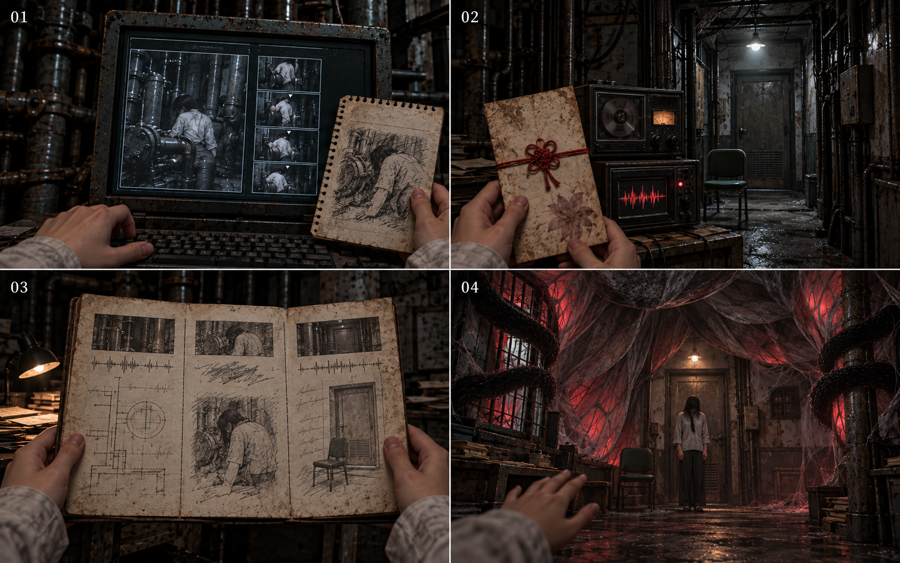
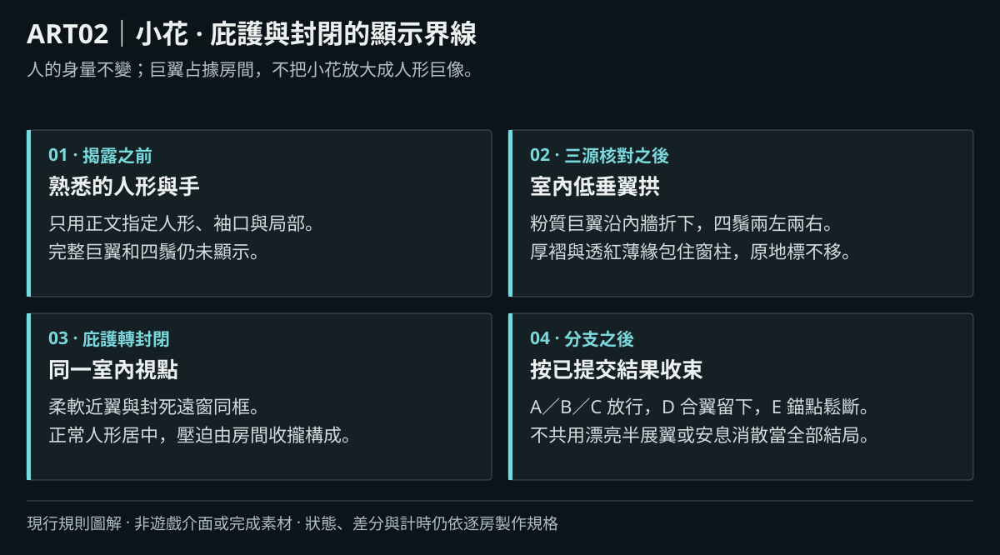
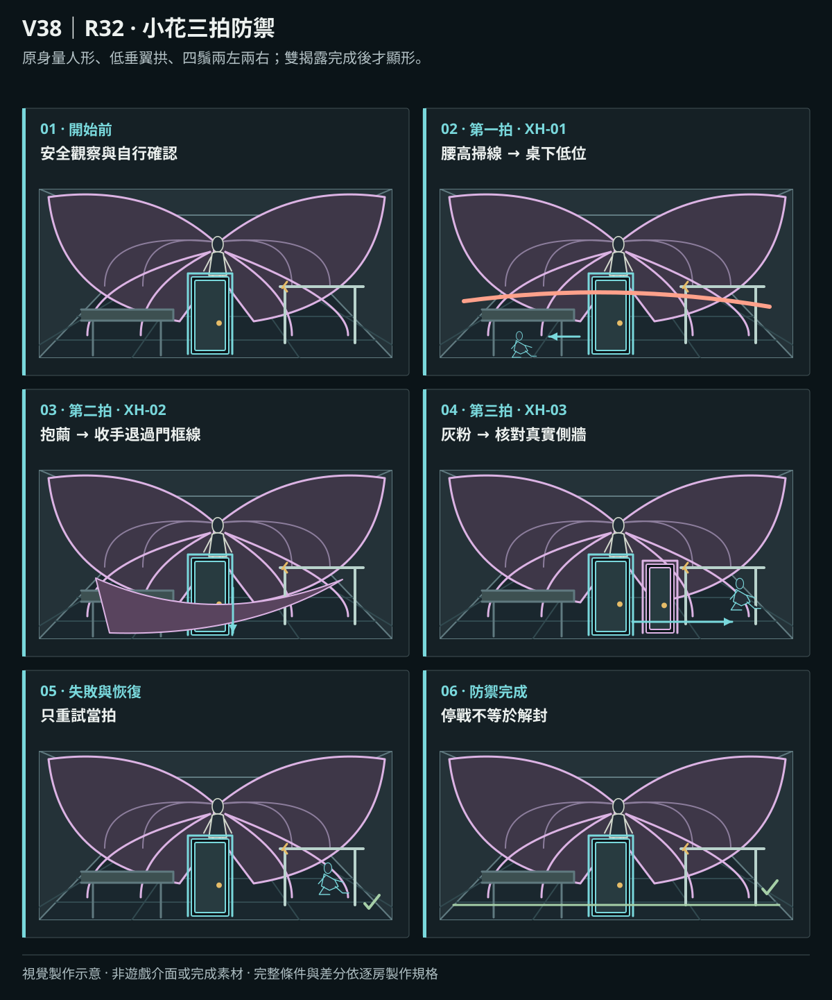
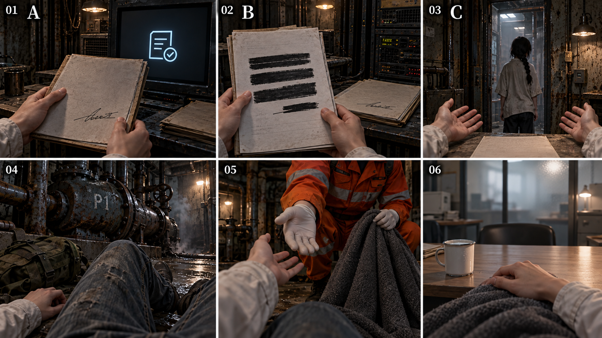
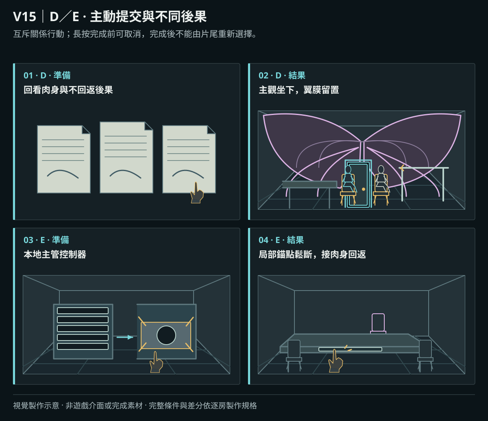
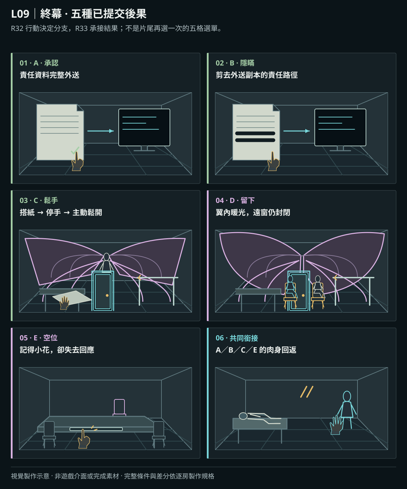
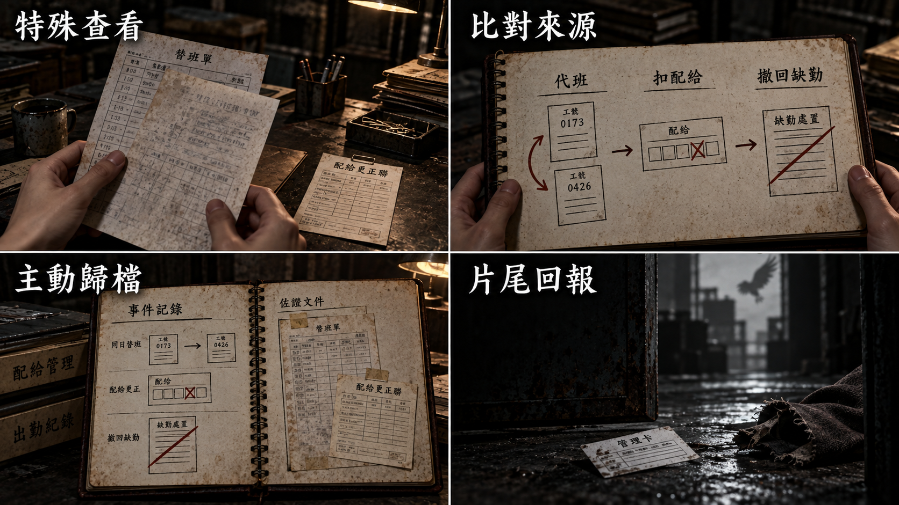
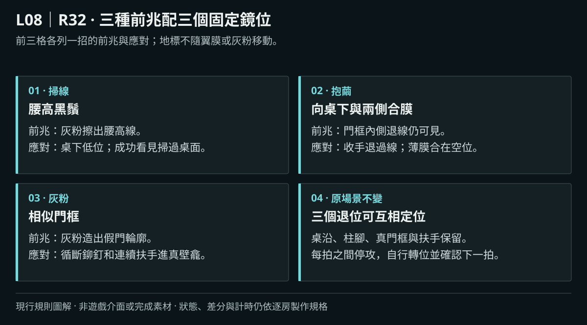

# 製作規格：終幕

[總目錄](../09_劇本/09-14_全劇本與關卡整合稿.md#book-specs) · [本幕劇本](../09_劇本/09-10_正式劇本_終幕.md#act-9) · [上一幕規格：第八幕](10-10_製作規格_第八幕.md#spec-act-8) · [共用附錄](../09_劇本/09-15_正式劇本_共用附錄.md#book-appendices) · [示意圖目錄](10-11_製作規格_示意圖目錄.md#catalog-group-9)

[R32](#node-r32-spec)、[R33](#node-r33-spec)、[POST](#node-post-spec)

## 終幕 · 頂層的地板：製作規格

<!-- production:ordered:v3 -->

[共用製作規則](../09_劇本/09-15_正式劇本_共用附錄.md#production-reading-contract)

[本幕概覽](#spec-act-9-overview) · [場景流程](#spec-act-9-rooms) · [跨場景共用規則](#spec-act-9-shared) · [跨場景圖解](#spec-act-9-references) · [幕尾狀態與交付](#spec-act-9-delivery)

### 本幕概覽與前置

<!-- import:s-0910-2:begin -->

#### 本幕演出契約

| 項目 | 本稿處理 |
| --- | --- |
| 必經順序 | 泵房三源 → 離體知情 → 玩家主動繼續 → 來源邊界 → 封鎖三源 → 完整顯形 → 三拍防禦 → 停戰 → 關係行動提交 → 分支結果 → 人物後果 |
| 共同前置 | projection_reveal_complete、seal_reveal_complete、defense_complete；解封是結果，不是先行條件 |
| 時長 | 沿原終幕設計預算；分支按動作與台詞讀演，沒有最低等候分鐘、生命倒數或限時選結局 |
| 空間 | 全程樓內，R32 沿頂層核心；肉身固定 P1 內凹室，回返後沿用 P1 泵房／維修台鏡位 |
| 資源 | 零穩定、零選填能完成全部五路；供電、權限、原件與回執仍需核對 |
| 小花 | 知道共同經歷與承諾，不知道 P1 肉身、震損全貌或玩家暗中遮蔽了哪些資料 |
| 結果 | A／B／C 自主放行，D 持續留置，E 局部抹除；不以道歉口吻、收集率或過往抹除次數決定路線 |
| 聲畫 | 無配樂、無全知旁白；小花臉仍不作新立繪，巨大形態只在封鎖三源之後從室內呈現 |

---
<!-- import:s-0910-2:end -->

前置設定與跨場景規則

<!-- import:s-0910-1:begin -->

#### 遊戲劇本 · 終幕 · 頂層的地板

> 前接 [第八幕](../09_劇本/09-17_正式劇本_第八幕.md#act-8)。依 [06-08](#doc-0608)、[結局系統](../09_劇本/09-15_正式劇本_共用附錄.md#doc-0303)、[08-09](../09_劇本/09-15_正式劇本_共用附錄.md#doc-0809)、[遭遇規格](../09_劇本/09-15_正式劇本_共用附錄.md#doc-0412)、[小花](../09_劇本/09-15_正式劇本_共用附錄.md#doc-0202) 與 [主支線](../09_劇本/09-15_正式劇本_共用附錄.md#doc-0305) 展開。A–E 僅為製作分支標記，遊戲內不顯五選一結局選單。
<!-- import:s-0910-1:end -->

<!-- import:s-0608-3:begin -->

#### 終幕流程

泵房三源核對 → 主角確認離體 → 玩家主動繼續 → 小花來源與封鎖核心核對 → 半翼與四鬚顯形 → 三拍防禦與停戰 → 關係行動與分支提交 → 分支封鎖結果 → R33 人物後果。
<!-- import:s-0608-3:end -->

<!-- import:s-0608-2:begin -->

#### 本幕逃生計畫

| 階段 | 玩家處境與行動 |
| --- | --- |
| 當下打算 | 查明最後的阻攔，爭取離開的可能。 |
| 看得見的阻礙 | 先有肉身與封鎖雙揭露，再有小花三拍攻擊；擊退不自動解封。 |
| 解謎／躲避／擊退 | 依原順序核對、主動準備、防禦、停戰與關係行動。 |
| 可驗證的進展 | 三拍完成讓關係操作可用；只有分支提交與結果完成後，按原 A–E 路線回返或留下。 |
| 已查明後的短提示 | 「先擋住她。等她停下來，再決定怎麼離開。」 |

本幕回收 R1 的「有效不等於完成」、U4 的固定地標查證與前兩場必要遭遇的安全查證窗口。照片清晰只是一段主觀記憶，不能代替 R32 維修影像、人物來源、三拍防禦或 A–E 的現場提交。逐節點操作與最少收集測試見[全程玩法對照](../09_劇本/09-15_正式劇本_共用附錄.md#core-gameplay-nodes)及[邏輯驗收](../09_劇本/09-15_正式劇本_共用附錄.md#core-gameplay-audit)。

<!-- import:s-0608-2:end -->

<!-- import:s-0608-15:begin -->

#### 節點導覽

[場景節點與移動串接](../09_劇本/09-15_正式劇本_共用附錄.md#doc-0609)同步顯示分支前置及回返條件。

##### 動畫播放與互動契約

<!-- import:s-0608-15:end -->

<!-- scene-image-routes-9:begin -->

### 本幕連線與接景圖

按遊玩順序列出主場景與接景圖；通行條件見各列動線，交付依[共用製作規則](../09_劇本/09-15_正式劇本_共用附錄.md#production-reading-contract)。

| 原動線 | 接景方式 | 畫面節點／圖號 | 操作與條件來源 |
| --- | --- | --- | --- |
| R32→R32 | 原鏡回返 | [R32-V01](#node-r32-images) | [門檻、方向與回訪](#node-r32-nav) |
| R32→R33 | 後果演出 | [R32-V01](#node-r32-images) → [R33-V01](#node-r33-images) | [門檻、方向與回訪](#node-r32-nav) |
| R33→P1 | 後果演出 | [R33-V02](#node-r33-images) | [門檻、方向與回訪](#node-r33-nav) |
| R33→POST | 後果演出 | [R33-V01](#node-r33-images) → [POST-V01](#node-post-images) | [門檻、方向與回訪](#node-r33-nav) |
<!-- scene-image-routes-9:end -->

### 依流程逐場景製作

### R32 · 頂層的地板

[正式場次](../09_劇本/09-10_正式劇本_終幕.md#node-r32-script)

[進場與動線](#node-r32-nav) · [出入口位置](#node-r32-access) · [操作與示意](#node-r32-level) · [圖像示意](#node-r32-visual) · [製作細節](#node-r32-pack) · [圖像製作單](#node-r32-images) · [離場與次場景](#node-r32-exit)

**進出、動線與回訪**

<!-- import:s-0609-59:begin -->

#### R32 頂層的地板

進行目的：抵擋小花，決定如何解除最後阻攔；核對離體與小花封鎖核心；在關係行動中提交五條人物分支；高度、距離、地標三拍防禦後才作關係選擇

支線／收集：原安全觀察自動留下地標草圖，供三拍使用；無新增物件、抄寫操作或結局門檻。

房內順序：泵房三源核對／離體 → 玩家主動繼續 → 小花來源與 S6 封鎖核對 → 半翼四鬚顯形 → 三拍防禦完成後停戰 → 關係行動與後果預覽 → 提交 A／B／C／D／E → 分支封鎖與人物結果

| 方向 | 類型 | 可移動條件 | 移動演出提案 | 回訪規則 |
| --- | --- | --- | --- | --- |
| R31 → R32 | 跨幕 | 帳號／逃生核驗、E5-08 重新掛載、第五層鎖定、唯一解凍及維修索引核對完成；承接已完成的手動制動，不跳過 maintenance_index_seen／brake_locked | 在 50F 的 R31 轉身，看見仍在等待的小花；沿她讓出的同層核心短廊進 R32，不提前展示全形。 | 單向流程；不代表可沿此線倒退 |
| R32 → R32 | 回返 | projection_reveal_complete、四熱點全讀及 S6-01 已核對，且 finale.r32.phase = seal_verify；S6-02 尚未核對，不在顯形或防禦中 | 嘗試跨出門檻，短轉場回到同一門框；雙結與敲聲重現。核對後只供回看記錄，不重走循環。 | 一次現時回返核對；不新增可往返房間。 |
| R32 → R33 | 終幕 | projection_reveal_complete ＋ seal_reveal_complete ＋ defense_complete ＋ committed_ending_id ＋ branch_outcome_complete；A／B／C／E 另需分支演出完成後的 seal_resolved，D 不需 | 顯示自主放行、囚禁或抹除後果；進各路人物片尾。 | 單向流程；不代表可沿此線倒退 |
<!-- import:s-0609-59:end -->
<!-- navigation:r32:end -->

#### 主場景出入口

<!-- scene-access:R32:begin -->
| 動線 | 顯示名稱 | 畫面位置與辨識物 | 通行狀態 |
| --- | --- | --- | --- |
| R31→R32 | 來路：備份內室短廊 | 頂層地板來向的原門框，短廊承接 R31；扶手與真實側牆持續可辨。 | 單向承接轉身演出，不開放回上一幕探索。 |
| R32→R32 | 回返門檻 | 可見雙結與連續扶手的原門框，與沒有相接扶手的假門分開。 | 肉身揭露完成、四熱點及 S6-01 鎖舌紀錄全數核對後，在封鎖來源核對階段且尚未顯形前只試走一次並回同處；不在防禦中試走，也不通向新房。 |
| R32→R33 | 離場／後果銜接 | 沿原門框、翼膜與終端構圖呈現分支結果，不另長出出口。 | 完成揭露、防禦、結局選擇與分支演出後進人物後果；停攻不等於解封，留置分支也不因片尾開始就獲准離開。 |
| 封閉 | 封窗與假門 | 內井封窗、翼膜及沒有連續扶手的門形。 | 不是露天屋頂出口；假門只在原攻防中辨認，不能切進不存在的房間。 |
<!-- scene-access:R32:end -->

**關卡、解謎與失敗回饋**

<!-- import:s-0608-4:begin -->

#### R32：先核對自己，再面對小花

##### R32 空間與畫面製作定位

| 項目 | 畫面與製作要求 |
| --- | --- |
| 樓層定位 | 50F |
| 樓棟定位 | B 棟 |
| 樓層與環境 | 50F 頂層封鎖核心；與 R31 同層相鄰，地標、最後防禦與分支順序維持。 原光源、材質與證據焦點依本房規格。 |
| 入口方向 | 由 R31 承接；以來路門框／扶手作背向定位，前進方向依下列出口地標。左右方位沿既有構圖，不將反向回訪鏡頭誤當另一扇門。 |
| 可見出口 | 同一門框顯示回返；各分支結果成立後接 R33。首次全景就交代入口輪廓或可查看的遮擋，不靠無標示的畫外點擊換房。 |
| 阻擋與開放條件 | 往 R33：projection_reveal_complete ＋ seal_reveal_complete ＋ defense_complete ＋ committed_ending_id ＋ branch_outcome_complete；A／B／C／E 另須 seal_resolved，D 不需 seal_resolved，封鎖維持 active |
| 畫面中的解謎要素 | 肉身核對來源、封鎖來源、三拍防禦位置與關係行動物件。關鍵標記可近看，與裝飾物有可辨的材質或輪廓差異，不只靠顏色或聲音。 |
| 完成後變化 | 三拍防禦完成只停攻、不解封。A／B 由小花自主讓開，C 由玩家搭紙、停手、鬆開後小花跨離門框；E 完成抹除才解除封鎖；D 保持翼膜囚禁且肉身仍活著。分支結果完成才接 R33，D 不要求解封。 |

**空間第一印象：**灰暗封窗內井、挑高柱列與夾層，門邊仍是熟悉人形的小花；入場不見翼膜紅光、巨翼或四鬚。完成肉身核對並由玩家繼續，再完成封鎖三源後，才以同鏡位顯形差分把空間收緊。主角始終在樓內，各租戶歷史不搶走兩人的關係焦點。

**逃生因果與可見回饋：**第三拍防禦完成後明確停止攻擊、恢復原關係行動熱點；出口尚未自動開放。解封、回返與資料處理的後果分別由原分支決定，擊退與最終離開有清楚的兩段回饋。

初入頂層，小花仍是熟悉的等待者，不亮 Boss 標籤、不展示巨大形態。主角先使用 R31 已取得、R15 已恢復的維修通道核對自己；四個小花熱點此時可見，但封鎖推理尚未開放。沒有強制先解小花才能知道肉身的循環條件。

##### 操作與呈現補充

- [s-0910-14](../09_劇本/09-10_正式劇本_終幕.md#s-0910-14)：每招 3.5 秒完整前兆、失敗六秒恢復；只重做當前步，無外傷／資源扣除，已過步驟保存。輔助輸入依原等效逐步模式，不替玩家選結局。
- [s-0910-19](../09_劇本/09-10_正式劇本_終幕.md#s-0910-19)：原件來自 R31 可讀冷備份與本地索引，按已查來源核驗；主觀記憶、路線筆記及未找到姓名不冒充原件。未知外部握手不作求援接收者已知身分。
- [s-0910-19](../09_劇本/09-10_正式劇本_終幕.md#s-0910-19)：下列各路從準備到提交原子保存；回執不明查同一交易，不重送、不轉成 D。保存失敗留待完成交易，只可重試或退出；不能先演成功再要求重選。

###### R32 出口與回訪

| 目的節點 | 條件 | 移動與辨向 | 回訪邊界 |
| --- | --- | --- | --- |
| R32 | projection_reveal_complete、四熱點全讀及 S6-01 已核對，且 finale.r32.phase = seal_verify；S6-02 尚未核對，不在顯形或防禦中 | 嘗試跨出門檻，短轉場回到同一門框；雙結與敲聲重現。核對後只供回看記錄，不重走循環。 | 單向流程；不代表可沿此線倒退 |
| R33 | projection_reveal_complete ＋ seal_reveal_complete ＋ defense_complete ＋ committed_ending_id ＋ branch_outcome_complete；A／B／C／E 另須 seal_resolved，D 不需 seal_resolved，封鎖維持 active | 顯示自主放行、囚禁或抹除後果；進各路人物片尾。 | 單向流程；不代表可沿此線倒退 |
<!-- import:s-0608-4:end -->

<!-- import:s-0608-5:begin -->

#### R32：泵房與沒有離開的身體

R31 已取得的維修通道在此完成本地核驗。使用序幕可見的 P1 檢修鏡頭，經 R15 已恢復的供電與網段取得 E6-01 現時畫面：泵體後的凹室、主角白襯衫背側、膝部布結與微弱呼吸；畫面時間持續前進，至少能辨識兩次呼吸，不把單張靜格當生命診斷。E6-02 核對 P1 同一鏡頭倒下前後的連續片段與時戳，與 E6-01 的當下呼吸及 M6-01 記憶共同確認她未離開凹室。

**連續查證操作：**R32-D01 開啟原比較視圖後，E6-01 留在旁欄；R32-D02 直接展開同鏡頭的連續紀錄，R32-F01 再由玩家實際查看自己的最後靜格。三份來源分列媒介與已讀狀態，不能由看過現時影像就自動取得另兩份。R32-D09 沿這些原頁完成原一次投影關聯確認，保留已核對的鏡頭、時戳與位置，不要求重輸入欄位、重選鏡頭或重新開三份副本。錯配回到同一視圖保留實讀進度；取消、跳過演出及讀檔均不補未讀來源，不提前寫入 projection_reveal_complete。比較視圖沿既有 D01／D02／F01／D09 畫面狀態，不新增介面入口或正式提交。

**影像連續性：**P1 鏡頭原由當地泵房低壓迴路供電並本地錄影；R15 各供電路線恢復上層讀取端與維修網段，不是到 R15 才開始拍攝。E6-02 只核對本次倒下前後至當下的留存片段，時間欄若有斷點即不符合本核驗，不能以一張靜格或十四日昏迷說法補洞。

玩家對照倒下前的 M6-01 靜止記憶：手停在試圖撐起身體的位置，包停在泵體內側。此段只增加一個可檢視靜格，不新增第二次解凍。拼出「肉身在 P1／昏倒前後影像連續／剛才移動的是意識」後，核對成功後才接主觀手與包紮細節，主角說「我沒有走出去。」台詞與呼吸完整結束後，玩家可任意停留；原 15–30 秒僅供觀察情緒餘波，不作倒數或操作門檻。小花沒有提示或裁決。

光學影像屬設備證據，最後記憶屬主角觀察。玩家知道她當下仍活著，但不知道能否獲救。此時才開放玩家收起泵房畫面，親自查閱門邊祈願卡；最後操作仍需封鎖揭露，不讓快捷鍵或抹除跳過。
<!-- import:s-0608-5:end -->

<!-- import:s-0608-6:begin -->

#### R32：她就是封鎖核心

離體知情後提供玩家自行繼續的停頓，至少讓台詞與呼吸完整結束；不把下一個反轉自動接在同一鏡頭爆點。四個既有熱點仍在：校正門、祈願卡、分來源通話、內門空位。四原件分成兩組同頁對照：校正門／祈願卡、分來源通話／內門空位；兩頁在同一來源板直接切換，不逐件關閉後回全景再開板。每個來源仍須親查；依已讀原件留下三項簡短筆記，界定小花的經歷與承諾、主角當晚下行及她未知的硬碟後續。撤除六選三句卡與獨立完成彈窗，不在此再考一次結論。

**具體接續操作：**R32-03 收起來源板回 R32-V01，同一扶手、手與門邊小花留在視野。玩家主動點祈願卡才開始 R32-04，這個點擊承接既有「繼續」，不額外插一個確認視窗。可回看泵房來源或閒置，存讀保留離體已知但尚未繼續的階段。四熱點中的內門空位直接附 E5-04 已核時間／方向與來源頁，不重做 R31 身分題；玩家仍須親查眼前空位、另外三處原件及後續 S6。測任意停留、回讀、讀檔與祈願卡尚未點擊，均不自動開封鎖核驗或顯形。

祈願卡回收 F1–F4 的人為字形，第五格留白；F5 只列設備回傳，不填到紙上。卡是既有場所殘留的同構構圖，不證明小花生前來過頂層，不新增收集或輸碼。已讀 R8 小帳才可附查宿舍約定文字，未讀不補收藏、不影響四熱點與來源板。具體字形與原件對照分別見 [09-13](../09_劇本/09-15_正式劇本_共用附錄.md#doc-0913) 及 [終幕正式稿](../09_劇本/09-10_正式劇本_終幕.md#doc-0910)。

接著在同鏡位核對三項封鎖來源，不新增收集房。四熱點全讀後，從仍在側邊的來源板直接展開 R31 指定門端原頁，不重走目錄、不再核身分；實際跨門與提出／撤回離開請求後，將本次觀察附回同板。S6-01 已核欄位、S6-02 的門框對照保持在原位，最後只作原一次 S6 關聯確認，不要求重新選抄三份來源或另按完成彈窗；這份保留不會代做 S6-03 現時試探。

| 來源 ID | 玩家操作與表現 | 能證明的範圍 |
| --- | --- | --- |
| S6-01／設備紀錄 | 查看 R31 必得索引所含回返節點門端紀錄：鎖已開、路徑仍反覆返回，原始時序不變 | 證明不能只以當下鎖死解釋；單獨不證明小花控制。R17 錯誤鑰匙推論導回 R14 的正常回程，不算此項回返證據 |
| S6-02／觀察 | 點選本房「前往出口」節點，只走原定短轉場便回到同一門框；小花的雙結與兩下敲擊同時在各門檻構圖重現 | 現在式回返與她的局部顯現相連；不改過去、不虛構遠端監控影像 |
| S6-03／現時互動 | 主角先朝出口提出離開請求，小花回應「別走」，門框回返疊層增強；玩家再收起指向出口的手、停止催促並等她回應，疊層短暫減弱。此時只作可逆觀察，不開啟停戰後的留置／結局介面、不提交設備命令；三來源核對後才完整顯形 | 以 S6-01–03 交叉核對確認她是核心；R17 誤判、R20 承諾與 R25 疊影只作事後關係回顧，不單獨證明她操控出口。不是機器讀出恨意，也不是主角想像全部故事 |

S6-03 的首次減弱是可逆試探，不提前寫 seal_resolved。四熱點全讀、三來源均讀且在同一來源板完成一次 S6 關聯後開始「半展翼—纏樓」現時顯形；演出完成才設 seal_reveal_complete。小花說：「妳每一次都說出去。那我呢？」主角不能用「我原本要救妳」作答。

**U4 領域回收：**S6-01–03 關聯完成後，沿原 R32-C02 來源板可回看已存 U4 同址筆記，確認先前繞行檢修夾道只避開局部門檻，並未解除小花領域。這是既存經歷的事後理解，不新增第四份證據、回憶動畫、配音或確認關卡；未開回查也能繼續顯形與原防禦。舊檔未保留 U4 筆記時省略該回查，不補造觀察，S6 本房三源仍可完整查證。領域歸屬不靠選填留光、MR-01、聲音猜人或早期名字揭露。

**零選填的關係承接：**四熱點原必要查證頁沿 R32-C01 文字層，並列已核對的 R20 承諾原句、小花 A 軌「她說會回來」、校正門等待與祈願句「請讓他平安回家。」；各自來源／日期保持可讀。這些均是主線原來源回查，照片、H-08、R8 小帳及任何支線不參與觸發，不補收藏或新歷史。先讓玩家看懂她對他人的牽掛及自己仍等待的承諾，再沿原 S6 現時互動辨明封鎖；不用情感理解取代三源查證。

**她想過的生活：**沿 R32-C01 既有側欄，僅在實讀過 E3-02 本人申請時回查「我想改去修理桌」與維持原組的回覆；這是必要主線已見的生活願望回收，不以 R8 小帳、U3 回憶或照片代替，也不增加第五個關係來源、重讀門檻或完成彈窗。

<!-- import:s-0608-6:end -->

<!-- import:s-0608-7:begin -->

#### R32：半展翼、四鬚與封窗翼膜紅光

本次室內連續顯形的分鏡估算約 20–35 秒，只在完整來源核對後播放；完整演出結束才交還防禦準備，不於顯形中判定攻擊。

**鏡位與真實位置。** 全段從原 R32 室內定點呈現，不移到樓外看主角，不新增可行走外景。肉身仍在 P1；微小主角以受困意識的尺度呈現，不是另一具身體。R32 既有背景需補可見的被遮蔽的高窗與內側光縫，作同一房間的美術細節，非新房或新熱點。

| 拍點 | 畫面、聲音與台詞 | 玩家與來源 |
| --- | --- | --- |
| 核對完成 | 同一來源板收起，校正門與窗縫仍可辨，小花維持人形 | 必須先完成 E6／M6 身體揭露及 S6 三源關聯；尚未寫入 seal_reveal_complete |
| 庇護 | 過長袖口投影向兩側延伸成半展蛾翼，先像替主角擋住高處壓下的陰影；灰粉沉在光束內，不遮字幕 | 同一現時顯形的第一拍，非回放；約 4 秒，可靜態替代 |
| 收攏 | 巨翼沿內牆垂成向內的拱，翼緣包住門窗；小花維持原身量，頸影向胸前折低，低辮、雙結和等待的手仍可辨。四根粗黑絨毛觸鬚以兩左兩右不同走向纏過挑高內壁與窗框 | 此顯形階段無攻擊判定；完整揭露後另進三拍防禦，觸鬚無血條 |
| 囚禁 | 從室內看到觸鬚陰影攀過挑高內壁、巨大翼膜封住窗框；厚褶遮光、薄緣透紅但不透景，極少光縫保留方向。低頻摩擦與原門端回返聲合在一起，小花說：「妳每一次都說出去。那我呢？」 | 全部屬當下感知；不顯示監控框或客觀錄影時戳。玩家不能因此取得新死因證據 |
| 看清 | 小花的熟悉輪廓被放在巨大陰影中心；現時顯形停在可閱讀差分。演出與字幕完成後設 seal_reveal_complete | 提供重看來源與防禦準備確認；顯形期間無作答倒數、不扣穩定度 |

樓的垂直尺度由室內挑高的柱列與夾層構件、跨窗巨大觸鬚及其遮光呈現，不以主角站在外面的全景反打。四根觸鬚是同一個怨念封鎖，無四個開關、四段對戰或四種受害者編碼。素材未完成前可用分層靜稿驗證構圖，不能把海報直接貼成玩家視角。

##### V13｜終幕揭露與室內囚禁

**適用與限制：**01 肉身與連續紀錄，02 祈願紙及分開的來源，03 來源邊界，04 三源核對後室內顯形。小花維持原身量，由低垂翼拱與四鬚包住窗柱。設備及紙面為版面示意，正式文字、時間、雙結及連續影像依原件工單。

<!-- illustration-info:V13:begin -->
**圖號：** V13　**類型：** 概念／構圖參考

**場景編號：** [R32](#node-r32-spec)、[P1](10-01_製作規格_序幕.md#node-p1-spec)

[用途、功能與圖像目錄](10-11_製作規格_示意圖目錄.md#catalog-v13) · [原圖檔](../../assets/07_視聽與介面/assets/current_design/V13_current.png)
<!-- illustration-info:V13:end -->

[完整圖說與操作對照](#h-0608-378) · [圖像目錄](../09_劇本/09-14_全劇本與關卡整合稿.md#book-illustrations)

##### ART02｜庇護與封閉的顯示界線

**適用與限制：**改以庇護與封閉的顯示界線圖解：揭露前維持人形局部，三源核對後才顯室內低垂翼拱與四鬚。原半展翼藝術圖退役為意象研究，不作現行遊戲姿態。

<!-- illustration-info:ART02:begin -->
**圖號：** ART02　**類型：** 規則圖解

**場景編號：** [R32](#node-r32-spec)

[用途、功能與圖像目錄](10-11_製作規格_示意圖目錄.md#catalog-art02) · [原圖檔](../../assets/illustrations/current/ART02.svg)
<!-- illustration-info:ART02:end -->

[完整圖說與操作對照](../09_劇本/09-15_正式劇本_共用附錄.md#h-0202-228) · [圖像目錄](../09_劇本/09-14_全劇本與關卡整合稿.md#book-illustrations)

##### 執念領域：看得見出口，卻離不開的房間

**遊玩命題：辨認可靠的空間關係，並把保持距離與最終關係選擇分開。**沿[共用領域界線](../09_劇本/09-15_正式劇本_共用附錄.md#boss-domains)，只強化原 R32 的支配感，不增新房或新的回返節點。翼影令柱列看似分隔成近處窄面，但房間幾何、扶手接縫、控制器位置與可操作通路不變。

**身體與聲場：**依[角色視聽規則](../09_劇本/09-15_正式劇本_共用附錄.md#haunted-av-language)，只在完整顯形條件成立後，把原袖口纖維延續到翼膜內側；不改成真人皮膚、臉孔、額外手臂或新的蟲群。近處仍柔軟，貼窗處繃緊，維持原四鬚兩左兩右。擬音由衣料輕擦轉成柱角繃響，沿可見接觸點定位，不以主角／家人聲音從身後呼喚。現時小花原台詞保持原聲，不拉長或倒放成咒語。

三拍沿原前兆與命中時序分配材質：XH-01 的細擦跟腰高掃線，低位聲音被桌面遮擋但方向字幕不變；XH-02 在抱住空位時才收成繃響；XH-03 灰粉沿假門亮邊呈細絨，真扶手、斷鉚釘不被粉蓋成同樣外觀。這些效果不增加致盲、持續傷害或第二次命中。低動態以固定纖維、粉邊及原靜態前兆呈現，無聲仍靠高度、退線與地標解三拍。

停戰後掃擦、收緊聲與攻擊動態停止，翼內柔軟紋理與封窗保持同框；不再用呼吸式收縮假裝下一招。關係選擇、必要來源及安全觀察不加擬音壓迫，A／B／C／E 原分支結果後才撤封，D 維持安靜的囚禁，不恢復攻擊或加安息效果。

| 原階段 | 領域演出與可驗證回饋 | 不能提前或代做 |
| --- | --- | --- |
| 初入至肉身核對 | 先見原門框、扶手、斷鉚釘、桌架低縫及退線；小花仍為人形。設備、主觀記憶各按原來源呈現 | 地標展示不新增收集旗標，不代做後續安全觀察；不以巨翼、四鬚或領域名稱提前確診封鎖核心 |
| 四熱點／同一來源板與 S6 核對 | S6-02 短轉場後沿扶手確認同一處斷鉚釘；出口回返與房間未移位同時可見。S6-03 仍只作可逆試探 | 三來源完成前不顯完整形態，不藉新地標替代 E6／M6、四熱點或 S6 任何必要來源；室內換位不觸發新回返 |
| 半展翼至 `seal_reveal_complete` | 原顯形中讓翼影由遮護上方轉成隔住門窗，熟悉桌邊、柱列與來路被收攏在同一壓迫構圖 | 沿原約 20–35 秒顯形，不再接一次領域動畫；演出無攻擊。三個防禦位置、字幕與必要來源始終可辨 |
| `defense_intro`／`between_steps` | 玩家先查看原地標及可退位置，再明確確認每拍開始；原位的形狀及連接關係可反覆核對 | 不新增找地標清單或計時門檻，領域背景不自行啟動下一招；先前選填缺漏不影響辨路 |
| `defense_active` | XH-01 低縫保留原柱腳視線；XH-02 薄膜包住上一拍低位，收手退過線後留下間距；XH-03 假門亮邊不接扶手，真凹位仍由原斷鉚釘定位 | 各招威脅區沿原表，不以新遮罩擴大命中；假門不複製真地標，不以隨機換位或亮暗二選一代替空間判斷 |
| `defense_complete`／`relationship_setup` | 粉流退去、桌門與側牆重新可同時看清，但四鬚、封窗翼膜與出口回返仍在 | 停戰不解封、不預設留下；關係選擇期間無攻擊、資源耗費或隱藏等待懲罰 |
| 已提交分支與結果演出 | A／B／C 依原自主放行逐步讓出門框；E 依原抹除切斷錨點；D 保留翼內暖光及封窗 | 額外聲場／遮罩在 A／B／C／E 的原放行或斷裂演出後才撤下，與 `seal_resolved` 同步；D 不先撤再重封。不可逆提交與 `branch_outcome_complete` 仍分開 |

**安全與資料：**領域只作用於現時感知及既有回返，不覆寫 P1 維修影像、歷史凝固或紙上字形；不提供小花原本不知道的震損全貌、硬碟與肉身資訊。原 3.5 秒前兆、6 秒恢復窗、各拍保存及零穩定度規則不變。無聲與低動態版保留門線、低縫、斷鉚釘與連續扶手的形狀／文字線索，讀完整來源與真正暫停時不偷跑攻擊。

**保存與恢復：**由既有 `projection_reveal_complete`、`seal_reveal_complete`、`defense_step`、`between_steps`、`defense_complete`、`committed_ending_id`、`branch_outcome_complete` 及 `seal_resolved` 還原當前構圖；顯形中斷沿原演出保存位置接續，不增 `domain_cleared` 或重新發獎勵。回執不明仍查同一 `pending_commit_id`，不能因聲場退去就換結局、重傳或先解封。

**待灰盒驗收：**測初入不洩底、S6-02 只一次回返、三拍不同安全位、讀檔固定地標及低動態／無聲等效；以零選填與零穩定度逐一完成 A–E，檢查停戰仍封閉、A／B／C／E 各自結果後才撤下效果、D 全程維持。測試者須能說明「看得見門不代表走得出去」「避開攻擊不是同意留下」，不能只記得變成紅色房間。
<!-- import:s-0608-7:end -->

<!-- import:s-0608-8:begin -->

#### R32 蛾形三拍防禦

三拍後的停戰短演出分鏡估算約 10–20 秒；實際招式仍沿原 3.5 秒前兆與 6 秒恢復窗。已過步驟保存，失敗只重做當前步，停戰後不再插攻擊或自動選結局。

##### 圖解：小花三拍：掃線、抱繭與真假地標

[查看圖像：小花三拍：掃線、抱繭與真假地標](#fig-l08)

前三格各將一招前兆與對應動作放在一起，第四格說明共用地標與拍間確認；三拍先後順序依正文。

| 分鏡 | 玩家操作與畫面回應 |
| --- | --- |
| 01 | 橫掃：腰高掃線跨過桌面，桌架低處仍留空隙；切到桌下低位，看見黑鬚掃過空桌。站去側牆不能代替低位。 |
| 02 | 抱繭：薄膜包向桌下與兩側，門框退線仍可見；收手退過門線，薄膜合在空位。蹲回桌下無效。 |
| 03 | 灰粉：假門浮現時，沿原連續扶手核對斷鉚釘，轉入真實側牆凹位；原門線與桌下不是通用安全位。 |
| 04 | 固定地標：桌沿、柱腳、真門框及扶手不移位；每拍之間停攻，玩家自行轉位並確認下一拍。 |

雙揭露與顯形完成後，由玩家確認準備才開始；三拍完成寫入 defense_complete 並停攻，不解除四鬚封鎖，接著開放關係行動。

招式、反應窗、受擊、輔助模式與驗收以 [昆蟲身體恐怖與攻擊規格](../09_劇本/09-15_正式劇本_共用附錄.md#h-0412-102) 為唯一依據。

##### R32 三拍的不同判斷

安全準備讓玩家自由查看上表的三處位置與固定地標；提示同時提供形狀與文字，不以大面積遮黑或閃白阻止讀圖。

原安全觀察會自動把已看清的位置留成草圖，供拍前與拍間回查；不新增抄寫操作，草圖也不代替現場判斷。[觀察、保存與圖像細節](#finale-landmarks-observation-spec)。

每拍成功後原地保留成果，停攻讓玩家自行轉入下一拍觀察位並確認；3.5 秒前兆從確認後起算。失敗只回本拍起點、保留已過步驟；恢復期不自動傳到下一個危險點。抱繭不需要玩家先選擁抱，不會以受擊暗選 D。

完成三拍後四鬚仍纏樓、門仍被封，小花停止攻擊才說原停戰台詞。defense_complete 只開放關係行動，A–E 的解封與人物後果沿原提交條件。

**停戰後的壓力：**三拍完成即停攻，攻擊前兆停止，原翼膜與可見門框仍保持封鎖差分；查閱、準備或取消均回原停戰構圖。閒置不催促、不逼近、不重啟攻擊，不加隱藏倒數或冷卻代價。封鎖只依各分支結果解除；未選行動、取消與存讀不推定玩家同意留下。

**封門因果回查：**停戰時沿原來源頁保留實讀 E4-05 的集團撤離封門日期，與眼前她仍收攏的手、仍封閉的門框並置：集團先下令封樓，小花死後的怨念回返在後，她現在不肯放行仍是需要面對的行動。兩份既有原頁都不重新抄入來源板、不給新收藏；舊檔若沒有保存對應已讀頁即省略該回查，不以本段補發知識。保留全部原停戰台詞與四熱點／三來源查證，不追加全知旁白或配音。

判定、保存、輔助操作見 [招式判斷與保存契約](../09_劇本/09-15_正式劇本_共用附錄.md#h-0412-171)。

##### V38｜小花三拍防禦

**適用與限制：**安全觀察、桌下低位、門框退線、真壁龕依序呈現。每招 3.5 秒前兆；失敗只重試當拍並有六秒恢復。三拍完成停戰不代表解封。

<!-- illustration-info:V38:begin -->
**圖號：** V38　**類型：** 規則圖解

**場景編號：** [R32](#node-r32-spec)

[用途、功能與圖像目錄](10-11_製作規格_示意圖目錄.md#catalog-v38) · [原圖檔](../../assets/illustrations/current/V38.svg)
<!-- illustration-info:V38:end -->

[完整圖說與操作對照](../09_劇本/09-15_正式劇本_共用附錄.md#h-0412-224) · [圖像目錄](../09_劇本/09-14_全劇本與關卡整合稿.md#book-illustrations)

<!-- import:s-0608-8:end -->

<!-- import:s-0608-9:begin -->

#### R32：關係行動

三拍防禦完成並停戰後，回到小花的質問與玩家的回應，才打開場景中的終端、門邊紙、空椅與主管控制器。四個入口代表不同動作，終端內另分完整資料與遮蔽副本；不呈現 A–E 選單。所有必要線索在此可回顧，不需回到不可逆路線以前。

| 熱點 | 準備操作 | 提交及結果 |
| --- | --- | --- |
| 責任資料終端 | 預覽已核實原件，將自己的責任頁納入或明確遮蔽；先確認獨立泵房定位 | 外送成功提交 A 或 B；小花只回應眼前離開請求，不知道被隱藏的資料。她自主離開門框，解除回返 |
| 門邊紙／雙結 | 預覽位置信標與本地保全，鬆手時一併啟動；提出陪到門口、仍會回身體的有限承諾 | 搭紙 → 停手讓她移動 → 主動鬆開。小花自己跨離門框，完成 C；沒有等待分鐘數或身體衰減計時 |
| 小花旁的空椅 | 回看仍活著的肉身；顯示不回返與持續封鎖後果 | 合上主觀筆記介面、坐下並長按確認 D；封鎖持續，不自動送求援、不演死亡 |
| 主管控制器 | 以 S6 已核實的錨點及現場權限預覽索引撤銷、抹除、切中繼與機械封存 | 四秒可取消，完成直接提交 E；小花顯現及回返錨點被抹除，封鎖解除。硬碟留在本地槽，不由意識攜出 |

所有準備畫面都保留返回場景的入口，取消不發送定位、不刪資料、不改結局。D 的長按確認為 4 秒，E 依既定 4 秒；兩者均提供等義的點擊輔助確認，不能把誤觸、久候或失敗防禦視為同意。

A／B 必須取得資料外送成功回執才提交；回執未知先查詢同一筆交易，不重傳、不換分支。C 只在確認鬆手時提交，E 只在完整核可時提交；A／B／C／E 的定位於同次提交排程一次，D 不排程。保存失敗保留待完成交易並提供重試或退出，不播放成功後又退回選結局。完成後讓路／斷翼／合翼演出可從安全差分接續；R33 只讀結果，不重做不可逆動作。五條分支皆可在零穩定度、零選填收集下完成，詳細資料契約見 [終幕製作包](../09_劇本/09-15_正式劇本_共用附錄.md#doc-0809)。

A／B／C 的停止設備留置命令只處理人為控制；真正解除怨念由小花現時自主行動完成。E 的控制器只作用已核對的本地怨靈錨點，不能用來任意清除遠方生命或改寫過去。D 是明確選擇保留現時依附，沒有先鬆翼再突然反悔的假反轉。

B 的 R32-B2 承接停戰時「不想再等」的自覺：外送成功提交後，小花看向自己擋門的手、鬆開手指，說「這次，別再說會回來」，再收手讓路。她停止要求另一個回來的承諾，不是認可遮蔽副本或赦免主角；視線不移向終端。這是已提交分支的結果演出，不新增選項、好感門檻或 C 的搭紙同行操作。新增一句配音及字幕；低動態版依同一順序呈現看手／收手／通路已讓開的差分，存讀沿既有結果演出階段接續，不重送資料或定位。

##### V14｜結局行動：留下名字與鬆手

**適用與限制：**上排 A／B／C 是互斥行動：完整公開、刪修副本、搭紙鬆手；下排為適用分支的肉身回返、時間轉場後室內救援及照護。不是攻堅或玩家步行下樓；概念簽名為占位，正式原件仍依梁樂瑤同源稿。

<!-- illustration-info:V14:begin -->
**圖號：** V14　**類型：** 概念／構圖參考

**場景編號：** [R32](#node-r32-spec)、[R33](#node-r33-spec)、[P1](10-01_製作規格_序幕.md#node-p1-spec)

[用途、功能與圖像目錄](10-11_製作規格_示意圖目錄.md#catalog-v14) · [原圖檔](../../assets/07_視聽與介面/assets/current_design/V14_current.png)
<!-- illustration-info:V14:end -->

[完整圖說與操作對照](../09_劇本/09-15_正式劇本_共用附錄.md#h-0303-144) · [圖像目錄](../09_劇本/09-14_全劇本與關卡整合稿.md#book-illustrations)

##### V15｜結局行動：留下與重演簽核

**適用與限制：**D／E 各分準備與提交後果；四秒完成前可取消。D 肉身仍活著、封鎖持續；E 只處理已核對的本地錨點並接肉身回返。

<!-- illustration-info:V15:begin -->
**圖號：** V15　**類型：** 規則圖解

**場景編號：** [R32](#node-r32-spec)、[R33](#node-r33-spec)、[P1](10-01_製作規格_序幕.md#node-p1-spec)

[用途、功能與圖像目錄](10-11_製作規格_示意圖目錄.md#catalog-v15) · [原圖檔](../../assets/illustrations/current/V15.svg)
<!-- illustration-info:V15:end -->

[完整圖說與操作對照](../09_劇本/09-15_正式劇本_共用附錄.md#h-0303-157) · [圖像目錄](../09_劇本/09-14_全劇本與關卡整合稿.md#book-illustrations)

<!-- import:s-0608-9:end -->

<!-- import:s-0608-17:begin -->
[離體確認後的自主停頓](#h-0608-88)、[封鎖查證後顯形](#h-0608-114)及[停戰後關係行動](#h-0608-163)依各段處理。
<!-- import:s-0608-17:end -->

<!-- import:s-0608-14:begin -->

#### 灰燈蛾意象：囚禁（終幕構圖）

魔化小花的灰黑翼膜與四根粗黑絨毛觸鬚纏封疊樓，血紅透光來自遮住窗面的翼膜；畫面不見天空；主角受困於樓內。囚禁示意以室內挑高柱列、夾層、封窗翼膜與觸鬚陰影呈現包圍整棟樓的尺度；D 保留囚禁，A／B／C 自主鬆翼，E 以錨點斷裂收束。
<!-- import:s-0608-14:end -->

**跨房圖像參照：** [L08（R32 適用格）](#fig-l08) · [L09（R32 適用格）](#fig-l09)

狀態、素材與驗收（製作細節）

**狀態、素材與驗收**

**現場地標的筆記回收：**依[收集與調查共用契約](../09_劇本/09-15_正式劇本_共用附錄.md#collection-investigation-contract)，以下是三組既有必要安全觀察的自動草圖，不新增原件、背包物品、解謎板、歷史片段或「抄寫三次」。只有雙揭露與顯形完成後，在原 R32-V02 安全準備或拍間停攻觀察位，玩家實際轉到並看清對應原局部，才寫該組 `.seen`；入場 V01 的全景展示不寫入。來源 ID 只供製作，玩家看見位置名稱及已見局部。

| 觀察 ID／狀態 | 原觀察與草圖內容 | 原防禦中的用途 |
| --- | --- | --- |
| `OBS9-01`／`observations.obs9_01.seen` | 桌架低縫與另一端原柱腳；能看見通過高度，僅記錄原觀察到的形狀與相對位置 | XH-01 依原腰高掃線親自進低位；草圖不代選或移位 |
| `OBS9-02`／`observations.obs9_02.seen` | 門框內側退線及退線外間距，與原門框同位 | XH-02 收手退過原線，舊低位不適用；草圖不增加安全區 |
| `OBS9-03`／`observations.obs9_03.seen` | 同一組斷鉚釘、原接縫及連續扶手，接向真實側牆凹位；不拆兩件灌數 | XH-03 對看亮門形是否接上原扶手，再親自換位；不預標假門或直接顯示正解 |

草圖隨實際原觀察自動補入，未見局部仍留白；任何已看部分可安全回看，不再核三來源或新增 `linked` 門檻。原安全準備及各拍確認仍照原條件，開拍不另外檢查收集數、草圖完整度或選填調查；零穩定、前段零選填仍可完成 A–E。攻擊中沿原暫停規則，不額外開即時讀紙操作。三拍完成後保留只讀位置筆記，分支承諾後不加補收工作。

**保存與驗收：**來源已見與原 `defense_step`／`defense_complete` 分開保存；舊檔缺草圖不倒填觀察、不撤銷已過招式、不重新上演顯形，於下一個合法安全觀察位可按原操作查看。測全略前段選填、零穩定、只看一處後存讀、拍間補看、已防禦舊檔與無聲／低動態版。地標位置、前兆、3.5 秒反應與六秒恢復沿原規格；取得筆記不等於選定結局或解除封鎖。

<!-- import:s-0809-9:begin -->

#### R32 防禦狀態

seal_revealed → defense_intro → defense_active → defense_complete → relationship_setup。新增 finale.r32.defense_step=0..3、defense_complete=false/true，三招成功或等效逐步輔助完成後設 true。失敗只重做當前步，讀檔不重發已完成招式。已提交結局結果不重演戰鬥；未提交舊檢查點補進 defense_intro，不直接視為過關。

領域顯示依[本房階段對照](#xiaohua-domain)讀取原狀態；defense_complete 只清除動態攻擊，不清除封窗與回返，分支結果演出仍負責解封。

招式、反應窗、受擊、輔助模式與驗收以 [昆蟲身體恐怖與攻擊規格](../09_劇本/09-15_正式劇本_共用附錄.md#h-0412-102) 為唯一依據。
<!-- import:s-0809-9:end -->

<!-- import:s-0809-11:begin -->

#### R32 招式實作與驗收

以 [遭遇招式表與保存契約](../09_劇本/09-15_正式劇本_共用附錄.md#h-0412-171) 與 R32 場景原文為準。不要共用單一 is_in_cover 判定所有招式；依 attack_id 分別檢查 terminal_closed、safe_side、hands_released、low_position、outside_membrane 或 verified_landmark。這些是本地暫態條件，不是新增證據或結局旗標。

##### R32 · 三拍現時聲與固定退路

依[聽覺判讀契約](../09_劇本/09-15_正式劇本_共用附錄.md#hearing-threat-contract)，雙揭露完成後逐拍自行確認，才顯示現場帶。掃擦、衣料收緊等依各拍原音效時點更新；聲音尚未發生時不提前畫出波峰，3.5 秒前兆仍由原掃線／薄膜／假門與地標提供。R32-V02 交三鏡位波形與方向字幕預覽，假門不靠音量或字幕標出真假。各拍之間停攻，停戰後撤下；安全必要查證、歷史聲音與結局不帶追逐，失誤只重試當拍。
<!-- import:s-0809-11:end -->

#### 場景節點與靜態圖製作單

<!-- scene-images:R32:begin -->
| 畫面節點／圖號 | 用途 | 必畫內容 | 狀態與拆圖 | 來源 |
| --- | --- | --- | --- | --- |
| R32-V01 | 主場景 | 頂層內井地板、小花、維修與責任終端、真實側牆、連續扶手及回返門框。 | 庇護／封閉／三拍攻防／停戰／五結局各必要差分；B 另交看向擋門的手、鬆指收手及讓出一人通路的連續差分，沿 R32-B2 台詞接續，低動態版同樣可辨。初入只在封窗板縫見紅光與細白絲，完整翼膜於既定揭露節點才顯現，並與窗縫白絲接合。另交原身量人形、沿內牆低垂翼拱、厚褶／透紅薄緣及四根粗毛觸鬚兩左兩右的結構表；低辮、雙結與人類手掌保持可辨。霧、白絲、翼膜分層；仍在塔內，不新增露天屋頂。第一人稱過場沿原 20–35 秒從庇護接封房，視點留在核對後站位，不切外部大全景；桌沿、柱腳、門框及三個原退位可接回 V02。低動態版分交同站位庇護／翼拱／封窗差分，顯形無攻擊，演出後先安全查看，再由玩家確認第一拍。五結局另交門前 A 收手讓縫／B 逐指鬆開再讓路／C 第三拍後留紙／D 坐位合翼／E 控制器旁錨點鬆斷，首尾各對應原分支而非共用消散片；接原分支台詞與時序，不重播封房 20–35 秒。A／B 收件證明、C 第三拍、D／E 原四秒確認各自成立後才接結果，動畫不提交分支或重送定位；正常、低動態及原合法略過都回同一分支終態，D 保持封鎖，其餘依原解除後回返。現場波形沿三拍聲響與 R32-V02 操作鏡位，停戰即撤下，不預告真相或標出假門答案。 | [本場景](../09_劇本/09-10_正式劇本_終幕.md#node-r32-script) |
| R32-D01 | 介面 | P1 現時檢修鏡頭 | 設備即時影像；僅在終端螢幕遮罩內播放，保留邊框、連續時間及至少兩次可辨呼吸，低動態版亦須有連續差分。 泵體遮擋、通道與肉身同框，時間和連續影格可核對；監視串流不是一張假照片。 | [R32-01](../09_劇本/09-10_正式劇本_終幕.md#s-0910-5) |
| R32-D02 | 文件 | 倒下前後連續紀錄 E6-02 | 原時戳、包與身體位置的關鍵靜格各頁；不是十四日連續昏迷。 | [R32-02](../09_劇本/09-10_正式劇本_終幕.md#s-0910-6) |
| R32-F01 | 回憶畫面 | M6-01 自身最後靜格 | 手試圖撐起、包在泵體內側，與 P1 真實位置相符。 | [R32-02](../09_劇本/09-10_正式劇本_終幕.md#s-0910-6) |
| R32-D09 | 介面 | 肉身、連續位置與主觀移動核對 | 成功條件（主線必要）：比較 P1 現存肉身、連續前後位置與缺口後仍在移動的主觀視角，確認投影揭露；完成後才接續門前祈願紙與封鎖來源的調查。 三來源沿現時鏡頭及原靜格，錯配退回、已查／確認各態，不能從預覽直接完成揭露；收起回 R32-V01，祈願卡沿原熱點承接主動繼續，不另交倒數彈窗。 | [R32-03](../09_劇本/09-10_正式劇本_終幕.md#s-0910-7) |
| R32-C01 | 近看 | 筆記、門框、祈願紙、雙結與廣播來源 | 成功條件（主線必要）：親查校正門、祈願紙、分清來源的求救聲及內門空位四處，確認本人的記憶與現場對應；仍須實際試門並觀察封鎖反應，四處讀完本身不會開門。 四原件分兩組同頁對照，物件各有可讀局部；已讀／未讀及原件筆記分層，共用來源板另交 S6 三源未齊／待關聯／矛盾原件／關聯完成差分。祈願紙沿 P1 原圖，不自動合成全知往事，不交六選三句卡。 | [R32-04](../09_劇本/09-10_正式劇本_終幕.md#s-0910-8) |
| R32-D03 | 文件 | 指定回返門端原始紀錄 | 成功條件（主線必要）：回查已在 R31 取得的維修索引及原門鎖回執，確認機械鎖已釋放卻沒有實際通過的紀錄；接著仍須親自試門，查明現時迴返原因。 鎖舌釋放與未抵外側時間分開，沿 R31 必得索引來源。 | [R32-06](../09_劇本/09-10_正式劇本_終幕.md#s-0910-10) |
| R32-C02 | 操作近看 | 出口請求與收手位置 | 成功條件（主線必要）：主動提出離開、觀察迴返加劇，再撤回要求、觀察反應減弱；將已解鎖、同地迴返與回應變化連起並確認，辨明封鎖來源。完成調查仍須應對接下來三段攻勢。 原請求前／完成動作／回返變化，S6-03 不由按鍵預覽就取得；S6 關聯完成後才交已存 U4 筆記回查，未存則省略，不新增證據槽或自動完成 S6。 | [R32-08](../09_劇本/09-10_正式劇本_終幕.md#s-0910-12) |
| R32-V02 | 操作鏡位 | 桌下低縫、門框退線、真實側牆凹位 | 成功條件（主線必要）：依三段前兆分別退到低桌下、收手退過門線、進入有斷鉚釘與扶手的真壁龕；各段避開後再確認進下一段。三段皆過才開放結局處置，停攻不等於封鎖解除。 三個固定安全鏡位各一圖；翼拱只改遮罩與材質，原位置、掃線和退線不移。斷鉚釘與連續扶手可辨，假門沒有相接扶手；三招沿原 3.5 秒前兆，低動態與效果關閉版保留指向。另交三拍現場波形與方向字幕預覽，沿原聲響時點，不預報假門正解；停戰收起。 OBS9-01／02／03 復用各局部，另交草圖未見留白／實見補入／只讀回查及文字替代，隨原安全觀察自動寫入、不加抄寫按鍵；鉚釘與扶手是一組，草圖不預報正解、不新增收集或結局門檻，不新增全景或完整插圖。 | [R32-10](../09_劇本/09-10_正式劇本_終幕.md#s-0910-14) |
| R32-D04 | 介面 | 五種行動預覽 | 完成條件（結局擇一）：完成兩次真相確認及三段防禦後，在四個操作位置選定五種處置之一，親自完成該路提交與後續反應；預覽可退出，只須完成一條結局，不用完成全部五條。 A 完整責任／B 遮自身責任／C 保全定位／D 留下／E 接管各頁；預覽不提交。 | [R32-15](../09_劇本/09-10_正式劇本_終幕.md#s-0910-19) |
| R32-D05 | 介面 | 責任原件、收件證明及定位 | 完成條件（完整公開結局）：核對完整責任原件與簽名後提交，收到完整公開回執才確定本路，定位另行處理；等小花在後續演出中實際解除封鎖，再進 R33。 上傳中／失敗可重試／外側收件／另送定位各態；不將傳輸成功畫成已放行。 | [R32-A1](../09_劇本/09-10_正式劇本_終幕.md#s-0910-21) |
| R32-D06 | 文件 | 遮去自身責任的副本預覽 | 完成條件（刪修公開結局）：確認刪去責任的副本並提交，收到副本回執才確定本路，原件留存、定位另行處理；完成承諾後等小花實際解除封鎖，再進 R33。此分支不是一般隱私遮蔽。 遮簽名、權限、責任連線與受害者隱私分開，原件仍保存。 | [R32-B1](../09_劇本/09-10_正式劇本_終幕.md#s-0910-23) |
| R32-C03 | 操作近看 | 搭紙、讓位與鬆手 | 完成條件（留下原件結局）：確認本地原件及定位指紋可保存，放下紙、停手並留出空間，第三拍放手確認才確定本路；原件留在本地而非完整公開，待小花離開門邊、封鎖解除後進 R33。 三拍手與紙分層，門框外側位置可辨；最後確認才保全與送定位。第一人稱動作回饋交第一拍送紙／停手、第二拍讓空間／袖口移出、第三拍雙手先後鬆開／留紙；三次原輸入各自觸發，第三拍前仍可取消準備並依原進度接續。低動態版同手與紙落點，不能一次播放完成三拍；已提交只還原留紙與開路，不重送定位或指紋。 | [R32-C2](../09_劇本/09-10_正式劇本_終幕.md#s-0910-26) |
| R32-C04 | 近看 | 空椅與仍有呼吸的肉身來源 | 完成條件（留下結局）：已知肉身仍活著，讀完本次不回返肉身、封鎖持續的後果，明確確認並完成 4 秒長按或等價輔助操作，才確定留下；本路不以定位送出或封鎖解除為條件，接自己的 R33 收束。 留在當下不是死亡，關閉未發求援預覽。第一人稱過場以已坐下的低視點銜接 V01 分支 D，自己的手與椅緣在前景，另一椅靠近、翼縫逐漸合光；低動態版保留近處暖光與遠處封窗同框。不在確認前靠椅或合翼，不把坐下等待算成四秒提交；P1 肉身仍存活，不接 R33-V02 回身。 | [R32-D1](../09_劇本/09-10_正式劇本_終幕.md#s-0910-27) |
| R32-C05 | 操作近看 | 主管控制器與本地回返錨點 | 完成條件（強制接管結局）：核對小花現場來源、回返錨點、供電與權限後，長按 4 秒完成緊急接管，提交切斷、清除與本地保存／定位結果；確認本路封鎖已解除後，才接 R33。 電力／權限／來源三者、四秒長按及取消／完成圖；不可清除全樓。第一人稱過場只在接管已提交後接 V01 分支 E，控制器留在近處，四個已核對錨點、觸鬚鬆斷與空站位分層；低動態版同核可音與終態，不能播放動畫代替四秒確認。歷史核可單仍是已讀靜格，主角記憶及本地原件沿原結果保留。 | [R32-E1](../09_劇本/09-10_正式劇本_終幕.md#s-0910-29) |
<!-- scene-images:R32:end -->

<!-- scene-image-access-art-r32:begin -->
**出入口交圖：**R32-V01 對照[本場景出入口表](#node-r32-access)分層交付，沿同一地標對位；依[出入口共用契約](../09_劇本/09-15_正式劇本_共用附錄.md#scene-access-contract)驗收。
<!-- scene-image-access-art-r32:end -->

#### 離場通路與次場景

<!-- production-subscenes:r32 -->

沿[本場景動線](#node-r32-nav)的原出口與分支交接；不新增中間探索場景。

### R33 · 人物後果

[正式場次](../09_劇本/09-10_正式劇本_終幕.md#node-r33-script)

[進場與動線](#node-r33-nav) · [出入口位置](#node-r33-access) · [操作與示意](#node-r33-level) · [圖像示意](#node-r33-visual) · [製作細節](#node-r33-pack) · [圖像製作單](#node-r33-images) · [離場與次場景](#node-r33-exit)

**進出、動線與回訪**

<!-- import:s-0609-60:begin -->

#### R33 人物後果

進行目的：呈現逃生或留下的分支後果；呈現分支封鎖及人物後果；A／B／C／E 回返與後日，D 留在翼內。

支線／收集：依原房選填調查；無新增支線掛點。

房內順序：確認分支結果 → A／B／C／E 回返與後日；D 翼內留置 → 名冊與字幕 → 本輪 SQ-K 完成才自動播放康片尾，未完成直接回選單

| 方向 | 類型 | 可移動條件 | 移動演出提案 | 回訪規則 |
| --- | --- | --- | --- | --- |
| R32 → R33 | 終幕 | projection_reveal_complete ＋ seal_reveal_complete ＋ defense_complete ＋ committed_ending_id ＋ branch_outcome_complete；A／B／C／E 另需分支演出完成後的 seal_resolved，D 不需 | 顯示自主放行、囚禁或抹除後果；進各路人物片尾。 | 單向流程；不代表可沿此線倒退 |
| R33 → P1 | 肉身回返 | A／B／C／E 分支結果及 seal_resolved 成立，定位已排程；D 留在翼內不走此線 | 回接 P1 肉身，再以時間切換到搜救、照護及P1 維修台近景；不重開序幕探索。 | 單向流程；不代表可沿此線倒退 |
| R33 → POST | 片尾 | 本分支人物演出完成；D 不要求肉身回返；片尾均可完成，只有本輪 side.kang.completed 才排程康彩蛋 | 完成名冊與字幕後才播放選填過去敘事片段；可跳過及回看。 | 單向流程；不代表可沿此線倒退 |
<!-- import:s-0609-60:end -->
<!-- navigation:r33:end -->

#### 演出節點銜接

<!-- scene-access:R33:begin -->
| 動線 | 顯示名稱 | 畫面位置與辨識物 | 通行狀態 |
| --- | --- | --- | --- |
| R32→R33 | 進場：分支後果 | 承接 R32 已完成的放行、留置或抹除結果。 | 這是人物演出節點，不是新增的可探索房間。 |
| R33→P1 | 回接：地底肉身 | 沿終幕專用鏡位回到 P1 凹室，之後才切換搜救、照護及維修台。 | 僅 A／B／C／E 在分支完成、封鎖解除及定位排程後進行；D 留在翼內，不提供點門逃離或重玩序幕的操作。 |
| R33→POST | 離場：片尾名冊 | 本分支人物演出收束後，切至名冊與字幕畫面。 | 各分支都能進入片尾；進片尾不表示角色已獲救。 |
<!-- scene-access:R33:end -->

**關卡、解謎與失敗回饋**

<!-- import:s-0608-10:begin -->

#### R33：人物後果

##### 圖解：五種人物後果

[查看圖像：五種人物後果](#fig-l09)

A–E 是已提交分支的人物後果，供片尾構圖對照；遊戲中不顯示五格選單。

| 分鏡 | 玩家操作與畫面回應 |
| --- | --- |
| A | 承認：回返與室內救援後，樂瑤在 P1 維修台旁指認已接收責任頁影本上的簽名。這是承擔，不代表所有人獲救或責任已獲赦免。 |
| B | 隱瞞：同樣在 P1 獲救與接受詢問，她把手縮回保溫毯下，只交代自己受困的經過。被剪的是外送副本中的責任路徑，本地原件仍在。 |
| C | 鬆手：在 R32 陪到約定門邊，放開普通窗邊紙；小花自己離開門框，紙留在門邊。此格是回返前的關係動作，之後樂瑤仍回 P1，並以空白紀錄紙標出設備位置。 |
| D | 留下：兩張椅子靠近，暖光與封窗翼膜包住兩人，出口仍被封住。只呈現這一次主動放棄回返的當下；P1 肉身仍昏迷存活，不推定死亡或永生。 |
| E | 空位：抹除後回返並獲救；後日室內桌邊敲兩下，對面沒有熟悉的第二組回聲。她記得小花，沒有失憶，也沒有勝利式解脫。 |

回返路線的救援與照護皆在樓內；D 留在翼內且肉身仍活著，E 的失去不以死亡鏡頭代替。

##### L09｜五種人物後果

**適用與限制：**A～E 為 R32 已提交行動的互斥後果；第 6 格說明肉身回返與時間切換，R33 只承接結果。

<!-- illustration-info:L09:begin -->
**圖號：** L09　**類型：** 規則圖解

**場景編號：** [R32](#node-r32-spec)、[R33](#node-r33-spec)、[P1](10-01_製作規格_序幕.md#node-p1-spec)

[用途、功能與圖像目錄](10-11_製作規格_示意圖目錄.md#catalog-l09) · [原圖檔](../../assets/illustrations/current/L09.svg)
<!-- illustration-info:L09:end -->

[完整圖說與操作對照](#h-0608-182) · [圖像目錄](../09_劇本/09-14_全劇本與關卡整合稿.md#book-illustrations)

##### R33 空間與畫面製作定位

| 項目 | 畫面與製作要求 |
| --- | --- |
| 樓層定位 | 50F／B3（分支演出） |
| 樓棟定位 | 分支演出 |
| 樓層與環境 | 分支演出節點；D 留在 50F 的 R32，A／B／C／E 以終幕鏡位回接 B3 的 P1 肉身，後日照護為時間轉場，不是沿樓梯下樓，也不重新開放地下探索。既有空間材質、光源與生活物件沿本房原文。 |
| 入口方向 | 承接已提交分支的演出狀態；以畫面及聲音轉場交代時間，不設進房操作或來路門。 |
| 可見出口 | A／B／C／E 演出回接 P1 與室內救援，D 留在 R32；人物後果完成後接片尾，沒有自由移動出口。 |
| 阻擋與開放條件 | 往 P1：A／B／C／E 分支結果完成、seal_resolved 成立且定位已排程；D 不走此線；往 POST：本分支人物演出完成；D 不要求肉身回返；SQ-K 控制彩蛋 |
| 畫面中的解謎要素 | 呈現已成立的結果，不新增謎題、證據熱點或結局選擇；字幕、略過與回看依片尾規格。 |
| 完成後變化 | 呈現已提交分支及其片尾；D 不回 P1，其他分支按原結果演出。略過不改已提交結果，無新增可玩解謎。 |

##### R33 動畫演出與人物差分

###### 五條結局的動畫收束

| 項目 | 場景演出規格 |
| --- | --- |
| 形式與節奏 | 共用素材加人物差分；播放長度以台詞與動作節拍決定，無固定等待門檻。 |
| 鏡頭與動作 | A：P1 維修台旁指認救援者提供的責任頁影本；B：同一維修台旁縮手入毯、回答「客服」；C：承接 R32 已完成的搭紙、停手、鬆手，由小花自行跨離門框；D：承接已確認留下，椅子靠攏、翼內暖光、最後窗縫閉合；E：承接 R32 四秒核可後的斷翼結果，P1 內兩下敲擊沒有回應。 |
| 操作與資訊邊界 | A／B／C／E 共用 P1 回接、維修通道搜救、照護及 P1 維修台，以時間切換表達後日；D 留在當下，不演死亡。C 三拍與 E 四秒已在 R32 由玩家完成，不能由影片代按，也不在 R33 重做；提交前可取消，提交後略過演出仍保留原結果。 |

###### 康的片尾彩蛋

| 項目 | 場景演出規格 |
| --- | --- |
| 形式與節奏 | 既定約 20–30 秒過去敘事動畫，非可操作凝固層。 |
| 鏡頭與動作 | 本輪 side.kang.completed 且主結局完成後：刷卡回到門框 →「把門打開」→ 灰翼與四鬚包覆 → 短促吞食輪廓 → 白卡、破袖落地，通行燈熄滅。 |
| 操作與資訊邊界 | 只給觀眾看，不加入主角證據或知識；無監控框與錄影時戳。跳字幕仍到已解鎖彩蛋，彩蛋可跳過與回看；主結局五路均適用。 |

R33 是結局演出節點。A／B／C／E 經分支差分、獨立定位與 P1 回返，再以時間切換呈現照護及 P1 維修台近景；D 留在同一 R32 翼內空間，直接進名冊與字幕。P1 維修台是原泵房內共用片尾鏡位，不新增可探索房間。四個回返分支使用同一搜救條件與照護情境，差異落在她說了什麼、保留或抹掉了誰。

完整台詞、確定後果、資料去向與片尾見 [結局系統](../09_劇本/09-15_正式劇本_共用附錄.md#doc-0303)。先演出再出短句，不以設備狀態截圖代替結局。

C／D 的 LM-03 回顧只在已讀時開放，使用同一 U3 靜格與無聲舊句，可略過、可取消準備，不提交結局。A 的附頁影本須真的外送並收到回執；C 的 CARE 回收只是本人當下寫的原件位置與欄名，標示待調取，不偷渡成完整證據移交。人物短句後保留可略過的二十秒黑畫面及原環境音，再進名冊、製作字幕與有資格的康彩蛋。

##### 操作與呈現補充

- [s-0910-33](../09_劇本/09-10_正式劇本_終幕.md#s-0910-33)：清障用時間省略容納，聲音不另寫外部工程劇情。照護只見毯子、手、泵房構件；四路救援品質一致。

###### R33 出口與回訪

| 目的節點 | 條件 | 移動與辨向 | 回訪邊界 |
| --- | --- | --- | --- |
| P1 | A／B／C／E 分支結果完成、seal_resolved 成立且定位已排程；D 不走此線 | 回接 P1 肉身，再以時間切換到搜救、照護及P1 維修台近景；不重開序幕探索。 | 單向流程；不代表可沿此線倒退 |
| POST | 本分支人物演出完成；D 不要求肉身回返；SQ-K 控制彩蛋 | 完成名冊與字幕後才播放選填過去敘事片段；可跳過及回看。 | 單向流程；不代表可沿此線倒退 |

**存檔與素材驗收：**讀取已提交的結局、解封／留置與定位結果；恢復片尾播放進度，不再執行提交交易。交付五種關係差分與共用 P1 回接、室內搜救／照護及維修台鏡位；這些是演出素材，不另配置可探索房間或移動出口。
<!-- import:s-0608-10:end -->

**跨房圖像參照：** [V14（R33 適用格）](#fig-v14) · [V15（R33 適用格）](#fig-v15)

狀態、素材與驗收（製作細節）

**狀態、素材與驗收**

<!-- import:s-0809-6:begin -->

#### R33 演出邊界

R33 只讀已提交的分支交易及封鎖結果，接續人物後果、名冊與片尾；C 三拍與 E 四秒均已在 R32 由玩家完成，不能由影片代做或在 R33 重做。定位按原冪等排程執行一次，不重送；略過僅前進演出，不更改分支、資料或身體狀態。D 保持當下活著且囚禁，不進 P1 回返，仍可正常完成人物後果與本輪有資格的康彩蛋。
<!-- import:s-0809-6:end -->

#### 場景節點與靜態圖製作單

<!-- scene-images:R33:begin -->
| 畫面節點／圖號 | 用途 | 必畫內容 | 狀態與拆圖 | 來源 |
| --- | --- | --- | --- | --- |
| R33-V01 | 演出主圖 | 沿結局重用 P1 凹室、維修台與照護構圖；D 留在 R32 室內。 | 非可探索新房；A／B／C／E 回接肉身，D 仍被留住，不能提供回序幕出口。 | [本場景](../09_劇本/09-10_正式劇本_終幕.md#node-r33-script) |
| R33-V02 | 演出底圖 | 回到肉身的手與 P1 救援構圖 | 沿 P1 空間母圖但改終幕機位與遮擋，另交身體、搜救及照護局部；不是鏡像翻圖。第一人稱過場拆凹室低位底圖、手指微蜷、同一口吸氣帶動的衣料及清晰度恢復；低動態版同地標接清楚靜格。只接 A／B／C／E 已提交分支，D 不用；不站起痊癒、不重送定位。吸氣後仍等待救援，時間省略再接工具聲與維修入口來人，不呈現即時傳送救援。 | [R33-01](../09_劇本/09-10_正式劇本_終幕.md#s-0910-33) |
| R33-V03 | 演出底圖 | 保留原簽名的責任頁 | 第一人稱過場；照護後從主角座位看影本與指向簽名的手，固定分支演出，不另增指認操作。 責任原件沿 R32 來源，指向簽名的手分層。 | [R33-A](../09_劇本/09-10_正式劇本_終幕.md#s-0910-34) |
| R33-V04 | 演出底圖 | 保溫毯與責任缺頁後果 | 第一人稱過場；沿照護中的主觀視點看毯緣與收回的手，保留低動態差分。 毯、手、原結果畫面分層，不暗示責任完整。 | [R33-B](../09_劇本/09-10_正式劇本_終幕.md#s-0910-35) |
| R33-V05 | 演出底圖 | 門邊留紙與本地原件保全 | 第一人稱過場；照護後從主角眼前看她標註留存位置，與 R32 門邊留紙分開，沿既定分支而非新增解謎。 沿 R32 紙與門框素材，與救援時間切換分清。 | [R33-C](../09_劇本/09-10_正式劇本_終幕.md#s-0910-36) |
| R33-V06 | 演出底圖 | 暖光空椅與當下肉身 | 重用 R32 室內構圖；仍無出口，肉身存活不改。 | [R33-D](../09_劇本/09-10_正式劇本_終幕.md#s-0910-37) |
| R33-V07 | 演出底圖 | 敲兩下的後果 | 第一人稱過場；照護後從桌邊原視點看指節兩敲，手與桌面分層，沿既定分支而非新增節拍操作。 原手部與設備局部；敲聲另製，不重啟首領。 | [R33-E](../09_劇本/09-10_正式劇本_終幕.md#s-0910-38) |
<!-- scene-images:R33:end -->

<!-- scene-image-access-art-r33:begin -->
**銜接交圖：**R33-V01 依[演出銜接表](#node-r33-access)對位，不新增門口或移動熱區。
<!-- scene-image-access-art-r33:end -->

#### 離場通路與次場景

<!-- production-subscenes:r33 -->

沿[本場景動線](#node-r33-nav)的原出口與分支交接；不新增中間探索場景。

### POST · 片尾與康彩蛋

[正式場次](../09_劇本/09-10_正式劇本_終幕.md#node-post-script)

[進場與動線](#node-post-nav) · [出入口位置](#node-post-access) · [操作與示意](#node-post-level) · [圖像示意](#node-post-visual) · [製作細節](#node-post-pack) · [圖像製作單](#node-post-images) · [離場與次場景](#node-post-exit)

**進出、動線與回訪**

<!-- import:s-0609-61:begin -->

#### POST 片尾與康彩蛋

進行目的：主結局人物後果、名冊與字幕後，只有本輪 side.kang.completed 才自動播放康彩蛋；未解本輪直接回選單，舊收藏只供手動回看。

支線／收集：SQ-K 片尾獎賞

| 方向 | 類型 | 可移動條件 | 移動演出提案 | 回訪規則 |
| --- | --- | --- | --- | --- |
| R33 → POST | 片尾 | 本分支人物演出完成；D 不要求肉身回返；片尾均可完成，只有本輪 side.kang.completed 才排程康彩蛋 | 完成名冊與字幕後才播放選填過去敘事片段；可跳過及回看。 | 單向流程；不代表可沿此線倒退 |
<!-- import:s-0609-61:end -->
<!-- navigation:post:end -->

#### 演出節點銜接

<!-- scene-access:POST:begin -->
| 動線 | 顯示名稱 | 畫面位置與辨識物 | 通行狀態 |
| --- | --- | --- | --- |
| R33→POST | 進場：名冊與字幕 | 承接 R33 人物後果的片尾畫面。 | 不設場景移動熱點；康彩蛋只依本輪支線狀態，在原片尾位置播放。 |
| 結束 | 結束／回看 | 使用原片尾的跳過、回看及結束介面。 | 不是樓內出口；彩蛋中的門框不解鎖新房或補發證據。 |
<!-- scene-access:POST:end -->

**關卡、解謎與失敗回饋**

<!-- import:s-0608-18:begin -->

#### POST：片尾與康彩蛋

##### POST 空間與畫面製作定位

| 項目 | 畫面與製作要求 |
| --- | --- |
| 樓層定位 | 片尾演出（無固定樓層） |
| 樓棟定位 | 片尾演出 |
| 樓層與環境 | 分支演出節點；名冊、字幕與條件式康彩蛋均為片尾，不配置新的實體樓層。既有空間材質、光源與生活物件沿本房原文。 |
| 入口方向 | 承接已提交分支的演出狀態；以畫面及聲音轉場交代時間，不設進房操作或來路門。 |
| 可見出口 | 字幕及符合本輪資格的彩蛋播畢後返回選單；不是可行走場景。 |
| 阻擋與開放條件 | 主結局與人物後果已完成；本輪 side.kang.completed 才排程康彩蛋，未解則字幕後返回選單。沒有返回關卡的移動出口。 |
| 畫面中的解謎要素 | 呈現已成立的結果，不新增謎題、證據熱點或結局選擇；字幕、略過與回看依片尾規格。 |
| 完成後變化 | 依本輪 SQ-K 資格播放或略過康彩蛋後返回選單；收藏只記錄可回看內容，不新增主角證據，不替未解謎的本輪補發資格。 |

彩蛋來源與資格見 [康支線](../09_劇本/09-15_正式劇本_共用附錄.md#doc-0305)。

##### 操作與呈現補充

- [s-0910-39](../09_劇本/09-10_正式劇本_終幕.md#s-0910-39)：順序固定為人物結局 → 原片尾短句 → 二十秒黑畫面／環境音 → POST-00 名冊 → 製作字幕 → 有資格的康彩蛋或選單。名冊仍可自行翻頁，跳製作字幕不等於跳過已解鎖彩蛋。
- [s-0910-40](../09_劇本/09-10_正式劇本_終幕.md#s-0910-40)：不同來源可並存，不能因抹除訊號而刪掉已保存物證。劇情記錄不給善惡分，結局名稱只在完成後追加本輪已見者。
- [s-0910-41](../09_劇本/09-10_正式劇本_終幕.md#s-0910-41)：不滿資格就回選單，不留「漏看真結局」空槽。彩蛋沒有第六種結局權重。
- [s-0910-42](../09_劇本/09-10_正式劇本_終幕.md#s-0910-42)：此片段確定康死亡，不用可能逃出生天收尾；但不回寫主角知識、案卷或 S6 來源，不重做 R31 歷史解凍規則。
<!-- import:s-0608-18:end -->

<!-- import:s-0608-12:begin -->

#### 片尾｜康的下落

本輪 side.kang.completed 時，在任一主結局與字幕後播放康被吞食的過去敘事片段。D 不要求回返、E 不清除觀看資格；片尾不反過來把彩蛋內容加入主角知識。詳細收集見 [主支線](../09_劇本/09-15_正式劇本_共用附錄.md#doc-0305)。

##### V31｜特殊收集、支線與回報

**適用與限制：**支線取得、完成與片尾回報的共用示例；康彩蛋依 SQ-K 實際完成狀態，不因看圖自動解鎖。

<!-- illustration-info:V31:begin -->
**圖號：** V31　**類型：** 概念／構圖參考

**場景編號：** 跨幕共用；對照場景：[POST](#node-post-spec)

[用途、功能與圖像目錄](10-11_製作規格_示意圖目錄.md#catalog-v31) · [原圖檔](../../assets/07_視聽與介面/assets/current_design/V31.png)
<!-- illustration-info:V31:end -->

[完整圖說與操作對照](../09_劇本/09-15_正式劇本_共用附錄.md#h-0305-181) · [圖像目錄](../09_劇本/09-14_全劇本與關卡整合稿.md#book-illustrations)

<!-- import:s-0608-12:end -->

狀態、素材與驗收（製作細節）

**狀態、素材與驗收**

#### 場景節點與靜態圖製作單

<!-- scene-images:POST:begin -->
| 畫面節點／圖號 | 用途 | 必畫內容 | 狀態與拆圖 | 來源 |
| --- | --- | --- | --- | --- |
| POST-V01 | 演出主圖 | 片尾名冊、字幕與條件成立才播放的康彩蛋；非探索節點。 | 姓名已知／未知、抹除空框依實際紀錄；彩蛋不回頭賦予玩家新證據。 | [本場景](../09_劇本/09-10_正式劇本_終幕.md#node-post-script) |
| POST-D01 | 介面 | 片尾名冊與留下的欄位 | 文字用可本地化排版，背景／空框獨立；未取得姓名不可自動補全。 | [POST-00](../09_劇本/09-10_正式劇本_終幕.md#s-0910-40) |
| POST-V02 | 演出底圖 | 字幕後門框與翼影 | 片尾旁觀過場；沿觀眾鏡位交門框與翼影，和主角感知分開。 原靜態底圖及動態疊層，沿可跳過／回看規則。 | [POST-01](../09_劇本/09-10_正式劇本_終幕.md#s-0910-41) |
| POST-V03 | 演出底圖 | 康白卡與破裂襯衫局部 | 片尾旁觀過場；保留可辨的康、白卡與袖口，不改成康眼中視角或主角回憶。 僅條件成立的過去敘事使用；不做可點證據、不解鎖新路。 | [POST-02](../09_劇本/09-10_正式劇本_終幕.md#s-0910-42) |
<!-- scene-images:POST:end -->

<!-- scene-image-access-art-post:begin -->
**銜接交圖：**POST-V01 依[演出銜接表](#node-post-access)對位，不新增門口或移動熱區。
<!-- scene-image-access-art-post:end -->

#### 離場通路與次場景

<!-- production-subscenes:post -->

沿[本場景動線](#node-post-nav)的原出口與分支交接；不新增中間探索場景。

### 跨場景共用規則

### 跨場景圖解對照

跨房整板集中於此；各格依標示場景使用，互斥分支、後續回訪及不同幕內容不連成必做步驟。

##### L08｜小花三拍：掃線、抱繭與真假地標

**適用與限制：**三種前兆各配固定退位：掃線到桌下、抱繭退過門框線、灰粉依斷鉚釘及連續扶手到真壁龕；拍間停攻，自行轉位並確認。

<!-- illustration-info:L08:begin -->
**圖號：** L08　**類型：** 規則圖解

**場景編號：** [R32](#node-r32-spec)

[用途、功能與圖像目錄](10-11_製作規格_示意圖目錄.md#catalog-l08) · [原圖檔](../../assets/illustrations/current/L08.svg)
<!-- illustration-info:L08:end -->

[完整圖說與操作對照](#h-0608-130) · [圖像目錄](../09_劇本/09-14_全劇本與關卡整合稿.md#book-illustrations)

<!-- import:s-0608-13:begin -->

#### 圖像查閱索引

[泵房三源與離體核對](#h-0608-88) → [四熱點與封鎖來源](#h-0608-98) → [完整顯形](#h-0608-114) → [三拍防禦](#h-0608-128) → [關係行動及互斥分支](#h-0608-163)。圖中的概念構圖供製作參照，原件文字、提交順序與判定依各操作段落。
<!-- import:s-0608-13:end -->

<!-- import:s-0608-19:begin -->

#### 圖解與操作對照

##### 圖解：終幕揭露與室內囚禁

[查看圖像：終幕揭露與室內囚禁](#fig-v13)

| 面板 | 畫面與操作 |
| --- | --- |
| 1 | 泵房三源核對與離體確認，不新增肉身 |
| 2 | 祈願卡、雙來源廣播、空位與同構門，確認封鎖來源 |
| 3 | 來源邊界在紙本約定頁分清已知與未證實 |
| 4 | 室內抬頭仰望小花巨翼與四黑鬚纏樓，紅光透過封窗翼膜 |

**操作邊界：**揭露→完整顯形後才防禦；防禦另見[小花三拍防禦](../09_劇本/09-15_正式劇本_共用附錄.md#h-0412-224)；全程室內不見外部天空；四根粗黑觸鬚只小花有；不能先解除封鎖。
<!-- import:s-0608-19:end -->

### 幕尾狀態與交付

<!-- import:s-0910-43:begin -->

#### 聲音與交付

逐字配音落點如下。分支互斥、既有文本重用與新增待審分列；系統／片尾無聲。環境、敲擊及呼吸不是新增對白。

| # | 聲音／方式 | 逐字台詞 | 場次 | 來源狀態 |
| --- | --- | --- | --- | --- |
| 1 | 主角／知情後 | 我沒有走出去。 | R32-03 | 鎖定 |
| 2 | 主角／現時試探 | 我想出去。 | R32-08 | 新增；待審 |
| 3 | 小花／現時回應 | 別走 | R32-08 | 鎖定 |
| 4 | 小花／現時 | 妳每一次都說出去。那我呢？ | R32-09 | 鎖定 |
| 5 | 小花／現時 | 我只是……不想再等。 | R32-14 | 鎖定 |
| 6 | 主角／現時 | 妳也把門關上了。 | R32-14 | 鎖定 |
| 7 | 主角／現時 | 那天我只想出去。 | R32-14 | 鎖定 |
| 8 | 主角／現時 | 我簽過的，不會因為我回來就沒有了。 | R32-14 | 鎖定 |
| 9 | 主角／現時 | 讓我帶著這些出去。 | R32-A1 | 新增；待審 |
| 10 | 主角／現時 | 我的名字，也在裡面。 | R32-A1 | 鎖定 |
| 11 | 小花／現時 | 那不是還給我的。 | R32-A2 | 鎖定 |
| 12 | 主角／現時 | 我會把這裡的事帶出去。 | R32-B1 | 鎖定 |
| 13 | 小花／現時 | 這次，別再說會回來。 | R32-B2 | 新增；待審 |
| 14 | 主角／現時 | 我陪妳走到這道門。不替妳決定出去。 | R32-C1 | 新增；待審 |
| 15 | 小花／現時 | 走到門口，然後呢？ | R32-C1 | 鎖定 |
| 16 | 主角／現時 | 然後我回去。妳要不要走，由妳。 | R32-C1 | 鎖定 |
| 17 | 小花／現時 | 妳不用替我扶了。 | R32-C2 | 鎖定 |
| 18 | 小花／現時 | 這次不要先走。 | R32-D2 | 鎖定 |
| 19 | 主角／後日 | 這張是我簽的。 | R33-A | 鎖定 |
| 20 | 救援者／後日 | 妳在裡面做什麼工作？ | R33-B | 鎖定 |
| 21 | 主角／後日 | 客服。 | R33-B | 鎖定 |
| 22 | 主角／後日 | 她還有東西留在那裡。 | R33-C | 鎖定 |
| 23 | 康／過去敘事 | 把門打開。 | POST-02 | 鎖定 |
<!-- import:s-0910-43:end -->

<!-- import:s-0608-11:begin -->

#### 製作與驗收

- 共通 gate 為雙揭露與 defense_complete；分支完成後以 branch_outcome_complete 進 R33，不把 seal_resolved 當共同提交前置。
- A／B／C／E 的分支演出完成後才寫 seal_resolved，seal_state 為 released，供進 R33 及回接 P1 檢查；D 不寫 seal_resolved，seal_state 為 active、return_state 為 declined。解封不能倒過來成為首次提交結局的前提。
- 全部分支可在 0 穩定及零選填完成。D 不能由漏線索、等待或取消誤觸。
- 小花不讀心；B 不演她識破遠端遮蔽，E 不演她知道肉身位置。
- C 的三拍可使用按鍵或減少動態模式，不要求精細拖曳、實際等待或強制觀看完整動畫。
- 巨蛾由原 R32 室內呈現，四鬚不是四個開關，歷史記憶維持靜格，R31 唯一歷史解凍不變。
- 素材包含五種關係差分、共用搜救／照護及 P1 維修台近景、R8 現時放蛾操作；既有藝術圖不代表這些遊戲資產已完成。
<!-- import:s-0608-11:end -->

<!-- import:s-0910-44:begin -->

#### 待製作驗收

- 離體與封鎖三源各自齊全；兩次揭露之間自主停頓，不由小花搶答、不把 R17 普通回程當封鎖。
- S6-03 只觀察，不提交；三拍防禦每招不同解，失敗不暗選 D，完成也不先解封。
- 五路 × 零／有選填 × 零／正常穩定；必要原件、供電與定位均可由主線取得。
- 全程不看照片、不做 H-08／人物支線，靜音及有效預設下部開局仍可從必要來源說明承諾、等待、核可與封鎖各自依據；不補支線收藏，不以同情或喜歡小花判通過。
- 連續測 R31 至停戰：三份肉身來源與 S6 各只沿原一次關聯確認，來源實讀、錯配、取消及讀檔不互相冒用；四熱點可同板切換，未讀頁仍待查。請玩家用自己的話說出她曾想做什麼、誰先封樓、她現在做了什麼；若只剩欄位名稱或「打倒她就逃出」，回修焦點與重複操作，不再加原件。
- 停戰後長時間閱讀、準備／取消及存讀均無攻擊前兆、催促或隱藏代價；封鎖仍在，只有原分支結果改變，不能因閒置或預覽寫入 D。
- A／B 預覽不外送，回執不明不重發；C 鬆手才送信標，改走 D 不遺留求援。
- D 封鎖持續仍能完成人物片尾；E 抹除與切中繼不取消已排程的獨立定位，不抹記憶。
- 保存失敗不假報成功；重載只續演、不再次簽核、重發資料或改世界結果。
- 回返四路共用救援品質；有限身體恢復、清障時間省略與樓內照護可辨，不瞬間痊癒。
- 名冊未知維持未知；康彩蛋本輪資格、略過與回看不混同世界證據。
- 複查覆蓋全文，演出張力、可讀性、聲音窗口與玩家是否能自行推理仍須實際試玩。
<!-- import:s-0910-44:end -->

[總目錄](../09_劇本/09-14_全劇本與關卡整合稿.md#book-specs) · [本幕劇本](../09_劇本/09-10_正式劇本_終幕.md#act-9) · [上一幕規格：第八幕](10-10_製作規格_第八幕.md#spec-act-8) · [共用附錄](../09_劇本/09-15_正式劇本_共用附錄.md#book-appendices)
