# 製作規格：示意圖目錄

共 **111 張**。依幕別及劇本順序看圖，點圖可開原圖；詳細說明收在「製作註記」。

[序幕](#catalog-group-0) · [第一幕](#catalog-group-1) · [第二幕](#catalog-group-2) · [第三幕](#catalog-group-3) · [第四幕](#catalog-group-4) · [第五幕](#catalog-group-5) · [第六幕](#catalog-group-6) · [第七幕](#catalog-group-7) · [第八幕](#catalog-group-8) · [終幕](#catalog-group-9) · [跨幕共用](#catalog-group-common)

## 序幕 · 雨夜與地底（3 張）

### V16｜開場、深層下水道與求生

**類型：** 探索、劇情演出 · [P0](10-01_製作規格_序幕.md#node-p0-spec)、[P1](10-01_製作規格_序幕.md#node-p1-spec)、[P2](10-01_製作規格_序幕.md#node-p2-spec) · [製作規格](10-01_製作規格_序幕.md#illustration-note-v16)

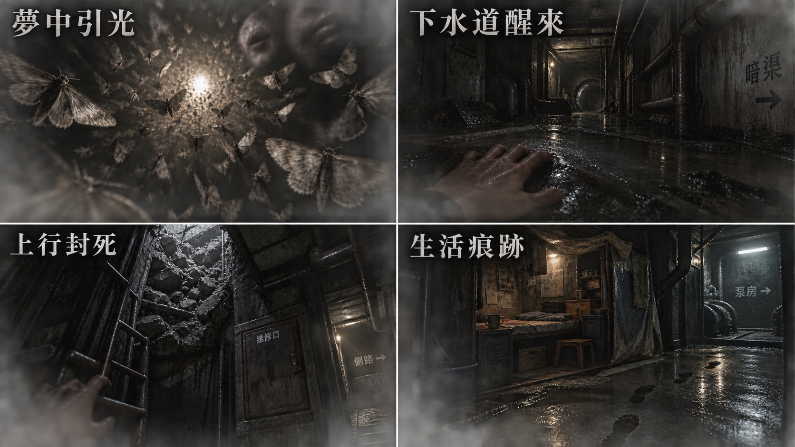

製作註記

**圖像形式：** 概念／構圖參考

**用途：** 序幕開場與封閉求生構圖

**功能作用：** 由夢、醒轉、上行受阻建立逃生目標，生活痕跡跨節點使用，不提前揭露肉身。

**位置：** [P0](10-01_製作規格_序幕.md#node-p0-spec)（共用地基 · B3）、[P1](10-01_製作規格_序幕.md#node-p1-spec)（共用地基 · B3）、[P2](10-01_製作規格_序幕.md#node-p2-spec)（共用地基 · B3）

[原圖檔](../../assets/07_視聽與介面/assets/current_design/V16.png)

### V40｜照片、殘留光與來源界線

**類型：** 探索、劇情演出 · [P0](10-01_製作規格_序幕.md#node-p0-spec)、[P1](10-01_製作規格_序幕.md#node-p1-spec)、[P2](10-01_製作規格_序幕.md#node-p2-spec) · [製作規格](10-01_製作規格_序幕.md#illustration-note-v40)

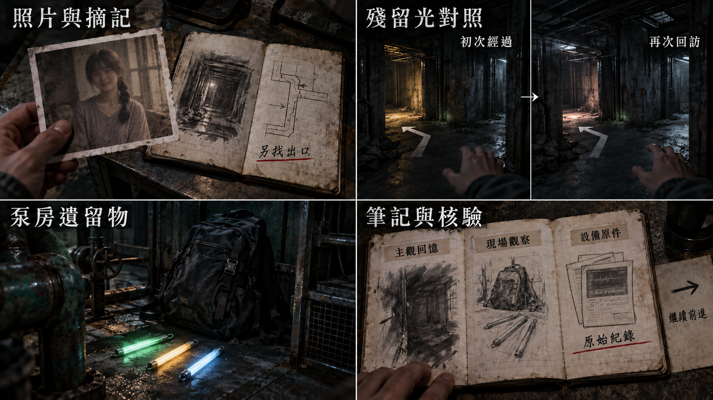

製作註記

**圖像形式：** 概念／構圖參考

**用途：** 照片、主觀殘留光與實體來源

**功能作用：** 區分主觀記錄與泵房實物，筆記不成攝影錄音裝置，序幕不先確認離體。

**位置：** [P0](10-01_製作規格_序幕.md#node-p0-spec)（共用地基 · B3）、[P1](10-01_製作規格_序幕.md#node-p1-spec)（共用地基 · B3）、[P2](10-01_製作規格_序幕.md#node-p2-spec)（共用地基 · B3）

[原圖檔](../../assets/07_視聽與介面/assets/current_design/V40.png)

### L01｜地基處理室：從可見線索進入凝固

**類型：** 探索、解謎、操作 · [P2](10-01_製作規格_序幕.md#node-p2-spec) · [製作規格](10-01_製作規格_序幕.md#illustration-note-l01)

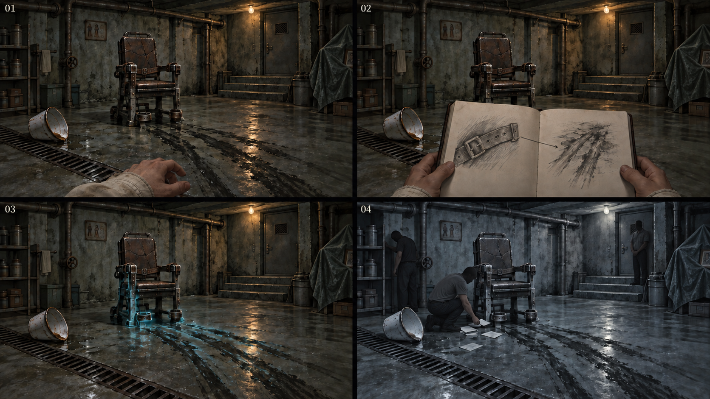

製作註記

**圖像形式：** 概念／構圖參考

**用途：** 凝固教學分鏡

**功能作用：** 先查可見來源並建立關聯，再進同房歷史靜格，建立現在與過去的界線。

**位置：** [P2](10-01_製作規格_序幕.md#node-p2-spec)（共用地基 · B3）

[原圖檔](../../assets/06_關卡規格/assets/level_flow/L01.png)

## 第一幕 · 門面與棚（9 張）

### L02｜入口大廳：叫號與讓路

**類型：** 操作、解謎、劇情演出 · [R1](10-02_製作規格_第一幕.md#node-r1-spec) · [製作規格](10-02_製作規格_第一幕.md#illustration-note-l02)

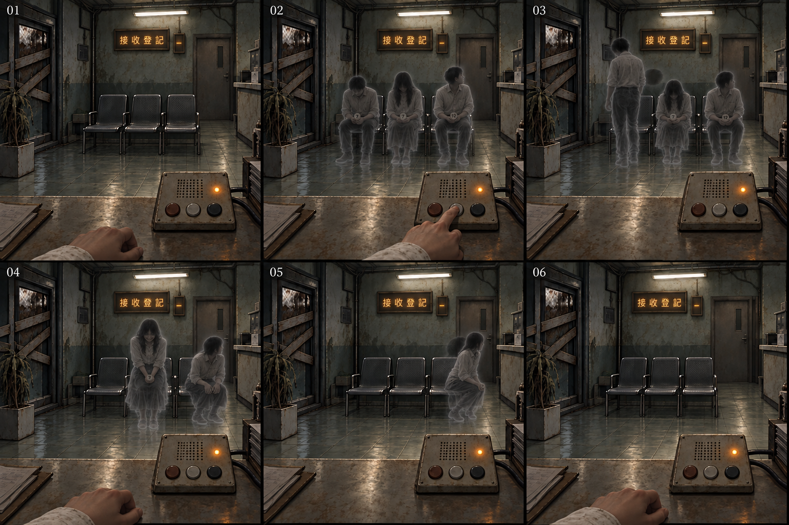

製作註記

**圖像形式：** 概念／構圖參考

**用途：** 三人叫號構圖與通路操作

**功能作用：** 呈現受迫等待、逐號異常與內門讓路；三人離去後仍由玩家開門。

**位置：** [R1](10-02_製作規格_第一幕.md#node-r1-spec)（A 棟 · 1F）

[原圖檔](../../assets/06_關卡規格/assets/level_flow/L02_current.png)

### L02-RULES｜三人叫號方向與內門條件

**類型：** 操作、解謎、劇情演出 · [R1](10-02_製作規格_第一幕.md#node-r1-spec) · [製作規格](10-02_製作規格_第一幕.md#illustration-note-l02-rules)

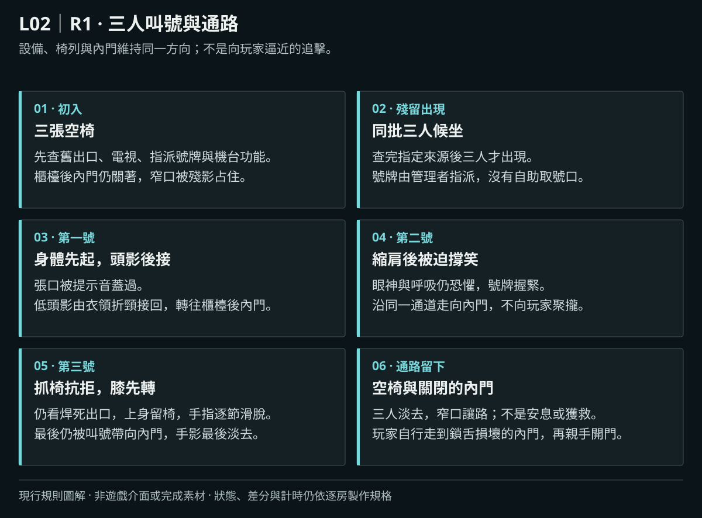

製作註記

**圖像形式：** 規則圖解

**用途：** 三人叫號構圖與通路操作

**功能作用：** 呈現受迫等待、逐號異常與內門讓路；三人離去後仍由玩家開門。

**位置：** [R1](10-02_製作規格_第一幕.md#node-r1-spec)（A 棟 · 1F）

[原圖檔](../../assets/illustrations/current/L02.svg)

### ACCESS-R3｜R3 出入口配置草圖

**類型：** 探索、場景配置 · [R3](10-02_製作規格_第一幕.md#node-r3-spec) · [製作規格](10-02_製作規格_第一幕.md#node-r3-access-layout)

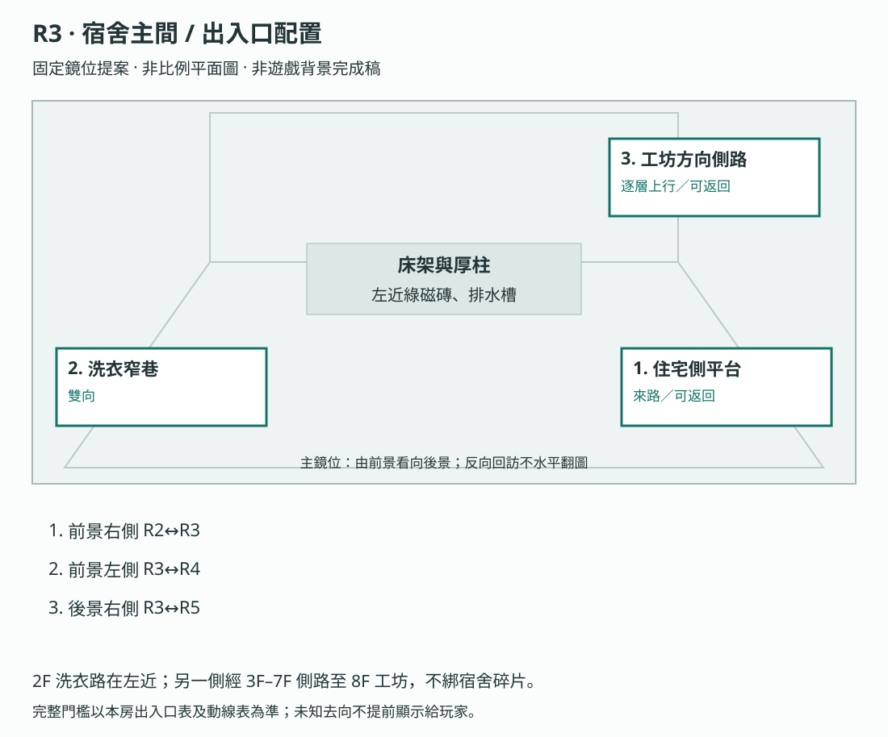

製作註記

**圖像形式：** 出入口草圖

**用途：** 主場景出入口與視線配置草圖

**功能作用：** 對照入口、出口、回訪及封閉位置，協助製作門框、移動熱區與遮擋；實際通行仍依本房條件。

**位置：** [R3](10-02_製作規格_第一幕.md#node-r3-spec)（A 棟 · 2F）

[原圖檔](../../assets/scene_access/r3.svg)

### V01｜直接查看、關聯與三圖層

**類型：** 探索、解謎、操作 · [R3](10-02_製作規格_第一幕.md#node-r3-spec) · [製作規格](10-02_製作規格_第一幕.md#illustration-note-v01)

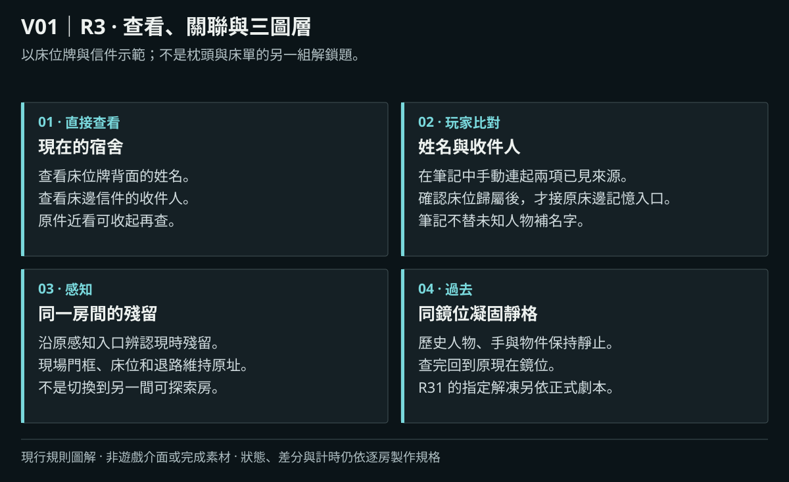

製作註記

**圖像形式：** 規則圖解

**用途：** 查看、關聯與三圖層教學

**功能作用：** 以床位牌與信件核對歸屬，再接指定記憶入口；歷史人物維持靜止。

**位置：** [R3](10-02_製作規格_第一幕.md#node-r3-spec)（A 棟 · 2F）

[原圖檔](../../assets/illustrations/current/V01.svg)

### REF-ASCENT-A｜A 棟 3–7F：五段探路與接景

**類型：** 探索、操作、場景配置 · [R3](10-02_製作規格_第一幕.md#node-r3-spec)、[R5](10-02_製作規格_第一幕.md#node-r5-spec) · [製作規格](10-02_製作規格_第一幕.md#illustration-note-ref-ascent-a)

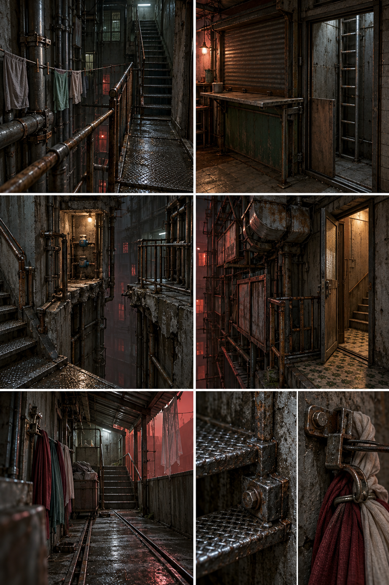

製作註記

**圖像形式：** 概念／構圖參考

**用途：** 3–7F 逐層生活平台與可走支撐

**功能作用：** 五個環境依序接 2F 與 8F；第六格是既有踏板及夾扣近看，不另增加樓層。

**位置：** [R3](10-02_製作規格_第一幕.md#node-r3-spec)（A 棟 · 2F）、[R5](10-02_製作規格_第一幕.md#node-r5-spec)（A 棟 · 8F）；次場景：[T-R3-R5-01](10-02_製作規格_第一幕.md#subscene-t-r3-r5-01-spec)（A 棟 · 3F）、[T-R3-R5-02](10-02_製作規格_第一幕.md#subscene-t-r3-r5-02-spec)（A 棟 · 4F）、[T-R3-R5-03](10-02_製作規格_第一幕.md#subscene-t-r3-r5-03-spec)（A 棟 · 5F）、[T-R3-R5-04](10-02_製作規格_第一幕.md#subscene-t-r3-r5-04-spec)（A 棟 · 6F）、[T-R3-R5-05](10-02_製作規格_第一幕.md#subscene-t-r3-r5-05-spec)（A 棟 · 7F）

[原圖檔](../../assets/07_視聽與介面/assets/current_design/ascent_a_3_7_current.png)

### REF-ASCENT-A-RULES｜A 棟 3–7F：五段探路與接景：精確圖解

**類型：** 探索、操作、場景配置 · [R3](10-02_製作規格_第一幕.md#node-r3-spec)、[R5](10-02_製作規格_第一幕.md#node-r5-spec) · [製作規格](10-02_製作規格_第一幕.md#illustration-note-ref-ascent-a-rules)

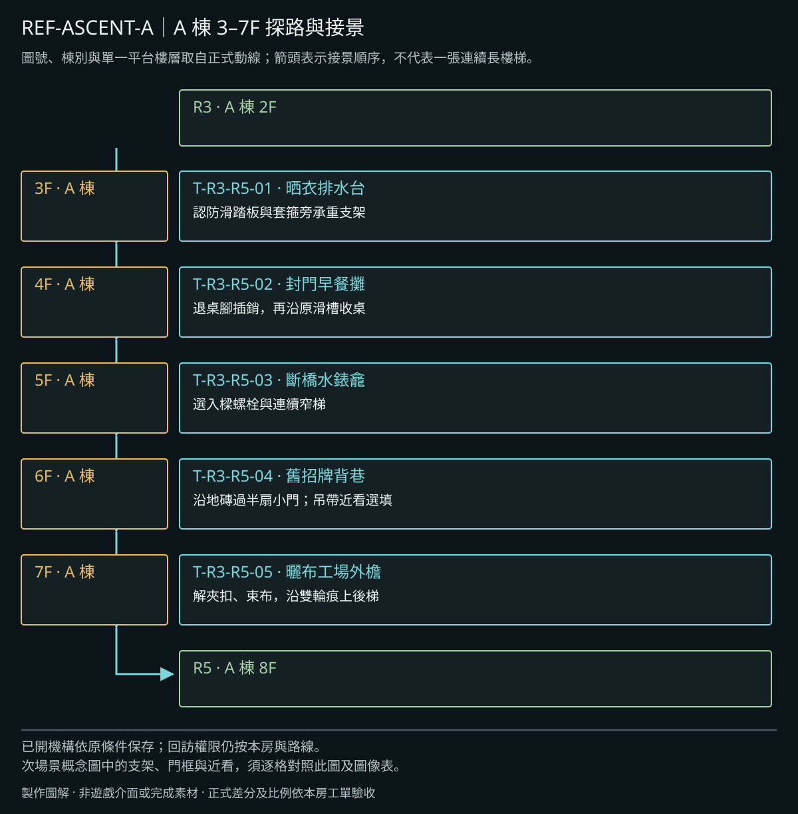

製作註記

**圖像形式：** 規則圖解

**用途：** 3–7F 逐層生活平台與可走支撐

**功能作用：** 五個環境依序接 2F 與 8F；第六格是既有踏板及夾扣近看，不另增加樓層。

**位置：** [R3](10-02_製作規格_第一幕.md#node-r3-spec)（A 棟 · 2F）、[R5](10-02_製作規格_第一幕.md#node-r5-spec)（A 棟 · 8F）；次場景：[T-R3-R5-01](10-02_製作規格_第一幕.md#subscene-t-r3-r5-01-spec)（A 棟 · 3F）、[T-R3-R5-02](10-02_製作規格_第一幕.md#subscene-t-r3-r5-02-spec)（A 棟 · 4F）、[T-R3-R5-03](10-02_製作規格_第一幕.md#subscene-t-r3-r5-03-spec)（A 棟 · 5F）、[T-R3-R5-04](10-02_製作規格_第一幕.md#subscene-t-r3-r5-04-spec)（A 棟 · 6F）、[T-R3-R5-05](10-02_製作規格_第一幕.md#subscene-t-r3-r5-05-spec)（A 棟 · 7F）

[原圖檔](../../assets/illustrations/current/REF-ASCENT-A.svg)

### V32｜怨靈的昆蟲身體恐怖：生活殘留

**類型：** 角色設定、劇情演出 · [R1](10-02_製作規格_第一幕.md#node-r1-spec)、[R3](10-02_製作規格_第一幕.md#node-r3-spec)、[R5](10-02_製作規格_第一幕.md#node-r5-spec)、[R7](10-03_製作規格_第二幕.md#node-r7-spec) · [製作規格](10-02_製作規格_第一幕.md#illustration-note-v32)

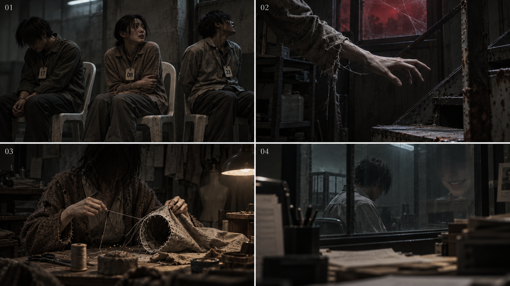

製作註記

**圖像形式：** 概念／構圖參考

**用途：** 生活殘留的昆蟲身體恐怖造型

**功能作用：** 區分等號者、墜落者、縫紉者與低標者，各自採指定局部或靜格，不新增完整個體。

**位置：** [R1](10-02_製作規格_第一幕.md#node-r1-spec)（A 棟 · 1F）、[R3](10-02_製作規格_第一幕.md#node-r3-spec)（A 棟 · 2F）、[R5](10-02_製作規格_第一幕.md#node-r5-spec)（A 棟 · 8F）、[R7](10-03_製作規格_第二幕.md#node-r7-spec)（A 棟 · 15F）

[原圖檔](../../assets/07_視聽與介面/assets/current_design/V32_current.png)

### V18｜第一幕：回訪與生活線索

**類型：** 探索 · [R4](10-02_製作規格_第一幕.md#node-r4-spec)、[R2](10-02_製作規格_第一幕.md#node-r2-spec)、[R3](10-02_製作規格_第一幕.md#node-r3-spec)、[R4b](10-02_製作規格_第一幕.md#node-r4b-spec) · [製作規格](10-02_製作規格_第一幕.md#illustration-note-v18)

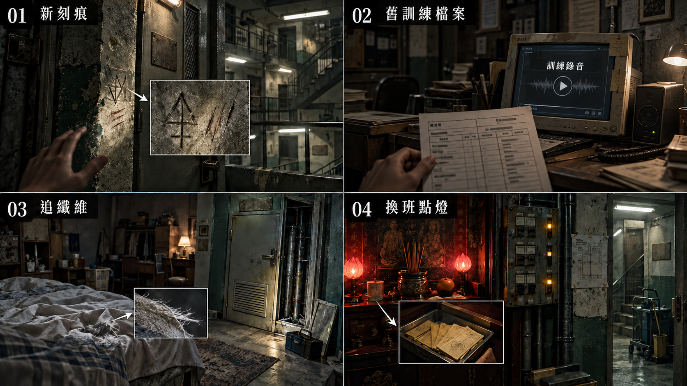

製作註記

**圖像形式：** 概念／構圖參考

**用途：** 第一幕回訪與選填來源

**功能作用：** 對照刻痕、績效錄音、布纖維與餐券，各房回訪條件分別保存。

**位置：** [R4](10-02_製作規格_第一幕.md#node-r4-spec)（A 棟 · 2F）、[R2](10-02_製作規格_第一幕.md#node-r2-spec)（A 棟 · 1F）、[R3](10-02_製作規格_第一幕.md#node-r3-spec)（A 棟 · 2F）、[R4b](10-02_製作規格_第一幕.md#node-r4b-spec)（A 棟 · 2F）

[原圖檔](../../assets/07_視聽與介面/assets/current_design/V18.png)

### V17｜第一幕：門面、供桌與宿舍

**類型：** 探索、場景配置 · [R4](10-02_製作規格_第一幕.md#node-r4-spec)、[R4b](10-02_製作規格_第一幕.md#node-r4b-spec)、[R3](10-02_製作規格_第一幕.md#node-r3-spec) · [製作規格](10-02_製作規格_第一幕.md#illustration-note-v17)

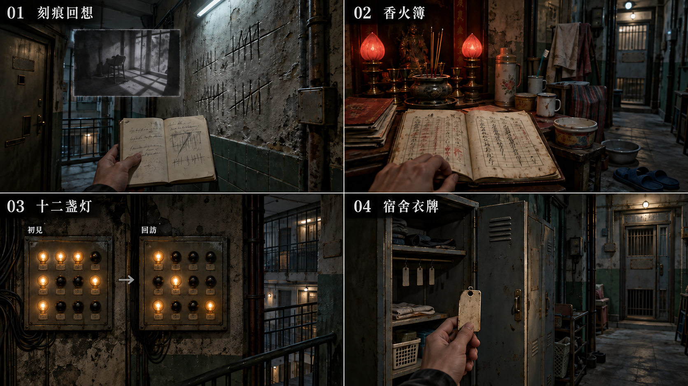

製作註記

**圖像形式：** 概念／構圖參考

**用途：** 刻痕、供桌與住宿原件構圖

**功能作用：** 將受管制生活痕跡分配到各房，供桌、刻痕與未領衣牌不合成同一空間。

**位置：** [R4](10-02_製作規格_第一幕.md#node-r4-spec)（A 棟 · 2F）、[R4b](10-02_製作規格_第一幕.md#node-r4b-spec)（A 棟 · 2F）、[R3](10-02_製作規格_第一幕.md#node-r3-spec)（A 棟 · 2F）

[原圖檔](../../assets/07_視聽與介面/assets/current_design/V17.png)

## 第二幕 · 產線（14 張）

### V11｜老周的兩種回應

**類型：** 操作、解謎 · [R7](10-03_製作規格_第二幕.md#node-r7-spec) · [製作規格](10-03_製作規格_第二幕.md#illustration-note-v11)

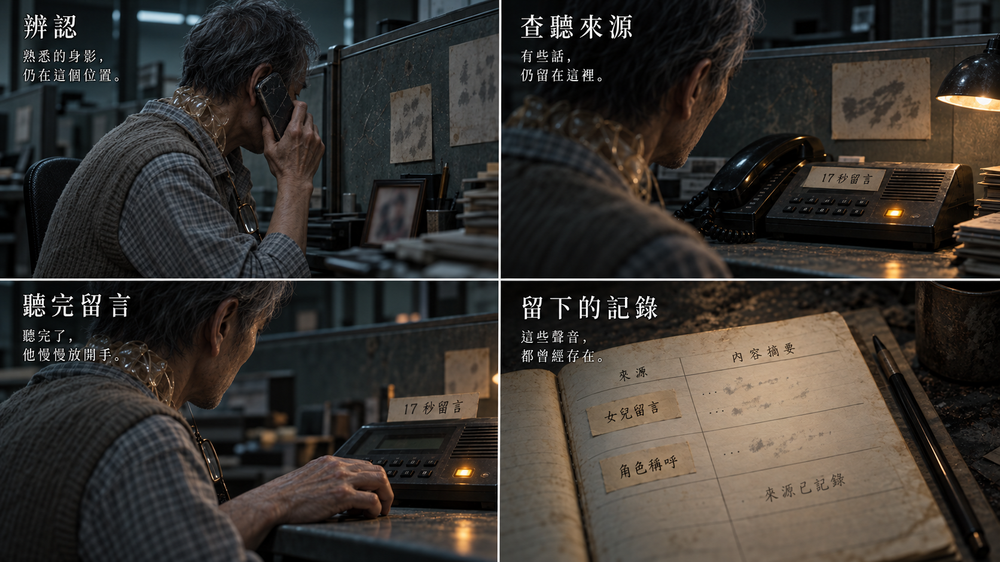

製作註記

**圖像形式：** 概念／構圖參考

**用途：** 老周的兩種既存聲音回應

**功能作用：** 保留家庭留言與角色稱呼造成的不同事實記錄；留言不是即時對外通話。

**位置：** [R7](10-03_製作規格_第二幕.md#node-r7-spec)（A 棟 · 15F）

[原圖檔](../../assets/07_視聽與介面/assets/current_design/V11.png)

### ACCESS-R8｜R8 出入口配置草圖

**類型：** 探索、場景配置 · [R8](10-03_製作規格_第二幕.md#node-r8-spec) · [製作規格](10-03_製作規格_第二幕.md#node-r8-access-layout)

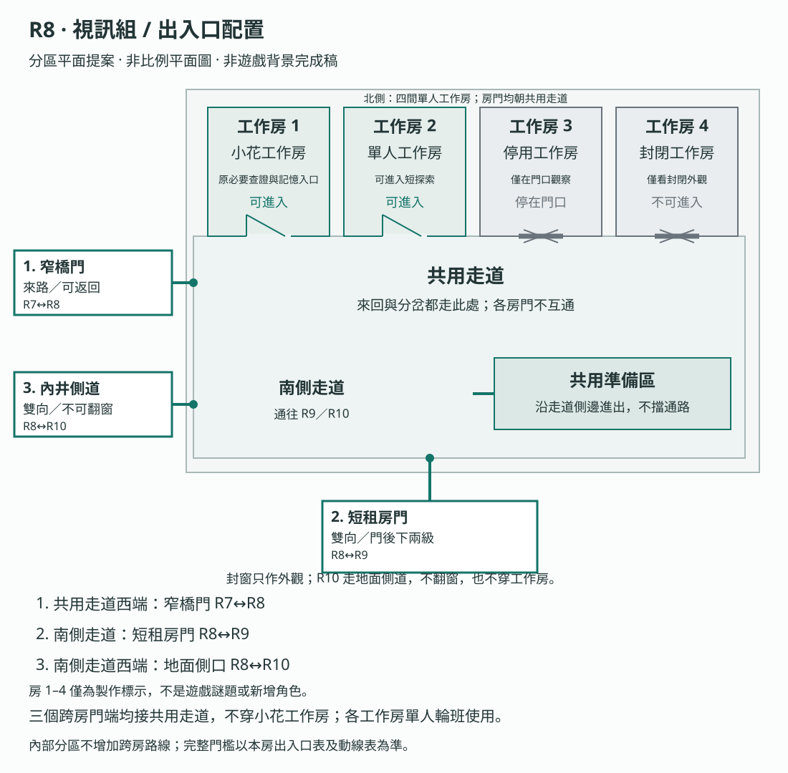

製作註記

**圖像形式：** 出入口草圖

**用途：** 主場景出入口與視線配置草圖

**功能作用：** 對照入口、出口、回訪及封閉位置，協助製作門框、移動熱區與遮擋；實際通行仍依本房條件。

**位置：** [R8](10-03_製作規格_第二幕.md#node-r8-spec)（B 棟 · 15F）

[原圖檔](../../assets/scene_access/r8.svg)

### V41｜現時放蛾與關係手勢

**類型：** 操作、劇情演出 · [R8](10-03_製作規格_第二幕.md#node-r8-spec) · [製作規格](10-03_製作規格_第二幕.md#illustration-note-v41)

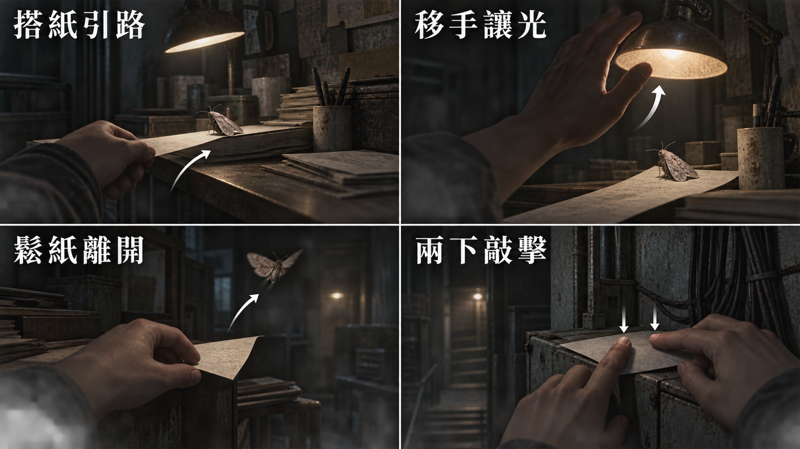

製作註記

**圖像形式：** 概念／構圖參考

**用途：** 現時放蛾、回敲與共同習慣的呼應

**功能作用：** 原三步放蛾完成即可插卡；R8-C02 補固定四拍記憶聲／摘要及自選現時回敲差分。圖解前三格為現時放蛾，第四格沿下部維修區回收；普通蛾不導航，歷史記憶維持靜格。

**位置：** [R8](10-03_製作規格_第二幕.md#node-r8-spec)（B 棟 · 15F）

[原圖檔](../../assets/07_視聽與介面/assets/current_design/V41.png)

### ART01｜放走：兩人於窗邊引蛾離開

**類型：** 劇情演出 · [R8](10-03_製作規格_第二幕.md#node-r8-spec) · [製作規格](10-03_製作規格_第二幕.md#illustration-note-art01)

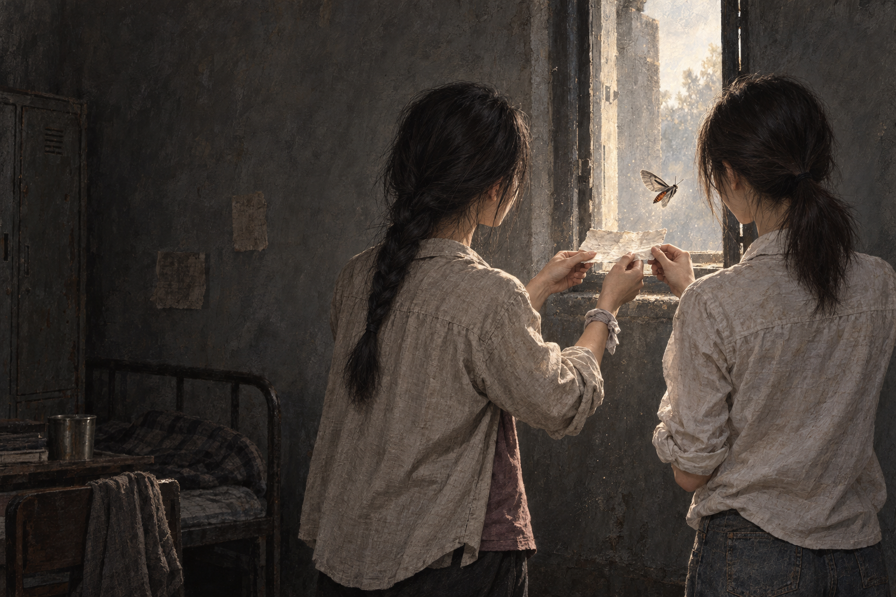

製作註記

**圖像形式：** 概念／構圖參考

**用途：** 過去窗邊放蛾的意象研究

**功能作用：** 供共同經歷的光影與手部參考；玩家只見指定局部靜格，不整張播放全景。

**位置：** [R8](10-03_製作規格_第二幕.md#node-r8-spec)（B 棟 · 15F）

[原圖檔](../../assets/07_視聽與介面/assets/moth_imagery/01_放走_窗邊.png)

### ACCESS-R11｜R11 出入口配置草圖

**類型：** 探索、場景配置 · [R11](10-03_製作規格_第二幕.md#node-r11-spec) · [製作規格](10-03_製作規格_第二幕.md#node-r11-access-layout)

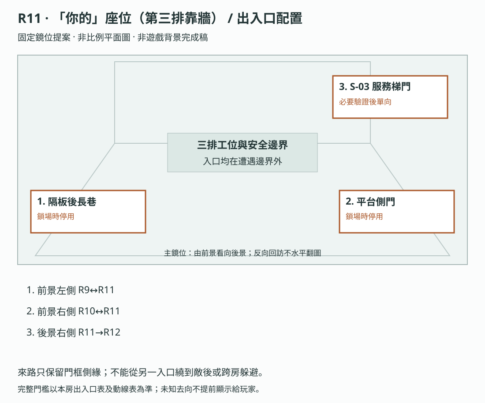

製作註記

**圖像形式：** 出入口草圖

**用途：** 主場景出入口與視線配置草圖

**功能作用：** 對照入口、出口、回訪及封閉位置，協助製作門框、移動熱區與遮擋；實際通行仍依本房條件。

**位置：** [R11](10-03_製作規格_第二幕.md#node-r11-spec)（B 棟 · 15F 上半層平台）

[原圖檔](../../assets/scene_access/r11.svg)

### V09｜阿尋查證與完成傳輸

**類型：** 操作、解謎、流程總覽 · [R11](10-03_製作規格_第二幕.md#node-r11-spec) · [製作規格](10-03_製作規格_第二幕.md#illustration-note-v09)

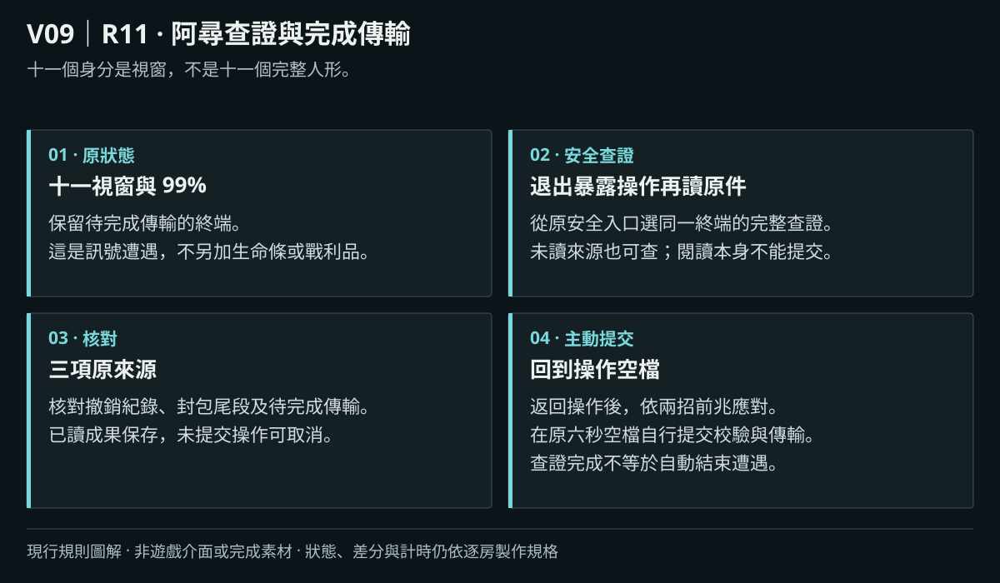

製作註記

**圖像形式：** 規則圖解

**用途：** 阿尋查證與傳輸操作流程

**功能作用：** 分開十一視窗、99% 狀態、安全查證、三來源核對及主動提交。

**位置：** [R11](10-03_製作規格_第二幕.md#node-r11-spec)（B 棟 · 15F 上半層平台）

[原圖檔](../../assets/illustrations/current/V09.svg)

### L03｜阿尋：凝視與敲擊的防禦

**類型：** 戰鬥／防禦、操作 · [R11](10-03_製作規格_第二幕.md#node-r11-spec) · [製作規格](10-03_製作規格_第二幕.md#illustration-note-l03)

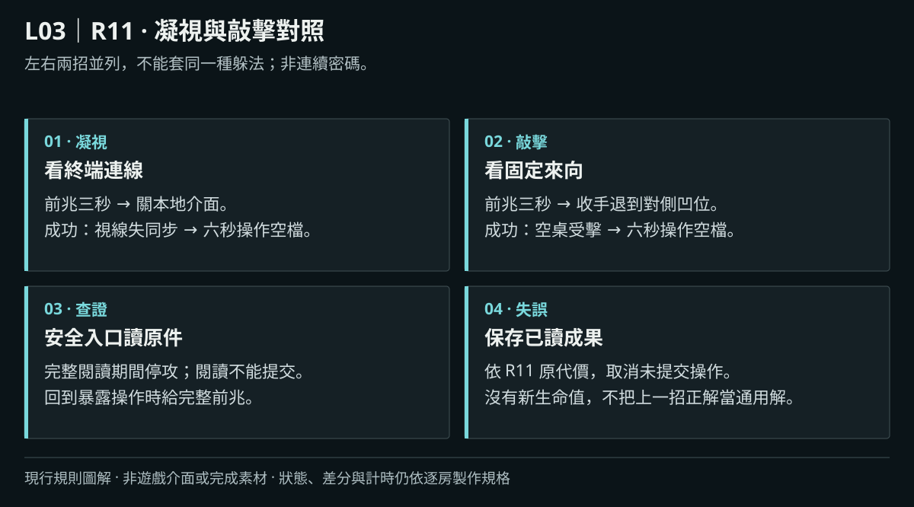

製作註記

**圖像形式：** 規則圖解

**用途：** 阿尋兩招攻防對照

**功能作用：** 凝視關介面、敲擊退對側，成功才有操作空檔，防禦與安全查證分開。

**位置：** [R11](10-03_製作規格_第二幕.md#node-r11-spec)（B 棟 · 15F 上半層平台）

[原圖檔](../../assets/illustrations/current/L03.svg)

### V10｜阿尋兩招與防禦

**類型：** 戰鬥／防禦、操作 · [R11](10-03_製作規格_第二幕.md#node-r11-spec) · [製作規格](10-03_製作規格_第二幕.md#illustration-note-v10)

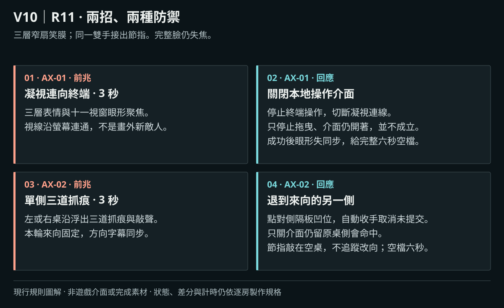

製作註記

**圖像形式：** 規則圖解

**用途：** 阿尋造型前兆與兩種防禦

**功能作用：** 將窄扇笑膜、眼形及節指對應凝視與敲擊，兩招不共用同一躲法。

**位置：** [R11](10-03_製作規格_第二幕.md#node-r11-spec)（B 棟 · 15F 上半層平台）

[原圖檔](../../assets/illustrations/current/V10.svg)

### REF-AHSUN｜阿尋領域：反光收窄與兩招差分

**類型：** 角色設定、戰鬥／防禦、場景配置 · [R11](10-03_製作規格_第二幕.md#node-r11-spec) · [製作規格](10-03_製作規格_第二幕.md#illustration-note-ref-ahsun)

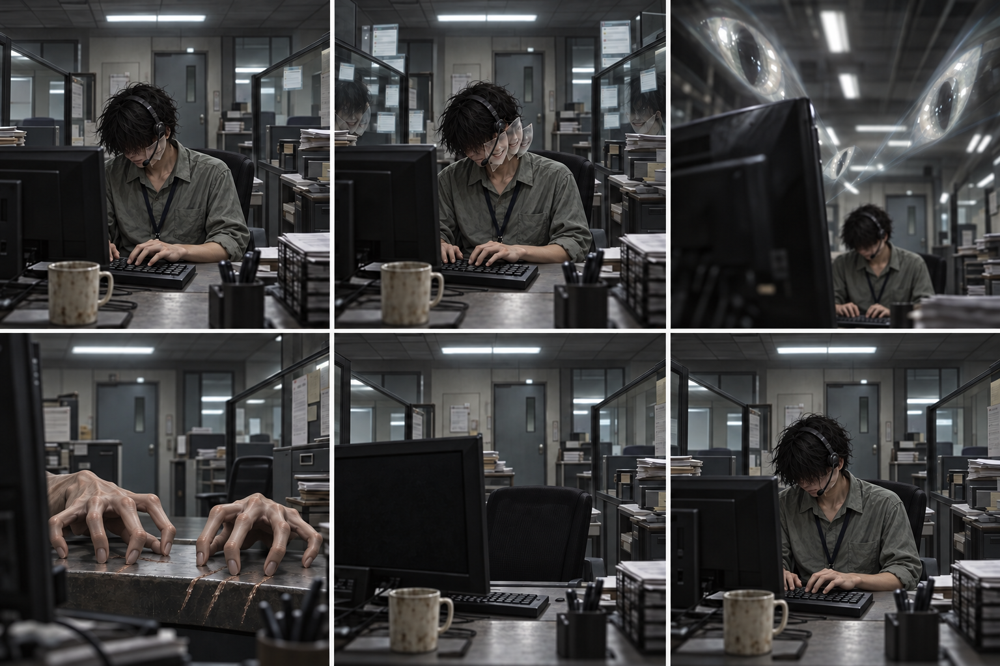

製作註記

**圖像形式：** 概念／構圖參考

**用途：** 阿尋領域前後與節指攻擊構圖

**功能作用：** 同房反光收窄、眼形對終端及同一雙手的節指分開；服務門與兩側凹位位置維持。

**位置：** [R11](10-03_製作規格_第二幕.md#node-r11-spec)（B 棟 · 15F 上半層平台）

[原圖檔](../../assets/07_視聽與介面/assets/current_design/ahsun_domain_current.png)

### REF-ASCENT-B｜B 棟 16–22F：逐層探路與跨棟

**類型：** 探索、場景配置 · [R11](10-03_製作規格_第二幕.md#node-r11-spec)、[R12](10-04_製作規格_第三幕.md#node-r12-spec) · [製作規格](10-03_製作規格_第二幕.md#illustration-note-ref-ascent-b)

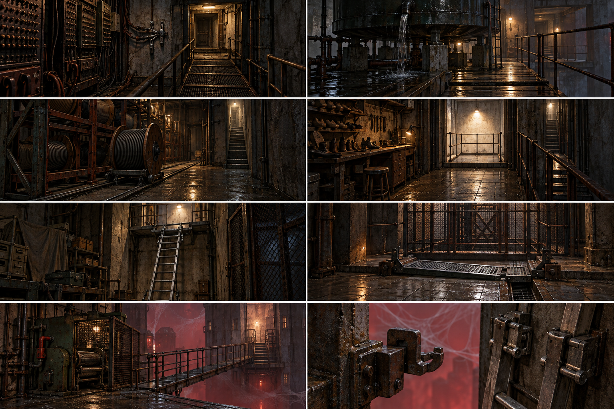

製作註記

**圖像形式：** 概念／構圖參考

**用途：** 16–22F 探路與同層跨棟構圖

**功能作用：** 七個平台到 22F 才過 B→A 橋，再循 A 棟短梯進 23F；原單向門與平台回訪分開。

**位置：** [R11](10-03_製作規格_第二幕.md#node-r11-spec)（B 棟 · 15F 上半層平台）、[R12](10-04_製作規格_第三幕.md#node-r12-spec)（A 棟 · 23F）；次場景：[T-R11-R12-01](10-03_製作規格_第二幕.md#subscene-t-r11-r12-01-spec)（B 棟 · 16F）、[T-R11-R12-02](10-03_製作規格_第二幕.md#subscene-t-r11-r12-02-spec)（B 棟 · 17F）、[T-R11-R12-03](10-03_製作規格_第二幕.md#subscene-t-r11-r12-03-spec)（B 棟 · 18F）、[T-R11-R12-04](10-03_製作規格_第二幕.md#subscene-t-r11-r12-04-spec)（B 棟 · 19F）、[T-R11-R12-05](10-03_製作規格_第二幕.md#subscene-t-r11-r12-05-spec)（B 棟 · 20F）、[T-R11-R12-06](10-03_製作規格_第二幕.md#subscene-t-r11-r12-06-spec)（B 棟 · 21F）、[T-R11-R12-07](10-03_製作規格_第二幕.md#subscene-t-r11-r12-07-spec)（B 棟 → A 棟 · 22F）

[原圖檔](../../assets/07_視聽與介面/assets/current_design/ascent_b_16_22_current.png)

### REF-ASCENT-B-RULES｜B 棟 16–22F：逐層探路與跨棟：精確圖解

**類型：** 探索、場景配置 · [R11](10-03_製作規格_第二幕.md#node-r11-spec)、[R12](10-04_製作規格_第三幕.md#node-r12-spec) · [製作規格](10-03_製作規格_第二幕.md#illustration-note-ref-ascent-b-rules)

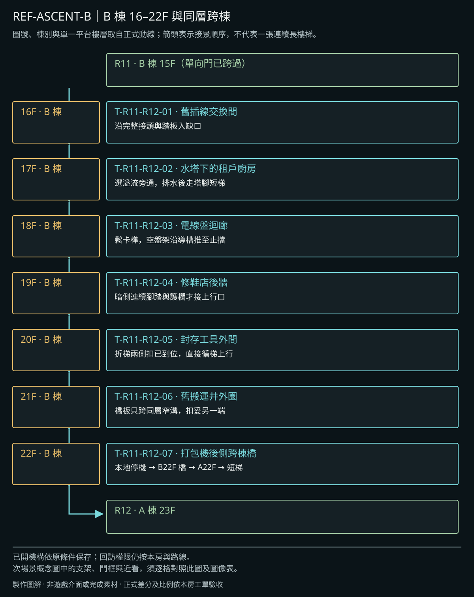

製作註記

**圖像形式：** 規則圖解

**用途：** 16–22F 探路與同層跨棟構圖

**功能作用：** 七個平台到 22F 才過 B→A 橋，再循 A 棟短梯進 23F；原單向門與平台回訪分開。

**位置：** [R11](10-03_製作規格_第二幕.md#node-r11-spec)（B 棟 · 15F 上半層平台）、[R12](10-04_製作規格_第三幕.md#node-r12-spec)（A 棟 · 23F）；次場景：[T-R11-R12-01](10-03_製作規格_第二幕.md#subscene-t-r11-r12-01-spec)（B 棟 · 16F）、[T-R11-R12-02](10-03_製作規格_第二幕.md#subscene-t-r11-r12-02-spec)（B 棟 · 17F）、[T-R11-R12-03](10-03_製作規格_第二幕.md#subscene-t-r11-r12-03-spec)（B 棟 · 18F）、[T-R11-R12-04](10-03_製作規格_第二幕.md#subscene-t-r11-r12-04-spec)（B 棟 · 19F）、[T-R11-R12-05](10-03_製作規格_第二幕.md#subscene-t-r11-r12-05-spec)（B 棟 · 20F）、[T-R11-R12-06](10-03_製作規格_第二幕.md#subscene-t-r11-r12-06-spec)（B 棟 · 21F）、[T-R11-R12-07](10-03_製作規格_第二幕.md#subscene-t-r11-r12-07-spec)（B 棟 → A 棟 · 22F）

[原圖檔](../../assets/illustrations/current/REF-ASCENT-B.svg)

### V19｜第二幕：工作區的異常

**類型：** 探索、場景配置 · [R6](10-03_製作規格_第二幕.md#node-r6-spec)、[R7](10-03_製作規格_第二幕.md#node-r7-spec) · [製作規格](10-03_製作規格_第二幕.md#illustration-note-v19)

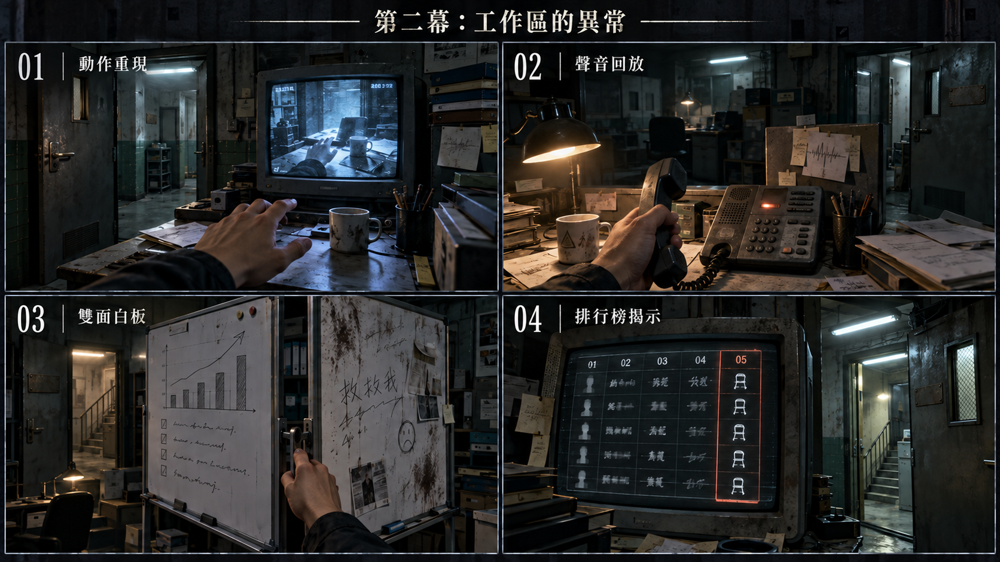

製作註記

**圖像形式：** 概念／構圖參考

**用途：** 工作區視聽異常與管理痕跡

**功能作用：** 用螢幕、現場聲音、白板與排行呈現受迫產線，不增加外部聯絡權限。

**位置：** [R6](10-03_製作規格_第二幕.md#node-r6-spec)（A 棟 · 11F）、[R7](10-03_製作規格_第二幕.md#node-r7-spec)（A 棟 · 15F）

[原圖檔](../../assets/07_視聽與介面/assets/current_design/V19.png)

### V20｜第二幕：生活與犯罪痕跡

**類型：** 探索 · [R6](10-03_製作規格_第二幕.md#node-r6-spec)、[R8](10-03_製作規格_第二幕.md#node-r8-spec)、[R9](10-03_製作規格_第二幕.md#node-r9-spec)、[R10](10-03_製作規格_第二幕.md#node-r10-spec) · [製作規格](10-03_製作規格_第二幕.md#illustration-note-v20)

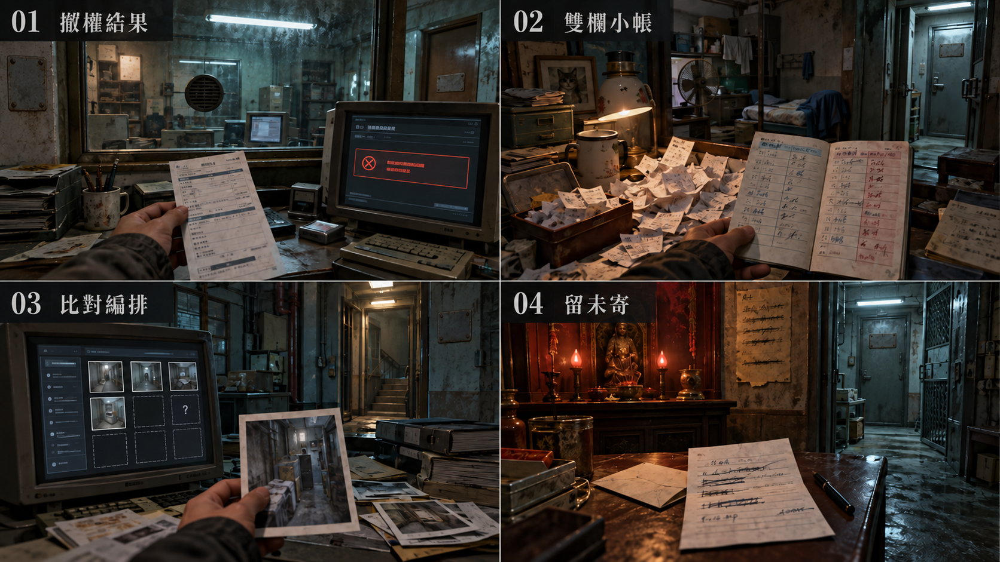

製作註記

**圖像形式：** 概念／構圖參考

**用途：** 生活原件與犯罪痕跡構圖

**功能作用：** 區分帳號匯款、紙花小帳、素材索引與未寄草稿，保留各來源的證明範圍。

**位置：** [R6](10-03_製作規格_第二幕.md#node-r6-spec)（A 棟 · 11F）、[R8](10-03_製作規格_第二幕.md#node-r8-spec)（B 棟 · 15F）、[R9](10-03_製作規格_第二幕.md#node-r9-spec)（B 棟 · 15F）、[R10](10-03_製作規格_第二幕.md#node-r10-spec)（B 棟 · 15F 上半層平台）

[原圖檔](../../assets/07_視聽與介面/assets/current_design/V20.png)

### V21｜第二幕：關係與回訪後果

**類型：** 探索、劇情演出 · [R7](10-03_製作規格_第二幕.md#node-r7-spec)、[R8](10-03_製作規格_第二幕.md#node-r8-spec)、[R10](10-03_製作規格_第二幕.md#node-r10-spec) · [製作規格](10-03_製作規格_第二幕.md#illustration-note-v21)

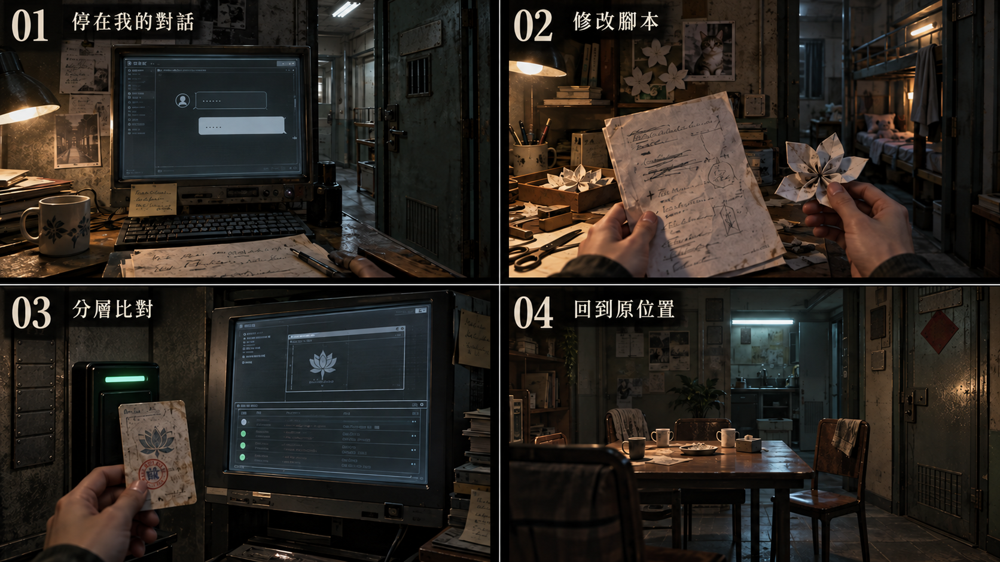

製作註記

**圖像形式：** 概念／構圖參考

**用途：** 關係線與回訪後果

**功能作用：** 呈現未送出對話、回訪空位、修改腳本與祈禱卡，不代玩家填完未知對話。

**位置：** [R7](10-03_製作規格_第二幕.md#node-r7-spec)（A 棟 · 15F）、[R8](10-03_製作規格_第二幕.md#node-r8-spec)（B 棟 · 15F）、[R10](10-03_製作規格_第二幕.md#node-r10-spec)（B 棟 · 15F 上半層平台）

[原圖檔](../../assets/07_視聽與介面/assets/current_design/V21.png)

## 第三幕 · 技術核心（13 張）

### ACCESS-R12｜R12 出入口配置草圖

**類型：** 探索、場景配置 · [R12](10-04_製作規格_第三幕.md#node-r12-spec) · [製作規格](10-04_製作規格_第三幕.md#node-r12-access-layout)

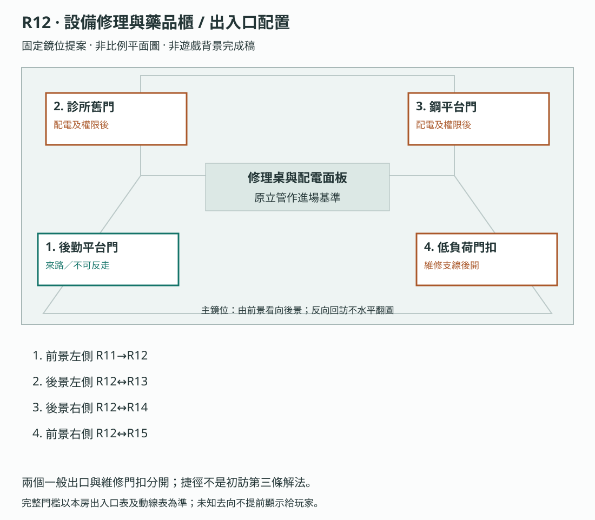

製作註記

**圖像形式：** 出入口草圖

**用途：** 主場景出入口與視線配置草圖

**功能作用：** 對照入口、出口、回訪及封閉位置，協助製作門框、移動熱區與遮擋；實際通行仍依本房條件。

**位置：** [R12](10-04_製作規格_第三幕.md#node-r12-spec)（A 棟 · 23F）

[原圖檔](../../assets/scene_access/r12.svg)

### V08｜現場訊號回應

**類型：** 操作、解謎 · [R12](10-04_製作規格_第三幕.md#node-r12-spec) · [製作規格](10-04_製作規格_第三幕.md#illustration-note-v08)

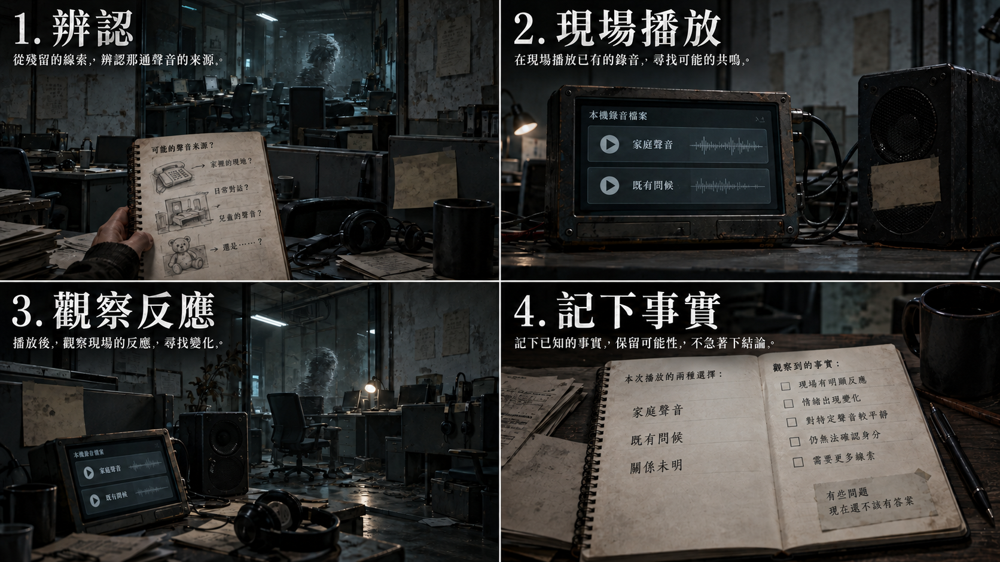

製作註記

**圖像形式：** 概念／構圖參考

**用途：** 本地訊號與未定收件人回應

**功能作用：** 由現場設備播放已取得來源，記錄反應而不補完未知身分或新增遠端施法。

**位置：** [R12](10-04_製作規格_第三幕.md#node-r12-spec)（A 棟 · 23F）

[原圖檔](../../assets/07_視聽與介面/assets/current_design/V08.png)

### ACCESS-R13｜R13 出入口配置草圖

**類型：** 探索、場景配置 · [R13](10-04_製作規格_第三幕.md#node-r13-spec) · [製作規格](10-04_製作規格_第三幕.md#node-r13-access-layout)

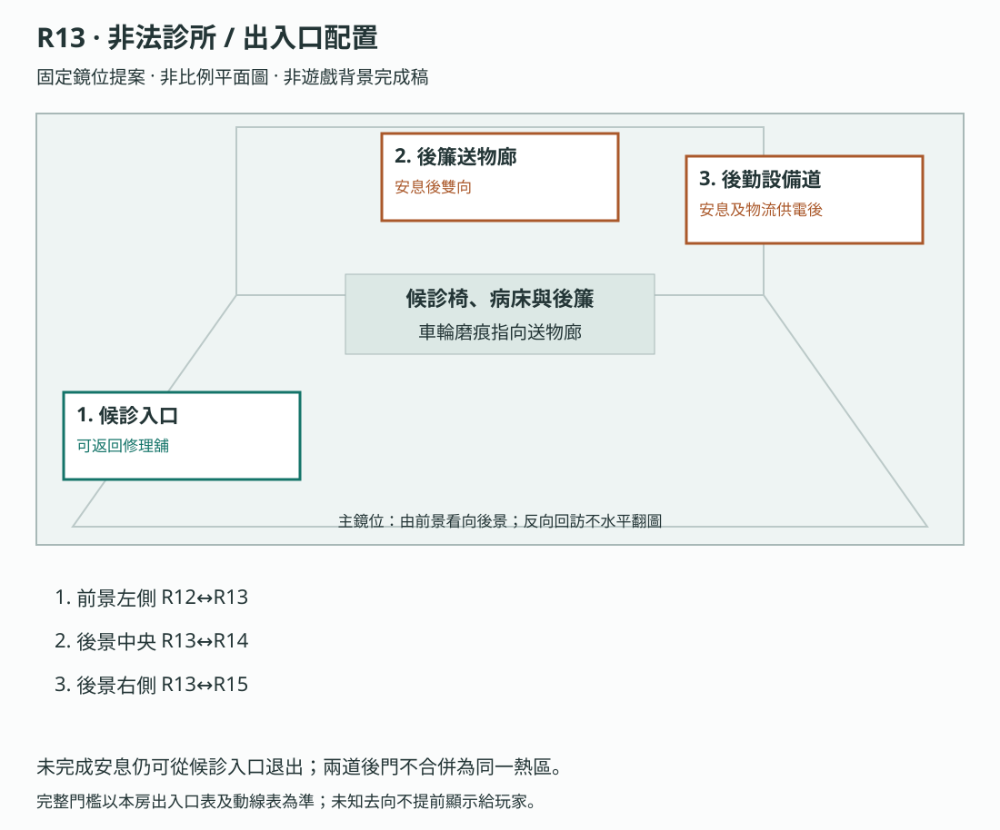

製作註記

**圖像形式：** 出入口草圖

**用途：** 主場景出入口與視線配置草圖

**功能作用：** 對照入口、出口、回訪及封閉位置，協助製作門框、移動熱區與遮擋；實際通行仍依本房條件。

**位置：** [R13](10-04_製作規格_第三幕.md#node-r13-spec)（A 棟 · 23F）

[原圖檔](../../assets/scene_access/r13.svg)

### ACCESS-R14｜R14 出入口配置草圖

**類型：** 探索、場景配置 · [R14](10-04_製作規格_第三幕.md#node-r14-spec) · [製作規格](10-04_製作規格_第三幕.md#node-r14-access-layout)

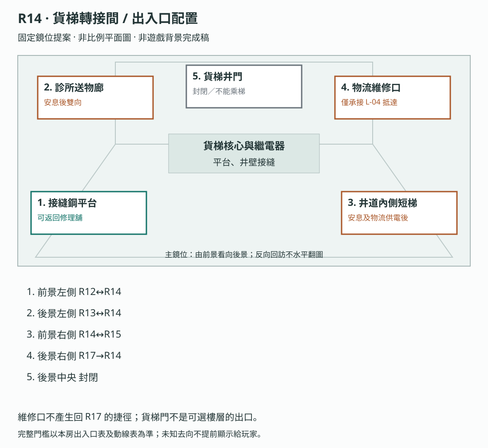

製作註記

**圖像形式：** 出入口草圖

**用途：** 主場景出入口與視線配置草圖

**功能作用：** 對照入口、出口、回訪及封閉位置，協助製作門框、移動熱區與遮擋；實際通行仍依本房條件。

**位置：** [R14](10-04_製作規格_第三幕.md#node-r14-spec)（B 棟 · 27F）

[原圖檔](../../assets/scene_access/r14.svg)

### ACCESS-R15｜R15 出入口配置草圖

**類型：** 探索、場景配置 · [R15](10-04_製作規格_第三幕.md#node-r15-spec) · [製作規格](10-04_製作規格_第三幕.md#node-r15-access-layout)

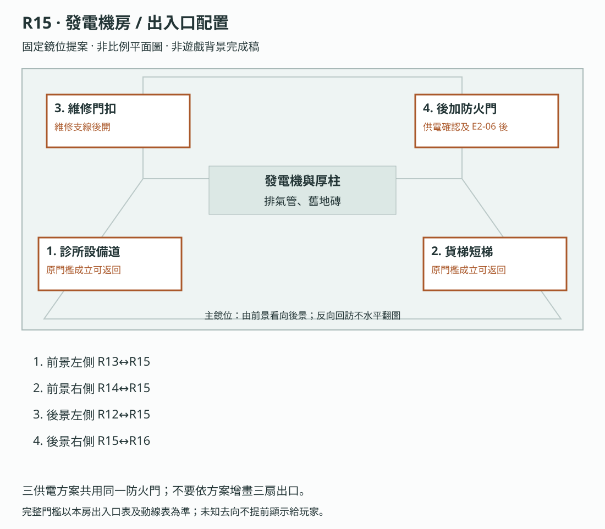

製作註記

**圖像形式：** 出入口草圖

**用途：** 主場景出入口與視線配置草圖

**功能作用：** 對照入口、出口、回訪及封閉位置，協助製作門框、移動熱區與遮擋；實際通行仍依本房條件。

**位置：** [R15](10-04_製作規格_第三幕.md#node-r15-spec)（B 棟 · 27F）

[原圖檔](../../assets/scene_access/r15.svg)

### L04｜供電取捨與路線回饋

**類型：** 操作、解謎、流程總覽 · [R15](10-04_製作規格_第三幕.md#node-r15-spec)、[R12](10-04_製作規格_第三幕.md#node-r12-spec)、[R16](10-04_製作規格_第三幕.md#node-r16-spec) · [製作規格](10-04_製作規格_第三幕.md#illustration-note-l04)

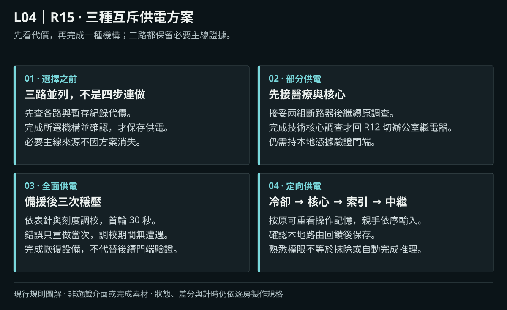

製作註記

**圖像形式：** 規則圖解

**用途：** 互斥供電方案與回訪條件

**功能作用：** 區分部分、全面、定向供電；保留必要來源，後續繼電器與門端驗證仍須操作。

**位置：** [R15](10-04_製作規格_第三幕.md#node-r15-spec)（B 棟 · 27F）、[R12](10-04_製作規格_第三幕.md#node-r12-spec)（A 棟 · 23F）、[R16](10-04_製作規格_第三幕.md#node-r16-spec)（B 棟 · 31F）

[原圖檔](../../assets/illustrations/current/L04.svg)

### ACCESS-R17｜R17 出入口配置草圖

**類型：** 探索、場景配置 · [R17](10-04_製作規格_第三幕.md#node-r17-spec) · [製作規格](10-04_製作規格_第三幕.md#node-r17-access-layout)

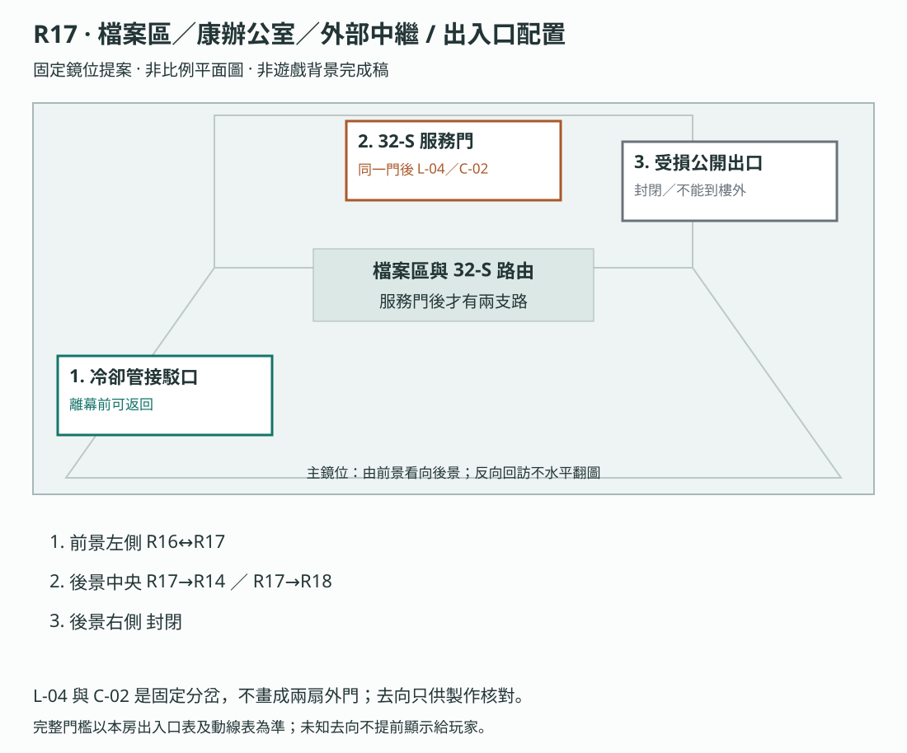

製作註記

**圖像形式：** 出入口草圖

**用途：** 主場景出入口與視線配置草圖

**功能作用：** 對照入口、出口、回訪及封閉位置，協助製作門框、移動熱區與遮擋；實際通行仍依本房條件。

**位置：** [R17](10-04_製作規格_第三幕.md#node-r17-spec)（B 棟 · 32F）

[原圖檔](../../assets/scene_access/r17.svg)

### REF-ASCENT-HIGH｜B 棟 33–36F：貨架與包覆門楣

**類型：** 探索、操作、場景配置 · [R17](10-04_製作規格_第三幕.md#node-r17-spec)、[R18](10-05_製作規格_第四幕.md#node-r18-spec) · [製作規格](10-04_製作規格_第三幕.md#illustration-note-ref-ascent-high)

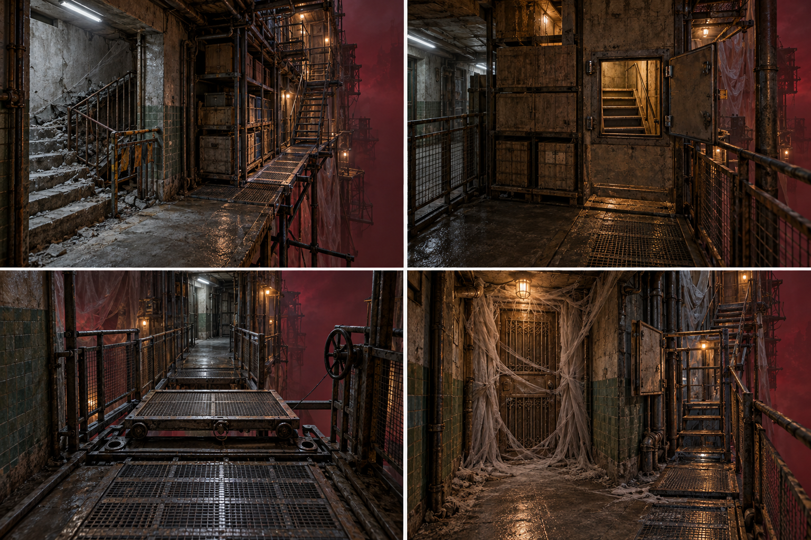

製作註記

**圖像形式：** 概念／構圖參考

**用途：** 33–36F 貨架、隔間、橫移臺與檢修片

**功能作用：** 依承重踏板與固定梯到 37F；貨臺只同層橫移，封住宅門與可開檢修片清楚分開。

**位置：** [R17](10-04_製作規格_第三幕.md#node-r17-spec)（B 棟 · 32F）、[R18](10-05_製作規格_第四幕.md#node-r18-spec)（B 棟 · 37F）；次場景：[T-R17-R18-01](10-04_製作規格_第三幕.md#subscene-t-r17-r18-01-spec)（B 棟 · 33F）、[T-R17-R18-02](10-04_製作規格_第三幕.md#subscene-t-r17-r18-02-spec)（B 棟 · 34F）、[T-R17-R18-03](10-04_製作規格_第三幕.md#subscene-t-r17-r18-03-spec)（B 棟 · 35F）、[T-R17-R18-04](10-04_製作規格_第三幕.md#subscene-t-r17-r18-04-spec)（B 棟 · 36F）

[原圖檔](../../assets/07_視聽與介面/assets/current_design/ascent_b_33_36_current.png)

### REF-ASCENT-HIGH-RULES｜B 棟 33–36F：貨架與包覆門楣：精確圖解

**類型：** 探索、操作、場景配置 · [R17](10-04_製作規格_第三幕.md#node-r17-spec)、[R18](10-05_製作規格_第四幕.md#node-r18-spec) · [製作規格](10-04_製作規格_第三幕.md#illustration-note-ref-ascent-high-rules)

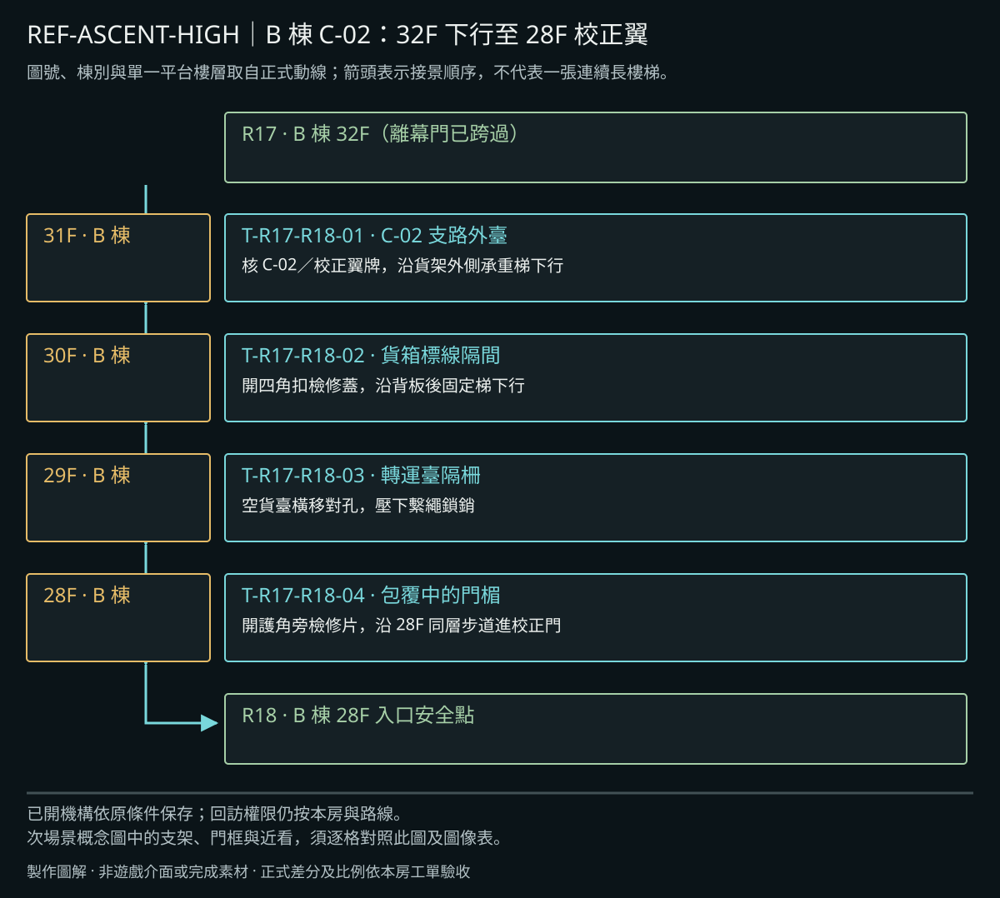

製作註記

**圖像形式：** 規則圖解

**用途：** 33–36F 貨架、隔間、橫移臺與檢修片

**功能作用：** 依承重踏板與固定梯到 37F；貨臺只同層橫移，封住宅門與可開檢修片清楚分開。

**位置：** [R17](10-04_製作規格_第三幕.md#node-r17-spec)（B 棟 · 32F）、[R18](10-05_製作規格_第四幕.md#node-r18-spec)（B 棟 · 37F）；次場景：[T-R17-R18-01](10-04_製作規格_第三幕.md#subscene-t-r17-r18-01-spec)（B 棟 · 33F）、[T-R17-R18-02](10-04_製作規格_第三幕.md#subscene-t-r17-r18-02-spec)（B 棟 · 34F）、[T-R17-R18-03](10-04_製作規格_第三幕.md#subscene-t-r17-r18-03-spec)（B 棟 · 35F）、[T-R17-R18-04](10-04_製作規格_第三幕.md#subscene-t-r17-r18-04-spec)（B 棟 · 36F）

[原圖檔](../../assets/illustrations/current/REF-ASCENT-HIGH.svg)

### V34｜怨靈的昆蟲身體恐怖：巡行與未知

**類型：** 角色設定、劇情演出 · [R3](10-02_製作規格_第一幕.md#node-r3-spec)、[R12](10-04_製作規格_第三幕.md#node-r12-spec)、[R16](10-04_製作規格_第三幕.md#node-r16-spec)、[R25](10-06_製作規格_第五幕.md#node-r25-spec) · [製作規格](10-04_製作規格_第三幕.md#illustration-note-v34)

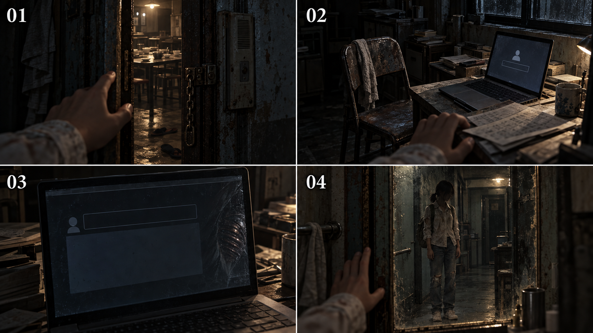

製作註記

**圖像形式：** 概念／構圖參考

**用途：** 缺席、反光與鏡像者造型參照

**功能作用：** 區分空名訊號、未定收件人、封鎖後者及鏡像者，保持現時衣著與未知界線。

**位置：** [R3](10-02_製作規格_第一幕.md#node-r3-spec)（A 棟 · 2F）、[R12](10-04_製作規格_第三幕.md#node-r12-spec)（A 棟 · 23F）、[R16](10-04_製作規格_第三幕.md#node-r16-spec)（B 棟 · 31F）、[R25](10-06_製作規格_第五幕.md#node-r25-spec)（B 棟 · 44F）

[原圖檔](../../assets/07_視聽與介面/assets/current_design/V34_current.png)

### V33｜怨靈的昆蟲身體恐怖：後勤威脅

**類型：** 角色設定、劇情演出 · [R10](10-03_製作規格_第二幕.md#node-r10-spec)、[R14](10-04_製作規格_第三幕.md#node-r14-spec)、[R13](10-04_製作規格_第三幕.md#node-r13-spec)、[R15](10-04_製作規格_第三幕.md#node-r15-spec) · [製作規格](10-04_製作規格_第三幕.md#illustration-note-v33)

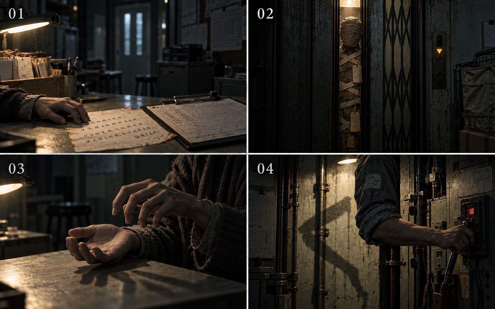

製作註記

**圖像形式：** 概念／構圖參考

**用途：** 後勤威脅的局部造型參照

**功能作用：** 以求助手、貨梯窄繭、空掌節指與電房局部呈現恐怖，未知者不補身分或死因。

**位置：** [R10](10-03_製作規格_第二幕.md#node-r10-spec)（B 棟 · 15F 上半層平台）、[R14](10-04_製作規格_第三幕.md#node-r14-spec)（B 棟 · 27F）、[R13](10-04_製作規格_第三幕.md#node-r13-spec)（A 棟 · 23F）、[R15](10-04_製作規格_第三幕.md#node-r15-spec)（B 棟 · 27F）

[原圖檔](../../assets/07_視聽與介面/assets/current_design/V33_current.png)

### V22｜第三幕：路由與後勤通路

**類型：** 操作、解謎、流程總覽 · [R12](10-04_製作規格_第三幕.md#node-r12-spec)、[R13](10-04_製作規格_第三幕.md#node-r13-spec)、[R14](10-04_製作規格_第三幕.md#node-r14-spec)、[R15](10-04_製作規格_第三幕.md#node-r15-spec)、[R17](10-04_製作規格_第三幕.md#node-r17-spec) · [製作規格](10-04_製作規格_第三幕.md#illustration-note-v22)

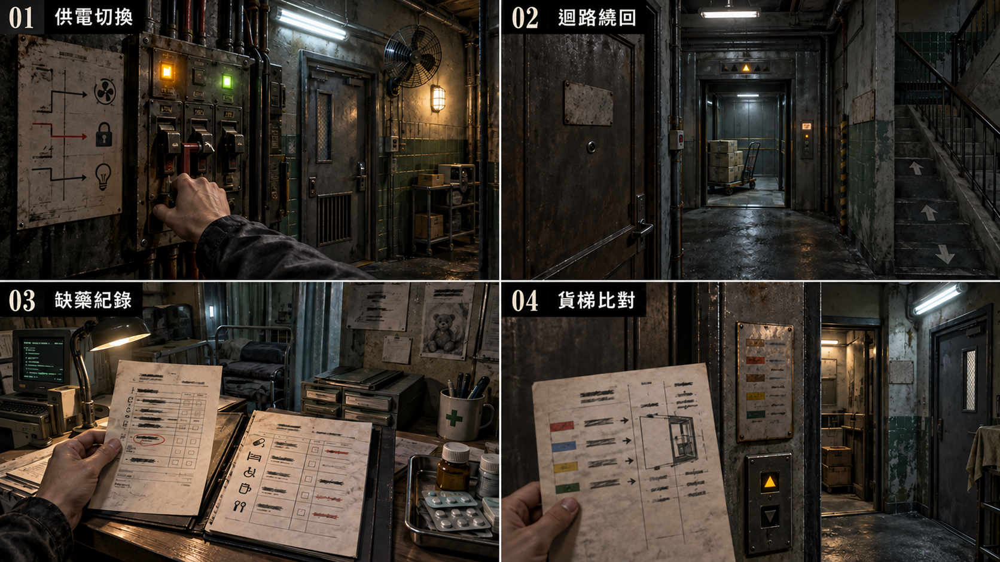

製作註記

**圖像形式：** 概念／構圖參考

**用途：** 第三幕路由、後勤與誤導回路

**功能作用：** 對照供電取捨、缺藥資料、貨梯門端及 R17→R14 回路，不新增跳層捷徑。

**位置：** [R12](10-04_製作規格_第三幕.md#node-r12-spec)（A 棟 · 23F）、[R13](10-04_製作規格_第三幕.md#node-r13-spec)（A 棟 · 23F）、[R14](10-04_製作規格_第三幕.md#node-r14-spec)（B 棟 · 27F）、[R15](10-04_製作規格_第三幕.md#node-r15-spec)（B 棟 · 27F）、[R17](10-04_製作規格_第三幕.md#node-r17-spec)（B 棟 · 32F）

[原圖檔](../../assets/07_視聽與介面/assets/current_design/V22.png)

### V23｜第三幕：證據與微異常

**類型：** 探索、劇情演出 · [R13](10-04_製作規格_第三幕.md#node-r13-spec)、[R16](10-04_製作規格_第三幕.md#node-r16-spec)、[R17](10-04_製作規格_第三幕.md#node-r17-spec) · [製作規格](10-04_製作規格_第三幕.md#illustration-note-v23)

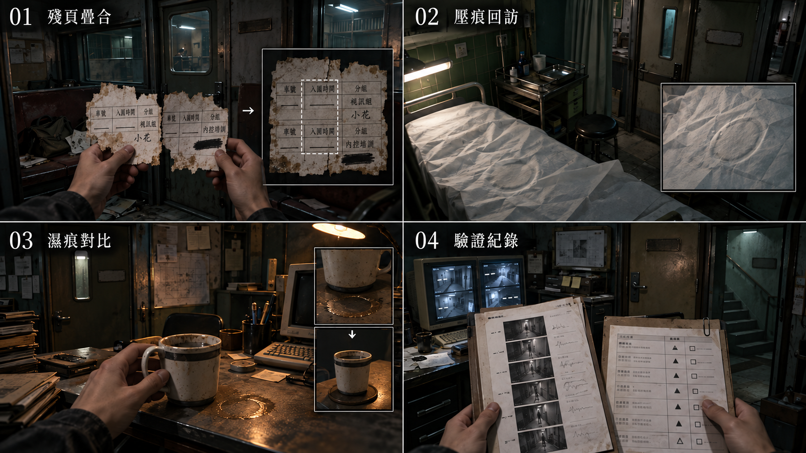

製作註記

**圖像形式：** 概念／構圖參考

**用途：** 第三幕原件與微異常構圖

**功能作用：** 保留床紙、系統資料、杯墊壓痕及同車殘頁各自來源。R13 原件舉證沿 D04 補主張／引用／另存差分，不指定唯一死因或推定額外屍體。

**位置：** [R13](10-04_製作規格_第三幕.md#node-r13-spec)（A 棟 · 23F）、[R16](10-04_製作規格_第三幕.md#node-r16-spec)（B 棟 · 31F）、[R17](10-04_製作規格_第三幕.md#node-r17-spec)（B 棟 · 32F）

[原圖檔](../../assets/07_視聽與介面/assets/current_design/V23.png)

## 第四幕 · 校正區（10 張）

### V07｜R18 第一人稱聽覺潛行畫面模擬

**類型：** 潛行、操作、介面 · [R18](10-05_製作規格_第四幕.md#node-r18-spec) · [製作規格](10-05_製作規格_第四幕.md#illustration-note-v07)

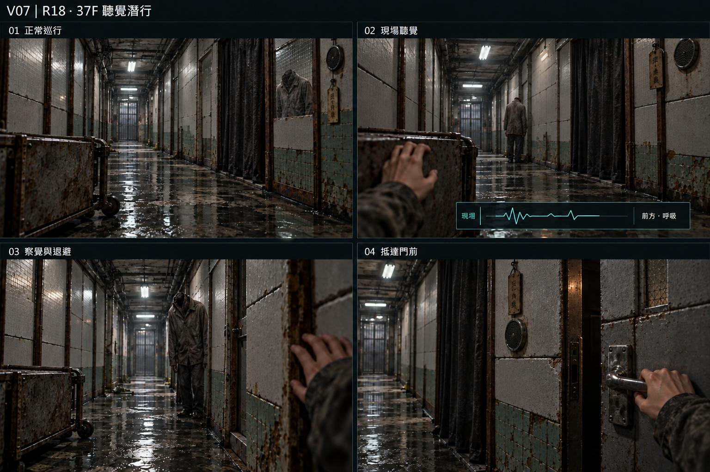

製作註記

**圖像形式：** 遊戲畫面模擬

**用途：** 第一人稱聽覺潛行畫面與精確對照

**功能作用：** 區分正常巡行、現場聽覺、補救退避與門前操作；N2 不作失敗復位點，抵達 N4 後仍手動開門。

**位置：** [R18](10-05_製作規格_第四幕.md#node-r18-spec)（B 棟 · 37F）

[原圖檔](../../assets/illustrations/gameplay/V07_gameplay_current.png)

### V07-RULES｜R18 聽覺潛行精確圖解

**類型：** 潛行、操作、介面 · [R18](10-05_製作規格_第四幕.md#node-r18-spec) · [製作規格](10-05_製作規格_第四幕.md#illustration-note-v07-rules)

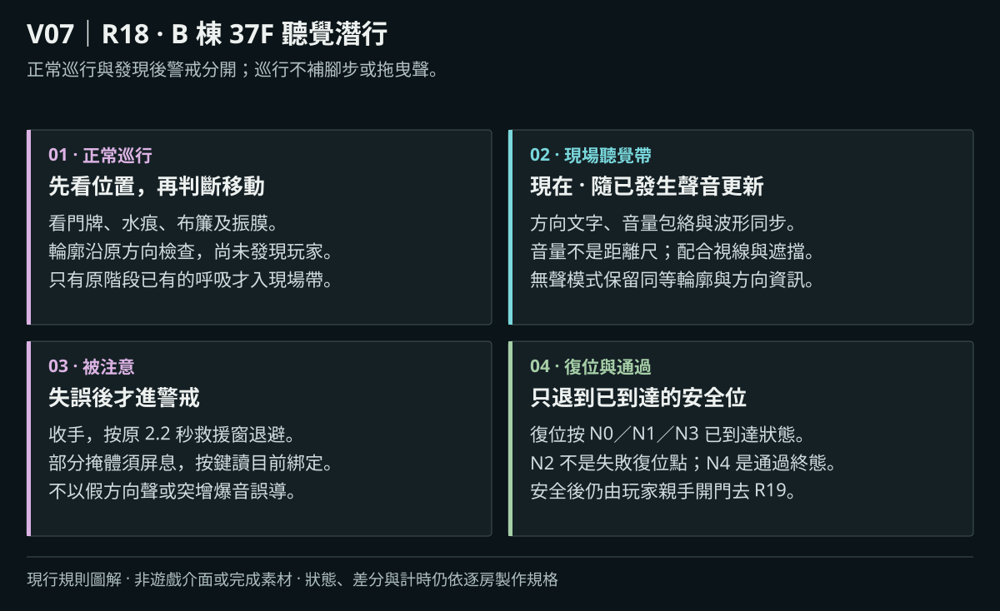

製作註記

**圖像形式：** 規則圖解

**用途：** 第一人稱聽覺潛行畫面與精確對照

**功能作用：** 區分正常巡行、現場聽覺、補救退避與門前操作；N2 不作失敗復位點，抵達 N4 後仍手動開門。

**位置：** [R18](10-05_製作規格_第四幕.md#node-r18-spec)（B 棟 · 37F）

[原圖檔](../../assets/illustrations/current/V07.svg)

### REF-GLASS｜R19／R20：玻璃定位片與維護表

**類型：** 解謎、操作 · [R19](10-05_製作規格_第四幕.md#node-r19-spec)、[R20](10-05_製作規格_第四幕.md#node-r20-spec) · [製作規格](10-05_製作規格_第四幕.md#illustration-note-ref-glass)

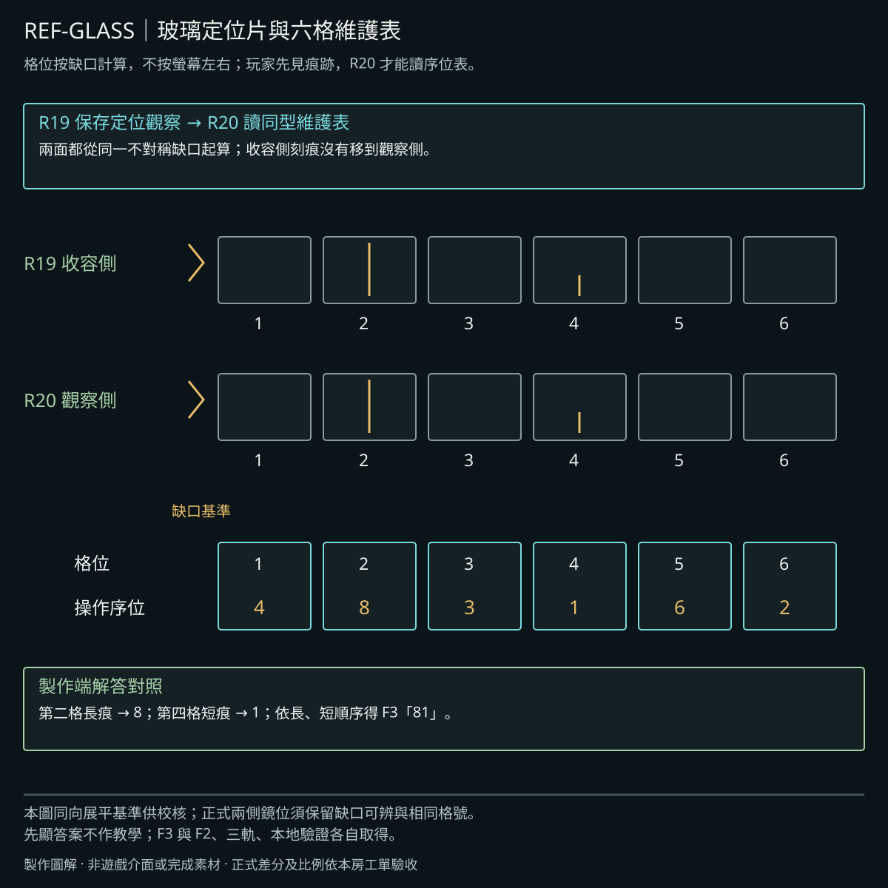

製作註記

**圖像形式：** 規則圖解

**用途：** 同缺口起算的刻痕與六格維護表

**功能作用：** 第二格長痕、第四格短痕按 4／8／3／1／6／2 對照得 81；R19 不提前顯答案。

**位置：** [R19](10-05_製作規格_第四幕.md#node-r19-spec)（B 棟 · 37F）、[R20](10-05_製作規格_第四幕.md#node-r20-spec)（B 棟 · 37F）

[原圖檔](../../assets/illustrations/current/REF-GLASS.svg)

### REF-PAPER｜R21：三份處置單與折頁 F4

**類型：** 解謎、操作 · [R21](10-05_製作規格_第四幕.md#node-r21-spec) · [製作規格](10-05_製作規格_第四幕.md#illustration-note-ref-paper)

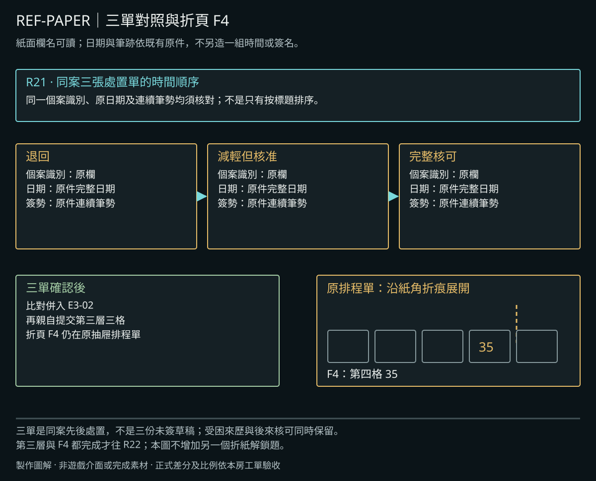

製作註記

**圖像形式：** 規則圖解

**用途：** 同案三單、本人換工請求與折頁 F4

**功能作用：** 小花換工申請與處理回覆併原三單／E3-02，分清本人願望與重排訓練；再另提交第三層、展原折頁取第四格 35，不新增三格槽。

**位置：** [R21](10-05_製作規格_第四幕.md#node-r21-spec)（B 棟 · 40F）

[原圖檔](../../assets/illustrations/current/REF-PAPER.svg)

### REF-UPPER-END｜R22：兩種釋放與同一出口

**類型：** 操作、流程總覽 · [R22](10-05_製作規格_第四幕.md#node-r22-spec)、[R23](10-06_製作規格_第五幕.md#node-r23-spec) · [製作規格](10-05_製作規格_第四幕.md#illustration-note-ref-upper-end)

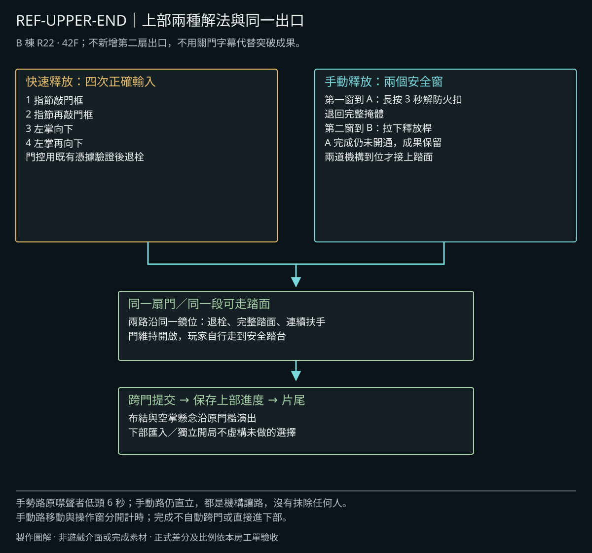

製作註記

**圖像形式：** 規則圖解

**用途：** 上部兩解、同一出口與跨門保存

**功能作用：** 四步手勢或兩窗機構通同一踏面，完成後仍自行跨門，兩路各自保留原後果。

**位置：** [R22](10-05_製作規格_第四幕.md#node-r22-spec)（B 棟 · 42F）、[R23](10-06_製作規格_第五幕.md#node-r23-spec)（B 棟 · 43F）

[原圖檔](../../assets/illustrations/current/REF-UPPER-END.svg)

### L05｜噤聲者三段操作

**類型：** 潛行、操作、解謎 · [R18](10-05_製作規格_第四幕.md#node-r18-spec)、[R19](10-05_製作規格_第四幕.md#node-r19-spec)、[R20](10-05_製作規格_第四幕.md#node-r20-spec) · [製作規格](10-05_製作規格_第四幕.md#illustration-note-l05)

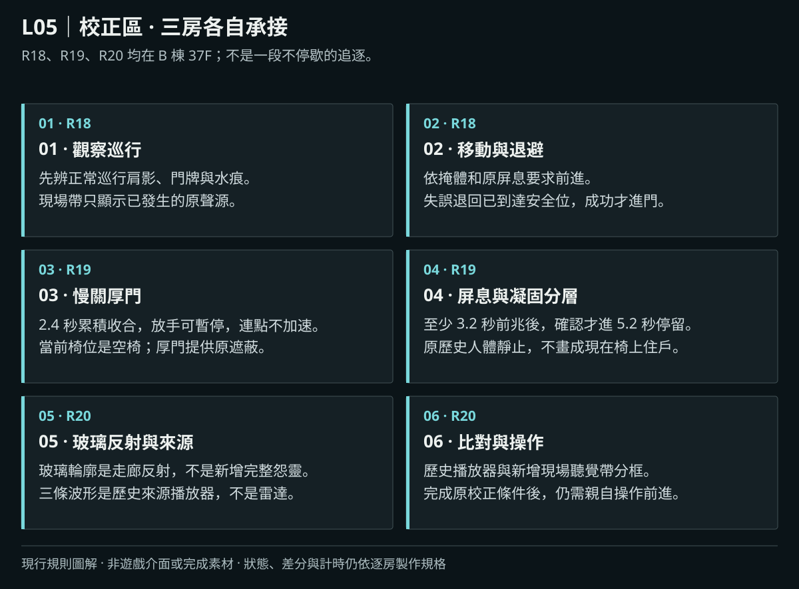

製作註記

**圖像形式：** 規則圖解

**用途：** 噤聲者三房遭遇流程

**功能作用：** 串起觀察巡行、退避、慢關門、屏息與來源校正；三房各自保存成果。

**位置：** [R18](10-05_製作規格_第四幕.md#node-r18-spec)（B 棟 · 37F）、[R19](10-05_製作規格_第四幕.md#node-r19-spec)（B 棟 · 37F）、[R20](10-05_製作規格_第四幕.md#node-r20-spec)（B 棟 · 37F）

[原圖檔](../../assets/illustrations/current/L05.svg)

### REF-SILENCER｜噤聲者：靜止、側耳與逼近

**類型：** 角色設定、潛行 · [R18](10-05_製作規格_第四幕.md#node-r18-spec)、[R19](10-05_製作規格_第四幕.md#node-r19-spec)、[R20](10-05_製作規格_第四幕.md#node-r20-spec)、[R22](10-05_製作規格_第四幕.md#node-r22-spec) · [製作規格](10-05_製作規格_第四幕.md#illustration-note-ref-silencer)

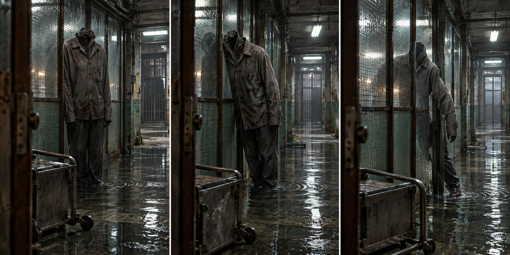

製作註記

**圖像形式：** 概念／構圖參考

**用途：** 噤聲者三姿態與玻璃薄片肩影

**功能作用：** 對照靜止、側耳及逼近；空衣領內折與水痕分流沿原巡行，不增加完整頭部或新攻擊。

**位置：** [R18](10-05_製作規格_第四幕.md#node-r18-spec)（B 棟 · 37F）、[R19](10-05_製作規格_第四幕.md#node-r19-spec)（B 棟 · 37F）、[R20](10-05_製作規格_第四幕.md#node-r20-spec)（B 棟 · 37F）、[R22](10-05_製作規格_第四幕.md#node-r22-spec)（B 棟 · 42F）

[原圖檔](../../assets/07_視聽與介面/assets/current_design/silencer_poses_current.png)

### REF-CALIBRATION｜校正三房：掩體與同片玻璃

**類型：** 潛行、場景配置 · [R18](10-05_製作規格_第四幕.md#node-r18-spec)、[R19](10-05_製作規格_第四幕.md#node-r19-spec)、[R20](10-05_製作規格_第四幕.md#node-r20-spec) · [製作規格](10-05_製作規格_第四幕.md#illustration-note-ref-calibration)

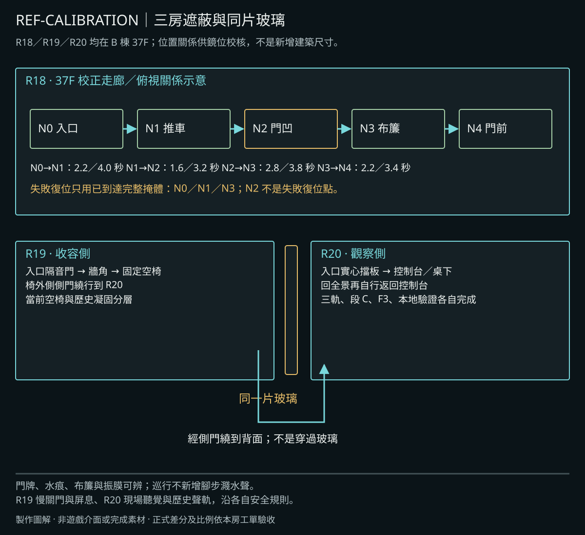

製作註記

**圖像形式：** 規則圖解

**用途：** 掩體順序、失敗復位與玻璃兩側關係

**功能作用：** N2 不作失敗復位點；R19 經原側門繞到 R20，三房威脅與查證成果分開保存。

**位置：** [R18](10-05_製作規格_第四幕.md#node-r18-spec)（B 棟 · 37F）、[R19](10-05_製作規格_第四幕.md#node-r19-spec)（B 棟 · 37F）、[R20](10-05_製作規格_第四幕.md#node-r20-spec)（B 棟 · 37F）

[原圖檔](../../assets/illustrations/current/REF-CALIBRATION.svg)

### V24｜上部末段：校正與突破

**類型：** 操作、解謎、流程總覽 · [R20](10-05_製作規格_第四幕.md#node-r20-spec)、[R21](10-05_製作規格_第四幕.md#node-r21-spec)、[R22](10-05_製作規格_第四幕.md#node-r22-spec) · [製作規格](10-05_製作規格_第四幕.md#illustration-note-v24)

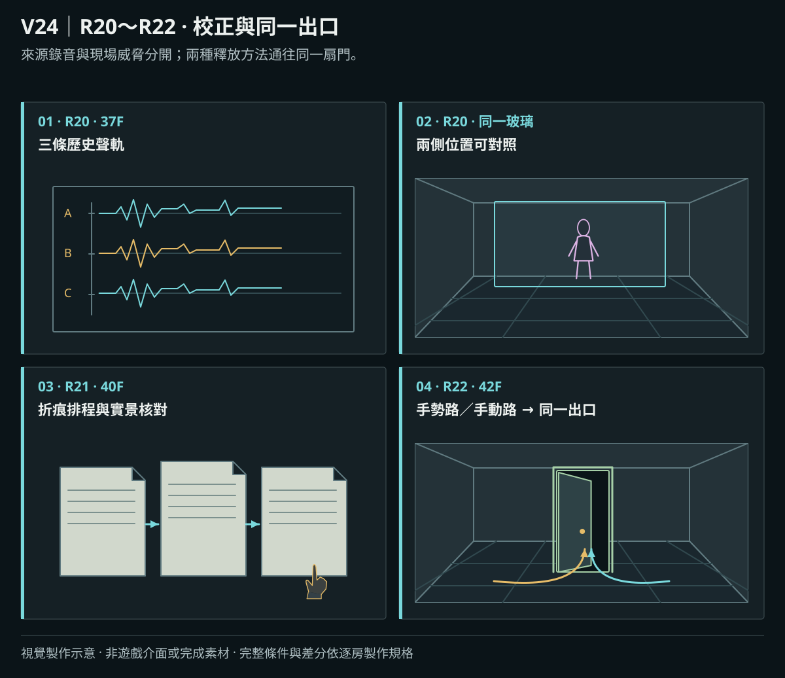

製作註記

**圖像形式：** 規則圖解

**用途：** 校正、排程與上部突破

**功能作用：** 歷史播放器與現場波形分開；R21 小花換工申請與處理回覆接原三單，退回處置不等於准調組。兩種釋放方法通同一出口，跨門只完成當部。

**位置：** [R20](10-05_製作規格_第四幕.md#node-r20-spec)（B 棟 · 37F）、[R21](10-05_製作規格_第四幕.md#node-r21-spec)（B 棟 · 40F）、[R22](10-05_製作規格_第四幕.md#node-r22-spec)（B 棟 · 42F）

[原圖檔](../../assets/illustrations/current/V24.svg)

### V29｜上下部承接與當部收尾

**類型：** 操作、劇情演出、流程總覽 · [R22](10-05_製作規格_第四幕.md#node-r22-spec)、[R23](10-06_製作規格_第五幕.md#node-r23-spec) · [製作規格](10-05_製作規格_第四幕.md#illustration-note-v29)

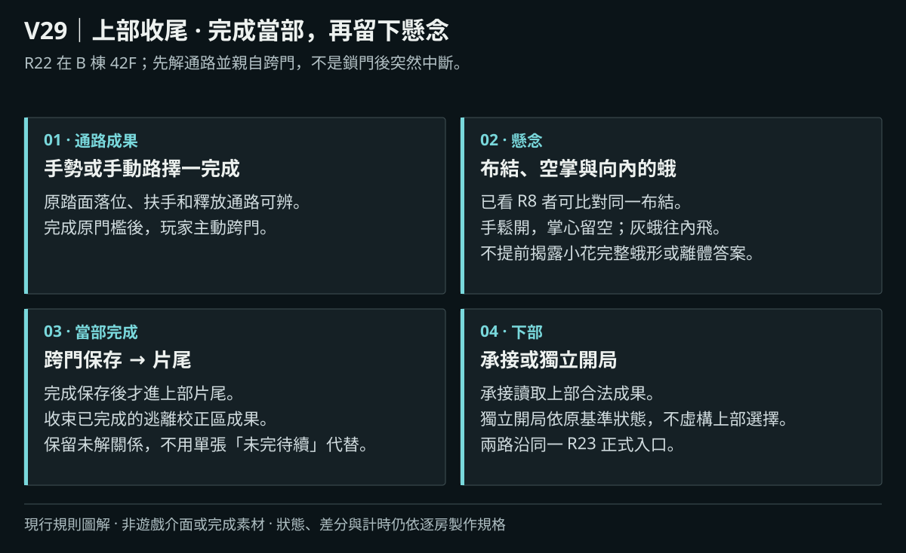

製作註記

**圖像形式：** 規則圖解

**用途：** 上部收尾及下部承接

**功能作用：** 四次手勢或雙鎖親手突破校正前段封鎖，另點布結懸念後跨門保存；R23 以已有關係疑問接原版本查證，獨立開局不虛構聽過門檻台詞。

**位置：** [R22](10-05_製作規格_第四幕.md#node-r22-spec)（B 棟 · 42F）、[R23](10-06_製作規格_第五幕.md#node-r23-spec)（B 棟 · 43F）

[原圖檔](../../assets/illustrations/current/V29.svg)

## 第五幕 · 我也是被逼的（7 張）

### REF-VERSIONS｜R23／R24：三版本與四人查證

**類型：** 解謎、操作 · [R23](10-06_製作規格_第五幕.md#node-r23-spec)、[R24](10-06_製作規格_第五幕.md#node-r24-spec) · [製作規格](10-06_製作規格_第五幕.md#illustration-note-ref-versions)

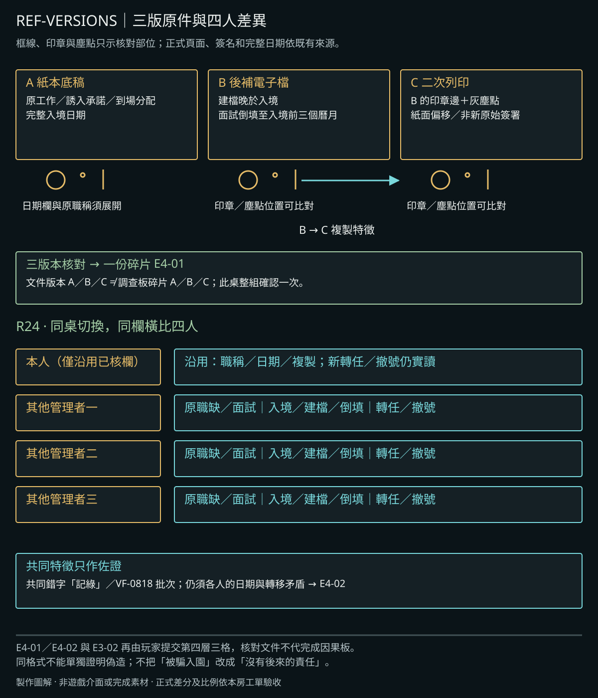

製作註記

**圖像形式：** 規則圖解

**用途：** 三版矛盾與四人同欄橫比

**功能作用：** R23 同區比三版，排除普通轉職；R24 同桌比四人，排除本人特例。本人沿用已核欄，新轉任／撤號仍實讀；原 E4-01／02 與三格提交保留。

**位置：** [R23](10-06_製作規格_第五幕.md#node-r23-spec)（B 棟 · 43F）、[R24](10-06_製作規格_第五幕.md#node-r24-spec)（B 棟 · 43F）

[原圖檔](../../assets/illustrations/current/REF-VERSIONS.svg)

### ACCESS-R25｜R25 出入口配置草圖

**類型：** 探索、場景配置 · [R25](10-06_製作規格_第五幕.md#node-r25-spec) · [製作規格](10-06_製作規格_第五幕.md#node-r25-access-layout)

製作註記

**圖像形式：** 出入口草圖

**用途：** 主場景出入口與視線配置草圖

**功能作用：** 對照入口、出口、回訪及封閉位置，協助製作門框、移動熱區與遮擋；實際通行仍依本房條件。

**位置：** [R25](10-06_製作規格_第五幕.md#node-r25-spec)（B 棟 · 44F）

[原圖檔](../../assets/scene_access/r25.svg)

### REF-TIME｜R25：三種時間尺度與廣播順序

**類型：** 解謎、操作、流程總覽 · [R25](10-06_製作規格_第五幕.md#node-r25-spec)、[R26](10-06_製作規格_第五幕.md#node-r26-spec) · [製作規格](10-06_製作規格_第五幕.md#illustration-note-ref-time)

製作註記

**圖像形式：** 規則圖解

**用途：** 七分鐘、十一秒、48 小時、F5 與廣播順序

**功能作用：** 歷史尺與獨立日期頁分開；09 保留前導零，A／B／C 本地開關仍由玩家手動切斷。

**位置：** [R25](10-06_製作規格_第五幕.md#node-r25-spec)（B 棟 · 44F）、[R26](10-06_製作規格_第五幕.md#node-r26-spec)（B 棟 · 44F）

[原圖檔](../../assets/illustrations/current/REF-TIME.svg)

### L06｜阿彪：壓掌與鉤臂的防禦

**類型：** 戰鬥／防禦、操作、解謎 · [R26](10-06_製作規格_第五幕.md#node-r26-spec) · [製作規格](10-06_製作規格_第五幕.md#illustration-note-l06)

製作註記

**圖像形式：** 規則圖解

**用途：** 阿彪攻防與停戰分界

**功能作用：** 壓掌退對側、鉤臂鬆柄；四來源齊備後停攻，三卡有效提交後才選拒絕或本地撤權。

**位置：** [R26](10-06_製作規格_第五幕.md#node-r26-spec)（B 棟 · 44F）

[原圖檔](../../assets/illustrations/current/L06.svg)

### REF-ABIAO｜阿彪領域：硬殼、反肘與兩種退場

**類型：** 角色設定、戰鬥／防禦、劇情演出 · [R26](10-06_製作規格_第五幕.md#node-r26-spec) · [製作規格](10-06_製作規格_第五幕.md#illustration-note-ref-abiao)

製作註記

**圖像形式：** 概念／構圖參考

**用途：** 阿彪雙層硬殼、反肘與領域退場

**功能作用：** 區分壓掌、牽柄、拒絕後仍在及抹除空框；完整臂連接依結構圖，不增加背部手臂。

**位置：** [R26](10-06_製作規格_第五幕.md#node-r26-spec)（B 棟 · 44F）

[原圖檔](../../assets/07_視聽與介面/assets/current_design/abiao_domain_current.png)

### V25｜下部開段：七分鐘與阿彪前置

**類型：** 解謎、操作、流程總覽 · [R23](10-06_製作規格_第五幕.md#node-r23-spec)、[R24](10-06_製作規格_第五幕.md#node-r24-spec)、[R25](10-06_製作規格_第五幕.md#node-r25-spec)、[R26](10-06_製作規格_第五幕.md#node-r26-spec)、[M1](10-07_製作規格_第六幕.md#node-m1-spec) · [製作規格](10-06_製作規格_第五幕.md#illustration-note-v25)

製作註記

**圖像形式：** 規則圖解

**用途：** 第五幕時間核對與離幕門檻

**功能作用：** 分開偽造文件、錄音、七分鐘、48 小時、F5、喇叭窗口與處置後返回控制點。

**位置：** [R23](10-06_製作規格_第五幕.md#node-r23-spec)（B 棟 · 43F）、[R24](10-06_製作規格_第五幕.md#node-r24-spec)（B 棟 · 43F）、[R25](10-06_製作規格_第五幕.md#node-r25-spec)（B 棟 · 44F）、[R26](10-06_製作規格_第五幕.md#node-r26-spec)（B 棟 · 44F）、[M1](10-07_製作規格_第六幕.md#node-m1-spec)（B 棟 · 44F → 45F）

[原圖檔](../../assets/illustrations/current/V25.svg)

### V12｜阿彪對峙與權限

**類型：** 戰鬥／防禦、解謎、操作 · [R26](10-06_製作規格_第五幕.md#node-r26-spec) · [製作規格](10-06_製作規格_第五幕.md#illustration-note-v12)

製作註記

**圖像形式：** 規則圖解

**用途：** 阿彪造型、原件舉證與權限處置

**功能作用：** 原單與較晚附件核引用編號、工號及日期，再接原三卡；四源停攻、三卡一次提交後才開兩路處置，拒絕不等於安息。選欄差分依原工單交付。

**位置：** [R26](10-06_製作規格_第五幕.md#node-r26-spec)（B 棟 · 44F）

[原圖檔](../../assets/illustrations/current/V12.svg)

## 第六幕 · 展示與暗巷（9 張）

### V39｜維修脊柱的七扇窗

**類型：** 探索、場景配置 · [M1](10-07_製作規格_第六幕.md#node-m1-spec) · [製作規格](10-07_製作規格_第六幕.md#illustration-note-v39)

製作註記

**圖像形式：** 概念／構圖參考

**用途：** 七窗維修夾道構圖

**功能作用：** 交代樓內 44F→45F 路線，3／5／7 窗有人影、其餘四窗空；近看選填不擋穿行。

**位置：** [M1](10-07_製作規格_第六幕.md#node-m1-spec)（B 棟 · 44F → 45F）

[原圖檔](../../assets/07_視聽與介面/assets/current_design/V39_current.png)

### ACCESS-U1｜U1 出入口配置草圖

**類型：** 探索、場景配置 · [U1](10-07_製作規格_第六幕.md#node-u1-spec) · [製作規格](10-07_製作規格_第六幕.md#node-u1-access-layout)

製作註記

**圖像形式：** 出入口草圖

**用途：** 主場景出入口與視線配置草圖

**功能作用：** 對照入口、出口、回訪及封閉位置，協助製作門框、移動熱區與遮擋；實際通行仍依本房條件。

**位置：** [U1](10-07_製作規格_第六幕.md#node-u1-spec)（B 棟 · 46F）

[原圖檔](../../assets/scene_access/u1.svg)

### REF-U1｜U1：三片管圖與實體端點

**類型：** 操作、解謎 · [U1](10-07_製作規格_第六幕.md#node-u1-spec)、[U2](10-07_製作規格_第六幕.md#node-u2-spec) · [製作規格](10-07_製作規格_第六幕.md#illustration-note-ref-u1)

製作註記

**圖像形式：** 規則圖解

**用途：** 三片管圖、三個實體端點與普通門閂

**功能作用：** 移架讀分租改管覆核籤，旋圖並核對上支封止、住戶支單橫刻與井側雙凹口短節，再手動退服務門插栓。形刻認管路，不按新門號；圖為操作摘要，原件全文依本房規格。

**位置：** [U1](10-07_製作規格_第六幕.md#node-u1-spec)（B 棟 · 46F）、[U2](10-07_製作規格_第六幕.md#node-u2-spec)（B 棟 · 46F）

[原圖檔](../../assets/illustrations/current/REF-U1.svg)

### REF-LAUNDRY｜U2／U2b：雙鏈與收架剖面

**類型：** 操作、解謎、場景配置 · [U2](10-07_製作規格_第六幕.md#node-u2-spec)、[U2b](10-07_製作規格_第六幕.md#node-u2b-spec)、[U3](10-07_製作規格_第六幕.md#node-u3-spec) · [製作規格](10-07_製作規格_第六幕.md#illustration-note-ref-laundry)

製作註記

**圖像形式：** 規則圖解

**用途：** 兩鏈、上層試動與橋下收架剖面

**功能作用：** 承重鏈與空轉鏈分開；下層兩段轉輪才清橋，凹位、短階及上橋側階各有用途。

**位置：** [U2](10-07_製作規格_第六幕.md#node-u2-spec)（B 棟 · 46F）、[U2b](10-07_製作規格_第六幕.md#node-u2b-spec)（B 棟 · 46F 橋下夾層）、[U3](10-07_製作規格_第六幕.md#node-u3-spec)（B 棟 · 46F）

[原圖檔](../../assets/illustrations/current/REF-LAUNDRY.svg)

### ACCESS-U3｜U3 出入口配置草圖

**類型：** 探索、場景配置 · [U3](10-07_製作規格_第六幕.md#node-u3-spec) · [製作規格](10-07_製作規格_第六幕.md#node-u3-access-layout)

製作註記

**圖像形式：** 出入口草圖

**用途：** 主場景出入口與視線配置草圖

**功能作用：** 對照入口、出口、回訪及封閉位置，協助製作門框、移動熱區與遮擋；實際通行仍依本房條件。

**位置：** [U3](10-07_製作規格_第六幕.md#node-u3-spec)（B 棟 · 46F）

[原圖檔](../../assets/scene_access/u3.svg)

### V26｜下部：別名、價格與證據邊界

**類型：** 探索、解謎 · [R27](10-07_製作規格_第六幕.md#node-r27-spec)、[R28](10-09_製作規格_第七幕.md#node-r28-spec)、[R31](10-10_製作規格_第八幕.md#node-r31-spec) · [製作規格](10-07_製作規格_第六幕.md#illustration-note-v26)

製作註記

**圖像形式：** 概念／構圖參考

**用途：** 別名、價目、傳聞與來源界線

**功能作用：** R27 私物退庫不代證人員獲釋；R28 求返卡對本地合同，不增加遠端頁。原三頁預覽分可保欄位與未知，結算分正文／已見摘要／雜湊，未開與逾時另列；未知去向與死因維持空白。局部差分依 D02／D03 工單。

**位置：** [R27](10-07_製作規格_第六幕.md#node-r27-spec)（B 棟 · 45F）、[R28](10-09_製作規格_第七幕.md#node-r28-spec)（B 棟 · 47F）、[R31](10-10_製作規格_第八幕.md#node-r31-spec)（B 棟 · 50F）

[原圖檔](../../assets/07_視聽與介面/assets/current_design/V26.png)

### L10｜生活夾層的解謎操作

**類型：** 操作、解謎、流程總覽 · [U1](10-07_製作規格_第六幕.md#node-u1-spec)、[U3](10-07_製作規格_第六幕.md#node-u3-spec)、[U4](10-09_製作規格_第七幕.md#node-u4-spec)、[U4b](10-09_製作規格_第七幕.md#node-u4b-spec)、[U6](10-10_製作規格_第八幕.md#node-u6-spec)、[U6b](10-10_製作規格_第八幕.md#node-u6b-spec) · [製作規格](10-07_製作規格_第六幕.md#illustration-note-l10)

製作註記

**圖像形式：** 規則圖解

**用途：** 生活夾層機關操作摘要

**功能作用：** U1 讀覆核籤核形刻後退栓；U3 配罩／調燈前後皆可讀校驗牌，拉桿前須實讀、核雙記並對栓；U4 回返後讀解扣片、核外扣支撐，下降才核內銷。平水與扣栓另依本房操作；原件全文依逐房規格。

**位置：** [U1](10-07_製作規格_第六幕.md#node-u1-spec)（B 棟 · 46F）、[U3](10-07_製作規格_第六幕.md#node-u3-spec)（B 棟 · 46F）、[U4](10-09_製作規格_第七幕.md#node-u4-spec)（B 棟 · 48F）、[U4b](10-09_製作規格_第七幕.md#node-u4b-spec)（B 棟 · 48F 檢修蓋下夾層）、[U6](10-10_製作規格_第八幕.md#node-u6-spec)（B 棟 · 49F）、[U6b](10-10_製作規格_第八幕.md#node-u6b-spec)（B 棟 · 49F 水箱下夾層）

[原圖檔](../../assets/illustrations/current/L10.svg)

### V30｜下部生活區、移動與主角回憶

**類型：** 操作、解謎、流程總覽 · [U1](10-07_製作規格_第六幕.md#node-u1-spec)、[U2](10-07_製作規格_第六幕.md#node-u2-spec)、[U2b](10-07_製作規格_第六幕.md#node-u2b-spec)、[U3](10-07_製作規格_第六幕.md#node-u3-spec)、[U4](10-09_製作規格_第七幕.md#node-u4-spec) · [製作規格](10-07_製作規格_第六幕.md#illustration-note-v30)

製作註記

**圖像形式：** 規則圖解

**用途：** 生活區操作與跨層領域概覽

**功能作用：** U1 讀分租改管覆核籤核端點後退栓；U3 配罩／調燈前後皆可讀檢修校驗牌，拉桿前須實讀並核固定／動栓雙記；U4 經 L2 到 48F，三地標核實回返後才讀解扣片核外扣。圖為摘要，原件全文依本房規格。

**位置：** [U1](10-07_製作規格_第六幕.md#node-u1-spec)（B 棟 · 46F）、[U2](10-07_製作規格_第六幕.md#node-u2-spec)（B 棟 · 46F）、[U2b](10-07_製作規格_第六幕.md#node-u2b-spec)（B 棟 · 46F 橋下夾層）、[U3](10-07_製作規格_第六幕.md#node-u3-spec)（B 棟 · 46F）、[U4](10-09_製作規格_第七幕.md#node-u4-spec)（B 棟 · 48F）

[原圖檔](../../assets/illustrations/current/V30.svg)

### V35｜下部未明怨影與操作窗

**類型：** 操作、戰鬥／防禦 · [U2b](10-07_製作規格_第六幕.md#node-u2b-spec)、[U5](10-09_製作規格_第七幕.md#node-u5-spec) · [製作規格](10-07_製作規格_第六幕.md#illustration-note-v35)

製作註記

**圖像形式：** 概念／構圖參考

**用途：** 未明怨影兩組操作窗口

**功能作用：** 洗衣橋下沿原窗口；U5 首次確認開始前讀封板與維修口配置銘片，核兩側獨立止點與軌外維修口，再主動開拍、擋來向並另拉同側落板，雙側封實才完成。圖為摘要，戰中只核當側拉柄／止點；原件全文依本房規格安全閱讀。

**位置：** [U2b](10-07_製作規格_第六幕.md#node-u2b-spec)（B 棟 · 46F 橋下夾層）、[U5](10-09_製作規格_第七幕.md#node-u5-spec)（B 棟 · 48F）

[原圖檔](../../assets/07_視聽與介面/assets/current_design/V35.png)

## 第七幕 · 簽名與回返（5 張）

### REF-SUITES｜47F 主管生活翼：三房與獨立衛浴

**類型：** 探索、場景配置 · [R29](10-09_製作規格_第七幕.md#node-r29-spec) · [製作規格](10-09_製作規格_第七幕.md#illustration-note-ref-suites)

製作註記

**圖像形式：** 概念／構圖參考

**用途：** 47F 三間主管套房與各自衛浴

**功能作用：** 七格環境依序為走廊、三組房間／衛浴，第八格為原熱水桶細節；生活待遇不增加自由或對外聯絡權限。

**位置：** [R29](10-09_製作規格_第七幕.md#node-r29-spec)（B 棟 · 47F）

[原圖檔](../../assets/07_視聽與介面/assets/current_design/manager_suites_current.png)

### REF-U4｜U4 同鏡位回返與檢修蓋材質參考

**類型：** 探索、操作、解謎 · [U4](10-09_製作規格_第七幕.md#node-u4-spec)、[U4b](10-09_製作規格_第七幕.md#node-u4b-spec) · [製作規格](10-09_製作規格_第七幕.md#illustration-note-ref-u4)

製作註記

**圖像形式：** 概念／構圖參考

**用途：** 鬼打牆同鏡位與蓋下去路

**功能作用：** 三組地標核實一次回返後，讀檢修蓋解扣銘片、核外扣滑槽與支撐止點，再掀蓋固定；下降才實查內銷、手動開閘。領域仍在，零留光槽可完成；圖為摘要，原件全文依本房規格。

**位置：** [U4](10-09_製作規格_第七幕.md#node-u4-spec)（B 棟 · 48F）、[U4b](10-09_製作規格_第七幕.md#node-u4b-spec)（B 棟 · 48F 檢修蓋下夾層）

[原圖檔](../../assets/07_視聽與介面/assets/current_design/domain_u4_current.png)

### REF-U4-RULES｜U4 地標核對與手動繞道操作圖

**類型：** 探索、操作、解謎 · [U4](10-09_製作規格_第七幕.md#node-u4-spec)、[U4b](10-09_製作規格_第七幕.md#node-u4b-spec) · [製作規格](10-09_製作規格_第七幕.md#illustration-note-ref-u4-rules)

製作註記

**圖像形式：** 規則圖解

**用途：** 鬼打牆同鏡位與蓋下去路

**功能作用：** 三組地標核實一次回返後，讀檢修蓋解扣銘片、核外扣滑槽與支撐止點，再掀蓋固定；下降才實查內銷、手動開閘。領域仍在，零留光槽可完成；圖為摘要，原件全文依本房規格。

**位置：** [U4](10-09_製作規格_第七幕.md#node-u4-spec)（B 棟 · 48F）、[U4b](10-09_製作規格_第七幕.md#node-u4b-spec)（B 棟 · 48F 檢修蓋下夾層）

[原圖檔](../../assets/illustrations/current/REF-U4.svg)

### L07｜簽核、制動與真相停頓

**類型：** 操作、解謎、流程總覽 · [R29](10-09_製作規格_第七幕.md#node-r29-spec)、[U4](10-09_製作規格_第七幕.md#node-u4-spec)、[U4b](10-09_製作規格_第七幕.md#node-u4b-spec)、[U5](10-09_製作規格_第七幕.md#node-u5-spec)、[U6](10-10_製作規格_第八幕.md#node-u6-spec)、[U6b](10-10_製作規格_第八幕.md#node-u6b-spec)、[R30](10-10_製作規格_第八幕.md#node-r30-spec)、[R31](10-10_製作規格_第八幕.md#node-r31-spec) · [製作規格](10-09_製作規格_第七幕.md#illustration-note-l07)

製作註記

**圖像形式：** 規則圖解

**用途：** 第七、八幕責任與繞道流程

**功能作用：** 責任停頓與 L2 之後，回返核實才讀解扣銘片、核外扣支撐，開蓋下降後核內銷；U5 首次確認開始前讀配置銘片、核兩側止點及維修口，再擋板封側。續接 49F 配重制動、50F 掛載與唯一歷史解凍；圖為操作摘要，原件全文依本房規格。

**位置：** [R29](10-09_製作規格_第七幕.md#node-r29-spec)（B 棟 · 47F）、[U4](10-09_製作規格_第七幕.md#node-u4-spec)（B 棟 · 48F）、[U4b](10-09_製作規格_第七幕.md#node-u4b-spec)（B 棟 · 48F 檢修蓋下夾層）、[U5](10-09_製作規格_第七幕.md#node-u5-spec)（B 棟 · 48F）、[U6](10-10_製作規格_第八幕.md#node-u6-spec)（B 棟 · 49F）、[U6b](10-10_製作規格_第八幕.md#node-u6b-spec)（B 棟 · 49F 水箱下夾層）、[R30](10-10_製作規格_第八幕.md#node-r30-spec)（B 棟 · 49F）、[R31](10-10_製作規格_第八幕.md#node-r31-spec)（B 棟 · 50F）

[原圖檔](../../assets/illustrations/current/L07.svg)

### V27｜下部：簽名、震損與制動

**類型：** 操作、解謎、流程總覽 · [R29](10-09_製作規格_第七幕.md#node-r29-spec)、[R30](10-10_製作規格_第八幕.md#node-r30-spec)、[R31](10-10_製作規格_第八幕.md#node-r31-spec) · [製作規格](10-09_製作規格_第七幕.md#illustration-note-v27)

製作註記

**圖像形式：** 規則圖解

**用途：** 簽名責任、震損與制動剖面

**功能作用：** R29 返家陳述與提價附欄併原跨月核對，保存後才責任停頓；區分過去公共動線與現在維修脊柱，沉降後手動制動。

**位置：** [R29](10-09_製作規格_第七幕.md#node-r29-spec)（B 棟 · 47F）、[R30](10-10_製作規格_第八幕.md#node-r30-spec)（B 棟 · 49F）、[R31](10-10_製作規格_第八幕.md#node-r31-spec)（B 棟 · 50F）

[原圖檔](../../assets/07_視聽與介面/assets/current_design/V27_damage_routes.svg)

## 第八幕 · 最後一道門（8 張）

### ACCESS-U6｜U6 出入口配置草圖

**類型：** 探索、場景配置 · [U6](10-10_製作規格_第八幕.md#node-u6-spec) · [製作規格](10-10_製作規格_第八幕.md#node-u6-access-layout)

製作註記

**圖像形式：** 出入口草圖

**用途：** 主場景出入口與視線配置草圖

**功能作用：** 對照入口、出口、回訪及封閉位置，協助製作門框、移動熱區與遮擋；實際通行仍依本房條件。

**位置：** [U6](10-10_製作規格_第八幕.md#node-u6-spec)（B 棟 · 49F）

[原圖檔](../../assets/scene_access/u6.svg)

### ACCESS-U6b｜U6b 出入口配置草圖

**類型：** 探索、場景配置 · [U6b](10-10_製作規格_第八幕.md#node-u6b-spec) · [製作規格](10-10_製作規格_第八幕.md#node-u6b-access-layout)

製作註記

**圖像形式：** 出入口草圖

**用途：** 主場景出入口與視線配置草圖

**功能作用：** 對照入口、出口、回訪及封閉位置，協助製作門框、移動熱區與遮擋；實際通行仍依本房條件。

**位置：** [U6b](10-10_製作規格_第八幕.md#node-u6b-spec)（B 棟 · 49F 水箱下夾層）

[原圖檔](../../assets/scene_access/u6b.svg)

### REF-BRAKE｜R30：沉降、三輛空車與手動制動

**類型：** 操作、劇情演出、場景配置 · [R30](10-10_製作規格_第八幕.md#node-r30-spec)、[R31](10-10_製作規格_第八幕.md#node-r31-spec) · [製作規格](10-10_製作規格_第八幕.md#illustration-note-ref-brake)

製作註記

**圖像形式：** 概念／構圖參考

**用途：** 沉降、三空車與手動制動分鏡

**功能作用：** 空車導軌與固定維修籠分開；棘爪扣妥才封後梯，玩家自行循短梯到 R31。

**位置：** [R30](10-10_製作規格_第八幕.md#node-r30-spec)（B 棟 · 49F）、[R31](10-10_製作規格_第八幕.md#node-r31-spec)（B 棟 · 50F）；次場景：[R30-V02](10-10_製作規格_第八幕.md#subscene-r30-v02-spec)（B 棟 · 49F → 50F）

[原圖檔](../../assets/07_視聽與介面/assets/current_design/brake_storyboard_current.png)

### REF-BRAKE-RULES｜R30：沉降、三輛空車與手動制動：精確圖解

**類型：** 操作、劇情演出、場景配置 · [R30](10-10_製作規格_第八幕.md#node-r30-spec)、[R31](10-10_製作規格_第八幕.md#node-r31-spec) · [製作規格](10-10_製作規格_第八幕.md#illustration-note-ref-brake-rules)

製作註記

**圖像形式：** 規則圖解

**用途：** 沉降、三空車與手動制動分鏡

**功能作用：** 空車導軌與固定維修籠分開；棘爪扣妥才封後梯，玩家自行循短梯到 R31。

**位置：** [R30](10-10_製作規格_第八幕.md#node-r30-spec)（B 棟 · 49F）、[R31](10-10_製作規格_第八幕.md#node-r31-spec)（B 棟 · 50F）；次場景：[R30-V02](10-10_製作規格_第八幕.md#subscene-r30-v02-spec)（B 棟 · 49F → 50F）

[原圖檔](../../assets/illustrations/current/REF-BRAKE.svg)

### V28｜下部：鑑識、逃生記錄與冷備份

**類型：** 探索、解謎、操作 · [R31](10-10_製作規格_第八幕.md#node-r31-spec) · [製作規格](10-10_製作規格_第八幕.md#illustration-note-v28)

製作註記

**圖像形式：** 概念／構圖參考

**用途：** 現場鑑識、逃生記錄與冷備份

**功能作用：** 核對當晚來源與本地可讀狀態，硬碟留抗震座重新掛載，讀取不算外送。

**位置：** [R31](10-10_製作規格_第八幕.md#node-r31-spec)（B 棟 · 50F）

[原圖檔](../../assets/07_視聽與介面/assets/current_design/V28.png)

### REF-THAW｜R31：十二秒解凍八拍分鏡

**類型：** 劇情演出 · [R31](10-10_製作規格_第八幕.md#node-r31-spec) · [製作規格](10-10_製作規格_第八幕.md#illustration-note-ref-thaw)

製作註記

**圖像形式：** 概念／構圖參考

**用途：** 唯一十二秒歷史解凍的八拍分鏡

**功能作用：** 按原時段呈現核可、離框、持續觀看、關畫面及自我重合；動畫與等價摘要沿同一完成結果。

**位置：** [R31](10-10_製作規格_第八幕.md#node-r31-spec)（B 棟 · 50F）

[原圖檔](../../assets/07_視聽與介面/assets/current_design/thaw_storyboard_current.png)

### REF-THAW-RULES｜R31：十二秒解凍八拍分鏡：精確圖解

**類型：** 劇情演出 · [R31](10-10_製作規格_第八幕.md#node-r31-spec) · [製作規格](10-10_製作規格_第八幕.md#illustration-note-ref-thaw-rules)

製作註記

**圖像形式：** 規則圖解

**用途：** 唯一十二秒歷史解凍的八拍分鏡

**功能作用：** 按原時段呈現核可、離框、持續觀看、關畫面及自我重合；動畫與等價摘要沿同一完成結果。

**位置：** [R31](10-10_製作規格_第八幕.md#node-r31-spec)（B 棟 · 50F）

[原圖檔](../../assets/illustrations/current/REF-THAW.svg)

### V36｜下部服務夾道與配重水箱

**類型：** 操作、解謎 · [U4b](10-09_製作規格_第七幕.md#node-u4b-spec)、[U6](10-10_製作規格_第八幕.md#node-u6-spec)、[U6b](10-10_製作規格_第八幕.md#node-u6b-spec) · [製作規格](10-10_製作規格_第八幕.md#illustration-note-v36)

製作註記

**圖像形式：** 概念／構圖參考

**用途：** 蓋下內銷、平水與踏面固定

**功能作用：** 承接 U4 已讀檢修蓋解扣銘片及外扣支撐核對，下降到 U4b 才親見內銷、抽銷開閘並確認踏台；U6 平水關閥、U6b 核水平扣栓另作。圖為操作摘要，原件全文依本房規格。

**位置：** [U4b](10-09_製作規格_第七幕.md#node-u4b-spec)（B 棟 · 48F 檢修蓋下夾層）、[U6](10-10_製作規格_第八幕.md#node-u6-spec)（B 棟 · 49F）、[U6b](10-10_製作規格_第八幕.md#node-u6b-spec)（B 棟 · 49F 水箱下夾層）

[原圖檔](../../assets/07_視聽與介面/assets/current_design/V36.png)

## 終幕 · 頂層的地板（7 張）

### V13｜終幕揭露與室內囚禁

**類型：** 劇情演出、探索、解謎 · [R32](10-08_製作規格_終幕.md#node-r32-spec)、[P1](10-01_製作規格_序幕.md#node-p1-spec) · [製作規格](10-08_製作規格_終幕.md#illustration-note-v13)

製作註記

**圖像形式：** 概念／構圖參考

**用途：** 肉身揭露與封鎖三源分鏡

**功能作用：** 先核 P1 連續影像與肉身，再核封鎖來源，之後才顯室內巨翼與四鬚。

**位置：** [R32](10-08_製作規格_終幕.md#node-r32-spec)（B 棟 · 50F）、[P1](10-01_製作規格_序幕.md#node-p1-spec)（共用地基 · B3）

[原圖檔](../../assets/07_視聽與介面/assets/current_design/V13_current.png)

### ART02｜庇護與封閉的顯示界線

**類型：** 劇情演出、角色設定 · [R32](10-08_製作規格_終幕.md#node-r32-spec) · [製作規格](10-08_製作規格_終幕.md#illustration-note-art02)

製作註記

**圖像形式：** 規則圖解

**用途：** 小花庇護轉封閉的顯示分級

**功能作用：** 先人形局部、三源核對後才室內翼拱與四鬚，再依已提交結局收束。

**位置：** [R32](10-08_製作規格_終幕.md#node-r32-spec)（B 棟 · 50F）

[原圖檔](../../assets/illustrations/current/ART02.svg)

### V38｜小花三拍防禦

**類型：** 戰鬥／防禦、操作、流程總覽 · [R32](10-08_製作規格_終幕.md#node-r32-spec) · [製作規格](10-08_製作規格_終幕.md#illustration-note-v38)

製作註記

**圖像形式：** 規則圖解

**用途：** 小花三拍防禦與停戰流程

**功能作用：** 先安全觀察再主動開拍，失敗只重試當拍；防禦完成不等於解除封鎖。

**位置：** [R32](10-08_製作規格_終幕.md#node-r32-spec)（B 棟 · 50F）

[原圖檔](../../assets/illustrations/current/V38.svg)

### V14｜結局行動：留下名字與鬆手

**類型：** 操作、劇情演出、流程總覽 · [R32](10-08_製作規格_終幕.md#node-r32-spec)、[R33](10-08_製作規格_終幕.md#node-r33-spec)、[P1](10-01_製作規格_序幕.md#node-p1-spec) · [製作規格](10-08_製作規格_終幕.md#illustration-note-v14)

製作註記

**圖像形式：** 概念／構圖參考

**用途：** A／B／C 關係行動與回返構圖

**功能作用：** 區分完整公開、刪修副本及搭紙鬆手，再以時間切換接室內救援與照護。原預覽回查 R28 保存位置／待調取，當地快取不憑筆記變成外送全文；局部差分依原工單。

**位置：** [R32](10-08_製作規格_終幕.md#node-r32-spec)（B 棟 · 50F）、[R33](10-08_製作規格_終幕.md#node-r33-spec)（分支演出 · 50F／B3（分支演出））、[P1](10-01_製作規格_序幕.md#node-p1-spec)（共用地基 · B3）

[原圖檔](../../assets/07_視聽與介面/assets/current_design/V14_current.png)

### V15｜結局行動：留下與重演簽核

**類型：** 操作、劇情演出、流程總覽 · [R32](10-08_製作規格_終幕.md#node-r32-spec)、[R33](10-08_製作規格_終幕.md#node-r33-spec)、[P1](10-01_製作規格_序幕.md#node-p1-spec) · [製作規格](10-08_製作規格_終幕.md#illustration-note-v15)

製作註記

**圖像形式：** 規則圖解

**用途：** D／E 提交前後與不可逆後果

**功能作用：** D 四秒確認後留下；E 本地錨點核可後抹除並回返，預覽與閒置都不算提交。

**位置：** [R32](10-08_製作規格_終幕.md#node-r32-spec)（B 棟 · 50F）、[R33](10-08_製作規格_終幕.md#node-r33-spec)（分支演出 · 50F／B3（分支演出））、[P1](10-01_製作規格_序幕.md#node-p1-spec)（共用地基 · B3）

[原圖檔](../../assets/illustrations/current/V15.svg)

### L09｜五種人物後果

**類型：** 劇情演出、流程總覽 · [R32](10-08_製作規格_終幕.md#node-r32-spec)、[R33](10-08_製作規格_終幕.md#node-r33-spec)、[P1](10-01_製作規格_序幕.md#node-p1-spec) · [製作規格](10-08_製作規格_終幕.md#illustration-note-l09)

製作註記

**圖像形式：** 規則圖解

**用途：** 五種已提交分支的片尾對照

**功能作用：** 區分承擔、隱瞞、鬆手、留下與空位；回返用時間切換，D 肉身仍存活。

**位置：** [R32](10-08_製作規格_終幕.md#node-r32-spec)（B 棟 · 50F）、[R33](10-08_製作規格_終幕.md#node-r33-spec)（分支演出 · 50F／B3（分支演出））、[P1](10-01_製作規格_序幕.md#node-p1-spec)（共用地基 · B3）

[原圖檔](../../assets/illustrations/current/L09.svg)

### L08｜小花三拍：掃線、抱繭與真假地標

**類型：** 戰鬥／防禦、操作 · [R32](10-08_製作規格_終幕.md#node-r32-spec) · [製作規格](10-08_製作規格_終幕.md#illustration-note-l08)

製作註記

**圖像形式：** 規則圖解

**用途：** 小花三拍前兆與固定避位

**功能作用：** 掃線到桌下、抱繭退門線、灰粉核真壁龕；地標不因領域特效移動。

**位置：** [R32](10-08_製作規格_終幕.md#node-r32-spec)（B 棟 · 50F）

[原圖檔](../../assets/illustrations/current/L08.svg)

## 跨幕共用（26 張）

### V02｜筆記本、來源與路徑

**類型：** 介面、探索 · 跨幕共用 · [製作規格](10-01_製作規格_序幕.md#illustration-note-v02)

製作註記

**圖像形式：** 規則圖解

**用途：** 筆記本、來源分類與路徑介面

**功能作用：** 區分物證、聲證、影證、文證，保存已知來源與路線，不提供遠端播放或全知地圖。

**位置：** 跨幕共用（無單一場景）

[原圖檔](../../assets/illustrations/current/V02.svg)

### V03｜紙本關聯與推理回饋

**類型：** 介面、解謎、操作 · 跨幕共用 · [R5](10-02_製作規格_第一幕.md#node-r5-spec) · [製作規格](10-02_製作規格_第一幕.md#illustration-note-v03)

製作註記

**圖像形式：** 概念／構圖參考

**用途：** 紙本推理與返回查證的介面示例

**功能作用：** 呈現來源、時序與手動關聯；必要集合依各房，不把資訊分組誤當四種碎片。

**位置：** 跨幕共用；對照場景：[R5](10-02_製作規格_第一幕.md#node-r5-spec)（A 棟 · 8F）

[原圖檔](../../assets/07_視聽與介面/assets/current_design/V03.png)

### V05｜穩定與恐慌

**類型：** 介面、操作 · 跨幕共用 · [R5](10-02_製作規格_第一幕.md#node-r5-spec) · [製作規格](10-02_製作規格_第一幕.md#illustration-note-v05)

製作註記

**圖像形式：** 概念／構圖參考

**用途：** 穩定、恐慌與安定角落

**功能作用：** 對照資源狀態、已使用與零穩定保底；選用安定不變成離幕門檻。

**位置：** 跨幕共用；對照場景：[R5](10-02_製作規格_第一幕.md#node-r5-spec)（A 棟 · 8F）

[原圖檔](../../assets/07_視聽與介面/assets/current_design/V05.png)

### V37｜解謎獎賞：捷徑、歌曲與回憶

**類型：** 探索、操作、解謎 · 跨幕共用 · [R9](10-03_製作規格_第二幕.md#node-r9-spec)、[R12](10-04_製作規格_第三幕.md#node-r12-spec)、[U4](10-09_製作規格_第七幕.md#node-u4-spec)、[U6](10-10_製作規格_第八幕.md#node-u6-spec) · [製作規格](10-03_製作規格_第二幕.md#illustration-note-v37)

製作註記

**圖像形式：** 概念／構圖參考

**用途：** 捷徑、歌曲與回憶的選填獎賞

**功能作用：** 分開 SQ-T／SQ-S／SQ-R；MR-01 在 U4、MR-02 在 U6，原始專案重排與服務口操作不新增主線門票。

**位置：** 跨幕共用；對照場景：[R9](10-03_製作規格_第二幕.md#node-r9-spec)（B 棟 · 15F）、[R12](10-04_製作規格_第三幕.md#node-r12-spec)（A 棟 · 23F）、[U4](10-09_製作規格_第七幕.md#node-u4-spec)（B 棟 · 48F）、[U6](10-10_製作規格_第八幕.md#node-u6-spec)（B 棟 · 49F）

[原圖檔](../../assets/07_視聽與介面/assets/current_design/V37.png)

### REF-BRIDGES｜24–26F：四條分岔跨棟路

**類型：** 探索、場景配置 · 跨幕共用 · [R12](10-04_製作規格_第三幕.md#node-r12-spec)、[R13](10-04_製作規格_第三幕.md#node-r13-spec)、[R14](10-04_製作規格_第三幕.md#node-r14-spec)、[R15](10-04_製作規格_第三幕.md#node-r15-spec) · [製作規格](10-04_製作規格_第三幕.md#illustration-note-ref-bridges)

製作註記

**圖像形式：** 規則圖解

**用途：** 四條分岔路的單層平台與跨棟落點

**功能作用：** 各路於 26F 同層 A→B；不同列不互接，通行、回訪與門端驗證仍依原房規格。

**位置：** 跨幕共用；對照場景：[R12](10-04_製作規格_第三幕.md#node-r12-spec)（A 棟 · 23F）、[R13](10-04_製作規格_第三幕.md#node-r13-spec)（A 棟 · 23F）、[R14](10-04_製作規格_第三幕.md#node-r14-spec)（B 棟 · 27F）、[R15](10-04_製作規格_第三幕.md#node-r15-spec)（B 棟 · 27F）；次場景：[T-R12-R14-01](10-04_製作規格_第三幕.md#subscene-t-r12-r14-01-spec)（A 棟 · 24F）、[T-R12-R14-02](10-04_製作規格_第三幕.md#subscene-t-r12-r14-02-spec)（A 棟 · 25F）、[T-R12-R14-03](10-04_製作規格_第三幕.md#subscene-t-r12-r14-03-spec)（A 棟 → B 棟 · 26F）、[T-R13-R14-01](10-04_製作規格_第三幕.md#subscene-t-r13-r14-01-spec)（A 棟 · 24F）、[T-R13-R14-02](10-04_製作規格_第三幕.md#subscene-t-r13-r14-02-spec)（A 棟 · 25F）、[T-R13-R14-03](10-04_製作規格_第三幕.md#subscene-t-r13-r14-03-spec)（A 棟 → B 棟 · 26F）、[T-R13-R15-01](10-04_製作規格_第三幕.md#subscene-t-r13-r15-01-spec)（A 棟 · 24F）、[T-R13-R15-02](10-04_製作規格_第三幕.md#subscene-t-r13-r15-02-spec)（A 棟 · 25F）、[T-R13-R15-03](10-04_製作規格_第三幕.md#subscene-t-r13-r15-03-spec)（A 棟 → B 棟 · 26F）、[T-R12-R15-01](10-04_製作規格_第三幕.md#subscene-t-r12-r15-01-spec)（A 棟 · 24F）、[T-R12-R15-02](10-04_製作規格_第三幕.md#subscene-t-r12-r15-02-spec)（A 棟 · 25F）、[T-R12-R15-03](10-04_製作規格_第三幕.md#subscene-t-r12-r15-03-spec)（A 棟 → B 棟 · 26F）

[原圖檔](../../assets/illustrations/current/REF-BRIDGES.svg)

### V04｜人物與特殊推理頁

**類型：** 介面、解謎 · 跨幕共用 · [R16](10-04_製作規格_第三幕.md#node-r16-spec)、[R17](10-04_製作規格_第三幕.md#node-r17-spec) · [製作規格](10-04_製作規格_第三幕.md#illustration-note-v04)

製作註記

**圖像形式：** 概念／構圖參考

**用途：** 人物頁與特殊推理軌位

**功能作用：** 區分已知、未知及依進度追加的欄位，保留責任推理與身分揭露的時機。

**位置：** 跨幕共用；對照場景：[R16](10-04_製作規格_第三幕.md#node-r16-spec)（B 棟 · 31F）、[R17](10-04_製作規格_第三幕.md#node-r17-spec)（B 棟 · 32F）

[原圖檔](../../assets/07_視聽與介面/assets/current_design/V04.png)

### V31｜特殊收集、支線與回報

**類型：** 探索、劇情演出、流程總覽 · 跨幕共用 · [POST](10-08_製作規格_終幕.md#node-post-spec) · [製作規格](10-08_製作規格_終幕.md#illustration-note-v31)

製作註記

**圖像形式：** 概念／構圖參考

**用途：** 選填支線取得與片尾回報

**功能作用：** 區分取得、完成與回報；康彩蛋依本輪 SQ-K 成果，查看示意不算解鎖。

**位置：** 跨幕共用；對照場景：[POST](10-08_製作規格_終幕.md#node-post-spec)（片尾演出 · 片尾演出（無固定樓層））

[原圖檔](../../assets/07_視聽與介面/assets/current_design/V31.png)

### L00｜全程體驗路線：上下部的操作、劇情與恐怖節拍

**類型：** 流程總覽 · 跨幕共用 · [製作規格](../09_劇本/09-15_正式劇本_共用附錄.md#illustration-note-l00)

製作註記

**圖像形式：** 概念／構圖參考

**用途：** 全程體驗與上下部節奏參考

**功能作用：** 對照探索、操作、危險與收束的節拍；不作比例地圖或移動許可。

**位置：** 跨幕共用（無單一場景）

[原圖檔](../../assets/06_關卡規格/assets/level_flow/L00_experience_route.png)

### L11｜三種場景串接：同層穿行、高差換鏡與分部承接

**類型：** 探索、場景配置、流程總覽 · 跨幕共用 · [P0](10-01_製作規格_序幕.md#node-p0-spec)、[P1](10-01_製作規格_序幕.md#node-p1-spec)、[U2](10-07_製作規格_第六幕.md#node-u2-spec)、[U2b](10-07_製作規格_第六幕.md#node-u2b-spec)、[R22](10-05_製作規格_第四幕.md#node-r22-spec)、[R23](10-06_製作規格_第五幕.md#node-r23-spec) · [製作規格](../09_劇本/09-15_正式劇本_共用附錄.md#illustration-note-l11)

製作註記

**圖像形式：** 概念／構圖參考

**用途：** 三種場景銜接方式

**功能作用：** 對照同層穿行、高差換鏡及上下部承接；只使用原本已定義的連線。

**位置：** 跨幕共用；對照場景：[P0](10-01_製作規格_序幕.md#node-p0-spec)（共用地基 · B3）、[P1](10-01_製作規格_序幕.md#node-p1-spec)（共用地基 · B3）、[U2](10-07_製作規格_第六幕.md#node-u2-spec)（B 棟 · 46F）、[U2b](10-07_製作規格_第六幕.md#node-u2b-spec)（B 棟 · 46F 橋下夾層）、[R22](10-05_製作規格_第四幕.md#node-r22-spec)（B 棟 · 42F）、[R23](10-06_製作規格_第五幕.md#node-r23-spec)（B 棟 · 43F）

[原圖檔](../../assets/06_關卡規格/assets/level_flow/L11_scene_connections.png)

### V06｜閱讀、存檔與可及性

**類型：** 介面 · 跨幕共用 · [製作規格](../09_劇本/09-15_正式劇本_共用附錄.md#illustration-note-v06)

製作註記

**圖像形式：** 概念／構圖參考

**用途：** 閱讀、存讀檔與可及性介面

**功能作用：** 保留來源可讀性、暫停與輔助設定，避免字幕遮擋線索或輔助代做操作。

**位置：** 跨幕共用（無單一場景）

[原圖檔](../../assets/07_視聽與介面/assets/current_design/V06.png)

### CHAR｜梁樂瑤現行角色設定表

**類型：** 角色設定 · 跨幕共用 · [製作規格](../09_劇本/09-15_正式劇本_共用附錄.md#illustration-note-char)

製作註記

**圖像形式：** 概念／構圖參考

**用途：** 梁樂瑤角色比例與服裝設定

**功能作用：** 校核身量、衣著及磨損連續性，不增加第三人稱鏡頭或提前揭露肉身位置。

**位置：** 跨幕共用（無單一場景）

[原圖檔](../../assets/07_視聽與介面/assets/角色設定表_梁樂瑤_D064_v15.png)

### WORLD-ART｜跨棟橋、拉閘門電梯、坍塌繞道、食堂、集體衛浴與主管套間

**類型：** 場景配置 · 跨幕共用 · [R4](10-02_製作規格_第一幕.md#node-r4-spec)、[R6](10-03_製作規格_第二幕.md#node-r6-spec)、[R29](10-09_製作規格_第七幕.md#node-r29-spec) · [製作規格](../09_劇本/09-15_正式劇本_共用附錄.md#illustration-note-world-art)

製作註記

**圖像形式：** 概念／構圖參考

**用途：** 跨棟與集體生活的空間材質

**功能作用：** 對照橋、電梯、繞道、食堂、衛浴與套間，呈現生活管理，正式位置依原場景。

**位置：** 跨幕共用；對照場景：[R4](10-02_製作規格_第一幕.md#node-r4-spec)（A 棟 · 2F）、[R6](10-03_製作規格_第二幕.md#node-r6-spec)（A 棟 · 11F）、[R29](10-09_製作規格_第七幕.md#node-r29-spec)（B 棟 · 47F）

[原圖檔](../../assets/07_視聽與介面/assets/current_design/world_spaces_current.png)

### WORLD｜由現行資料核對的雙棟動線與生活管理

**類型：** 場景配置、流程總覽 · 跨幕共用 · [製作規格](../09_劇本/09-15_正式劇本_共用附錄.md#illustration-note-world)

製作註記

**圖像形式：** 規則圖解

**用途：** 雙棟、電梯與生活管理規則

**功能作用：** 由現行資料核對橋層、停靠與工單數量，避免概念圖自行增加出口或自由樓層。

**位置：** 跨幕共用（無單一場景）

[原圖檔](../../assets/illustrations/current/WORLD.svg)

### CHAR-MATERIALS｜阿尋窄扇笑膜與阿彪雙層制服材質

**類型：** 角色設定 · 跨幕共用 · [R11](10-03_製作規格_第二幕.md#node-r11-spec)、[R26](10-06_製作規格_第五幕.md#node-r26-spec) · [製作規格](../09_劇本/09-15_正式劇本_共用附錄.md#illustration-note-char-materials)

製作註記

**圖像形式：** 概念／構圖參考

**用途：** 阿尋與阿彪材質及局部結構

**功能作用：** 對照窄扇笑膜、節指、雙層制服及反肘，完整結構與動態仍按本房工單。

**位置：** 跨幕共用；對照場景：[R11](10-03_製作規格_第二幕.md#node-r11-spec)（B 棟 · 15F 上半層平台）、[R26](10-06_製作規格_第五幕.md#node-r26-spec)（B 棟 · 44F）

[原圖檔](../../assets/07_視聽與介面/assets/current_design/character_materials_current.png)

### CORE｜探索、四種碎片、指定三格推理、操作與威脅循環

**類型：** 流程總覽、探索、解謎 · 跨幕共用 · [製作規格](../09_劇本/09-15_正式劇本_共用附錄.md#illustration-note-core)

製作註記

**圖像形式：** 規則圖解

**用途：** 核心玩法循環與推進分界

**功能作用：** 串起探索、來源、指定三格推理、機關操作與回報，不把每房改成收三片開門。

**位置：** 跨幕共用（無單一場景）

[原圖檔](../../assets/illustrations/current/CORE.svg)

### REF-LIFT｜L1 倒影與踏板、L2 假牆與真平台材質參考

**類型：** 操作、解謎、場景配置 · 跨幕共用 · [R15](10-04_製作規格_第三幕.md#node-r15-spec)、[R16](10-04_製作規格_第三幕.md#node-r16-spec)、[R29](10-09_製作規格_第七幕.md#node-r29-spec)、[U4](10-09_製作規格_第七幕.md#node-u4-spec) · [製作規格](../09_劇本/09-15_正式劇本_共用附錄.md#illustration-note-ref-lift)

製作註記

**圖像形式：** 概念／構圖參考

**用途：** 拉閘門電梯、平台與真假停靠

**功能作用：** L1 核 29／30／31F 及 30F 踏板檢修柄；L2 核 47／48F，停靠後仍手動開閘與跨門。

**位置：** 跨幕共用；對照場景：[R15](10-04_製作規格_第三幕.md#node-r15-spec)（B 棟 · 27F）、[R16](10-04_製作規格_第三幕.md#node-r16-spec)（B 棟 · 31F）、[R29](10-09_製作規格_第七幕.md#node-r29-spec)（B 棟 · 47F）、[U4](10-09_製作規格_第七幕.md#node-u4-spec)（B 棟 · 48F）；次場景：[T-R15-R16-03](10-04_製作規格_第三幕.md#subscene-t-r15-r16-03-spec)（B 棟 · 29F → 30F）、[T-R15-R16-04](10-04_製作規格_第三幕.md#subscene-t-r15-r16-04-spec)（B 棟 · 30F）、[T-R15-R16-05](10-04_製作規格_第三幕.md#subscene-t-r15-r16-05-spec)（B 棟 · 30F → 31F）、[T-R15-R16-06](10-04_製作規格_第三幕.md#subscene-t-r15-r16-06-spec)（B 棟 · 31F）、[T-R29-U4-02](10-09_製作規格_第七幕.md#subscene-t-r29-u4-02-spec)（B 棟 · 47F → 48F）、[T-R29-U4-03](10-09_製作規格_第七幕.md#subscene-t-r29-u4-03-spec)（B 棟 · 48F）

[原圖檔](../../assets/07_視聽與介面/assets/current_design/lift_details_current.png)

### REF-LIFT-RULES｜L1 與 L2 停靠及手動出入流程

**類型：** 操作、解謎、場景配置 · 跨幕共用 · [R15](10-04_製作規格_第三幕.md#node-r15-spec)、[R16](10-04_製作規格_第三幕.md#node-r16-spec)、[R29](10-09_製作規格_第七幕.md#node-r29-spec)、[U4](10-09_製作規格_第七幕.md#node-u4-spec) · [製作規格](../09_劇本/09-15_正式劇本_共用附錄.md#illustration-note-ref-lift-rules)

製作註記

**圖像形式：** 規則圖解

**用途：** 拉閘門電梯、平台與真假停靠

**功能作用：** L1 核 29／30／31F 及 30F 踏板檢修柄；L2 核 47／48F，停靠後仍手動開閘與跨門。

**位置：** 跨幕共用；對照場景：[R15](10-04_製作規格_第三幕.md#node-r15-spec)（B 棟 · 27F）、[R16](10-04_製作規格_第三幕.md#node-r16-spec)（B 棟 · 31F）、[R29](10-09_製作規格_第七幕.md#node-r29-spec)（B 棟 · 47F）、[U4](10-09_製作規格_第七幕.md#node-u4-spec)（B 棟 · 48F）；次場景：[T-R15-R16-03](10-04_製作規格_第三幕.md#subscene-t-r15-r16-03-spec)（B 棟 · 29F → 30F）、[T-R15-R16-04](10-04_製作規格_第三幕.md#subscene-t-r15-r16-04-spec)（B 棟 · 30F）、[T-R15-R16-05](10-04_製作規格_第三幕.md#subscene-t-r15-r16-05-spec)（B 棟 · 30F → 31F）、[T-R15-R16-06](10-04_製作規格_第三幕.md#subscene-t-r15-r16-06-spec)（B 棟 · 31F）、[T-R29-U4-02](10-09_製作規格_第七幕.md#subscene-t-r29-u4-02-spec)（B 棟 · 47F → 48F）、[T-R29-U4-03](10-09_製作規格_第七幕.md#subscene-t-r29-u4-03-spec)（B 棟 · 48F）

[原圖檔](../../assets/illustrations/current/REF-LIFT.svg)

### REF-MECHANISM｜固定燈架、橋栓、三槽水箱與止回栓材質參考

**類型：** 操作、解謎 · 跨幕共用 · [U3](10-07_製作規格_第六幕.md#node-u3-spec)、[U6](10-10_製作規格_第八幕.md#node-u6-spec)、[U6b](10-10_製作規格_第八幕.md#node-u6b-spec) · [製作規格](../09_劇本/09-15_正式劇本_共用附錄.md#illustration-note-ref-mechanism)

製作註記

**圖像形式：** 概念／構圖參考

**用途：** 燈架橋栓與三槽配重的狀態拆解

**功能作用：** U3 配罩／調燈前後皆可讀檢修校驗牌，完整拉桿前須實讀、核對照清的固定座／動栓雙基準並對栓；U6 守恆平水關閥，U6b 核水平扣栓。圖為操作摘要，牌文不給燈角答案，原件全文依本房規格。

**位置：** 跨幕共用；對照場景：[U3](10-07_製作規格_第六幕.md#node-u3-spec)（B 棟 · 46F）、[U6](10-10_製作規格_第八幕.md#node-u6-spec)（B 棟 · 49F）、[U6b](10-10_製作規格_第八幕.md#node-u6b-spec)（B 棟 · 49F 水箱下夾層）

[原圖檔](../../assets/07_視聽與介面/assets/current_design/mechanism_details_current.png)

### REF-MECHANISM-RULES｜固定燈架六組合與水箱平水關閥扣栓圖

**類型：** 操作、解謎 · 跨幕共用 · [U3](10-07_製作規格_第六幕.md#node-u3-spec)、[U6](10-10_製作規格_第八幕.md#node-u6-spec)、[U6b](10-10_製作規格_第八幕.md#node-u6b-spec) · [製作規格](../09_劇本/09-15_正式劇本_共用附錄.md#illustration-note-ref-mechanism-rules)

製作註記

**圖像形式：** 規則圖解

**用途：** 燈架橋栓與三槽配重的狀態拆解

**功能作用：** U3 配罩／調燈前後皆可讀檢修校驗牌，完整拉桿前須實讀、核對照清的固定座／動栓雙基準並對栓；U6 守恆平水關閥，U6b 核水平扣栓。圖為操作摘要，牌文不給燈角答案，原件全文依本房規格。

**位置：** 跨幕共用；對照場景：[U3](10-07_製作規格_第六幕.md#node-u3-spec)（B 棟 · 46F）、[U6](10-10_製作規格_第八幕.md#node-u6-spec)（B 棟 · 49F）、[U6b](10-10_製作規格_第八幕.md#node-u6b-spec)（B 棟 · 49F 水箱下夾層）

[原圖檔](../../assets/illustrations/current/REF-MECHANISM.svg)

### REF-R12｜R12 接頭追線測試與獨立權限核驗

**類型：** 操作、解謎 · 跨幕共用 · [R12](10-04_製作規格_第三幕.md#node-r12-spec) · [製作規格](../09_劇本/09-15_正式劇本_共用附錄.md#illustration-note-ref-r12)

製作註記

**圖像形式：** 規則圖解

**用途：** 接頭、追線測試與獨立權限

**功能作用：** 完整方口接頭、雙短線右座、長線左座，收手合蓋試電；帳號核驗另行完成。

**位置：** 跨幕共用；對照場景：[R12](10-04_製作規格_第三幕.md#node-r12-spec)（A 棟 · 23F）

[原圖檔](../../assets/illustrations/current/REF-R12.svg)

### REF-HEARING｜現場聲源波形、察覺補救與被抓保存分界

**類型：** 介面、潛行、戰鬥／防禦 · 跨幕共用 · [R18](10-05_製作規格_第四幕.md#node-r18-spec)、[R19](10-05_製作規格_第四幕.md#node-r19-spec)、[R20](10-05_製作規格_第四幕.md#node-r20-spec)、[R11](10-03_製作規格_第二幕.md#node-r11-spec)、[R26](10-06_製作規格_第五幕.md#node-r26-spec)、[R32](10-08_製作規格_終幕.md#node-r32-spec) · [製作規格](../09_劇本/09-15_正式劇本_共用附錄.md#illustration-note-ref-hearing)

製作註記

**圖像形式：** 規則圖解

**用途：** 現場波形、察覺補救與失敗保存

**功能作用：** 波形不作距離尺，歷史聲軌分開；校正區補救不套 Boss，安全閱讀與操作分界清楚。

**位置：** 跨幕共用；對照場景：[R18](10-05_製作規格_第四幕.md#node-r18-spec)（B 棟 · 37F）、[R19](10-05_製作規格_第四幕.md#node-r19-spec)（B 棟 · 37F）、[R20](10-05_製作規格_第四幕.md#node-r20-spec)（B 棟 · 37F）、[R11](10-03_製作規格_第二幕.md#node-r11-spec)（B 棟 · 15F 上半層平台）、[R26](10-06_製作規格_第五幕.md#node-r26-spec)（B 棟 · 44F）、[R32](10-08_製作規格_終幕.md#node-r32-spec)（B 棟 · 50F）

[原圖檔](../../assets/illustrations/current/REF-HEARING.svg)

### REF-ASCENT-A-UPPER｜A 棟 9–14F：共用生活路線

**類型：** 探索、場景配置 · 跨幕共用 · [R5](10-02_製作規格_第一幕.md#node-r5-spec)、[R6](10-03_製作規格_第二幕.md#node-r6-spec)、[R7](10-03_製作規格_第二幕.md#node-r7-spec) · [製作規格](../09_劇本/09-15_正式劇本_共用附錄.md#illustration-note-ref-ascent-a-upper)

製作註記

**圖像形式：** 概念／構圖參考

**用途：** 9／10／12／13／14F 生活與探路構圖

**功能作用：** 11F 先進 R6 完成本房，再續 12F；空衣籃只清路，人走固定梯，近看不增加機關。

**位置：** 跨幕共用；對照場景：[R5](10-02_製作規格_第一幕.md#node-r5-spec)（A 棟 · 8F）、[R6](10-03_製作規格_第二幕.md#node-r6-spec)（A 棟 · 11F）、[R7](10-03_製作規格_第二幕.md#node-r7-spec)（A 棟 · 15F）；次場景：[T-R5-R6-01](10-02_製作規格_第一幕.md#subscene-t-r5-r6-01-spec)（A 棟 · 9F）、[T-R5-R6-02](10-02_製作規格_第一幕.md#subscene-t-r5-r6-02-spec)（A 棟 · 10F）、[T-R6-R7-01](10-03_製作規格_第二幕.md#subscene-t-r6-r7-01-spec)（A 棟 · 12F）、[T-R6-R7-02](10-03_製作規格_第二幕.md#subscene-t-r6-r7-02-spec)（A 棟 · 13F）、[T-R6-R7-03](10-03_製作規格_第二幕.md#subscene-t-r6-r7-03-spec)（A 棟 · 14F）

[原圖檔](../../assets/07_視聽與介面/assets/current_design/ascent_a_9_14_current.png)

### REF-ASCENT-A-UPPER-RULES｜A 棟 9–14F：共用生活路線：精確圖解

**類型：** 探索、場景配置 · 跨幕共用 · [R5](10-02_製作規格_第一幕.md#node-r5-spec)、[R6](10-03_製作規格_第二幕.md#node-r6-spec)、[R7](10-03_製作規格_第二幕.md#node-r7-spec) · [製作規格](../09_劇本/09-15_正式劇本_共用附錄.md#illustration-note-ref-ascent-a-upper-rules)

製作註記

**圖像形式：** 規則圖解

**用途：** 9／10／12／13／14F 生活與探路構圖

**功能作用：** 11F 先進 R6 完成本房，再續 12F；空衣籃只清路，人走固定梯，近看不增加機關。

**位置：** 跨幕共用；對照場景：[R5](10-02_製作規格_第一幕.md#node-r5-spec)（A 棟 · 8F）、[R6](10-03_製作規格_第二幕.md#node-r6-spec)（A 棟 · 11F）、[R7](10-03_製作規格_第二幕.md#node-r7-spec)（A 棟 · 15F）；次場景：[T-R5-R6-01](10-02_製作規格_第一幕.md#subscene-t-r5-r6-01-spec)（A 棟 · 9F）、[T-R5-R6-02](10-02_製作規格_第一幕.md#subscene-t-r5-r6-02-spec)（A 棟 · 10F）、[T-R6-R7-01](10-03_製作規格_第二幕.md#subscene-t-r6-r7-01-spec)（A 棟 · 12F）、[T-R6-R7-02](10-03_製作規格_第二幕.md#subscene-t-r6-r7-02-spec)（A 棟 · 13F）、[T-R6-R7-03](10-03_製作規格_第二幕.md#subscene-t-r6-r7-03-spec)（A 棟 · 14F）

[原圖檔](../../assets/illustrations/current/REF-ASCENT-A-UPPER.svg)

### REF-MIRROR｜九次鏡像：反射面、手勢與站姿

**類型：** 劇情演出 · 跨幕共用 · [P0](10-01_製作規格_序幕.md#node-p0-spec)、[R1](10-02_製作規格_第一幕.md#node-r1-spec)、[R8](10-03_製作規格_第二幕.md#node-r8-spec)、[R16](10-04_製作規格_第三幕.md#node-r16-spec)、[R17](10-04_製作規格_第三幕.md#node-r17-spec)、[R22](10-05_製作規格_第四幕.md#node-r22-spec)、[R25](10-06_製作規格_第五幕.md#node-r25-spec)、[R30](10-10_製作規格_第八幕.md#node-r30-spec)、[R31](10-10_製作規格_第八幕.md#node-r31-spec) · [製作規格](../09_劇本/09-15_正式劇本_共用附錄.md#illustration-note-ref-mirror)

製作註記

**圖像形式：** 概念／構圖參考

**用途：** 九次鏡像的反射面與時間差對照

**功能作用：** 從延遲、位置錯位到提前、粉塵與唯一解凍；旁觀姿態僅供研究，正式維持第一人稱與原揭露順序。

**位置：** 跨幕共用；對照場景：[P0](10-01_製作規格_序幕.md#node-p0-spec)（共用地基 · B3）、[R1](10-02_製作規格_第一幕.md#node-r1-spec)（A 棟 · 1F）、[R8](10-03_製作規格_第二幕.md#node-r8-spec)（B 棟 · 15F）、[R16](10-04_製作規格_第三幕.md#node-r16-spec)（B 棟 · 31F）、[R17](10-04_製作規格_第三幕.md#node-r17-spec)（B 棟 · 32F）、[R22](10-05_製作規格_第四幕.md#node-r22-spec)（B 棟 · 42F）、[R25](10-06_製作規格_第五幕.md#node-r25-spec)（B 棟 · 44F）、[R30](10-10_製作規格_第八幕.md#node-r30-spec)（B 棟 · 49F）、[R31](10-10_製作規格_第八幕.md#node-r31-spec)（B 棟 · 50F）

[原圖檔](../../assets/07_視聽與介面/assets/current_design/mirror_nine_current.png)

### REF-MIRROR-RULES｜九次鏡像：反射面、手勢與站姿：精確圖解

**類型：** 劇情演出 · 跨幕共用 · [P0](10-01_製作規格_序幕.md#node-p0-spec)、[R1](10-02_製作規格_第一幕.md#node-r1-spec)、[R8](10-03_製作規格_第二幕.md#node-r8-spec)、[R16](10-04_製作規格_第三幕.md#node-r16-spec)、[R17](10-04_製作規格_第三幕.md#node-r17-spec)、[R22](10-05_製作規格_第四幕.md#node-r22-spec)、[R25](10-06_製作規格_第五幕.md#node-r25-spec)、[R30](10-10_製作規格_第八幕.md#node-r30-spec)、[R31](10-10_製作規格_第八幕.md#node-r31-spec) · [製作規格](../09_劇本/09-15_正式劇本_共用附錄.md#illustration-note-ref-mirror-rules)

製作註記

**圖像形式：** 規則圖解

**用途：** 九次鏡像的反射面與時間差對照

**功能作用：** 從延遲、位置錯位到提前、粉塵與唯一解凍；旁觀姿態僅供研究，正式維持第一人稱與原揭露順序。

**位置：** 跨幕共用；對照場景：[P0](10-01_製作規格_序幕.md#node-p0-spec)（共用地基 · B3）、[R1](10-02_製作規格_第一幕.md#node-r1-spec)（A 棟 · 1F）、[R8](10-03_製作規格_第二幕.md#node-r8-spec)（B 棟 · 15F）、[R16](10-04_製作規格_第三幕.md#node-r16-spec)（B 棟 · 31F）、[R17](10-04_製作規格_第三幕.md#node-r17-spec)（B 棟 · 32F）、[R22](10-05_製作規格_第四幕.md#node-r22-spec)（B 棟 · 42F）、[R25](10-06_製作規格_第五幕.md#node-r25-spec)（B 棟 · 44F）、[R30](10-10_製作規格_第八幕.md#node-r30-spec)（B 棟 · 49F）、[R31](10-10_製作規格_第八幕.md#node-r31-spec)（B 棟 · 50F）

[原圖檔](../../assets/illustrations/current/REF-MIRROR.svg)

### REF-DEFENSES｜阿尋與阿彪：拆件連接與分招防禦

**類型：** 角色設定、戰鬥／防禦、操作 · 跨幕共用 · [R11](10-03_製作規格_第二幕.md#node-r11-spec)、[R26](10-06_製作規格_第五幕.md#node-r26-spec) · [製作規格](../09_劇本/09-15_正式劇本_共用附錄.md#illustration-note-ref-defenses)

製作註記

**圖像形式：** 規則圖解

**用途：** 節指與兩段反肘的拆件連接和防禦對照

**功能作用：** 同一手臂可追溯；關介面、退對側、鬆柄各適用原招，不新增怪物或共同萬用躲法。

**位置：** 跨幕共用；對照場景：[R11](10-03_製作規格_第二幕.md#node-r11-spec)（B 棟 · 15F 上半層平台）、[R26](10-06_製作規格_第五幕.md#node-r26-spec)（B 棟 · 44F）

[原圖檔](../../assets/illustrations/current/REF-DEFENSES.svg)

