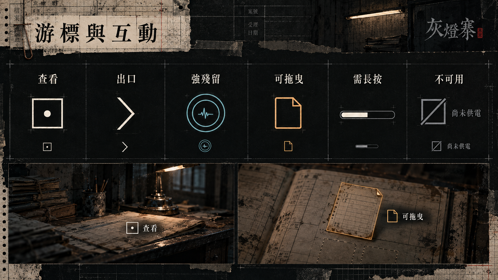
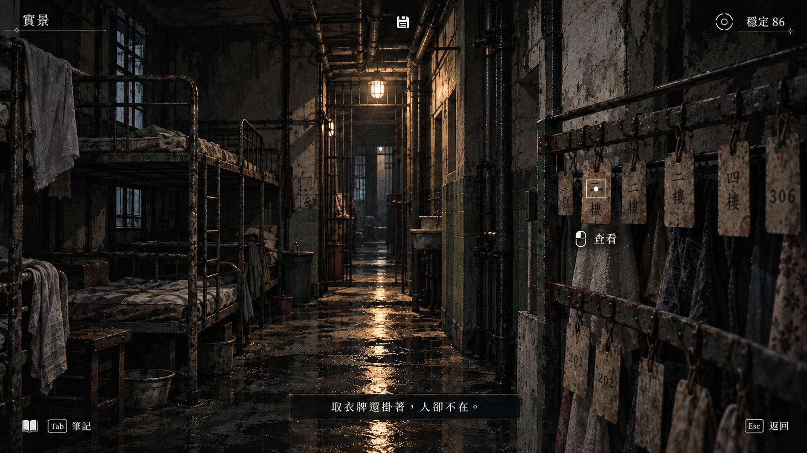
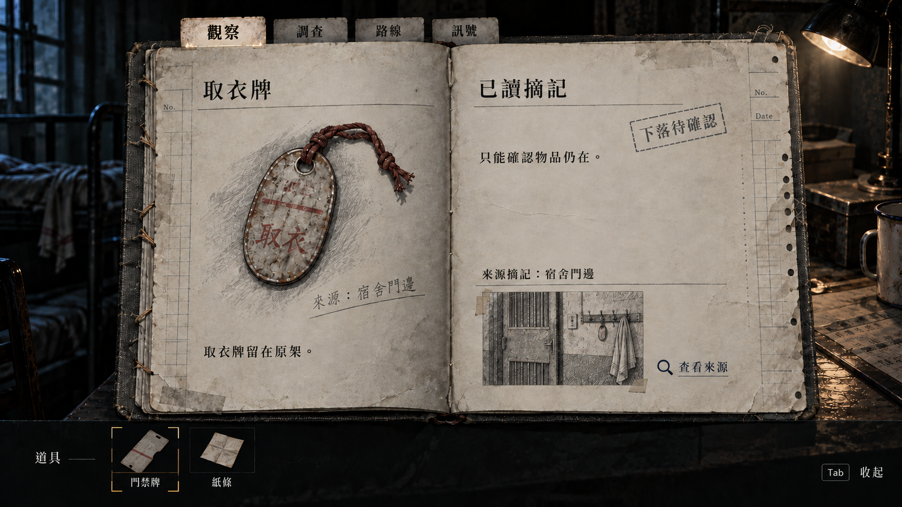
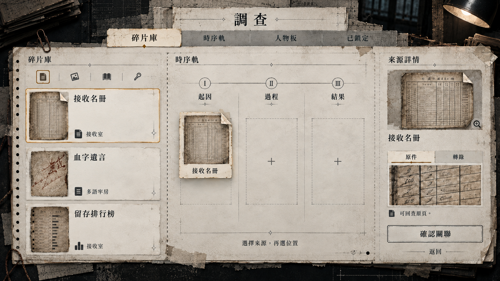
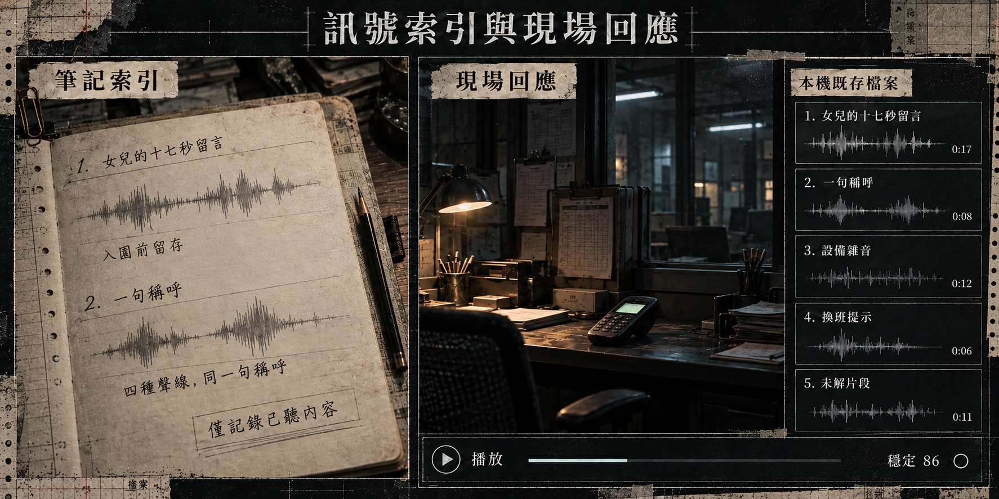
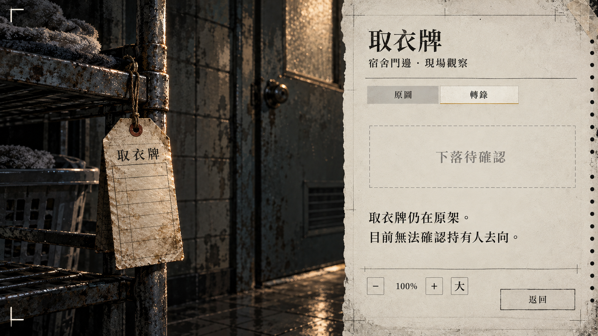
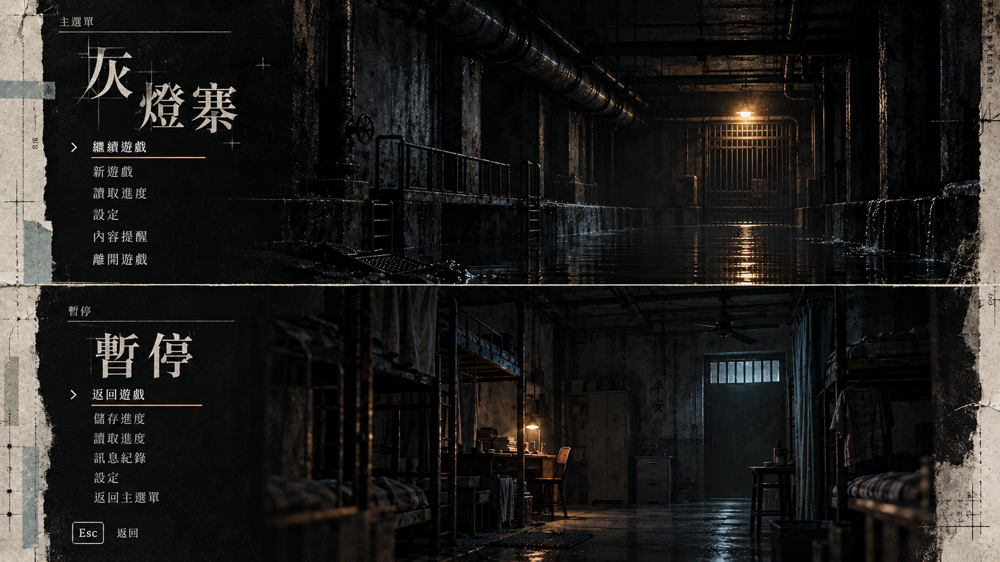
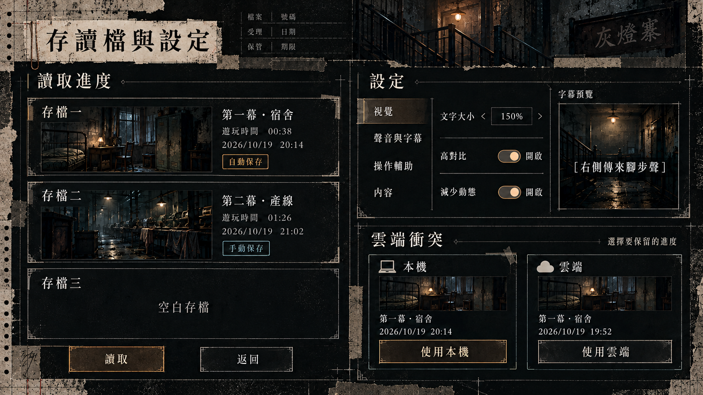

# 製作規格：UI 美術設計圖集

**8 張設計板。** 以「被塗改的紀錄，仍留下壓痕」為視覺核心：疊樓窗格、現代複寫紙、紙張外緣壓痕與生活縫補，配合灰黑留白及骨白焦點，呈現《灰燈寨》的制度壓迫與人的生活痕跡。介面保持冷靜可讀；操作與來源文案依[正式 UI 規格](../09_劇本/09-15_正式劇本_共用附錄.md#doc-0703)。

[游標](#ui01) · [探索](#ui02) · [筆記本與道具](#ui03) · [調查板](#ui04) · [訊號](#ui05) · [閱讀](#ui06) · [選單](#ui07) · [存讀與設定](#ui08)

## UI01｜游標與互動元件

**類型：** UI／操作 · 六種游標狀態及場景套用

製作註記

查看為小圓點＋單框；出口為開口箭頭；強殘留為雙環＋波形；拖曳為折角卡片；長按使用水平簽核列；不可用則為斜線框＋原因。大圖僅用來比較形狀，遊戲內採小尺寸，不將整件物體描邊。強殘留須在既有關聯成立後出現，不可用原因須由玩家選取後顯示。

需另交正常／聚焦／按住／不可用的原尺寸圖、熱點座標、深淺底可讀版本與鍵盤焦點；實際輸入區可大於圖形。長按列不套到只需點擊的操作。

[正式游標規則](../09_劇本/09-15_正式劇本_共用附錄.md#h-0703-248)

## UI02｜探索與最小 HUD

**類型：** UI／探索 · 實景、穩定、焦點與字幕

製作註記

右上僅呈現「穩定」與凝神圖示；左上為實景／感知／凝固標籤。游標只提示當前物件；上中存檔圖示、下中字幕不跟隨世界效果震動。圖中的 86 與字幕是排版示例，不增列正式台詞或資源。

游標為小圓點＋單框，不描出整件物品，也不以圖形大小作唯一點擊範圍。0 點改顯示錨點備援，沒有生命、恐慌數字、任務列表或收集率。潛行 ACTIVE 時依原規格收起一般 HUD，保留字幕與必要非聲音提示。

[正式 HUD 規則](../09_劇本/09-15_正式劇本_共用附錄.md#h-0703-229)

## UI03｜筆記本與道具索引

**類型：** UI／物件查閱 · 紙本跨頁與指定實物選取

製作註記

觀察／調查／路線／訊號共用同一本舊布面筆記本。紙本是主觀紀錄，不發光，也不提供遠端播放、上傳或主管按鈕；來源小圖是觀察示意，不代表新增拍照功能。未查明去向維持「下落待確認」。

下方道具列示意指定實物的選取索引；實際項目與所在地由當幕原規格決定，不能因看圖取得門禁牌或紙條。此列不是實體背包內容，沒有容量、重量、合成、裝備屬性或另一套收藏庫；不將現場原件收入 P1 背包。720p／UI 150% 改單頁與捲動，不縮字硬塞。

[筆記本規則](../09_劇本/09-15_正式劇本_共用附錄.md#h-0703-274) · [實物操作規則](../09_劇本/09-15_正式劇本_共用附錄.md#h-0703-852)

## UI04｜調查板與證據卡

**類型：** UI／解謎 · 來源庫、三格時序與原件詳情

製作註記

左 30% 來源卡、中央 50% 放置區、右 20% 詳情。示例沿第一幕既有接收名冊、血字遺言及留存排行榜；來源卡名稱不代表本輪已取得，實際顯示仍依已讀狀態。圖為尚未完成的拖放，不替玩家預填關聯。

選取、拖曳、草稿、正式鎖定分開；錯配採原中性回饋，不扣資源、不逐格指出答案。可停用拖曳，改為選來源→選位置；小畫面詳情改覆層。原件中的正文與筆跡須用正式來源另排，不採生成細字。

[調查板規則](../09_劇本/09-15_正式劇本_共用附錄.md#h-0703-379)

## UI05｜訊號索引與現場回應

**類型：** UI／訊號博弈 · 紙本紀錄與現場播放分工

製作註記

左側紙頁只保存名稱、描述與來源，不客觀播放；右側為有供電、既存檔案與輸出設備的現場抽屜。前兩列同等呈現，只描述已聽內容，不提前標示話術用途，也不用顏色、排序或評語推薦哪種回應較好。其他列、時長、桌面及設備比例為版面示例，不能新增訊號、修改原檔長度或取代 R7 正式鏡位。

正式抽屜依當地實際可用檔案列 5–7 筆，播放採該遭遇原輸入與成本；圖中的水平列僅示意已規定的按住回饋，不增加核可確認。關閉或離開設備收起抽屜，不由筆記遠端驅動怨靈；聲證回想仍依原主觀閱讀規則。

[訊號索引規則](../09_劇本/09-15_正式劇本_共用附錄.md#h-0703-294) · [現場抽屜規則](../09_劇本/09-15_正式劇本_共用附錄.md#h-0703-315)

## UI06｜原件近看與文字閱讀

**類型：** UI／閱讀 · 原圖、轉錄、放大與未知狀態

製作註記

原件近景保留物件與環境，另一側提供可讀轉錄、縮放、文字放大與返回。取衣牌只是既有觀察示例，不新增姓名、死亡結論或拿取獎勵；閱讀摘記不能冒充原件全文。現場原件留原處。

正文使用正式字型與來源文案；長文捲動、閱讀不限時。原件圖與轉錄各自定位，切換後保留焦點與閱讀位置；來源不明仍明示未知。

[閱讀與來源規則](../09_劇本/09-15_正式劇本_共用附錄.md#doc-0703)

## UI07｜主選單與暫停

**類型：** UI／系統選單 · 暗渠標題與房內暫停

製作註記

主選單使用深層暗渠、積水與維修柵門；暫停使用當前場景的暗化靜格，兩者共用焦點與字體。主選單未具有效存檔時停用繼續；不得提前展示結局或角色真相。

暫停、失焦及控制器中斷停止世界計時。訊號博弈中 Esc 先收起抽屜，不能把收起抽屜當成真正暫停。比較板上下兩格各自是獨立完整畫面的方向，不直接切半作成遊戲介面。

[主選單與暫停規則](../09_劇本/09-15_正式劇本_共用附錄.md#h-0703-778)

## UI08｜存讀檔與可及性設定

**類型：** UI／存讀檔／可及性 · 三主槽、設定預覽與雲端衝突

製作註記

三個主槽，各保留五份循環自動檔及幕首檢查點；畫面示例的日期、房名、縮圖與遊玩時間不是正式存檔。空槽使用中性底，不展示未見場景。雲端衝突並列本機／雲端，由玩家決定，不自動選較新的檔。

圖中本機按鈕的亮框只示意目前操作焦點，不代表系統推薦或已選定；兩個選項仍須提供相同的操作與資訊。

設定採左分類、中選項、右即時預覽；高對比、文字放大、減少動態與必要聲音字幕仍保留完整線索。正式字級與開關依原規格，圖中的複合板須拆成獨立讀檔、設定及衝突畫面。

還需交保存失敗、損壞檔恢復、覆寫確認及未套用設定狀態；這些是既有規格的後續元件，不宣稱本張已涵蓋。輔助不關閉成就，不在片尾標記玩家。

[存讀檔規則](../09_劇本/09-15_正式劇本_共用附錄.md#h-0703-792) · [設定規則](../09_劇本/09-15_正式劇本_共用附錄.md#h-0703-807)

## 製作交付

風格落地與驗收

紙本保留紙質與石墨，現場設備使用所屬終端的外框與冷光，系統選單直接疊於場景；三種載體共用版面與焦點規則，各自保留材質。疊樓窗格與外緣壓痕只作構圖語彙，正文不仿舊、不重影；裝飾不增加可讀線索，不使用終幕蛾翼或靈體圖示。骨白焦點與其他配色沿用既有 Token 語意，六種游標的形狀辨識與功能維持正式規格。

設計板外緣的撕紙、打孔、拼貼與套印格線屬展示構圖；正式畫面依紙本、終端及系統選單分別取用，不把整張仿舊外框覆到每個場景。焦點、來源狀態與正文另用乾淨元件重建，圖中的生成細字不作可讀證據。

圖內中文、細字、數值及裝飾須依正式字型／資料重建；PNG 是設計概念，不作可點擊成品或游標素材直接裁切。正式畫布以 1920×1080、64 px 安全邊距規劃，另驗 1280×720、UI 150%、灰階、鍵盤與減少動態。比較板的圖像比例不等於遊戲單畫面的輸出比例。

需拆出游標與焦點、紙本底與頁籤、卡片及狀態、現場抽屜、閱讀元件、選單、存檔卡與設定預覽；文字、圖示和底板分層。本文不改動劇本、玩法、可攜物、聲證或結局條件。

生成方式：內建 `image_gen.imagegen`；[本次藝術風格提示詞與選用紀錄](../../assets/07_視聽與介面/assets/ui_art_direction_2026-10-19/prompts.json)。前版圖檔另行保留供修訂追溯，正文只展示本次選用的 8 張。本組獨立於逐幕流程示意圖，原有 110 張目錄的計數不包含這 8 張 UI 設計板。
