<a id="video-act-1"></a>

# 影片製作列表・第一幕 · 門面與棚（36 段）

> 本頁由 `node tools/build-video-list.mjs` 依[第一幕劇本](../09_劇本/09-04_正式劇本_第一幕.md)與[第一幕製作規格](10-02_製作規格_第一幕.md)產生，請勿手改；要改動畫，請改劇本或同幕圖像表，要改鏡頭、光與聲音設計，請改[影片導演註記](10-22_製作規格_影片導演註記.md)，要改人物、場景與物品素材，請改[影片素材設定](10-23_製作規格_影片素材設定.md)，再重新執行。提示詞的用法、共用影片風格與禁止事項見[總表的提示詞說明](10-16_製作規格_影片製作列表.md#video-prompt-guide)。

[影片製作總表](10-16_製作規格_影片製作列表.md#video-catalog) · [上一幕：序幕](10-17_製作規格_影片製作列表_序幕.md) · [下一幕：第二幕](10-19_製作規格_影片製作列表_第二幕.md) · [第一人稱動畫製作與交接](../09_劇本/09-15_正式劇本_共用附錄.md#first-person-animation-contract)

## 本幕統計

| <span class="video-interact">第一人稱互動</span> | <span class="video-feedback">第一人稱動作回饋</span> | <span class="video-memory">主觀記憶動畫</span> | <span class="video-scene">場景局部動畫</span> | <span class="video-device">設備內影片</span> | 合計 |
| --- | --- | --- | --- | --- | --- |
| 2 | 16 | 4 | 8 | 6 | 36 |

| 重要級別 | <span class="importance-high">高</span> | <span class="importance-mid">中</span> | <span class="importance-low">低</span> | 合計 |
| --- | --- | --- | --- | --- |
| 段數 | 15 | 17 | 4 | 36 |

本幕重要級別 <span class="importance-high">高</span> 的段落：`R1-01·3`、`R1-03·1`、`R1-03·2`、`R1-03·3`、`R1-03·4`、`R1-03·5`、`R1-03·6`、`R1-03·7`、`R1-03·8`、`R2-01a·2`、`R3-00·1`、`R3-00·2`、`R4-V02·2`、`R4b-02·1`、`R5-01·1`。分級方式見[總表的重要級別](10-16_製作規格_影片製作列表.md#video-importance)。

導演註記：已寫 24 段（高級別 15／15 段），[R1-01·3 布袋下緣的縫](10-22_製作規格_影片導演註記.md#vd-r1-01-3)、[R1-02·2 切斷的宣導與窄房風扇](10-22_製作規格_影片導演註記.md#vd-r1-02-2)、[R1-02·3 照稿擠出來的笑](10-22_製作規格_影片導演註記.md#vd-r1-02-3)、[R1-02·4 第二次硬撐起來的笑](10-22_製作規格_影片導演註記.md#vd-r1-02-4)、[R1-02·5 被雜訊吃掉的彎鉤](10-22_製作規格_影片導演註記.md#vd-r1-02-5)、[R1-03·1 三人同時轉頭](10-22_製作規格_影片導演註記.md#vd-r1-03-1)、[R1-03·2 第一個號](10-22_製作規格_影片導演註記.md#vd-r1-03-2)、[R1-03·3 第二個號](10-22_製作規格_影片導演註記.md#vd-r1-03-3)、[R1-03·4 第三個號](10-22_製作規格_影片導演註記.md#vd-r1-03-4)、[R1-03·5 走過櫃檯](10-22_製作規格_影片導演註記.md#vd-r1-03-5)、[R1-03·6 最後一隻手](10-22_製作規格_影片導演註記.md#vd-r1-03-6)、[R1-03·7 鈴聲測試](10-22_製作規格_影片導演註記.md#vd-r1-03-7)、[R1-03·8 重置測試](10-22_製作規格_影片導演註記.md#vd-r1-03-8)、[R1-04b·1 晚 0.3 秒轉身的黑螢幕](10-22_製作規格_影片導演註記.md#vd-r1-04b-1)、[R1-04·1 接上同一張嘴的聲線](10-22_製作規格_影片導演註記.md#vd-r1-04-1)、[R2-01a·2 照著形狀描字](10-22_製作規格_影片導演註記.md#vd-r2-01a-2)、[R3-00·1 取出紙花](10-22_製作規格_影片導演註記.md#vd-r3-00-1)、[R3-00·2 收據摺的花](10-22_製作規格_影片導演註記.md#vd-r3-00-2)、[R3-01·1 無聲攤平的凹痕](10-22_製作規格_影片導演註記.md#vd-r3-01-1)、[R4-V02·2 排隊時忍不住的笑](10-22_製作規格_影片導演註記.md#vd-r4-v02-2)、[R4b-02·1 放回香火簿](10-22_製作規格_影片導演註記.md#vd-r4b-02-1)、[R4b-03·1 十二盞電子燈與門角瞬影](10-22_製作規格_影片導演註記.md#vd-r4b-03-1)、[R5-01·1 她還在縫](10-22_製作規格_影片導演註記.md#vd-r5-01-1)、[R5-02a·1 0388 林佩君 已放行](10-22_製作規格_影片導演註記.md#vd-r5-02a-1)。寫了註記的段落，提示詞的分鏡、鏡頭與聲音改用註記。

本幕重點橋段 ★：R1 叫號（R1-03·1、R1-03·2、R1-03·3、R1-03·4、R1-03·5、R1-03·6、R1-03·7、R1-03·8）；R3 上鋪紙花（R3-00·1、R3-00·2）；R4b 收回香火簿（R4b-02·1）；R5 縫紉者（R5-01·1）。控制交接見[總表重點橋段](10-16_製作規格_影片製作列表.md#video-key-bridges)。

## R1-01 進門（3 段）

<a id="v-r1-01-1"></a>

### R1-01·1　動作回饋（中）

- **重要級別：**<span class="importance-mid">中</span>　較長的動作回饋
- **類型：**<span class="video-feedback">第一人稱動作回饋</span>　**畫面：**`R1-V01`　**剪用：**約 6 秒
- **劇本：**[R1-01 進門](../09_劇本/09-04_正式劇本_第一幕.md#h-0904-30)
- **交付：**AI 生成稿只作動態參考或底稿；正式交付為疊在原主圖或近看上的短手部／物件動態圖層。

**劇本描述**　眼前門扇先遮住大部分畫面。手從視野下緣伸出，壓下梯間側橫推桿、推開內門；視線跟著跨入門檻往前帶，「接收登記」燈箱、塑膠椅與接待櫃檯依次露出。跨過門檻後，閉門器緩慢收回，原斜舌扣進門框；大廳側只剩沒有把手的平鐵皮。視點在大廳入口停穩。飾板邊緣沒有封齊，背後是舊店面的鐵閘；一根排水管越過公司招牌。

**對白／配音**　無對白（純畫面／環境音）

**分鏡板**　進門

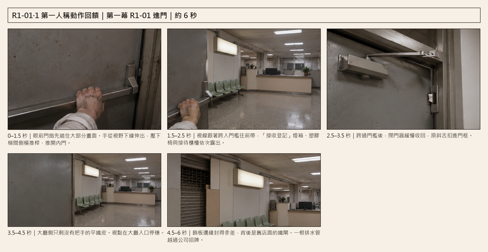

```prompt
【影片】R1-01·1｜第一人稱動作回饋｜第一幕 R1-01 進門
【生成方式】首尾格生影片：終點停在 R1-V01（主場景：「接收登記」燈箱、三張空等候椅、櫃檯、待發號牌、叫號機、內門與封住的樓外出口） 的視點與構圖；起點依分鏡第一格另做一張寫實實拍的首格。構圖、光源與物件位置照定稿。
【長度】剪用約 6 秒；生成 10 秒後裁切。
【分鏡】
0–1.5 秒｜眼前門扇先遮住大部分畫面。手從視野下緣伸出，壓下梯間側橫推桿、推開內門。
1.5–2.5 秒｜視線跟著跨入門檻往前帶，「接收登記」燈箱、塑膠椅與接待櫃檯依次露出。
2.5–3.5 秒｜跨過門檻後，閉門器緩慢收回，原斜舌扣進門框。
3.5–4.5 秒｜大廳側只剩沒有把手的平鐵皮。視點在大廳入口停穩。
4.5–6 秒｜飾板邊緣封得參差，背後是舊店面的鐵閘。一根排水管越過公司招牌。
【鏡頭】約 28mm 第一人稱主觀視線。視點只照分鏡緩慢移動，由身體帶動、有重量與停頓，不晃動、不旋轉，地平線保持水平；焦點先在她的手，手碰到的門框與扣件跟著收清；最後在分鏡寫的位置停穩。
【人物】她的手只露出手與白襯衫袖口，手背乾裂、有擦傷，從畫面下緣入鏡；五指比例正確。
【光線色調】R1 大廳：廉價、均勻的暖白日光燈，乾淨得不自然；不加恐怖暗角，也不偏冷青。整段光源與明暗都不變。
【影片風格】寫實、極致逼真的真人實景拍攝質感：真實攝影機與自然光學，輕微景深、自然底片顆粒與真實曝光；皮膚、布料、金屬、水漬與灰塵都有真實細節。動作自然流暢，有重量與慣性，符合真實人體動作。不是遊戲 CG、不是 3D 算圖、不是插畫。
【後製（不進 AI 生成）】
畫面文字：「接收登記」
【不要出現】清楚可辨識的人臉五官；任何可讀的文字、號碼、標誌、國旗或國名（畫面上的字留白或模糊，後製再合成）；配樂；第三人稱或看見主角全身；鏡頭晃動或突然換景；血腥特寫、裸露；手指數量或手部結構錯誤；分鏡沒寫的人物、物件突然出現、消失或變形；遊戲 CG 感、3D 算圖感、插畫、動漫或卡通畫風、塑膠般光滑的皮膚與材質；動作僵硬、機械、卡頓、漂浮感或不自然的慢動作。
```

**素材提示詞**　人物：[她・現在（第一人稱的手）](10-23_製作規格_影片素材設定.md#va-her-hands)｜場景：R1 入口大廳｜物品：無

```asset
【素材】人物｜她・現在（第一人稱的手）｜R1-01·1
【內容】26 歲成年女性的雙手與前臂，體態消瘦，手腕偏細。手背與指節乾裂，有零散的表淺擦傷與乾掉的泥灰，指甲短、邊緣不齊。白色普通長袖襯衫的袖口有局部撕裂、水漬與乾泥，不是制服剪裁，可隨手捲到前臂。動作時手肘靠近身體，起手前常先停一下。
【構圖】手部參考圖：中性灰背景、柔和均勻光；雙手與前臂的正面、側面、握物三個角度，只拍到手肘以下，五指比例正確。
【風格】寫實、極致逼真的真人實景攝影質感：真實相機與自然光學，輕微景深與自然底片顆粒；皮膚、布料、金屬、水漬與灰塵都有真實細節。不是遊戲 CG、不是 3D 算圖、不是插畫。
【不要出現】戒指、手錶、指甲油或任何飾品；新鮮流血或傷口剖面；名牌或品牌標誌；手指數量或手部結構錯誤；清楚可辨識的人臉五官；任何可讀的文字、號碼、標誌、國旗或國名（字留白或模糊，後製再合成）；血腥特寫、裸露；遊戲 CG 感、3D 算圖感、插畫、動漫或卡通畫風、塑膠般光滑的皮膚與材質。
```

```asset
【素材】場景｜R1 入口大廳｜R1-01·1
【內容】寫實實景的空景，不含任何人物與手；畫面中所有牌面、告示、標籤與紙件上的文字、數字一律留白或模糊。
空間：R1-V01（主場景）：燈箱（字留白）、三張空等候椅、櫃檯、待發號牌、叫號機、內門與封住的樓外出口。櫃檯外側矮牆凹位露出固定網櫃與待發灰布袋。地下梯段門無把手背面與斜舌。前景散著接收登記表。第一次全景裡，三張等候椅仍是空的。椅背與櫃檯夾成唯一可繞往後室的窄口。櫃檯後的庫房門可以看見。舊門鎖控制鈕在櫃檯內側，候坐側沒有開門鈕。庫房門的鎖舌已損壞。
【構圖】空景參考：第一人稱站立視線高度、約 28mm 人眼視角、平視、地平線水平；構圖與本段首格一致，不含人物、手與人影。
【光線色調】R1 大廳：廉價、均勻的暖白日光燈，乾淨得不自然；不加恐怖暗角，也不偏冷青。
【風格】寫實、極致逼真的真人實景攝影質感：真實相機與自然光學，輕微景深與自然底片顆粒；皮膚、布料、金屬、水漬與灰塵都有真實細節。不是遊戲 CG、不是 3D 算圖、不是插畫。
【不要出現】任何人物、手、人影或異變者；清楚可辨識的人臉五官；任何可讀的文字、號碼、標誌、國旗或國名（字留白或模糊，後製再合成）；血腥特寫、裸露；遊戲 CG 感、3D 算圖感、插畫、動漫或卡通畫風、塑膠般光滑的皮膚與材質。
```

<a id="v-r1-01-2"></a>

### R1-01·2　動作回饋（中）

- **重要級別：**<span class="importance-mid">中</span>　接主觀記憶的觸碰
- **類型：**<span class="video-feedback">第一人稱動作回饋</span>　**畫面：**`R1-V01`　**剪用：**約 1.5 秒
- **劇本：**[R1-01 進門](../09_劇本/09-04_正式劇本_第一幕.md#node-r1-access-script)
- **交付：**AI 生成稿只作動態參考或底稿；正式交付為疊在原主圖或近看上的短手部／物件動態圖層。

**劇本描述**　她彎身拾起那張表，拇指壓住捲起的一角，把它攤平在膝上。

**對白／配音**　無對白（純畫面／環境音）

**分鏡板**　進門

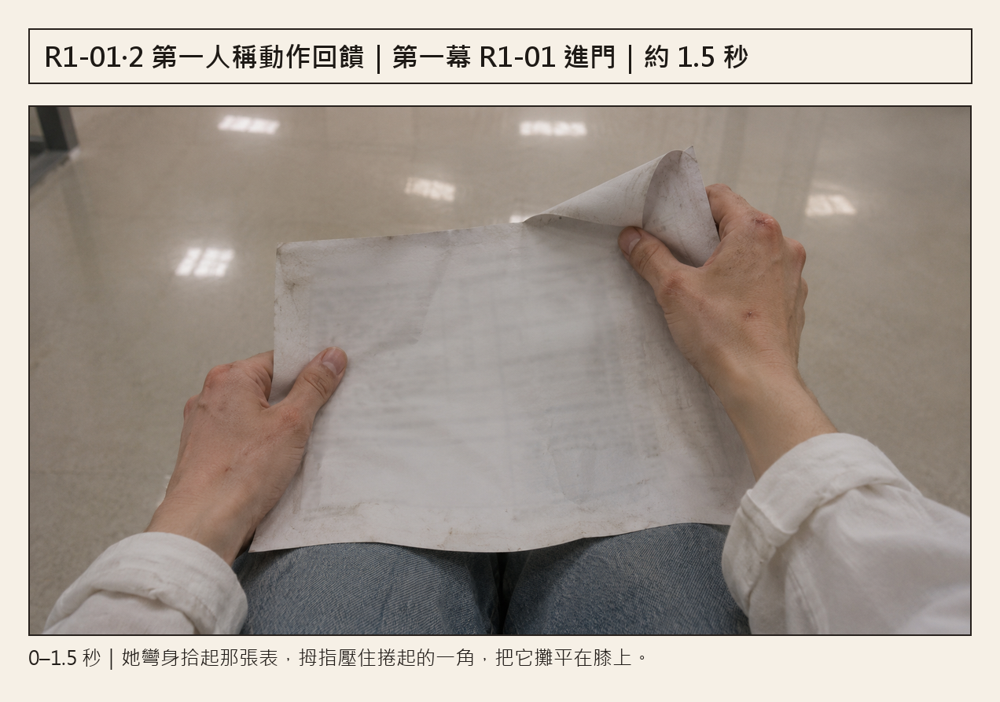

```prompt
【影片】R1-01·2｜第一人稱動作回饋｜第一幕 R1-01 進門
【生成方式】圖生影片：首格用上一段 R1-01·1 的最後一格，保持構圖、光線、色調、人物與物件造型不變，只加入下列動作。
【長度】剪用約 1.5 秒；生成 5 秒後裁切。
【分鏡】
0–1.5 秒｜她彎身拾起那張表，拇指壓住捲起的一角，把它攤平在膝上。
【鏡頭】約 28mm 第一人稱主觀視線，鏡位鎖定不動，要疊回原主圖，景深照首格。焦點先在她的手，手碰到的物件跟著收清；動作有重量，做完就停住，不加分鏡以外的動作。
【人物】她的手只露出手與白襯衫袖口，手背乾裂、有擦傷，從畫面下緣入鏡；五指比例正確。
【光線色調】R1 大廳：廉價、均勻的暖白日光燈，乾淨得不自然；不加恐怖暗角，也不偏冷青。整段光源與明暗都不變。
【影片風格】寫實、極致逼真的真人實景拍攝質感：真實攝影機與自然光學，輕微景深、自然底片顆粒與真實曝光；皮膚、布料、金屬、水漬與灰塵都有真實細節。動作自然流暢，有重量與慣性，符合真實人體動作。不是遊戲 CG、不是 3D 算圖、不是插畫。
【不要出現】清楚可辨識的人臉五官；任何可讀的文字、號碼、標誌、國旗或國名（畫面上的字留白或模糊，後製再合成）；配樂；第三人稱或看見主角全身；鏡頭晃動、推移或換景；血腥特寫、裸露；手指數量或手部結構錯誤；分鏡沒寫的人物、物件突然出現、消失或變形；遊戲 CG 感、3D 算圖感、插畫、動漫或卡通畫風、塑膠般光滑的皮膚與材質；動作僵硬、機械、卡頓、漂浮感或不自然的慢動作。
```

**素材提示詞**　人物：[她・現在（第一人稱的手）](10-23_製作規格_影片素材設定.md#va-her-hands)｜場景：R1 入口大廳｜物品：[接收登記表（R1）](10-23_製作規格_影片素材設定.md#va-form)

```asset
【素材】人物｜她・現在（第一人稱的手）｜R1-01·2
【內容】26 歲成年女性的雙手與前臂，體態消瘦，手腕偏細。手背與指節乾裂，有零散的表淺擦傷與乾掉的泥灰，指甲短、邊緣不齊。白色普通長袖襯衫的袖口有局部撕裂、水漬與乾泥，不是制服剪裁，可隨手捲到前臂。動作時手肘靠近身體，起手前常先停一下。
【構圖】手部參考圖：中性灰背景、柔和均勻光；雙手與前臂的正面、側面、握物三個角度，只拍到手肘以下，五指比例正確。
【風格】寫實、極致逼真的真人實景攝影質感：真實相機與自然光學，輕微景深與自然底片顆粒；皮膚、布料、金屬、水漬與灰塵都有真實細節。不是遊戲 CG、不是 3D 算圖、不是插畫。
【不要出現】戒指、手錶、指甲油或任何飾品；新鮮流血或傷口剖面；名牌或品牌標誌；手指數量或手部結構錯誤；清楚可辨識的人臉五官；任何可讀的文字、號碼、標誌、國旗或國名（字留白或模糊，後製再合成）；血腥特寫、裸露；遊戲 CG 感、3D 算圖感、插畫、動漫或卡通畫風、塑膠般光滑的皮膚與材質。
```

```asset
【素材】場景｜R1 入口大廳｜R1-01·2
【內容】寫實實景的空景，不含任何人物與手；畫面中所有牌面、告示、標籤與紙件上的文字、數字一律留白或模糊。
空間：R1-V01（主場景）：燈箱（字留白）、三張空等候椅、櫃檯、待發號牌、叫號機、內門與封住的樓外出口。櫃檯外側矮牆凹位露出固定網櫃與待發灰布袋。地下梯段門無把手背面與斜舌。前景散著接收登記表。第一次全景裡，三張等候椅仍是空的。椅背與櫃檯夾成唯一可繞往後室的窄口。櫃檯後的庫房門可以看見。舊門鎖控制鈕在櫃檯內側，候坐側沒有開門鈕。庫房門的鎖舌已損壞。
【構圖】空景參考：第一人稱站立視線高度、約 28mm 人眼視角、平視、地平線水平；構圖與本段首格一致，不含人物、手與人影。
【光線色調】R1 大廳：廉價、均勻的暖白日光燈，乾淨得不自然；不加恐怖暗角，也不偏冷青。
【風格】寫實、極致逼真的真人實景攝影質感：真實相機與自然光學，輕微景深與自然底片顆粒；皮膚、布料、金屬、水漬與灰塵都有真實細節。不是遊戲 CG、不是 3D 算圖、不是插畫。
【不要出現】任何人物、手、人影或異變者；清楚可辨識的人臉五官；任何可讀的文字、號碼、標誌、國旗或國名（字留白或模糊，後製再合成）；血腥特寫、裸露；遊戲 CG 感、3D 算圖感、插畫、動漫或卡通畫風、塑膠般光滑的皮膚與材質。
```

```asset
【素材】物品｜接收登記表（R1）｜R1-01·2
【內容】一張 A4 直式影印表單，紙薄而廉價，印著格線與欄位框，「宿舍分配」等欄位的字留白或模糊。大廳地上的那張邊角捲起，有濕鞋印與水漬；記憶裡的那張剛發下來，平整乾淨。
【構圖】物品參考圖：單一物件置中，中性深灰背景、柔和側光；正面、背面與局部特寫三個角度，比例照實物。
【風格】寫實、極致逼真的真人實景攝影質感：真實相機與自然光學，輕微景深與自然底片顆粒；皮膚、布料、金屬、水漬與灰塵都有真實細節。不是遊戲 CG、不是 3D 算圖、不是插畫。
【不要出現】人物與手；清楚可辨識的人臉五官；任何可讀的文字、號碼、標誌、國旗或國名（字留白或模糊，後製再合成）；血腥特寫、裸露；遊戲 CG 感、3D 算圖感、插畫、動漫或卡通畫風、塑膠般光滑的皮膚與材質。
```

<a id="v-r1-01-3"></a>

### R1-01·3　主觀記憶動畫（高）

- **重要級別：**<span class="importance-high">高</span>　主觀記憶
- **類型：**<span class="video-memory">主觀記憶動畫</span>　**畫面：**`R1-V01`　**剪用：**約 3–6 秒
- **劇本：**[R1-01 進門](../09_劇本/09-04_正式劇本_第一幕.md#node-r1-access-script)
- **交付：**併入觸碰物件的原近看或主圖素材項，另交記憶動畫分層與二至三張低動態記憶靜格。
- **規則：**[主觀記憶動畫](../09_劇本/09-15_正式劇本_共用附錄.md#memory-animation-contract)：只到肩膀以下、不給臉與名字，任何輸入立即結束。
- **導演註記：**[R1-01·3 布袋下緣的縫](10-22_製作規格_影片導演註記.md#vd-r1-01-3)

**劇本描述**　記憶裡是一輛行駛中的九人座廂型車，她坐在中間那一排靠滑門的位子，沒關緊的滑門一路喀喀地震。她的頭被粗布袋罩住，嘴上勒著布條；布紋透進一點一點的光，只有布袋下緣的一道縫，看得見自己的膝蓋。膝上攤著同一種表，風從滑門的縫灌進來，掀起一角；她的手指按住「宿舍分配」那一欄，往身旁挪過去，挪到旁邊那隻手底下。旁邊那隻手只按著表上的數字。車子一顛，她的手腕擦過滑門的鐵邊，兩張表一起滑了半寸，兩隻手同時壓住。畫面只到肩膀以下，看不見任何人的臉。

**對白／配音**　前座看守聲線（主觀記憶回聲）「別出聲。進去都叫號碼，沒人在叫名字的。」

**分鏡板**　布袋下緣的縫

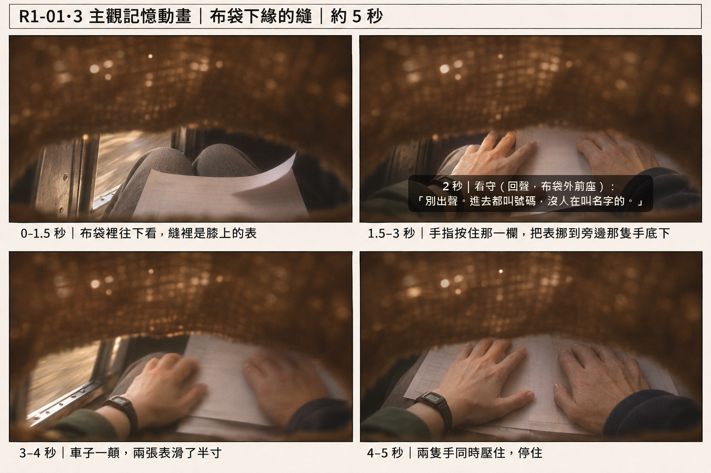

```prompt
【影片】R1-01·3｜主觀記憶動畫｜第一幕 R1-01 進門
【生成方式】先依分鏡第一格生成一張寫實實拍的記憶首格（併入 R1-V01 素材項的記憶分層），再用圖生影片。
【長度】剪用約 5 秒（可在 3–6 秒間）；生成 5 秒後裁切。
【情緒節奏】被押送，看不清也不能出聲，只能靠一道縫和兩隻手互相照應。悶、熱、壓得很緊；顛簸那一下是全段的重音。
【分鏡】
0–1.5 秒｜畫面大半是貼在眼前、失焦的粗布紋，織紋間透著一點一點的光；只有下緣一道縫裡，看得見膝上攤著的一張表，滑門縫灌進來的風掀起它的一角。
1.5–3 秒｜縫裡，她的手指按住表上那一欄，把表往身旁挪過去，挪到旁邊那隻手底下；那隻手只按著表上的數字。　對白：前座看守聲線（主觀記憶回聲）「別出聲。進去都叫號碼，沒人在叫名字的。」
3–4 秒｜車子一顛，布袋下緣的縫晃開又合上；她的手腕擦過滑門的鐵邊，兩張表一起滑了半寸。
4–5 秒｜兩隻手同時壓住滑開的表，停住；縫裡只剩紙和兩隻手。
【鏡頭】從布袋裡面往下看；約 35mm，幾乎不動，只有呼吸時布料極輕微的起伏。畫面上緣與兩側是貼在眼前、完全失焦的粗布紋，只有下緣一道橫向的縫看得清楚，縫裡是膝上的表與手；焦點一直在縫裡的紙面，布紋留在焦外。顛簸時晃的是布袋下緣，畫面本身不晃。構圖只到肩膀以下。
【人物】她的手與前臂可入鏡，穿墨綠短外套、袖口素色無圖案，腕上戴著窄面黑色數位錶。另一個人只看得出壓在表上的手與不明顯的暗色袖邊，不帶可辨識特徵；構圖只到肩膀以下，看不見任何人的臉。
【光線色調】九人座廂型車的車窗貼著很黑的隔熱紙，只有她身旁沒關緊的滑門縫漏進一條日光，再透過布袋織紋變成一點一點細碎的亮點，隨車身震動忽明忽暗；縫裡的紙面是畫面最亮的地方，其餘是布袋裡的暗。記憶色調：柔和低對比的暖褐微光，帶輕微顆粒與四周微暈，像隔著一層舊塑膠片看；不用凝固層的單色冷青，也不加訊號雜訊。光源只用分鏡裡原有的。
【影片風格】寫實、極致逼真的真人實景拍攝質感：真實攝影機與自然光學，輕微景深、自然底片顆粒與真實曝光；皮膚、布料、金屬、水漬與灰塵都有真實細節。動作自然流暢，有重量與慣性，符合真實人體動作。不是遊戲 CG、不是 3D 算圖、不是插畫。
【後製（不進 AI 生成）】
畫面文字：「宿舍分配」
聲音與後製對點：
・0–1.5 秒：引擎低沉的轉聲與滑門一路喀喀的震響隔著布袋變得很悶，整段不斷；她只能用鼻子呼吸，鼻息壓在布條後面，很近。
・2 秒：布袋外，前座傳來一聲隔著粗布袋變悶、平淡冷硬的看守聲線回聲「別出聲。進去都叫號碼，沒人在叫名字的。」（字幕不標姓名）。
・3 秒：滑門猛震一下，手腕擦過鐵邊的一聲悶響，布條後悶住一口氣。
・4–5 秒：5 秒畫面結束時接回大廳的日光燈電流聲。
【不要出現】清楚可辨識的人臉五官；任何可讀的文字、號碼、標誌、國旗或國名（畫面上的字留白或模糊，後製再合成）；配樂；第三人稱或看見主角全身；鏡頭晃動、推移或換景；血腥特寫、裸露；手指數量或手部結構錯誤；分鏡沒寫的人物、物件突然出現、消失或變形；遊戲 CG 感、3D 算圖感、插畫、動漫或卡通畫風、塑膠般光滑的皮膚與材質；動作僵硬、機械、卡頓、漂浮感或不自然的慢動作；冷青色調或訊號雜訊；對方的臉、名牌或可讀的名字。
```

**素材提示詞**　人物：[她・記憶裡（入園前）](10-23_製作規格_影片素材設定.md#va-her-before)、[車上鄰座的手（R1 記憶）](10-23_製作規格_影片素材設定.md#va-van-companion)｜場景：[九人座廂型車・布袋下緣的縫（R1 記憶）](10-23_製作規格_影片素材設定.md#va-scene-van)｜物品：[接收登記表（R1）](10-23_製作規格_影片素材設定.md#va-form)

```asset
【素材】人物｜她・記憶裡（入園前）｜R1-01·3
【內容】入園前的她：二十多歲成年女性的雙手與前臂，手指乾淨、指甲剪短，還沒有現在的乾裂、泥灰與擦挫傷。穿日常通勤的墨綠短外套，袖口素色無圖案、尺寸合身；手腕戴一只窄面黑色數位錶。
【構圖】手部參考圖：中性灰背景、柔和暖光；雙手與前臂的正面、側面、握物三個角度，只拍到手肘以下。
【風格】寫實、極致逼真的真人實景攝影質感：真實相機與自然光學，輕微景深與自然底片顆粒；皮膚、布料、金屬、水漬與灰塵都有真實細節。不是遊戲 CG、不是 3D 算圖、不是插畫。
【不要出現】白襯衫；現在的乾裂、泥灰與擦挫傷；戒指或華麗飾品；名牌或品牌標誌；手指數量或手部結構錯誤；清楚可辨識的人臉五官；任何可讀的文字、號碼、標誌、國旗或國名（字留白或模糊，後製再合成）；血腥特寫、裸露；遊戲 CG 感、3D 算圖感、插畫、動漫或卡通畫風、塑膠般光滑的皮膚與材質。
```

```asset
【素材】人物｜車上鄰座的手（R1 記憶）｜R1-01·3
【內容】身旁瘦小年輕女性的一隻手：手指靈活、指腹略帶薄繭，只按著紙面邊緣；僅露出暗沉不起眼的衣袖邊緣，不顯示特定袖色、過長袖口或可辨識的服裝特徵。
【構圖】手部參考圖：中性灰背景、柔和暖光；從指縫與腕口看進的手掌與指尖兩個角度，只拍到手腕。
【風格】寫實、極致逼真的真人實景攝影質感：真實相機與自然光學，輕微景深與自然底片顆粒；皮膚、布料、金屬、水漬與灰塵都有真實細節。不是遊戲 CG、不是 3D 算圖、不是插畫。
【不要出現】粉紅棕格紋或素面米色過長袖口；辮子、胸前或肩頸輪廓；首飾、手錶或指甲彩繪；名牌或品牌標誌；手指數量或手部結構錯誤；清楚可辨識的人臉五官；任何可讀的文字、號碼、標誌、國旗或國名（字留白或模糊，後製再合成）；血腥特寫、裸露；遊戲 CG 感、3D 算圖感、插畫、動漫或卡通畫風、塑膠般光滑的皮膚與材質。
```

```asset
【素材】場景｜九人座廂型車・布袋下緣的縫（R1 記憶）｜R1-01·3
【內容】行駛中的九人座廂型車內，中間那一排靠滑門的空座位。座椅是磨舊的灰色布面，滑門沒關緊，留著一道縫，漏進一條日光；車窗貼著很黑的隔熱紙，車內偏暗。從座椅視線往下看，座墊前側預留攤開一張紙表的位置（文字留白）；第二張前景遮罩是失焦的粗麻布織紋佔滿畫面上緣與兩側，只留下緣一道縫。都不含任何人。
【構圖】參考兩張：一張是中排靠滑門座位的空景（約 35mm，坐在座位時眼睛高度往下看）；一張是布袋織紋的前景遮罩（粗麻布貼近鏡頭、失焦，只留下緣一道縫，縫裡留空）。都不含人物與手。
【光線色調】記憶色調：柔和低對比的暖褐微光，帶輕微顆粒與四周微暈；不用凝固層的單色冷青，也不加訊號雜訊。
【風格】寫實、極致逼真的真人實景攝影質感：真實相機與自然光學，輕微景深與自然底片顆粒；皮膚、布料、金屬、水漬與灰塵都有真實細節。不是遊戲 CG、不是 3D 算圖、不是插畫。
【不要出現】任何人物、手、人影或異變者；清楚可辨識的人臉五官；任何可讀的文字、號碼、標誌、國旗或國名（字留白或模糊，後製再合成）；血腥特寫、裸露；遊戲 CG 感、3D 算圖感、插畫、動漫或卡通畫風、塑膠般光滑的皮膚與材質。
```

```asset
【素材】物品｜接收登記表（R1）｜R1-01·3
【內容】一張 A4 直式影印表單，紙薄而廉價，印著格線與欄位框，「宿舍分配」等欄位的字留白或模糊。大廳地上的那張邊角捲起，有濕鞋印與水漬；記憶裡的那張剛發下來，平整乾淨。
【構圖】物品參考圖：單一物件置中，中性深灰背景、柔和側光；正面、背面與局部特寫三個角度，比例照實物。
【風格】寫實、極致逼真的真人實景攝影質感：真實相機與自然光學，輕微景深與自然底片顆粒；皮膚、布料、金屬、水漬與灰塵都有真實細節。不是遊戲 CG、不是 3D 算圖、不是插畫。
【不要出現】人物與手；清楚可辨識的人臉五官；任何可讀的文字、號碼、標誌、國旗或國名（字留白或模糊，後製再合成）；血腥特寫、裸露；遊戲 CG 感、3D 算圖感、插畫、動漫或卡通畫風、塑膠般光滑的皮膚與材質。
```

## R1-02 空椅子上（6 段）

<a id="v-r1-02-1"></a>

### R1-02·1　設備內影片（中）

- **重要級別：**<span class="importance-mid">中</span>　設備裡的劇情影片
- **類型：**<span class="video-device">設備內影片</span>　**畫面：**`R1-C02`　**剪用：**約 5 秒
- **劇本：**[R1-02 空椅子上](../09_劇本/09-04_正式劇本_第一幕.md#h-0904-55)
- **交付：**成片合成進設備螢幕遮罩；近看保留設備邊框，字幕與畫面文字後製加上。

**劇本描述**　接待員保持固定笑容。畫面依序切過編號床位、餐券與封住的出入口，沒有可辨識的樓外景色。輕快聲音底下只剩分配與禁令，畫面裡沒有可選的方案。

**對白／配音**　接待員（設備錄音）「食宿由管理處分配。依編號等候，不得自行離開。」

**分鏡板**　空椅子上

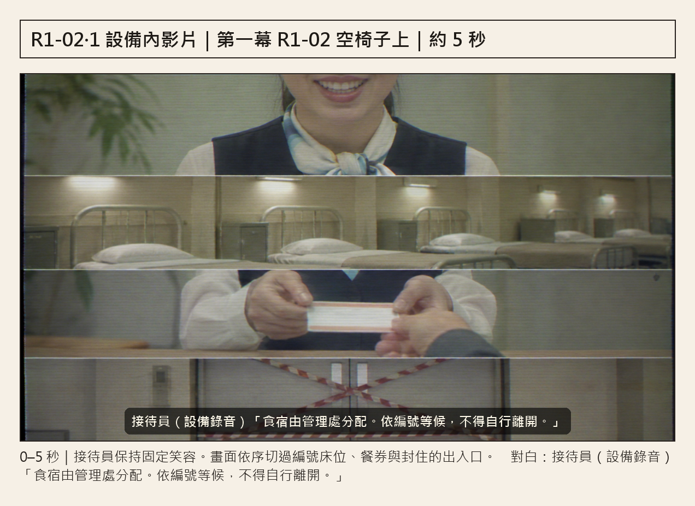

```prompt
【影片】R1-02·1｜設備內影片｜第一幕 R1-02 空椅子上
【生成方式】圖生影片：首格是 R1-C02 螢幕裡播放的畫面，做成真人實拍的錄影畫面，不含設備外框。
【長度】剪用約 5 秒；生成 5 秒後裁切。
【分鏡】
0–5 秒｜接待員保持固定笑容。畫面依序切過編號床位、餐券與封住的出入口。　對白：接待員（設備錄音）「食宿由管理處分配。依編號等候，不得自行離開。」
【鏡頭】只生成設備螢幕裡播放的畫面本身（全幅，不含設備外框），後製再合成進螢幕遮罩。片內像固定機位的舊錄影，約 35mm、鏡頭不動，可以照分鏡切換畫面；焦點在片中人物的嘴、肩膀與手。
【人物】片中人物的臉要被裁切、壓縮或模糊，只看得清嘴形、肩膀與手；不做清晰肖像。
【光線色調】舊螢幕畫質：略低解析、輕微掃描線與色偏，亮度只在螢幕範圍內。整段光源與明暗都不變。
【影片風格】寫實、極致逼真的真人實拍錄影畫面，再疊上舊螢幕的質感；人物動作自然、不僵硬。不是遊戲 CG、不是 3D 算圖、不是動畫。
【後製（不進 AI 生成）】
聲音與後製對點：
・0–5 秒：輕快的背景宣傳音持續，緊接接待員錄音進場。
・整段：接待員（設備錄音）「食宿由管理處分配。依編號等候，不得自行離開。」
【不要出現】清楚可辨識的人臉五官；任何可讀的文字、號碼、標誌、國旗或國名（畫面上的字留白或模糊，後製再合成）；配樂；血腥特寫、裸露；手指數量或手部結構錯誤；分鏡沒寫的人物、物件突然出現、消失或變形；遊戲 CG 感、3D 算圖感、插畫、動漫或卡通畫風、塑膠般光滑的皮膚與材質；動作僵硬、機械、卡頓、漂浮感或不自然的慢動作。
```

**素材提示詞**　人物：[宣導片裡的接待員（R1）](10-23_製作規格_影片素材設定.md#va-receptionist)｜場景：[管制宣導片（R1 電視）](10-23_製作規格_影片素材設定.md#va-scene-promo)｜物品：無

```asset
【素材】人物｜宣導片裡的接待員（R1）｜R1-02·1
【內容】管制宣導片裡的成年接待員，坐在乾淨得不自然的櫃檯後，穿整齊但廉價的淺色襯衫，沒有名牌與公司標誌；一直保持固定、過度標準的笑容，嘴型照著稿子動。舊錄影畫質：略低解析、輕微掃描線與色偏；臉被壓縮與裁切，只看得清嘴形、肩膀與手。
【構圖】錄影畫面參考：16:9 全幅、不含電視外框；胸上景一張、嘴形近景一張。
【風格】寫實、極致逼真的真人實景攝影質感：真實相機與自然光學，輕微景深與自然底片顆粒；皮膚、布料、金屬、水漬與灰塵都有真實細節。不是遊戲 CG、不是 3D 算圖、不是插畫。
【不要出現】清楚的正臉；公司標誌、名牌或制服；名牌或品牌標誌；手指數量或手部結構錯誤；清楚可辨識的人臉五官；任何可讀的文字、號碼、標誌、國旗或國名（字留白或模糊，後製再合成）；血腥特寫、裸露；遊戲 CG 感、3D 算圖感、插畫、動漫或卡通畫風、塑膠般光滑的皮膚與材質。
```

```asset
【素材】場景｜管制宣導片（R1 電視）｜R1-02·1
【內容】輕快的管制宣導片畫面，依序切過乾淨得不自然的接待櫃檯、一排編號床位、一疊餐券與一道被封住的出入口；沒有任何可辨識的樓外景色。打光明亮平均，色彩偏飽和但廉價。
【構圖】錄影畫面參考：16:9 全幅、不含電視外框；櫃檯、編號床位、餐券、封住的出入口各一張。
【光線色調】舊螢幕畫質：略低解析、輕微掃描線與色偏，亮度只在螢幕範圍內。
【風格】寫實、極致逼真的真人實景攝影質感：真實相機與自然光學，輕微景深與自然底片顆粒；皮膚、布料、金屬、水漬與灰塵都有真實細節。不是遊戲 CG、不是 3D 算圖、不是插畫。
【不要出現】任何人物、手、人影或異變者；清楚可辨識的人臉五官；任何可讀的文字、號碼、標誌、國旗或國名（字留白或模糊，後製再合成）；血腥特寫、裸露；遊戲 CG 感、3D 算圖感、插畫、動漫或卡通畫風、塑膠般光滑的皮膚與材質。
```

<a id="v-r1-02-2"></a>

### R1-02·2　設備內影片（中）

- **重要級別：**<span class="importance-mid">中</span>　設備裡的劇情影片
- **類型：**<span class="video-device">設備內影片</span>　**畫面：**`R1-C02`　**剪用：**約 5 秒
- **劇本：**[R1-02 空椅子上](../09_劇本/09-04_正式劇本_第一幕.md#h-0904-55)
- **交付：**成片合成進設備螢幕遮罩；近看保留設備邊框，字幕與畫面文字後製加上。
- **導演註記：**[R1-02·2 切斷的宣導與窄房風扇](10-22_製作規格_影片導演註記.md#vd-r1-02-2)

**劇本描述**　片尾沒有接回開頭。電視播到標著「內部留存／錄製原檔」的下一段，輕快聲音斷掉，只剩狹小房間的風扇聲。鏡頭只拍到一名成年人的嘴、肩膀和壓在桌上的雙手；一句邀約稿放在指間。他看向鏡頭旁。

**對白／配音**　錄影中的人（設備舊檔）「我也是被騙來的。還要我騙朋友？」 ／ 畫外管理者（設備舊檔）「照稿念。錄完交給我。」

**分鏡板**　切斷的宣導與窄房風扇

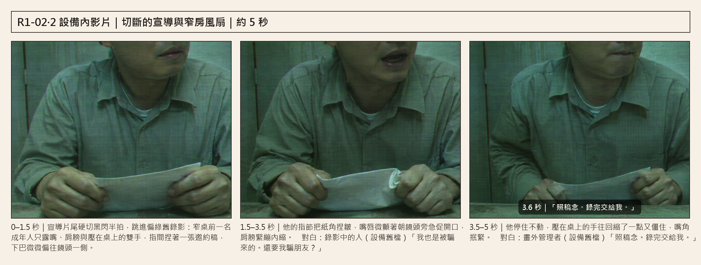

```prompt
【影片】R1-02·2｜設備內影片｜第一幕 R1-02 空椅子上
【生成方式】圖生影片：首格是 R1-C02 螢幕裡播放的畫面，做成真人實拍的錄影畫面，不含設備外框。
【長度】剪用約 5 秒；生成 5 秒後裁切。
【情緒節奏】廉價宣導的輕快感在一瞬截斷，掉進密閉窄房的壓迫。他不敢直視鏡頭、只盯著鏡外一側求饒，卻被冷硬壓回稿紙。
【分鏡】
0–1.5 秒｜宣導片尾硬切黑閃半拍，跳進偏綠舊錄影：窄桌前一名成年人只露嘴、肩膀與壓在桌上的雙手，指間捏著一張邀約稿，下巴微微偏往鏡頭一側。
1.5–3.5 秒｜他的指節把紙角捏皺，嘴唇微顫著朝鏡頭旁急促開口，肩膀緊繃內縮。　對白：錄影中的人（設備舊檔）「我也是被騙來的。還要我騙朋友？」
3.5–5 秒｜他停住不動，壓在桌上的手往回縮了一點又僵住，嘴角抿緊。　對白：畫外管理者（設備舊檔）「照稿念。錄完交給我。」
【鏡頭】只生成螢幕裡的舊錄影畫面（全幅、不含設備外框）；約 35mm 固定機位微俯拍窄桌與胸口以下，焦點咬住指間發緊的邀約稿與繃緊的嘴唇，眼睛以上切在框外。
【人物】片中人物的臉要被裁切、壓縮或模糊，只看得清嘴形、肩膀與手；不做清晰肖像。
【光線色調】前段是偏亮廉價宣導片尾，切入舊檔後轉成頂上一盞偏綠平板日光燈，疊上低解析雜訊與細掃描線。舊螢幕畫質：略低解析、輕微掃描線與色偏，亮度只在螢幕範圍內。
【影片風格】寫實、極致逼真的真人實拍錄影畫面，再疊上舊螢幕的質感；人物動作自然、不僵硬。不是遊戲 CG、不是 3D 算圖、不是動畫。
【後製（不進 AI 生成）】
畫面文字：「內部留存／錄製原檔」
聲音與後製對點：
・0 秒：輕快宣導聲硬斷，只剩狹小房間的風扇嗡聲。後製：畫面文字「內部留存／錄製原檔」。
・1.6 秒：錄影中的人（設備舊檔）「我也是被騙來的。還要我騙朋友？」，語氣發抖壓抑。
・3.6 秒：畫外管理者（設備舊檔）「照稿念。錄完交給我。」，聲線平冷不帶火氣。
【不要出現】清楚可辨識的人臉五官；任何可讀的文字、號碼、標誌、國旗或國名（畫面上的字留白或模糊，後製再合成）；配樂；血腥特寫、裸露；手指數量或手部結構錯誤；分鏡沒寫的人物、物件突然出現、消失或變形；遊戲 CG 感、3D 算圖感、插畫、動漫或卡通畫風、塑膠般光滑的皮膚與材質；動作僵硬、機械、卡頓、漂浮感或不自然的慢動作。
```

**素材提示詞**　人物：[錄製原檔裡的成年人（R1）](10-23_製作規格_影片素材設定.md#va-recorded-adult)｜場景：[內部留存的錄製原檔（R1 電視）](10-23_製作規格_影片素材設定.md#va-scene-recording)｜物品：無

```asset
【素材】人物｜錄製原檔裡的成年人（R1）｜R1-02·2
【內容】狹小房間裡的一名成年男性，只拍得到嘴、肩膀和壓在桌上的雙手。穿隨手發下的舊素 T，領口洗鬆。指間夾著一張印好的邀約稿。嘴角被要求勉強往上提，肩膀卻越來越緊；手在桌上縮了一下又壓回去。未剪輯的原始錄影：固定機位、略低解析、輕微雜訊。
【構圖】錄影畫面參考：16:9 全幅、不含電視外框；嘴與肩的近景一張、雙手壓在桌上的近景一張，眼睛以上一律出框。
【風格】寫實、極致逼真的真人實景攝影質感：真實相機與自然光學，輕微景深與自然底片顆粒；皮膚、布料、金屬、水漬與灰塵都有真實細節。不是遊戲 CG、不是 3D 算圖、不是插畫。
【不要出現】眼睛與完整的臉；傷痕或被毆打的痕跡；名牌或品牌標誌；手指數量或手部結構錯誤；清楚可辨識的人臉五官；任何可讀的文字、號碼、標誌、國旗或國名（字留白或模糊，後製再合成）；血腥特寫、裸露；遊戲 CG 感、3D 算圖感、插畫、動漫或卡通畫風、塑膠般光滑的皮膚與材質。
```

```asset
【素材】場景｜內部留存的錄製原檔（R1 電視）｜R1-02·2
【內容】狹小的房間空景，一張貼牆的舊桌子與空椅，桌面磨舊；牆邊一台小電扇在轉。固定機位平拍桌面與後牆，預留桌前坐位空間（不含人物與手）；光是頭頂一盞偏綠、平板的日光燈。片頭留一張檔頭字卡的位置（字留白，後製合成）。
【構圖】錄影畫面參考：16:9 全幅、不含電視外框；空桌與電扇的空景一張。
【光線色調】舊螢幕畫質：略低解析、輕微掃描線與色偏，亮度只在螢幕範圍內。
【風格】寫實、極致逼真的真人實景攝影質感：真實相機與自然光學，輕微景深與自然底片顆粒；皮膚、布料、金屬、水漬與灰塵都有真實細節。不是遊戲 CG、不是 3D 算圖、不是插畫。
【不要出現】任何人物、手、人影或異變者；清楚可辨識的人臉五官；任何可讀的文字、號碼、標誌、國旗或國名（字留白或模糊，後製再合成）；血腥特寫、裸露；遊戲 CG 感、3D 算圖感、插畫、動漫或卡通畫風、塑膠般光滑的皮膚與材質。
```

<a id="v-r1-02-3"></a>

### R1-02·3　設備內影片（中）

- **重要級別：**<span class="importance-mid">中</span>　設備裡的劇情影片
- **類型：**<span class="video-device">設備內影片</span>　**畫面：**`R1-C02`　**剪用：**約 4 秒
- **劇本：**[R1-02 空椅子上](../09_劇本/09-04_正式劇本_第一幕.md#h-0904-55)
- **交付：**成片合成進設備螢幕遮罩；近看保留設備邊框，字幕與畫面文字後製加上。
- **導演註記：**[R1-02·3 照稿擠出來的笑](10-22_製作規格_影片導演註記.md#vd-r1-02-3)

**劇本描述**　桌上的手縮了一下。嘴角勉強抬起，聲音換成刻意輕鬆的語氣。

**對白／配音**　錄影中的人（設備舊檔）「這裡很好……你也過來吧。」 ／ 畫外管理者（設備舊檔）「重來。笑。」

**分鏡板**　照稿擠出來的笑

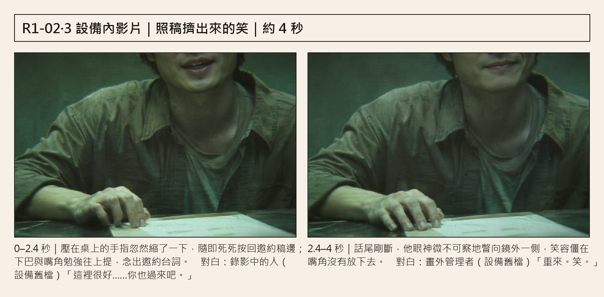

```prompt
【影片】R1-02·3｜設備內影片｜第一幕 R1-02 空椅子上
【生成方式】圖生影片：首格是 R1-C02 螢幕裡播放的畫面，做成真人實拍的錄影畫面，不含設備外框。
【長度】剪用約 4 秒；生成 5 秒後裁切。
【情緒節奏】舊錄影裡的假輕鬆最難看。手先背叛他往後縮，話唸出口時還要被迫維持住那個笑。
【分鏡】
0–2.4 秒｜壓在桌上的手指忽然縮了一下，隨即死死按回邀約稿邊；下巴與嘴角勉強往上提，念出邀約台詞。　對白：錄影中的人（設備舊檔）「這裡很好……你也過來吧。」
2.4–4 秒｜話尾剛斷，他眼神微不可察地瞥向鏡外一側，笑容僵在嘴角沒有放下去。　對白：畫外管理者（設備舊檔）「重來。笑。」
【鏡頭】只生成螢幕裡的舊錄影畫面（全幅、不含設備外框）；約 35mm 固定機位微俯拍桌面與胸口以下，焦點在緊壓桌面的手與繃住的嘴角，眼睛以上持續切在框外。
【人物】片中人物的臉要被裁切、壓縮或模糊，只看得清嘴形、肩膀與手；不做清晰肖像。
【光線色調】頂上一盞偏綠平板日光燈照亮桌面手背，疊上舊錄影低解析與輕微掃描線，整段不變。舊螢幕畫質：略低解析、輕微掃描線與色偏，亮度只在螢幕範圍內。
【影片風格】寫實、極致逼真的真人實拍錄影畫面，再疊上舊螢幕的質感；人物動作自然、不僵硬。不是遊戲 CG、不是 3D 算圖、不是動畫。
【後製（不進 AI 生成）】
聲音與後製對點：
・0 秒：窄房風扇嗡聲持續；0.3 秒：錄影中的人（設備舊檔）「這裡很好……你也過來吧。」，語氣刻意放輕卻發緊。
・2.6 秒：畫外管理者（設備舊檔）「重來。笑。」。
【不要出現】清楚可辨識的人臉五官；任何可讀的文字、號碼、標誌、國旗或國名（畫面上的字留白或模糊，後製再合成）；配樂；血腥特寫、裸露；手指數量或手部結構錯誤；分鏡沒寫的人物、物件突然出現、消失或變形；遊戲 CG 感、3D 算圖感、插畫、動漫或卡通畫風、塑膠般光滑的皮膚與材質；動作僵硬、機械、卡頓、漂浮感或不自然的慢動作。
```

**素材提示詞**　人物：[錄製原檔裡的成年人（R1）](10-23_製作規格_影片素材設定.md#va-recorded-adult)｜場景：[內部留存的錄製原檔（R1 電視）](10-23_製作規格_影片素材設定.md#va-scene-recording)｜物品：無

```asset
【素材】人物｜錄製原檔裡的成年人（R1）｜R1-02·3
【內容】狹小房間裡的一名成年男性，只拍得到嘴、肩膀和壓在桌上的雙手。穿隨手發下的舊素 T，領口洗鬆。指間夾著一張印好的邀約稿。嘴角被要求勉強往上提，肩膀卻越來越緊；手在桌上縮了一下又壓回去。未剪輯的原始錄影：固定機位、略低解析、輕微雜訊。
【構圖】錄影畫面參考：16:9 全幅、不含電視外框；嘴與肩的近景一張、雙手壓在桌上的近景一張，眼睛以上一律出框。
【風格】寫實、極致逼真的真人實景攝影質感：真實相機與自然光學，輕微景深與自然底片顆粒；皮膚、布料、金屬、水漬與灰塵都有真實細節。不是遊戲 CG、不是 3D 算圖、不是插畫。
【不要出現】眼睛與完整的臉；傷痕或被毆打的痕跡；名牌或品牌標誌；手指數量或手部結構錯誤；清楚可辨識的人臉五官；任何可讀的文字、號碼、標誌、國旗或國名（字留白或模糊，後製再合成）；血腥特寫、裸露；遊戲 CG 感、3D 算圖感、插畫、動漫或卡通畫風、塑膠般光滑的皮膚與材質。
```

```asset
【素材】場景｜內部留存的錄製原檔（R1 電視）｜R1-02·3
【內容】狹小的房間空景，一張貼牆的舊桌子與空椅，桌面磨舊；牆邊一台小電扇在轉。固定機位平拍桌面與後牆，預留桌前坐位空間（不含人物與手）；光是頭頂一盞偏綠、平板的日光燈。片頭留一張檔頭字卡的位置（字留白，後製合成）。
【構圖】錄影畫面參考：16:9 全幅、不含電視外框；空桌與電扇的空景一張。
【光線色調】舊螢幕畫質：略低解析、輕微掃描線與色偏，亮度只在螢幕範圍內。
【風格】寫實、極致逼真的真人實景攝影質感：真實相機與自然光學，輕微景深與自然底片顆粒；皮膚、布料、金屬、水漬與灰塵都有真實細節。不是遊戲 CG、不是 3D 算圖、不是插畫。
【不要出現】任何人物、手、人影或異變者；清楚可辨識的人臉五官；任何可讀的文字、號碼、標誌、國旗或國名（字留白或模糊，後製再合成）；血腥特寫、裸露；遊戲 CG 感、3D 算圖感、插畫、動漫或卡通畫風、塑膠般光滑的皮膚與材質。
```

<a id="v-r1-02-4"></a>

### R1-02·4　設備內影片（中）

- **重要級別：**<span class="importance-mid">中</span>　設備裡的劇情影片
- **類型：**<span class="video-device">設備內影片</span>　**畫面：**`R1-C02`　**剪用：**約 5 秒
- **劇本：**[R1-02 空椅子上](../09_劇本/09-04_正式劇本_第一幕.md#h-0904-55)
- **交付：**成片合成進設備螢幕遮罩；近看保留設備邊框，字幕與畫面文字後製加上。
- **導演註記：**[R1-02·4 第二次硬撐起來的笑](10-22_製作規格_影片導演註記.md#vd-r1-02-4)

**劇本描述**　嘴角又往上提，肩膀卻更緊。仍是同一雙手、同一張桌子。

**對白／配音**　錄影中的人（設備舊檔）「這裡很好。你也過來吧。」

**分鏡板**　第二次硬撐起來的笑

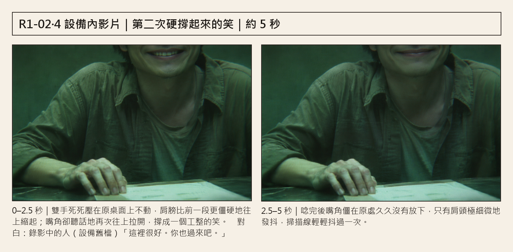

```prompt
【影片】R1-02·4｜設備內影片｜第一幕 R1-02 空椅子上
【生成方式】圖生影片：首格是 R1-C02 螢幕裡播放的畫面，做成真人實拍的錄影畫面，不含設備外框。
【長度】剪用約 5 秒；生成 5 秒後裁切。
【情緒節奏】照要求再試一次，笑比剛才更標準，身體卻徹底繃死。把恐懼壓進微笑裡的反差，是整段舊檔最難受的一幕。
【分鏡】
0–2.5 秒｜雙手死死壓在原桌面上不動，肩膀比前一段更僵硬地往上縮起；嘴角卻聽話地再次往上拉開，撐成一個工整的笑。　對白：錄影中的人（設備舊檔）「這裡很好。你也過來吧。」
2.5–5 秒｜唸完後嘴角僵在原處久久沒有放下，只有肩頭極細微地發抖，掃描線輕輕抖過一次。
【鏡頭】只生成螢幕裡的舊錄影畫面（全幅、不含設備外框）；約 35mm 固定機位接續上一段構圖，焦點停在被硬拉開的嘴角與緊壓桌面的手指，眼睛以上仍在框外。
【人物】片中人物的臉要被裁切、壓縮或模糊，只看得清嘴形、肩膀與手；不做清晰肖像。
【光線色調】維持同一盞偏綠平板日光燈與舊錄影低解析掃描線，桌面手背因用力而浮出微白指節反光。舊螢幕畫質：略低解析、輕微掃描線與色偏，亮度只在螢幕範圍內。
【影片風格】寫實、極致逼真的真人實拍錄影畫面，再疊上舊螢幕的質感；人物動作自然、不僵硬。不是遊戲 CG、不是 3D 算圖、不是動畫。
【後製（不進 AI 生成）】
聲音與後製對點：
・0 秒：窄房風扇嗡聲持續；0.8 秒：錄影中的人（設備舊檔）「這裡很好。你也過來吧。」，語調刻意拉平、幾乎聽不出起伏。
・2.5–5 秒：語尾落下後只剩風扇低嗡與細微類比底噪。
【不要出現】清楚可辨識的人臉五官；任何可讀的文字、號碼、標誌、國旗或國名（畫面上的字留白或模糊，後製再合成）；配樂；血腥特寫、裸露；手指數量或手部結構錯誤；分鏡沒寫的人物、物件突然出現、消失或變形；遊戲 CG 感、3D 算圖感、插畫、動漫或卡通畫風、塑膠般光滑的皮膚與材質；動作僵硬、機械、卡頓、漂浮感或不自然的慢動作。
```

**素材提示詞**　人物：[錄製原檔裡的成年人（R1）](10-23_製作規格_影片素材設定.md#va-recorded-adult)｜場景：[內部留存的錄製原檔（R1 電視）](10-23_製作規格_影片素材設定.md#va-scene-recording)｜物品：無

```asset
【素材】人物｜錄製原檔裡的成年人（R1）｜R1-02·4
【內容】狹小房間裡的一名成年男性，只拍得到嘴、肩膀和壓在桌上的雙手。穿隨手發下的舊素 T，領口洗鬆。指間夾著一張印好的邀約稿。嘴角被要求勉強往上提，肩膀卻越來越緊；手在桌上縮了一下又壓回去。未剪輯的原始錄影：固定機位、略低解析、輕微雜訊。
【構圖】錄影畫面參考：16:9 全幅、不含電視外框；嘴與肩的近景一張、雙手壓在桌上的近景一張，眼睛以上一律出框。
【風格】寫實、極致逼真的真人實景攝影質感：真實相機與自然光學，輕微景深與自然底片顆粒；皮膚、布料、金屬、水漬與灰塵都有真實細節。不是遊戲 CG、不是 3D 算圖、不是插畫。
【不要出現】眼睛與完整的臉；傷痕或被毆打的痕跡；名牌或品牌標誌；手指數量或手部結構錯誤；清楚可辨識的人臉五官；任何可讀的文字、號碼、標誌、國旗或國名（字留白或模糊，後製再合成）；血腥特寫、裸露；遊戲 CG 感、3D 算圖感、插畫、動漫或卡通畫風、塑膠般光滑的皮膚與材質。
```

```asset
【素材】場景｜內部留存的錄製原檔（R1 電視）｜R1-02·4
【內容】狹小的房間空景，一張貼牆的舊桌子與空椅，桌面磨舊；牆邊一台小電扇在轉。固定機位平拍桌面與後牆，預留桌前坐位空間（不含人物與手）；光是頭頂一盞偏綠、平板的日光燈。片頭留一張檔頭字卡的位置（字留白，後製合成）。
【構圖】錄影畫面參考：16:9 全幅、不含電視外框；空桌與電扇的空景一張。
【光線色調】舊螢幕畫質：略低解析、輕微掃描線與色偏，亮度只在螢幕範圍內。
【風格】寫實、極致逼真的真人實景攝影質感：真實相機與自然光學，輕微景深與自然底片顆粒；皮膚、布料、金屬、水漬與灰塵都有真實細節。不是遊戲 CG、不是 3D 算圖、不是插畫。
【不要出現】任何人物、手、人影或異變者；清楚可辨識的人臉五官；任何可讀的文字、號碼、標誌、國旗或國名（字留白或模糊，後製再合成）；血腥特寫、裸露；遊戲 CG 感、3D 算圖感、插畫、動漫或卡通畫風、塑膠般光滑的皮膚與材質。
```

<a id="v-r1-02-5"></a>

### R1-02·5　設備內影片（中）

- **重要級別：**<span class="importance-mid">中</span>　設備裡的劇情影片
- **類型：**<span class="video-device">設備內影片</span>　**畫面：**`R1-C02`　**剪用：**約 7.5 秒
- **劇本：**[R1-02 空椅子上](../09_劇本/09-04_正式劇本_第一幕.md#h-0904-55)
- **交付：**成片合成進設備螢幕遮罩；近看保留設備邊框，字幕與畫面文字後製加上。
- **導演註記：**[R1-02·5 被雜訊吃掉的彎鉤](10-22_製作規格_影片導演註記.md#vd-r1-02-5)

**劇本描述**　看過這段舊檔再收起近看，遠景裡的電視沒有接回宣導片，畫面停在那張嘴勉強提起的笑上；輕快的聲音沒有回來，只有提示聲仍照原本的間隔從喇叭響起。雜訊一點一點吃掉嘴角的線，最後只剩兩道淡淡的彎鉤，一直停到電視熄滅。

**對白／配音**　無對白（純畫面／環境音）

**分鏡板**　被雜訊吃掉的彎鉤

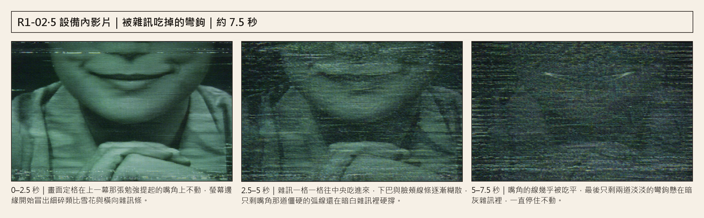

```prompt
【影片】R1-02·5｜設備內影片｜第一幕 R1-02 空椅子上
【生成方式】圖生影片：首格是 R1-C02 螢幕裡播放的畫面，做成真人實拍的錄影畫面，不含設備外框。
【長度】剪用約 7.5 秒；生成 10 秒後裁切。
【情緒節奏】看完了，電視卻不肯恢復原狀。輕快配音消失後，只剩冷冰冰的叫號提示音一聲一聲疊在被雪花吞蝕的假笑上。
【分鏡】
0–2.5 秒｜畫面定格在上一幕那張勉強提起的嘴角上不動，螢幕邊緣開始冒出細碎類比雪花與橫向雜訊條。
2.5–5 秒｜雜訊一格一格往中央吃進來，下巴與臉頰線條逐漸糊散，只剩嘴角那道僵硬的弧線還在暗白雜訊裡硬撐。
5–7.5 秒｜嘴角的線幾乎被吃平，最後只剩兩道淡淡的彎鉤懸在暗灰雜訊裡，一直停住不動。
【鏡頭】只生成螢幕裡的舊錄影畫面（全幅、不含設備外框）；約 35mm 固定定格機位，對準被雜訊逐步侵蝕的半截下巴與嘴角，整段不移鏡。
【人物】片中人物的臉要被裁切、壓縮或模糊，只看得清嘴形、肩膀與手；不做清晰肖像。
【光線色調】偏綠舊錄影亮度隨雪花雜訊一格格掉暗，嘴角兩道亮線最後退成暗灰底上的淺鉤。舊螢幕畫質：略低解析、輕微掃描線與色偏，亮度只在螢幕範圍內。
【影片風格】寫實、極致逼真的真人實拍錄影畫面，再疊上舊螢幕的質感；人物動作自然、不僵硬。不是遊戲 CG、不是 3D 算圖、不是動畫。
【後製（不進 AI 生成）】
聲音與後製對點：
・0 秒：原本的輕快音不再回來；0.6 秒：喇叭照原間隔響起一聲冰冷的叫號提示音。
・3.2 秒：第二聲叫號提示音落在雜訊沙沙聲上，節拍工整無情。
・6 秒：第三聲提示音餘韻慢慢混進電視微弱電流聲。
【不要出現】清楚可辨識的人臉五官；任何可讀的文字、號碼、標誌、國旗或國名（畫面上的字留白或模糊，後製再合成）；配樂；血腥特寫、裸露；手指數量或手部結構錯誤；分鏡沒寫的人物、物件突然出現、消失或變形；遊戲 CG 感、3D 算圖感、插畫、動漫或卡通畫風、塑膠般光滑的皮膚與材質；動作僵硬、機械、卡頓、漂浮感或不自然的慢動作。
```

**素材提示詞**　人物：[錄製原檔裡的成年人（R1）](10-23_製作規格_影片素材設定.md#va-recorded-adult)｜場景：[內部留存的錄製原檔（R1 電視）](10-23_製作規格_影片素材設定.md#va-scene-recording)｜物品：無

```asset
【素材】人物｜錄製原檔裡的成年人（R1）｜R1-02·5
【內容】狹小房間裡的一名成年男性，只拍得到嘴、肩膀和壓在桌上的雙手。穿隨手發下的舊素 T，領口洗鬆。指間夾著一張印好的邀約稿。嘴角被要求勉強往上提，肩膀卻越來越緊；手在桌上縮了一下又壓回去。未剪輯的原始錄影：固定機位、略低解析、輕微雜訊。
【構圖】錄影畫面參考：16:9 全幅、不含電視外框；嘴與肩的近景一張、雙手壓在桌上的近景一張，眼睛以上一律出框。
【風格】寫實、極致逼真的真人實景攝影質感：真實相機與自然光學，輕微景深與自然底片顆粒；皮膚、布料、金屬、水漬與灰塵都有真實細節。不是遊戲 CG、不是 3D 算圖、不是插畫。
【不要出現】眼睛與完整的臉；傷痕或被毆打的痕跡；名牌或品牌標誌；手指數量或手部結構錯誤；清楚可辨識的人臉五官；任何可讀的文字、號碼、標誌、國旗或國名（字留白或模糊，後製再合成）；血腥特寫、裸露；遊戲 CG 感、3D 算圖感、插畫、動漫或卡通畫風、塑膠般光滑的皮膚與材質。
```

```asset
【素材】場景｜內部留存的錄製原檔（R1 電視）｜R1-02·5
【內容】狹小的房間空景，一張貼牆的舊桌子與空椅，桌面磨舊；牆邊一台小電扇在轉。固定機位平拍桌面與後牆，預留桌前坐位空間（不含人物與手）；光是頭頂一盞偏綠、平板的日光燈。片頭留一張檔頭字卡的位置（字留白，後製合成）。
【構圖】錄影畫面參考：16:9 全幅、不含電視外框；空桌與電扇的空景一張。
【光線色調】舊螢幕畫質：略低解析、輕微掃描線與色偏，亮度只在螢幕範圍內。
【風格】寫實、極致逼真的真人實景攝影質感：真實相機與自然光學，輕微景深與自然底片顆粒；皮膚、布料、金屬、水漬與灰塵都有真實細節。不是遊戲 CG、不是 3D 算圖、不是插畫。
【不要出現】任何人物、手、人影或異變者；清楚可辨識的人臉五官；任何可讀的文字、號碼、標誌、國旗或國名（字留白或模糊，後製再合成）；血腥特寫、裸露；遊戲 CG 感、3D 算圖感、插畫、動漫或卡通畫風、塑膠般光滑的皮膚與材質。
```

<a id="v-r1-02-6"></a>

### R1-02·6　場景局部動畫（中）

- **重要級別：**<span class="importance-mid">中</span>　逼近或異常的前兆
- **類型：**<span class="video-scene">場景局部動畫</span>　**畫面：**`R1-C02`　**剪用：**約 8 秒
- **劇本：**[R1-02 空椅子上](../09_劇本/09-04_正式劇本_第一幕.md#h-0904-55)
- **交付：**只取會動的局部，做成疊在原主圖或近看上的獨立動態圖層，其餘畫面沿用原圖。

**劇本描述**　完成指定觀察後，椅面上出現三個端坐的局部殘留。第三張椅子上的人一直看著封住的出口，號牌壓在膝上，另一隻手扣著椅緣。管制影片的提示聲再次響起，他先縮肩，衣領內的頸影多折了一節，才慢慢轉回喇叭方向。嘴微微張開，只有一口吞回去的氣。

**對白／配音**　主角（OS）「他們想走……卻還在等叫號。」

**分鏡板**　空椅子上

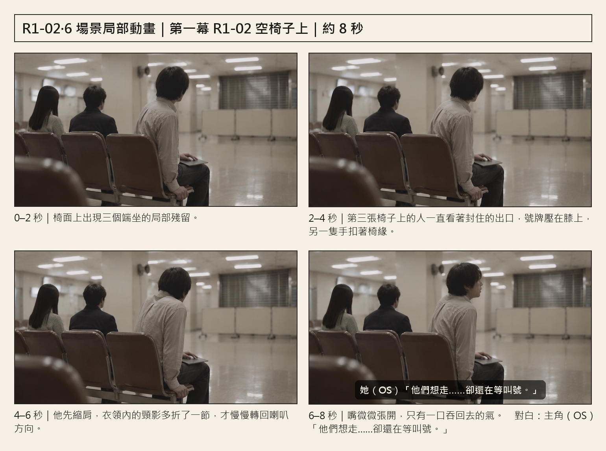

```prompt
【影片】R1-02·6｜場景局部動畫｜第一幕 R1-02 空椅子上
【生成方式】圖生影片：首格用上一段 R1-02·5 的最後一格，保持構圖、光線、色調、人物與物件造型不變，只加入下列動作。
【長度】剪用約 8 秒；生成 10 秒後裁切。
【分鏡】
0–2 秒｜椅面上出現三個端坐的局部殘留。
2–4 秒｜第三張椅子上的人一直看著封住的出口，號牌壓在膝上，另一隻手扣著椅緣。
4–6 秒｜他先縮肩，衣領內的頸影多折了一節，才慢慢轉回喇叭方向。
6–8 秒｜嘴微微張開，只有一口吞回去的氣。　對白：主角（OS）「他們想走……卻還在等叫號。」
【鏡頭】約 28mm，鏡頭鎖定不動，要疊回原主圖，景深照首格。焦點在分鏡點名的人物、倒影或異變者，前景與背景略微失焦，其餘畫面保持靜止；不新增人物或物件。
【人物】人物與異變者照首格的造型與位置，臉不給清楚五官（無臉、背光或被遮住），動作緩慢但連貫自然。
【光線色調】R1 大廳：廉價、均勻的暖白日光燈，乾淨得不自然；不加恐怖暗角，也不偏冷青。整段光源與明暗都不變。
【影片風格】寫實、極致逼真的真人實景拍攝質感：真實攝影機與自然光學，輕微景深、自然底片顆粒與真實曝光；皮膚、布料、金屬、水漬與灰塵都有真實細節。動作自然流暢，有重量與慣性，符合真實人體動作。不是遊戲 CG、不是 3D 算圖、不是插畫。
【後製（不進 AI 生成）】
聲音與後製對點：
・4–6 秒：管制影片的提示聲再次響起。
【不要出現】清楚可辨識的人臉五官；任何可讀的文字、號碼、標誌、國旗或國名（畫面上的字留白或模糊，後製再合成）；配樂；第三人稱或看見主角全身；鏡頭晃動、推移或換景；血腥特寫、裸露；手指數量或手部結構錯誤；分鏡沒寫的人物、物件突然出現、消失或變形；遊戲 CG 感、3D 算圖感、插畫、動漫或卡通畫風、塑膠般光滑的皮膚與材質；動作僵硬、機械、卡頓、漂浮感或不自然的慢動作。
```

**素材提示詞**　人物：[等號者三人（R1）](10-23_製作規格_影片素材設定.md#va-callers)｜場景：R1 入口大廳｜物品：[號牌（R1）](10-23_製作規格_影片素材設定.md#va-number-plate)

```asset
【素材】人物｜等號者三人（R1）｜R1-02·6
【內容】大廳塑膠等候椅上的三個年輕人（兩女一男，約十九到二十六歲），高矮胖瘦各不相同，穿的是自己平常的便服，像日常途中突然被帶進園區：左邊的女生是灰色針織開襟衫、白 T、淺色寬牛仔褲；中間的男生是暗紅帽 T、側邊白條紋的灰運動褲；右邊的女生是深藍大學 T、黑色寬褲。衣服乾淨但有一天下來的皺褶，色調低飽和。每人手裡都有一張塑膠號牌。第一人坐得最直；第二人縮肩、抿著嘴，嘴角被迫往兩側提起；第三人望著封住的出口，一手把號牌壓在膝上、一手扣住椅緣。異變只在頸部：衣領裡有一道細長的折角，頸影比肩膀多折一節，慢半拍才接回頭影。臉都沒有清楚五官（低垂、背光或模糊）。
【構圖】人物參考圖：中性灰背景、上方均勻暖白光；三人並排坐姿的正面與側面，加一張衣領內頸影多折一節的局部特寫。
【風格】寫實、極致逼真的真人實景攝影質感：真實相機與自然光學，輕微景深與自然底片顆粒；皮膚、布料、金屬、水漬與灰塵都有真實細節。不是遊戲 CG、不是 3D 算圖、不是插畫。
【不要出現】腐爛、傷口或血跡；三人長得一樣或穿同一套衣服；制服、戲服或破舊二手衣；名牌或品牌標誌；手指數量或手部結構錯誤；清楚可辨識的人臉五官；任何可讀的文字、號碼、標誌、國旗或國名（字留白或模糊，後製再合成）；血腥特寫、裸露；遊戲 CG 感、3D 算圖感、插畫、動漫或卡通畫風、塑膠般光滑的皮膚與材質。
```

```asset
【素材】場景｜R1 入口大廳｜R1-02·6
【內容】寫實實景的空景，不含任何人物與手；畫面中所有牌面、告示、標籤與紙件上的文字、數字一律留白或模糊。
空間：R1-V01（主場景）：燈箱（字留白）、三張空等候椅、櫃檯、待發號牌、叫號機、內門與封住的樓外出口。櫃檯外側矮牆凹位露出固定網櫃與待發灰布袋。地下梯段門無把手背面與斜舌。前景散著接收登記表。第一次全景裡，三張等候椅仍是空的。椅背與櫃檯夾成唯一可繞往後室的窄口。櫃檯後的庫房門可以看見。舊門鎖控制鈕在櫃檯內側，候坐側沒有開門鈕。庫房門的鎖舌已損壞。
本段畫面：R1-C02（操作近看）：電視、號牌及待叫序列。
【構圖】空景參考兩張：一張照「空間」的全景，第一人稱站立視線高度、約 28mm 人眼視角、平視、地平線水平；一張照「本段畫面」的近看構圖，與本段首格一致。都不含人物、手與人影。
【光線色調】R1 大廳：廉價、均勻的暖白日光燈，乾淨得不自然；不加恐怖暗角，也不偏冷青。
【風格】寫實、極致逼真的真人實景攝影質感：真實相機與自然光學，輕微景深與自然底片顆粒；皮膚、布料、金屬、水漬與灰塵都有真實細節。不是遊戲 CG、不是 3D 算圖、不是插畫。
【不要出現】任何人物、手、人影或異變者；清楚可辨識的人臉五官；任何可讀的文字、號碼、標誌、國旗或國名（字留白或模糊，後製再合成）；血腥特寫、裸露；遊戲 CG 感、3D 算圖感、插畫、動漫或卡通畫風、塑膠般光滑的皮膚與材質。
```

```asset
【素材】物品｜號牌（R1）｜R1-02·6
【內容】手掌大小的硬塑膠號牌，灰白色，邊角磨圓，表面刮花；只印一組接收編號，號碼留白或模糊。
【構圖】物品參考圖：單一物件置中，中性深灰背景、柔和側光；正面、背面與局部特寫三個角度，比例照實物。
【風格】寫實、極致逼真的真人實景攝影質感：真實相機與自然光學，輕微景深與自然底片顆粒；皮膚、布料、金屬、水漬與灰塵都有真實細節。不是遊戲 CG、不是 3D 算圖、不是插畫。
【不要出現】人物與手；清楚可辨識的人臉五官；任何可讀的文字、號碼、標誌、國旗或國名（字留白或模糊，後製再合成）；血腥特寫、裸露；遊戲 CG 感、3D 算圖感、插畫、動漫或卡通畫風、塑膠般光滑的皮膚與材質。
```

## R1-03 叫號（8 段）

<a id="v-r1-03-1"></a>

### R1-03·1　動作回饋（高）

- **重要級別：**<span class="importance-high">高</span>　重點橋段：R1 叫號
- **類型：**<span class="video-feedback">第一人稱動作回饋</span>　**畫面：**`R1-C03`　**剪用：**約 3.5 秒
- **劇本：**[R1-03 叫號](../09_劇本/09-04_正式劇本_第一幕.md#h-0904-75)
- **交付：**AI 生成稿只作動態參考或底稿；正式交付為疊在原主圖或近看上的短手部／物件動態圖層。
- **重點 ★ R1 叫號：**從叫號機原站位看轉頭、第三人抓椅抗拒而膝先轉、起立與散去；原待叫順序、三鍵、錯誤回饋及通路條件不變。設備宣導片仍是電視內的影片。
- **導演註記：**[R1-03·1 三人同時轉頭](10-22_製作規格_影片導演註記.md#vd-r1-03-1)

**劇本描述**　三個輪廓同時轉頭，肩膀仍朝前，衣領裡的細長折角像晚了一拍才接回頭影。視線停在玩家操作叫號機的位置，機台邊緣留在前景；既有監控鏡頭沿巡迴轉向入口。

**對白／配音**　無對白（純畫面／環境音）

**分鏡板**　三人同時轉頭

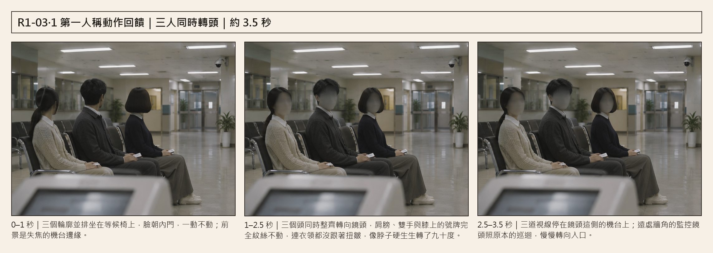

```prompt
【影片】R1-03·1｜第一人稱動作回饋｜第一幕 R1-03 叫號
【生成方式】圖生影片：首格直接用 R1-C03（操作近看：叫號機三鍵與椅側號牌） 的寫實定稿圖；構圖、光線、人物與物件造型保持不變，只加入下列動作。
【長度】剪用約 3.5 秒；生成 5 秒後裁切。
【情緒節奏】被一整排人同時注意到的不自在。動作整齊得不像活人，越安靜越讓人發毛。
【分鏡】
0–1 秒｜三個輪廓並排坐在等候椅上，臉朝內門，一動不動；前景是失焦的機台邊緣。
1–2.5 秒｜三個頭同時整齊轉向鏡頭，肩膀、雙手與膝上的號牌完全紋絲不動，連衣領都沒跟著扭皺，像脖子硬生生轉了九十度。
2.5–3.5 秒｜三道視線停在鏡頭這側的機台上；遠處牆角的監控鏡頭照原本的巡迴，慢慢轉向入口。
【鏡頭】鏡頭鎖定不動，要疊回原圖；焦段與景深照首格：前景的機台邊緣微微失焦，焦點落在三張等候椅。
【人物】人物與異變者照首格的造型與位置，臉不給清楚五官（無臉、背光或被遮住），動作緩慢但連貫自然。
【光線色調】天花板日光燈把大廳照得平均、偏暖白，陰影很淺；輪廓在這種光下也沒有變暗，清楚得讓人不安。輪廓的臉像隔著一層霧，讀不出五官。整體維持大廳廉價暖白日光燈色調，不加恐怖暗角、不偏冷青。
【影片風格】寫實、極致逼真的真人實景拍攝質感：真實攝影機與自然光學，輕微景深、自然底片顆粒與真實曝光；皮膚、布料、金屬、水漬與灰塵都有真實細節。動作自然流暢，有重量與慣性，符合真實人體動作。不是遊戲 CG、不是 3D 算圖、不是插畫。
【後製（不進 AI 生成）】
聲音與後製對點：
・0–1 秒：日光燈均勻的電流嗡聲，整段不斷。
・1–2.5 秒：轉頭時沒有腳步與衣料聲，只在頭轉定那一瞬響起一聲極輕、乾硬的紙折般喀響，隨即只剩日光燈嗡聲。
・3 秒：監控鏡頭轉動的細小馬達聲。
【不要出現】清楚可辨識的人臉五官；任何可讀的文字、號碼、標誌、國旗或國名（畫面上的字留白或模糊，後製再合成）；配樂；第三人稱或看見主角全身；鏡頭晃動、推移或換景；血腥特寫、裸露；手指數量或手部結構錯誤；分鏡沒寫的人物、物件突然出現、消失或變形；遊戲 CG 感、3D 算圖感、插畫、動漫或卡通畫風、塑膠般光滑的皮膚與材質；動作僵硬、機械、卡頓、漂浮感或不自然的慢動作。
```

**素材提示詞**　人物：[等號者三人（R1）](10-23_製作規格_影片素材設定.md#va-callers)｜場景：R1 入口大廳｜物品：無

```asset
【素材】人物｜等號者三人（R1）｜R1-03·1
【內容】大廳塑膠等候椅上的三個年輕人（兩女一男，約十九到二十六歲），高矮胖瘦各不相同，穿的是自己平常的便服，像日常途中突然被帶進園區：左邊的女生是灰色針織開襟衫、白 T、淺色寬牛仔褲；中間的男生是暗紅帽 T、側邊白條紋的灰運動褲；右邊的女生是深藍大學 T、黑色寬褲。衣服乾淨但有一天下來的皺褶，色調低飽和。每人手裡都有一張塑膠號牌。第一人坐得最直；第二人縮肩、抿著嘴，嘴角被迫往兩側提起；第三人望著封住的出口，一手把號牌壓在膝上、一手扣住椅緣。異變只在頸部：衣領裡有一道細長的折角，頸影比肩膀多折一節，慢半拍才接回頭影。臉都沒有清楚五官（低垂、背光或模糊）。
【構圖】人物參考圖：中性灰背景、上方均勻暖白光；三人並排坐姿的正面與側面，加一張衣領內頸影多折一節的局部特寫。
【風格】寫實、極致逼真的真人實景攝影質感：真實相機與自然光學，輕微景深與自然底片顆粒；皮膚、布料、金屬、水漬與灰塵都有真實細節。不是遊戲 CG、不是 3D 算圖、不是插畫。
【不要出現】腐爛、傷口或血跡；三人長得一樣或穿同一套衣服；制服、戲服或破舊二手衣；名牌或品牌標誌；手指數量或手部結構錯誤；清楚可辨識的人臉五官；任何可讀的文字、號碼、標誌、國旗或國名（字留白或模糊，後製再合成）；血腥特寫、裸露；遊戲 CG 感、3D 算圖感、插畫、動漫或卡通畫風、塑膠般光滑的皮膚與材質。
```

```asset
【素材】場景｜R1 入口大廳｜R1-03·1
【內容】寫實實景的空景，不含任何人物與手；畫面中所有牌面、告示、標籤與紙件上的文字、數字一律留白或模糊。
空間：R1-V01（主場景）：燈箱（字留白）、三張空等候椅、櫃檯、待發號牌、叫號機、內門與封住的樓外出口。櫃檯外側矮牆凹位露出固定網櫃與待發灰布袋。地下梯段門無把手背面與斜舌。前景散著接收登記表。第一次全景裡，三張等候椅仍是空的。椅背與櫃檯夾成唯一可繞往後室的窄口。櫃檯後的庫房門可以看見。舊門鎖控制鈕在櫃檯內側，候坐側沒有開門鈕。庫房門的鎖舌已損壞。
本段畫面：R1-C03（操作近看）：叫號機三鍵與椅側號牌。
【構圖】空景參考兩張：一張照「空間」的全景，第一人稱站立視線高度、約 28mm 人眼視角、平視、地平線水平；一張照「本段畫面」的近看構圖，與本段首格一致。都不含人物、手與人影。
【光線色調】R1 大廳：廉價、均勻的暖白日光燈，乾淨得不自然；不加恐怖暗角，也不偏冷青。
【風格】寫實、極致逼真的真人實景攝影質感：真實相機與自然光學，輕微景深與自然底片顆粒；皮膚、布料、金屬、水漬與灰塵都有真實細節。不是遊戲 CG、不是 3D 算圖、不是插畫。
【不要出現】任何人物、手、人影或異變者；清楚可辨識的人臉五官；任何可讀的文字、號碼、標誌、國旗或國名（字留白或模糊，後製再合成）；血腥特寫、裸露；遊戲 CG 感、3D 算圖感、插畫、動漫或卡通畫風、塑膠般光滑的皮膚與材質。
```

<a id="v-r1-03-2"></a>

### R1-03·2　動作回饋（高）

- **重要級別：**<span class="importance-high">高</span>　重點橋段：R1 叫號
- **類型：**<span class="video-feedback">第一人稱動作回饋</span>　**畫面：**`R1-C03`　**剪用：**約 2.5 秒
- **劇本：**[R1-03 叫號](../09_劇本/09-04_正式劇本_第一幕.md#h-0904-87)｜播放叫號音
- **交付：**AI 生成稿只作動態參考或底稿；正式交付為疊在原主圖或近看上的短手部／物件動態圖層。
- **重點 ★ R1 叫號：**從叫號機原站位看轉頭、第三人抓椅抗拒而膝先轉、起立與散去；原待叫順序、三鍵、錯誤回饋及通路條件不變。設備宣導片仍是電視內的影片。
- **導演註記：**[R1-03·2 第一個號](10-22_製作規格_影片導演註記.md#vd-r1-03-2)

**劇本描述**　第一個號響起，那人抬手指向自己，嘴剛張開，喉間一口急氣便被第二聲提示音蓋住。機台只亮著接收編號；號牌已舉到胸前，身體先直起，低垂的頭仍留在原高度，衣領裡的細長折角展開後才把頭影接回。

**對白／配音**　無對白（純畫面／環境音）

**分鏡板**　第一個號

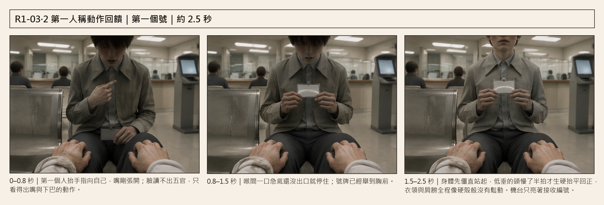

```prompt
【影片】R1-03·2｜第一人稱動作回饋｜第一幕 R1-03 叫號
【生成方式】圖生影片：首格用上一段 R1-03·1 的最後一格，保持構圖、光線、色調、人物與物件造型不變，只加入下列動作。
【長度】剪用約 2.5 秒；生成 5 秒後裁切。
【情緒節奏】想開口，被提示音壓回去。整段很短，那口沒出聲的氣是重點。
【分鏡】
0–0.8 秒｜第一個人抬手指向自己，嘴剛張開；臉讀不出五官，只看得出嘴與下巴的動作。
0.8–1.5 秒｜喉間一口急氣還沒出口就停住；號牌已經舉到胸前。
1.5–2.5 秒｜身體先僵直站起，低垂的頭慢了半拍才生硬抬平回正，衣領與肩膀全程像硬殼般沒有鬆動。機台只亮著接收編號。
【鏡頭】鏡頭鎖定不動，接上一段最後一格；焦點留在第一張椅子上的人。
【人物】人物與異變者照首格的造型與位置，臉不給清楚五官（無臉、背光或被遮住），動作緩慢但連貫自然。
【光線色調】日光燈的平均暖白光不變；號牌舉到胸前時，牌面反出一點燈光。整體維持大廳廉價暖白日光燈色調，不加恐怖暗角、不偏冷青。
【影片風格】寫實、極致逼真的真人實景拍攝質感：真實攝影機與自然光學，輕微景深、自然底片顆粒與真實曝光；皮膚、布料、金屬、水漬與灰塵都有真實細節。動作自然流暢，有重量與慣性，符合真實人體動作。不是遊戲 CG、不是 3D 算圖、不是插畫。
【後製（不進 AI 生成）】
聲音與後製對點：
・0 秒：櫃檯旁喇叭的三聲提示音響起第一聲。
・0.8 秒：第二聲提示音蓋過那口氣。
・1.6 秒：第三聲提示音，餘音拖進日光燈的嗡聲。
【不要出現】清楚可辨識的人臉五官；任何可讀的文字、號碼、標誌、國旗或國名（畫面上的字留白或模糊，後製再合成）；配樂；第三人稱或看見主角全身；鏡頭晃動、推移或換景；血腥特寫、裸露；手指數量或手部結構錯誤；分鏡沒寫的人物、物件突然出現、消失或變形；遊戲 CG 感、3D 算圖感、插畫、動漫或卡通畫風、塑膠般光滑的皮膚與材質；動作僵硬、機械、卡頓、漂浮感或不自然的慢動作。
```

**素材提示詞**　人物：[等號者三人（R1）](10-23_製作規格_影片素材設定.md#va-callers)｜場景：R1 入口大廳｜物品：[號牌（R1）](10-23_製作規格_影片素材設定.md#va-number-plate)

```asset
【素材】人物｜等號者三人（R1）｜R1-03·2
【內容】大廳塑膠等候椅上的三個年輕人（兩女一男，約十九到二十六歲），高矮胖瘦各不相同，穿的是自己平常的便服，像日常途中突然被帶進園區：左邊的女生是灰色針織開襟衫、白 T、淺色寬牛仔褲；中間的男生是暗紅帽 T、側邊白條紋的灰運動褲；右邊的女生是深藍大學 T、黑色寬褲。衣服乾淨但有一天下來的皺褶，色調低飽和。每人手裡都有一張塑膠號牌。第一人坐得最直；第二人縮肩、抿著嘴，嘴角被迫往兩側提起；第三人望著封住的出口，一手把號牌壓在膝上、一手扣住椅緣。異變只在頸部：衣領裡有一道細長的折角，頸影比肩膀多折一節，慢半拍才接回頭影。臉都沒有清楚五官（低垂、背光或模糊）。
【構圖】人物參考圖：中性灰背景、上方均勻暖白光；三人並排坐姿的正面與側面，加一張衣領內頸影多折一節的局部特寫。
【風格】寫實、極致逼真的真人實景攝影質感：真實相機與自然光學，輕微景深與自然底片顆粒；皮膚、布料、金屬、水漬與灰塵都有真實細節。不是遊戲 CG、不是 3D 算圖、不是插畫。
【不要出現】腐爛、傷口或血跡；三人長得一樣或穿同一套衣服；制服、戲服或破舊二手衣；名牌或品牌標誌；手指數量或手部結構錯誤；清楚可辨識的人臉五官；任何可讀的文字、號碼、標誌、國旗或國名（字留白或模糊，後製再合成）；血腥特寫、裸露；遊戲 CG 感、3D 算圖感、插畫、動漫或卡通畫風、塑膠般光滑的皮膚與材質。
```

```asset
【素材】場景｜R1 入口大廳｜R1-03·2
【內容】寫實實景的空景，不含任何人物與手；畫面中所有牌面、告示、標籤與紙件上的文字、數字一律留白或模糊。
空間：R1-V01（主場景）：燈箱（字留白）、三張空等候椅、櫃檯、待發號牌、叫號機、內門與封住的樓外出口。櫃檯外側矮牆凹位露出固定網櫃與待發灰布袋。地下梯段門無把手背面與斜舌。前景散著接收登記表。第一次全景裡，三張等候椅仍是空的。椅背與櫃檯夾成唯一可繞往後室的窄口。櫃檯後的庫房門可以看見。舊門鎖控制鈕在櫃檯內側，候坐側沒有開門鈕。庫房門的鎖舌已損壞。
本段畫面：R1-C03（操作近看）：叫號機三鍵與椅側號牌。
【構圖】空景參考兩張：一張照「空間」的全景，第一人稱站立視線高度、約 28mm 人眼視角、平視、地平線水平；一張照「本段畫面」的近看構圖，與本段首格一致。都不含人物、手與人影。
【光線色調】R1 大廳：廉價、均勻的暖白日光燈，乾淨得不自然；不加恐怖暗角，也不偏冷青。
【風格】寫實、極致逼真的真人實景攝影質感：真實相機與自然光學，輕微景深與自然底片顆粒；皮膚、布料、金屬、水漬與灰塵都有真實細節。不是遊戲 CG、不是 3D 算圖、不是插畫。
【不要出現】任何人物、手、人影或異變者；清楚可辨識的人臉五官；任何可讀的文字、號碼、標誌、國旗或國名（字留白或模糊，後製再合成）；血腥特寫、裸露；遊戲 CG 感、3D 算圖感、插畫、動漫或卡通畫風、塑膠般光滑的皮膚與材質。
```

```asset
【素材】物品｜號牌（R1）｜R1-03·2
【內容】手掌大小的硬塑膠號牌，灰白色，邊角磨圓，表面刮花；只印一組接收編號，號碼留白或模糊。
【構圖】物品參考圖：單一物件置中，中性深灰背景、柔和側光；正面、背面與局部特寫三個角度，比例照實物。
【風格】寫實、極致逼真的真人實景攝影質感：真實相機與自然光學，輕微景深與自然底片顆粒；皮膚、布料、金屬、水漬與灰塵都有真實細節。不是遊戲 CG、不是 3D 算圖、不是插畫。
【不要出現】人物與手；清楚可辨識的人臉五官；任何可讀的文字、號碼、標誌、國旗或國名（字留白或模糊，後製再合成）；血腥特寫、裸露；遊戲 CG 感、3D 算圖感、插畫、動漫或卡通畫風、塑膠般光滑的皮膚與材質。
```

<a id="v-r1-03-3"></a>

### R1-03·3　動作回饋（高）

- **重要級別：**<span class="importance-high">高</span>　重點橋段：R1 叫號
- **類型：**<span class="video-feedback">第一人稱動作回饋</span>　**畫面：**`R1-C03`　**剪用：**約 3.5 秒
- **劇本：**[R1-03 叫號](../09_劇本/09-04_正式劇本_第一幕.md#h-0904-87)｜播放叫號音
- **交付：**AI 生成稿只作動態參考或底稿；正式交付為疊在原主圖或近看上的短手部／物件動態圖層。
- **重點 ★ R1 叫號：**從叫號機原站位看轉頭、第三人抓椅抗拒而膝先轉、起立與散去；原待叫順序、三鍵、錯誤回饋及通路條件不變。設備宣導片仍是電視內的影片。
- **導演註記：**[R1-03·3 第二個號](10-22_製作規格_影片導演註記.md#vd-r1-03-3)

**劇本描述**　第二個號響起，那人先縮肩，抿住的嘴角卻慢慢往兩側提起。眼睛仍望著內門，胸口起伏急促，笑容已固定在臉上；站起時，手指還緊捏著號牌邊緣。

**對白／配音**　無對白（純畫面／環境音）

**分鏡板**　第二個號

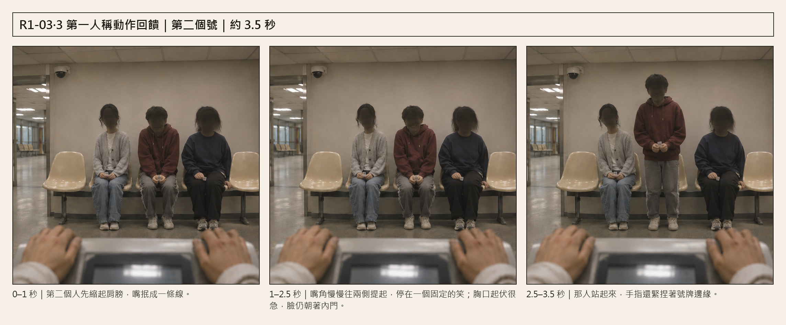

```prompt
【影片】R1-03·3｜第一人稱動作回饋｜第一幕 R1-03 叫號
【生成方式】圖生影片：首格用上一段 R1-03·2 的最後一格，保持構圖、光線、色調、人物與物件造型不變，只加入下列動作。
【長度】剪用約 3.5 秒；生成 5 秒後裁切。
【情緒節奏】害怕卻被要求笑。縮肩與慢慢撐起的笑同時發生，是這一段最難看的地方。
【分鏡】
0–1 秒｜第二個人先縮起肩膀，嘴抿成一條線。
1–2.5 秒｜嘴角慢慢往兩側提起，停在一個固定的笑；胸口起伏很急，臉仍朝著內門。
2.5–3.5 秒｜那人站起來，手指還緊捏著號牌邊緣。
【鏡頭】鏡頭鎖定不動，接上一段最後一格；焦點移到第二張椅子上的人。
【人物】人物與異變者照首格的造型與位置，臉不給清楚五官（無臉、背光或被遮住），動作緩慢但連貫自然。
【光線色調】日光燈的平均暖白光不變，胸口急促的起伏在衣料上看得出明暗變化。整體維持大廳廉價暖白日光燈色調，不加恐怖暗角、不偏冷青。
【影片風格】寫實、極致逼真的真人實景拍攝質感：真實攝影機與自然光學，輕微景深、自然底片顆粒與真實曝光；皮膚、布料、金屬、水漬與灰塵都有真實細節。動作自然流暢，有重量與慣性，符合真實人體動作。不是遊戲 CG、不是 3D 算圖、不是插畫。
【後製（不進 AI 生成）】
聲音與後製對點：
・0 秒：同一組三聲提示音再響一次。
・3 秒：塑膠椅輕輕一響。
【不要出現】清楚可辨識的人臉五官；任何可讀的文字、號碼、標誌、國旗或國名（畫面上的字留白或模糊，後製再合成）；配樂；第三人稱或看見主角全身；鏡頭晃動、推移或換景；血腥特寫、裸露；手指數量或手部結構錯誤；分鏡沒寫的人物、物件突然出現、消失或變形；遊戲 CG 感、3D 算圖感、插畫、動漫或卡通畫風、塑膠般光滑的皮膚與材質；動作僵硬、機械、卡頓、漂浮感或不自然的慢動作。
```

**素材提示詞**　人物：[等號者三人（R1）](10-23_製作規格_影片素材設定.md#va-callers)｜場景：R1 入口大廳｜物品：[號牌（R1）](10-23_製作規格_影片素材設定.md#va-number-plate)

```asset
【素材】人物｜等號者三人（R1）｜R1-03·3
【內容】大廳塑膠等候椅上的三個年輕人（兩女一男，約十九到二十六歲），高矮胖瘦各不相同，穿的是自己平常的便服，像日常途中突然被帶進園區：左邊的女生是灰色針織開襟衫、白 T、淺色寬牛仔褲；中間的男生是暗紅帽 T、側邊白條紋的灰運動褲；右邊的女生是深藍大學 T、黑色寬褲。衣服乾淨但有一天下來的皺褶，色調低飽和。每人手裡都有一張塑膠號牌。第一人坐得最直；第二人縮肩、抿著嘴，嘴角被迫往兩側提起；第三人望著封住的出口，一手把號牌壓在膝上、一手扣住椅緣。異變只在頸部：衣領裡有一道細長的折角，頸影比肩膀多折一節，慢半拍才接回頭影。臉都沒有清楚五官（低垂、背光或模糊）。
【構圖】人物參考圖：中性灰背景、上方均勻暖白光；三人並排坐姿的正面與側面，加一張衣領內頸影多折一節的局部特寫。
【風格】寫實、極致逼真的真人實景攝影質感：真實相機與自然光學，輕微景深與自然底片顆粒；皮膚、布料、金屬、水漬與灰塵都有真實細節。不是遊戲 CG、不是 3D 算圖、不是插畫。
【不要出現】腐爛、傷口或血跡；三人長得一樣或穿同一套衣服；制服、戲服或破舊二手衣；名牌或品牌標誌；手指數量或手部結構錯誤；清楚可辨識的人臉五官；任何可讀的文字、號碼、標誌、國旗或國名（字留白或模糊，後製再合成）；血腥特寫、裸露；遊戲 CG 感、3D 算圖感、插畫、動漫或卡通畫風、塑膠般光滑的皮膚與材質。
```

```asset
【素材】場景｜R1 入口大廳｜R1-03·3
【內容】寫實實景的空景，不含任何人物與手；畫面中所有牌面、告示、標籤與紙件上的文字、數字一律留白或模糊。
空間：R1-V01（主場景）：燈箱（字留白）、三張空等候椅、櫃檯、待發號牌、叫號機、內門與封住的樓外出口。櫃檯外側矮牆凹位露出固定網櫃與待發灰布袋。地下梯段門無把手背面與斜舌。前景散著接收登記表。第一次全景裡，三張等候椅仍是空的。椅背與櫃檯夾成唯一可繞往後室的窄口。櫃檯後的庫房門可以看見。舊門鎖控制鈕在櫃檯內側，候坐側沒有開門鈕。庫房門的鎖舌已損壞。
本段畫面：R1-C03（操作近看）：叫號機三鍵與椅側號牌。
【構圖】空景參考兩張：一張照「空間」的全景，第一人稱站立視線高度、約 28mm 人眼視角、平視、地平線水平；一張照「本段畫面」的近看構圖，與本段首格一致。都不含人物、手與人影。
【光線色調】R1 大廳：廉價、均勻的暖白日光燈，乾淨得不自然；不加恐怖暗角，也不偏冷青。
【風格】寫實、極致逼真的真人實景攝影質感：真實相機與自然光學，輕微景深與自然底片顆粒；皮膚、布料、金屬、水漬與灰塵都有真實細節。不是遊戲 CG、不是 3D 算圖、不是插畫。
【不要出現】任何人物、手、人影或異變者；清楚可辨識的人臉五官；任何可讀的文字、號碼、標誌、國旗或國名（字留白或模糊，後製再合成）；血腥特寫、裸露；遊戲 CG 感、3D 算圖感、插畫、動漫或卡通畫風、塑膠般光滑的皮膚與材質。
```

```asset
【素材】物品｜號牌（R1）｜R1-03·3
【內容】手掌大小的硬塑膠號牌，灰白色，邊角磨圓，表面刮花；只印一組接收編號，號碼留白或模糊。
【構圖】物品參考圖：單一物件置中，中性深灰背景、柔和側光；正面、背面與局部特寫三個角度，比例照實物。
【風格】寫實、極致逼真的真人實景攝影質感：真實相機與自然光學，輕微景深與自然底片顆粒；皮膚、布料、金屬、水漬與灰塵都有真實細節。不是遊戲 CG、不是 3D 算圖、不是插畫。
【不要出現】人物與手；清楚可辨識的人臉五官；任何可讀的文字、號碼、標誌、國旗或國名（字留白或模糊，後製再合成）；血腥特寫、裸露；遊戲 CG 感、3D 算圖感、插畫、動漫或卡通畫風、塑膠般光滑的皮膚與材質。
```

<a id="v-r1-03-4"></a>

### R1-03·4　動作回饋（高）

- **重要級別：**<span class="importance-high">高</span>　重點橋段：R1 叫號
- **類型：**<span class="video-feedback">第一人稱動作回饋</span>　**畫面：**`R1-C03`　**剪用：**約 3.5 秒
- **劇本：**[R1-03 叫號](../09_劇本/09-04_正式劇本_第一幕.md#h-0904-87)｜播放叫號音
- **交付：**AI 生成稿只作動態參考或底稿；正式交付為疊在原主圖或近看上的短手部／物件動態圖層。
- **重點 ★ R1 叫號：**從叫號機原站位看轉頭、第三人抓椅抗拒而膝先轉、起立與散去；原待叫順序、三鍵、錯誤回饋及通路條件不變。設備宣導片仍是電視內的影片。
- **導演註記：**[R1-03·4 第三個號](10-22_製作規格_影片導演註記.md#vd-r1-03-4)

**劇本描述**　第三個號響起時，那人仍望著出口，扣住椅緣的手沒有鬆開；膝蓋卻先朝內門轉去，上半身還留在椅上。塑膠椅短促地摩擦地面，手指逐節滑脫，衣領裡的頸影慢半拍才接回站起的肩膀。

**對白／配音**　無對白（純畫面／環境音）

**分鏡板**　第三個號

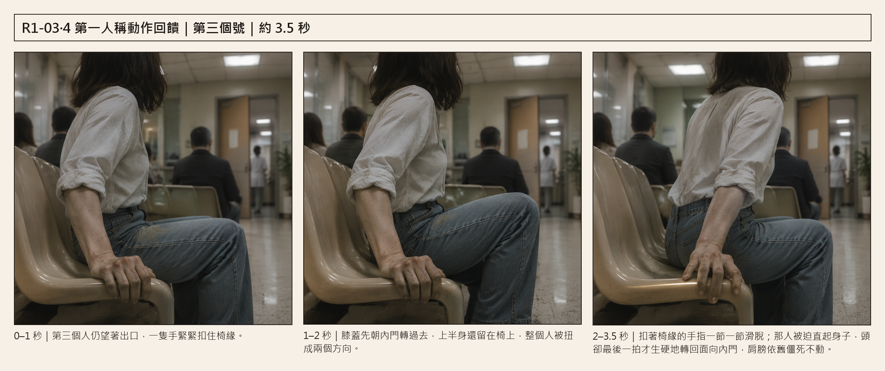

```prompt
【影片】R1-03·4｜第一人稱動作回饋｜第一幕 R1-03 叫號
【生成方式】圖生影片：首格用上一段 R1-03·3 的最後一格，保持構圖、光線、色調、人物與物件造型不變，只加入下列動作。
【長度】剪用約 3.5 秒；生成 5 秒後裁切。
【情緒節奏】身體被叫走，人還想逃。上下半身朝兩個方向，是整串叫號裡最用力的一段。
【分鏡】
0–1 秒｜第三個人仍望著出口，一隻手緊緊扣住椅緣。
1–2 秒｜膝蓋先朝內門轉過去，上半身還留在椅上，整個人被扭成兩個方向。
2–3.5 秒｜扣著椅緣的手指一節一節滑脫；那人被迫直起身子，頭卻最後一拍才生硬地轉回面向內門，肩膀依舊僵死不動。
【鏡頭】鏡頭鎖定不動，接上一段最後一格；焦點移到第三張椅子，那隻扣著椅緣的手在焦點中央。
【人物】人物與異變者照首格的造型與位置，臉不給清楚五官（無臉、背光或被遮住），動作緩慢但連貫自然。
【光線色調】日光燈的平均暖白光不變；手指滑脫時，椅緣的塑膠反出一道細亮。整體維持大廳廉價暖白日光燈色調，不加恐怖暗角、不偏冷青。
【影片風格】寫實、極致逼真的真人實景拍攝質感：真實攝影機與自然光學，輕微景深、自然底片顆粒與真實曝光；皮膚、布料、金屬、水漬與灰塵都有真實細節。動作自然流暢，有重量與慣性，符合真實人體動作。不是遊戲 CG、不是 3D 算圖、不是插畫。
【後製（不進 AI 生成）】
聲音與後製對點：
・0 秒：三聲提示音第三次響起。
・1.4 秒：塑膠椅腳在地磚上短促一刮。
【不要出現】清楚可辨識的人臉五官；任何可讀的文字、號碼、標誌、國旗或國名（畫面上的字留白或模糊，後製再合成）；配樂；第三人稱或看見主角全身；鏡頭晃動、推移或換景；血腥特寫、裸露；手指數量或手部結構錯誤；分鏡沒寫的人物、物件突然出現、消失或變形；遊戲 CG 感、3D 算圖感、插畫、動漫或卡通畫風、塑膠般光滑的皮膚與材質；動作僵硬、機械、卡頓、漂浮感或不自然的慢動作。
```

**素材提示詞**　人物：[等號者三人（R1）](10-23_製作規格_影片素材設定.md#va-callers)｜場景：R1 入口大廳｜物品：無

```asset
【素材】人物｜等號者三人（R1）｜R1-03·4
【內容】大廳塑膠等候椅上的三個年輕人（兩女一男，約十九到二十六歲），高矮胖瘦各不相同，穿的是自己平常的便服，像日常途中突然被帶進園區：左邊的女生是灰色針織開襟衫、白 T、淺色寬牛仔褲；中間的男生是暗紅帽 T、側邊白條紋的灰運動褲；右邊的女生是深藍大學 T、黑色寬褲。衣服乾淨但有一天下來的皺褶，色調低飽和。每人手裡都有一張塑膠號牌。第一人坐得最直；第二人縮肩、抿著嘴，嘴角被迫往兩側提起；第三人望著封住的出口，一手把號牌壓在膝上、一手扣住椅緣。異變只在頸部：衣領裡有一道細長的折角，頸影比肩膀多折一節，慢半拍才接回頭影。臉都沒有清楚五官（低垂、背光或模糊）。
【構圖】人物參考圖：中性灰背景、上方均勻暖白光；三人並排坐姿的正面與側面，加一張衣領內頸影多折一節的局部特寫。
【風格】寫實、極致逼真的真人實景攝影質感：真實相機與自然光學，輕微景深與自然底片顆粒；皮膚、布料、金屬、水漬與灰塵都有真實細節。不是遊戲 CG、不是 3D 算圖、不是插畫。
【不要出現】腐爛、傷口或血跡；三人長得一樣或穿同一套衣服；制服、戲服或破舊二手衣；名牌或品牌標誌；手指數量或手部結構錯誤；清楚可辨識的人臉五官；任何可讀的文字、號碼、標誌、國旗或國名（字留白或模糊，後製再合成）；血腥特寫、裸露；遊戲 CG 感、3D 算圖感、插畫、動漫或卡通畫風、塑膠般光滑的皮膚與材質。
```

```asset
【素材】場景｜R1 入口大廳｜R1-03·4
【內容】寫實實景的空景，不含任何人物與手；畫面中所有牌面、告示、標籤與紙件上的文字、數字一律留白或模糊。
空間：R1-V01（主場景）：燈箱（字留白）、三張空等候椅、櫃檯、待發號牌、叫號機、內門與封住的樓外出口。櫃檯外側矮牆凹位露出固定網櫃與待發灰布袋。地下梯段門無把手背面與斜舌。前景散著接收登記表。第一次全景裡，三張等候椅仍是空的。椅背與櫃檯夾成唯一可繞往後室的窄口。櫃檯後的庫房門可以看見。舊門鎖控制鈕在櫃檯內側，候坐側沒有開門鈕。庫房門的鎖舌已損壞。
本段畫面：R1-C03（操作近看）：叫號機三鍵與椅側號牌。
【構圖】空景參考兩張：一張照「空間」的全景，第一人稱站立視線高度、約 28mm 人眼視角、平視、地平線水平；一張照「本段畫面」的近看構圖，與本段首格一致。都不含人物、手與人影。
【光線色調】R1 大廳：廉價、均勻的暖白日光燈，乾淨得不自然；不加恐怖暗角，也不偏冷青。
【風格】寫實、極致逼真的真人實景攝影質感：真實相機與自然光學，輕微景深與自然底片顆粒；皮膚、布料、金屬、水漬與灰塵都有真實細節。不是遊戲 CG、不是 3D 算圖、不是插畫。
【不要出現】任何人物、手、人影或異變者；清楚可辨識的人臉五官；任何可讀的文字、號碼、標誌、國旗或國名（字留白或模糊，後製再合成）；血腥特寫、裸露；遊戲 CG 感、3D 算圖感、插畫、動漫或卡通畫風、塑膠般光滑的皮膚與材質。
```

<a id="v-r1-03-5"></a>

### R1-03·5　動作回饋（高）

- **重要級別：**<span class="importance-high">高</span>　重點橋段：R1 叫號
- **類型：**<span class="video-feedback">第一人稱動作回饋</span>　**畫面：**`R1-C03`　**剪用：**約 2.5 秒
- **劇本：**[R1-03 叫號](../09_劇本/09-04_正式劇本_第一幕.md#h-0904-87)｜播放叫號音
- **交付：**AI 生成稿只作動態參考或底稿；正式交付為疊在原主圖或近看上的短手部／物件動態圖層。
- **重點 ★ R1 叫號：**從叫號機原站位看轉頭、第三人抓椅抗拒而膝先轉、起立與散去；原待叫順序、三鍵、錯誤回饋及通路條件不變。設備宣導片仍是電視內的影片。
- **導演註記：**[R1-03·5 走過櫃檯](10-22_製作規格_影片導演註記.md#vd-r1-03-5)

**劇本描述**　三人沿原路依次走過櫃檯，手仍收在身前，沒有鬆肩或放下號牌。機台、椅列與內門始終留在同一觀看方向。

**對白／配音**　無對白（純畫面／環境音）

**分鏡板**　走過櫃檯

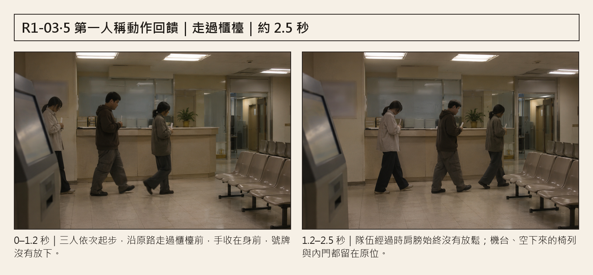

```prompt
【影片】R1-03·5｜第一人稱動作回饋｜第一幕 R1-03 叫號
【生成方式】圖生影片：首格用上一段 R1-03·4 的最後一格，保持構圖、光線、色調、人物與物件造型不變，只加入下列動作。
【長度】剪用約 2.5 秒；生成 5 秒後裁切。
【情緒節奏】順從的隊伍。整齊、安靜，一路沒有人放鬆肩膀。
【分鏡】
0–1.2 秒｜三人依次起步，沿原路走過櫃檯前，手收在身前，號牌沒有放下。
1.2–2.5 秒｜隊伍經過時肩膀始終沒有放鬆；機台、空下來的椅列與內門都留在原位。
【鏡頭】鏡頭鎖定不動，接上一段最後一格；焦點跟著隊伍經過的櫃檯前沿，不追人。
【人物】人物與異變者照首格的造型與位置，臉不給清楚五官（無臉、背光或被遮住），動作緩慢但連貫自然。
【光線色調】日光燈的平均暖白光不變，三人經過時在地磚上留下很淡的鞋影。整體維持大廳廉價暖白日光燈色調，不加恐怖暗角、不偏冷青。
【影片風格】寫實、極致逼真的真人實景拍攝質感：真實攝影機與自然光學，輕微景深、自然底片顆粒與真實曝光；皮膚、布料、金屬、水漬與灰塵都有真實細節。動作自然流暢，有重量與慣性，符合真實人體動作。不是遊戲 CG、不是 3D 算圖、不是插畫。
【後製（不進 AI 生成）】
聲音與後製對點：
・0–1.2 秒：輕而整齊的腳步聲，三人踩在同一個節拍上。
・1.2–2.5 秒：腳步聲往內門方向收小。
【不要出現】清楚可辨識的人臉五官；任何可讀的文字、號碼、標誌、國旗或國名（畫面上的字留白或模糊，後製再合成）；配樂；第三人稱或看見主角全身；鏡頭晃動、推移或換景；血腥特寫、裸露；手指數量或手部結構錯誤；分鏡沒寫的人物、物件突然出現、消失或變形；遊戲 CG 感、3D 算圖感、插畫、動漫或卡通畫風、塑膠般光滑的皮膚與材質；動作僵硬、機械、卡頓、漂浮感或不自然的慢動作。
```

**素材提示詞**　人物：[等號者三人（R1）](10-23_製作規格_影片素材設定.md#va-callers)｜場景：R1 入口大廳｜物品：[號牌（R1）](10-23_製作規格_影片素材設定.md#va-number-plate)

```asset
【素材】人物｜等號者三人（R1）｜R1-03·5
【內容】大廳塑膠等候椅上的三個年輕人（兩女一男，約十九到二十六歲），高矮胖瘦各不相同，穿的是自己平常的便服，像日常途中突然被帶進園區：左邊的女生是灰色針織開襟衫、白 T、淺色寬牛仔褲；中間的男生是暗紅帽 T、側邊白條紋的灰運動褲；右邊的女生是深藍大學 T、黑色寬褲。衣服乾淨但有一天下來的皺褶，色調低飽和。每人手裡都有一張塑膠號牌。第一人坐得最直；第二人縮肩、抿著嘴，嘴角被迫往兩側提起；第三人望著封住的出口，一手把號牌壓在膝上、一手扣住椅緣。異變只在頸部：衣領裡有一道細長的折角，頸影比肩膀多折一節，慢半拍才接回頭影。臉都沒有清楚五官（低垂、背光或模糊）。
【構圖】人物參考圖：中性灰背景、上方均勻暖白光；三人並排坐姿的正面與側面，加一張衣領內頸影多折一節的局部特寫。
【風格】寫實、極致逼真的真人實景攝影質感：真實相機與自然光學，輕微景深與自然底片顆粒；皮膚、布料、金屬、水漬與灰塵都有真實細節。不是遊戲 CG、不是 3D 算圖、不是插畫。
【不要出現】腐爛、傷口或血跡；三人長得一樣或穿同一套衣服；制服、戲服或破舊二手衣；名牌或品牌標誌；手指數量或手部結構錯誤；清楚可辨識的人臉五官；任何可讀的文字、號碼、標誌、國旗或國名（字留白或模糊，後製再合成）；血腥特寫、裸露；遊戲 CG 感、3D 算圖感、插畫、動漫或卡通畫風、塑膠般光滑的皮膚與材質。
```

```asset
【素材】場景｜R1 入口大廳｜R1-03·5
【內容】寫實實景的空景，不含任何人物與手；畫面中所有牌面、告示、標籤與紙件上的文字、數字一律留白或模糊。
空間：R1-V01（主場景）：燈箱（字留白）、三張空等候椅、櫃檯、待發號牌、叫號機、內門與封住的樓外出口。櫃檯外側矮牆凹位露出固定網櫃與待發灰布袋。地下梯段門無把手背面與斜舌。前景散著接收登記表。第一次全景裡，三張等候椅仍是空的。椅背與櫃檯夾成唯一可繞往後室的窄口。櫃檯後的庫房門可以看見。舊門鎖控制鈕在櫃檯內側，候坐側沒有開門鈕。庫房門的鎖舌已損壞。
本段畫面：R1-C03（操作近看）：叫號機三鍵與椅側號牌。
【構圖】空景參考兩張：一張照「空間」的全景，第一人稱站立視線高度、約 28mm 人眼視角、平視、地平線水平；一張照「本段畫面」的近看構圖，與本段首格一致。都不含人物、手與人影。
【光線色調】R1 大廳：廉價、均勻的暖白日光燈，乾淨得不自然；不加恐怖暗角，也不偏冷青。
【風格】寫實、極致逼真的真人實景攝影質感：真實相機與自然光學，輕微景深與自然底片顆粒；皮膚、布料、金屬、水漬與灰塵都有真實細節。不是遊戲 CG、不是 3D 算圖、不是插畫。
【不要出現】任何人物、手、人影或異變者；清楚可辨識的人臉五官；任何可讀的文字、號碼、標誌、國旗或國名（字留白或模糊，後製再合成）；血腥特寫、裸露；遊戲 CG 感、3D 算圖感、插畫、動漫或卡通畫風、塑膠般光滑的皮膚與材質。
```

```asset
【素材】物品｜號牌（R1）｜R1-03·5
【內容】手掌大小的硬塑膠號牌，灰白色，邊角磨圓，表面刮花；只印一組接收編號，號碼留白或模糊。
【構圖】物品參考圖：單一物件置中，中性深灰背景、柔和側光；正面、背面與局部特寫三個角度，比例照實物。
【風格】寫實、極致逼真的真人實景攝影質感：真實相機與自然光學，輕微景深與自然底片顆粒；皮膚、布料、金屬、水漬與灰塵都有真實細節。不是遊戲 CG、不是 3D 算圖、不是插畫。
【不要出現】人物與手；清楚可辨識的人臉五官；任何可讀的文字、號碼、標誌、國旗或國名（字留白或模糊，後製再合成）；血腥特寫、裸露；遊戲 CG 感、3D 算圖感、插畫、動漫或卡通畫風、塑膠般光滑的皮膚與材質。
```

<a id="v-r1-03-6"></a>

### R1-03·6　動作回饋（高）

- **重要級別：**<span class="importance-high">高</span>　重點橋段：R1 叫號
- **類型：**<span class="video-feedback">第一人稱動作回饋</span>　**畫面：**`R1-C03`　**剪用：**約 5 秒
- **劇本：**[R1-03 叫號](../09_劇本/09-04_正式劇本_第一幕.md#h-0904-87)｜播放叫號音
- **交付：**AI 生成稿只作動態參考或底稿；正式交付為疊在原主圖或近看上的短手部／物件動態圖層。
- **重點 ★ R1 叫號：**從叫號機原站位看轉頭、第三人抓椅抗拒而膝先轉、起立與散去；原待叫順序、三鍵、錯誤回饋及通路條件不變。設備宣導片仍是電視內的影片。
- **導演註記：**[R1-03·6 最後一隻手](10-22_製作規格_影片導演註記.md#vd-r1-03-6)

**劇本描述**　輪廓在內門前逐一淡去。最後消失的是第三人扣過椅緣的手；機台前景，主角的手仍在剛才按鍵的那一側。兩隻手之間留下空椅與緊閉的內門。通路讓出，損壞的鎖舌仍在原處。

**對白／配音**　無對白（純畫面／環境音）

**分鏡板**　最後一隻手

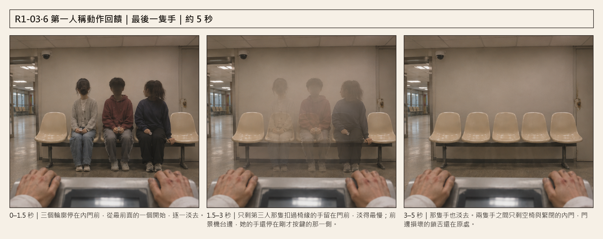

```prompt
【影片】R1-03·6｜第一人稱動作回饋｜第一幕 R1-03 叫號
【生成方式】圖生影片：首格用上一段 R1-03·5 的最後一格，保持構圖、光線、色調、人物與物件造型不變，只加入下列動作。
【長度】剪用約 5 秒；生成 5 秒後裁切。
【情緒節奏】散場後的空。最後留下的那隻手要停得夠久，讓人記住它剛才多不想放開。
【分鏡】
0–1.5 秒｜三個輪廓停在內門前，從最前面的一個開始，逐一淡去。
1.5–3 秒｜只剩第三人那隻扣過椅緣的手留在門前，淡得最慢；前景機台邊，她的手還停在剛才按鍵的那一側。
3–5 秒｜那隻手也淡去。兩隻手之間只剩空椅與緊閉的內門，門邊損壞的鎖舌還在原處。
【鏡頭】鏡頭鎖定不動，接上一段最後一格；畫面左右兩端各有一隻手：遠處第三人的手，前景機台邊她的手。
【人物】她的手只露出手與白襯衫袖口，手背乾裂、有擦傷，從畫面下緣入鏡；五指比例正確。人物與異變者照首格的造型與位置，臉不給清楚五官（無臉、背光或被遮住），動作緩慢但連貫自然。
【光線色調】日光燈的平均暖白光不變；輪廓淡去時沒有發光或特效，像被燈光慢慢洗掉。整體維持大廳廉價暖白日光燈色調，不加恐怖暗角、不偏冷青。
【影片風格】寫實、極致逼真的真人實景拍攝質感：真實攝影機與自然光學，輕微景深、自然底片顆粒與真實曝光；皮膚、布料、金屬、水漬與灰塵都有真實細節。動作自然流暢，有重量與慣性，符合真實人體動作。不是遊戲 CG、不是 3D 算圖、不是插畫。
【後製（不進 AI 生成）】
聲音與後製對點：
・0–1.5 秒：第三個號最後一聲提示音的回音還沒散。
・1.5–3 秒：回音的音高慢慢貼上日光燈的嗡聲。
・3–5 秒：回音完全混進嗡聲，聽不出在哪一刻停。
【不要出現】清楚可辨識的人臉五官；任何可讀的文字、號碼、標誌、國旗或國名（畫面上的字留白或模糊，後製再合成）；配樂；第三人稱或看見主角全身；鏡頭晃動、推移或換景；血腥特寫、裸露；手指數量或手部結構錯誤；分鏡沒寫的人物、物件突然出現、消失或變形；遊戲 CG 感、3D 算圖感、插畫、動漫或卡通畫風、塑膠般光滑的皮膚與材質；動作僵硬、機械、卡頓、漂浮感或不自然的慢動作。
```

**素材提示詞**　人物：[她・現在（第一人稱的手）](10-23_製作規格_影片素材設定.md#va-her-hands)、[等號者三人（R1）](10-23_製作規格_影片素材設定.md#va-callers)｜場景：R1 入口大廳｜物品：無

```asset
【素材】人物｜她・現在（第一人稱的手）｜R1-03·6
【內容】26 歲成年女性的雙手與前臂，體態消瘦，手腕偏細。手背與指節乾裂，有零散的表淺擦傷與乾掉的泥灰，指甲短、邊緣不齊。白色普通長袖襯衫的袖口有局部撕裂、水漬與乾泥，不是制服剪裁，可隨手捲到前臂。動作時手肘靠近身體，起手前常先停一下。
【構圖】手部參考圖：中性灰背景、柔和均勻光；雙手與前臂的正面、側面、握物三個角度，只拍到手肘以下，五指比例正確。
【風格】寫實、極致逼真的真人實景攝影質感：真實相機與自然光學，輕微景深與自然底片顆粒；皮膚、布料、金屬、水漬與灰塵都有真實細節。不是遊戲 CG、不是 3D 算圖、不是插畫。
【不要出現】戒指、手錶、指甲油或任何飾品；新鮮流血或傷口剖面；名牌或品牌標誌；手指數量或手部結構錯誤；清楚可辨識的人臉五官；任何可讀的文字、號碼、標誌、國旗或國名（字留白或模糊，後製再合成）；血腥特寫、裸露；遊戲 CG 感、3D 算圖感、插畫、動漫或卡通畫風、塑膠般光滑的皮膚與材質。
```

```asset
【素材】人物｜等號者三人（R1）｜R1-03·6
【內容】大廳塑膠等候椅上的三個年輕人（兩女一男，約十九到二十六歲），高矮胖瘦各不相同，穿的是自己平常的便服，像日常途中突然被帶進園區：左邊的女生是灰色針織開襟衫、白 T、淺色寬牛仔褲；中間的男生是暗紅帽 T、側邊白條紋的灰運動褲；右邊的女生是深藍大學 T、黑色寬褲。衣服乾淨但有一天下來的皺褶，色調低飽和。每人手裡都有一張塑膠號牌。第一人坐得最直；第二人縮肩、抿著嘴，嘴角被迫往兩側提起；第三人望著封住的出口，一手把號牌壓在膝上、一手扣住椅緣。異變只在頸部：衣領裡有一道細長的折角，頸影比肩膀多折一節，慢半拍才接回頭影。臉都沒有清楚五官（低垂、背光或模糊）。
【構圖】人物參考圖：中性灰背景、上方均勻暖白光；三人並排坐姿的正面與側面，加一張衣領內頸影多折一節的局部特寫。
【風格】寫實、極致逼真的真人實景攝影質感：真實相機與自然光學，輕微景深與自然底片顆粒；皮膚、布料、金屬、水漬與灰塵都有真實細節。不是遊戲 CG、不是 3D 算圖、不是插畫。
【不要出現】腐爛、傷口或血跡；三人長得一樣或穿同一套衣服；制服、戲服或破舊二手衣；名牌或品牌標誌；手指數量或手部結構錯誤；清楚可辨識的人臉五官；任何可讀的文字、號碼、標誌、國旗或國名（字留白或模糊，後製再合成）；血腥特寫、裸露；遊戲 CG 感、3D 算圖感、插畫、動漫或卡通畫風、塑膠般光滑的皮膚與材質。
```

```asset
【素材】場景｜R1 入口大廳｜R1-03·6
【內容】寫實實景的空景，不含任何人物與手；畫面中所有牌面、告示、標籤與紙件上的文字、數字一律留白或模糊。
空間：R1-V01（主場景）：燈箱（字留白）、三張空等候椅、櫃檯、待發號牌、叫號機、內門與封住的樓外出口。櫃檯外側矮牆凹位露出固定網櫃與待發灰布袋。地下梯段門無把手背面與斜舌。前景散著接收登記表。第一次全景裡，三張等候椅仍是空的。椅背與櫃檯夾成唯一可繞往後室的窄口。櫃檯後的庫房門可以看見。舊門鎖控制鈕在櫃檯內側，候坐側沒有開門鈕。庫房門的鎖舌已損壞。
本段畫面：R1-C03（操作近看）：叫號機三鍵與椅側號牌。
【構圖】空景參考兩張：一張照「空間」的全景，第一人稱站立視線高度、約 28mm 人眼視角、平視、地平線水平；一張照「本段畫面」的近看構圖，與本段首格一致。都不含人物、手與人影。
【光線色調】R1 大廳：廉價、均勻的暖白日光燈，乾淨得不自然；不加恐怖暗角，也不偏冷青。
【風格】寫實、極致逼真的真人實景攝影質感：真實相機與自然光學，輕微景深與自然底片顆粒；皮膚、布料、金屬、水漬與灰塵都有真實細節。不是遊戲 CG、不是 3D 算圖、不是插畫。
【不要出現】任何人物、手、人影或異變者；清楚可辨識的人臉五官；任何可讀的文字、號碼、標誌、國旗或國名（字留白或模糊，後製再合成）；血腥特寫、裸露；遊戲 CG 感、3D 算圖感、插畫、動漫或卡通畫風、塑膠般光滑的皮膚與材質。
```

<a id="v-r1-03-7"></a>

### R1-03·7　動作回饋（高）

- **重要級別：**<span class="importance-high">高</span>　重點橋段：R1 叫號
- **類型：**<span class="video-feedback">第一人稱動作回饋</span>　**畫面：**`R1-C03`　**剪用：**約 1.5 秒
- **劇本：**[R1-03 叫號](../09_劇本/09-04_正式劇本_第一幕.md#h-0904-104)｜測試鈴聲與重置
- **交付：**AI 生成稿只作動態參考或底稿；正式交付為疊在原主圖或近看上的短手部／物件動態圖層。
- **重點 ★ R1 叫號：**從叫號機原站位看轉頭、第三人抓椅抗拒而膝先轉、起立與散去；原待叫順序、三鍵、錯誤回饋及通路條件不變。設備宣導片仍是電視內的影片。
- **導演註記：**[R1-03·7 鈴聲測試](10-22_製作規格_影片導演註記.md#vd-r1-03-7)

**劇本描述**　輪廓轉向機上喇叭，手中的號牌沒有放下。玩家可近看椅側的接收編號，再對回機台待叫序列。

**對白／配音**　無對白（純畫面／環境音）

**分鏡板**　鈴聲測試

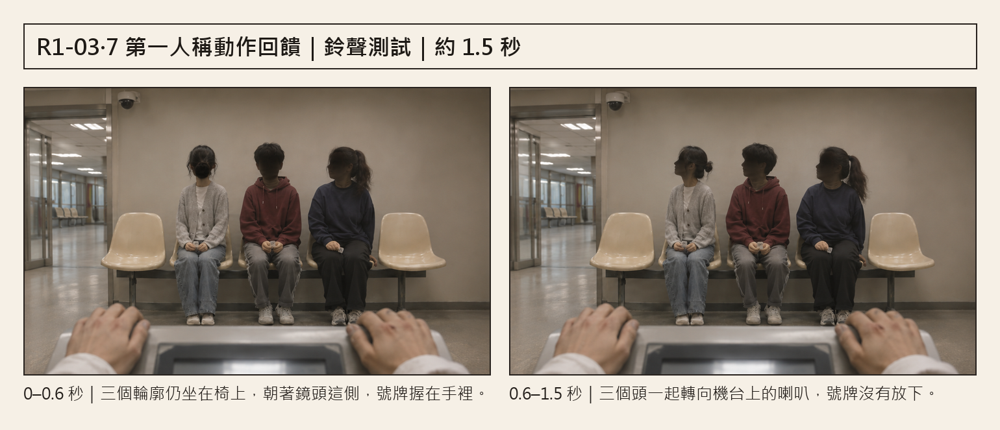

```prompt
【影片】R1-03·7｜第一人稱動作回饋｜第一幕 R1-03 叫號
【生成方式】圖生影片：首格用上一段 R1-03·6 的最後一格，保持構圖、光線、色調、人物與物件造型不變，只加入下列動作。
【長度】剪用約 1.5 秒；生成 5 秒後裁切。
【情緒節奏】只是測試，它們卻照樣被聲音牽著走。短、乾脆。
【分鏡】
0–0.6 秒｜三個輪廓仍坐在椅上，朝著鏡頭這側，號牌握在手裡。
0.6–1.5 秒｜三個頭一起轉向機台上的喇叭，號牌沒有放下。
【鏡頭】鏡頭鎖定不動，接上一段最後一格；焦點在三張等候椅。
【人物】人物與異變者照首格的造型與位置，臉不給清楚五官（無臉、背光或被遮住），動作緩慢但連貫自然。
【光線色調】日光燈的平均暖白光不變。整體維持大廳廉價暖白日光燈色調，不加恐怖暗角、不偏冷青。
【影片風格】寫實、極致逼真的真人實景拍攝質感：真實攝影機與自然光學，輕微景深、自然底片顆粒與真實曝光；皮膚、布料、金屬、水漬與灰塵都有真實細節。動作自然流暢，有重量與慣性，符合真實人體動作。不是遊戲 CG、不是 3D 算圖、不是插畫。
【後製（不進 AI 生成）】
聲音與後製對點：
・0 秒：機上喇叭響起模擬鈴聲。
・0.6–1.5 秒：鈴聲停後只剩嗡聲。
【不要出現】清楚可辨識的人臉五官；任何可讀的文字、號碼、標誌、國旗或國名（畫面上的字留白或模糊，後製再合成）；配樂；第三人稱或看見主角全身；鏡頭晃動、推移或換景；血腥特寫、裸露；手指數量或手部結構錯誤；分鏡沒寫的人物、物件突然出現、消失或變形；遊戲 CG 感、3D 算圖感、插畫、動漫或卡通畫風、塑膠般光滑的皮膚與材質；動作僵硬、機械、卡頓、漂浮感或不自然的慢動作。
```

**素材提示詞**　人物：[等號者三人（R1）](10-23_製作規格_影片素材設定.md#va-callers)｜場景：R1 入口大廳｜物品：[號牌（R1）](10-23_製作規格_影片素材設定.md#va-number-plate)

```asset
【素材】人物｜等號者三人（R1）｜R1-03·7
【內容】大廳塑膠等候椅上的三個年輕人（兩女一男，約十九到二十六歲），高矮胖瘦各不相同，穿的是自己平常的便服，像日常途中突然被帶進園區：左邊的女生是灰色針織開襟衫、白 T、淺色寬牛仔褲；中間的男生是暗紅帽 T、側邊白條紋的灰運動褲；右邊的女生是深藍大學 T、黑色寬褲。衣服乾淨但有一天下來的皺褶，色調低飽和。每人手裡都有一張塑膠號牌。第一人坐得最直；第二人縮肩、抿著嘴，嘴角被迫往兩側提起；第三人望著封住的出口，一手把號牌壓在膝上、一手扣住椅緣。異變只在頸部：衣領裡有一道細長的折角，頸影比肩膀多折一節，慢半拍才接回頭影。臉都沒有清楚五官（低垂、背光或模糊）。
【構圖】人物參考圖：中性灰背景、上方均勻暖白光；三人並排坐姿的正面與側面，加一張衣領內頸影多折一節的局部特寫。
【風格】寫實、極致逼真的真人實景攝影質感：真實相機與自然光學，輕微景深與自然底片顆粒；皮膚、布料、金屬、水漬與灰塵都有真實細節。不是遊戲 CG、不是 3D 算圖、不是插畫。
【不要出現】腐爛、傷口或血跡；三人長得一樣或穿同一套衣服；制服、戲服或破舊二手衣；名牌或品牌標誌；手指數量或手部結構錯誤；清楚可辨識的人臉五官；任何可讀的文字、號碼、標誌、國旗或國名（字留白或模糊，後製再合成）；血腥特寫、裸露；遊戲 CG 感、3D 算圖感、插畫、動漫或卡通畫風、塑膠般光滑的皮膚與材質。
```

```asset
【素材】場景｜R1 入口大廳｜R1-03·7
【內容】寫實實景的空景，不含任何人物與手；畫面中所有牌面、告示、標籤與紙件上的文字、數字一律留白或模糊。
空間：R1-V01（主場景）：燈箱（字留白）、三張空等候椅、櫃檯、待發號牌、叫號機、內門與封住的樓外出口。櫃檯外側矮牆凹位露出固定網櫃與待發灰布袋。地下梯段門無把手背面與斜舌。前景散著接收登記表。第一次全景裡，三張等候椅仍是空的。椅背與櫃檯夾成唯一可繞往後室的窄口。櫃檯後的庫房門可以看見。舊門鎖控制鈕在櫃檯內側，候坐側沒有開門鈕。庫房門的鎖舌已損壞。
本段畫面：R1-C03（操作近看）：叫號機三鍵與椅側號牌。
【構圖】空景參考兩張：一張照「空間」的全景，第一人稱站立視線高度、約 28mm 人眼視角、平視、地平線水平；一張照「本段畫面」的近看構圖，與本段首格一致。都不含人物、手與人影。
【光線色調】R1 大廳：廉價、均勻的暖白日光燈，乾淨得不自然；不加恐怖暗角，也不偏冷青。
【風格】寫實、極致逼真的真人實景攝影質感：真實相機與自然光學，輕微景深與自然底片顆粒；皮膚、布料、金屬、水漬與灰塵都有真實細節。不是遊戲 CG、不是 3D 算圖、不是插畫。
【不要出現】任何人物、手、人影或異變者；清楚可辨識的人臉五官；任何可讀的文字、號碼、標誌、國旗或國名（字留白或模糊，後製再合成）；血腥特寫、裸露；遊戲 CG 感、3D 算圖感、插畫、動漫或卡通畫風、塑膠般光滑的皮膚與材質。
```

```asset
【素材】物品｜號牌（R1）｜R1-03·7
【內容】手掌大小的硬塑膠號牌，灰白色，邊角磨圓，表面刮花；只印一組接收編號，號碼留白或模糊。
【構圖】物品參考圖：單一物件置中，中性深灰背景、柔和側光；正面、背面與局部特寫三個角度，比例照實物。
【風格】寫實、極致逼真的真人實景攝影質感：真實相機與自然光學，輕微景深與自然底片顆粒；皮膚、布料、金屬、水漬與灰塵都有真實細節。不是遊戲 CG、不是 3D 算圖、不是插畫。
【不要出現】人物與手；清楚可辨識的人臉五官；任何可讀的文字、號碼、標誌、國旗或國名（字留白或模糊，後製再合成）；血腥特寫、裸露；遊戲 CG 感、3D 算圖感、插畫、動漫或卡通畫風、塑膠般光滑的皮膚與材質。
```

<a id="v-r1-03-8"></a>

### R1-03·8　動作回饋（高）

- **重要級別：**<span class="importance-high">高</span>　重點橋段：R1 叫號
- **類型：**<span class="video-feedback">第一人稱動作回饋</span>　**畫面：**`R1-C03`　**剪用：**約 1.5 秒
- **劇本：**[R1-03 叫號](../09_劇本/09-04_正式劇本_第一幕.md#h-0904-104)｜測試鈴聲與重置
- **交付：**AI 生成稿只作動態參考或底稿；正式交付為疊在原主圖或近看上的短手部／物件動態圖層。
- **重點 ★ R1 叫號：**從叫號機原站位看轉頭、第三人抓椅抗拒而膝先轉、起立與散去；原待叫順序、三鍵、錯誤回饋及通路條件不變。設備宣導片仍是電視內的影片。
- **導演註記：**[R1-03·8 重置測試](10-22_製作規格_影片導演註記.md#vd-r1-03-8)

**劇本描述**　機台短響，原本朝向玩家的輪廓坐回等候姿勢。號牌和待叫序列都沒變。

**對白／配音**　無對白（純畫面／環境音）

**分鏡板**　重置測試

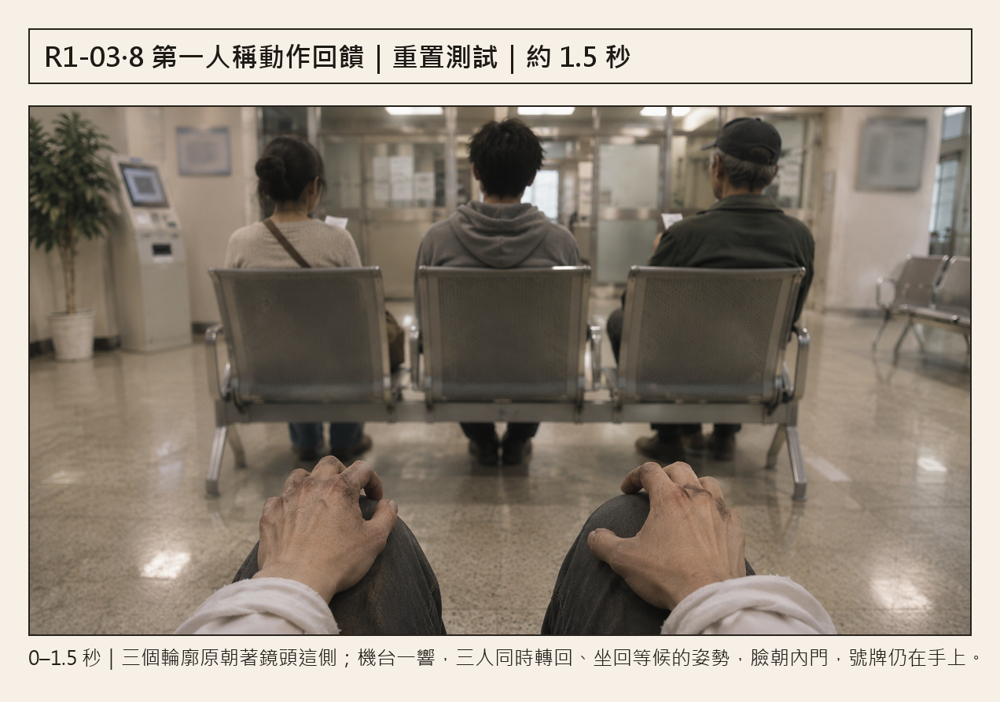

```prompt
【影片】R1-03·8｜第一人稱動作回饋｜第一幕 R1-03 叫號
【生成方式】圖生影片：首格用上一段 R1-03·7 的最後一格，保持構圖、光線、色調、人物與物件造型不變，只加入下列動作。
【長度】剪用約 1.5 秒；生成 5 秒後裁切。
【情緒節奏】被一聲短響按回原位。整齊得像沒發生過任何事。
【分鏡】
0–1.5 秒｜三個輪廓原朝著鏡頭這側；機台一響，三人同時轉回、坐回等候的姿勢，臉朝內門，號牌仍在手上。
【鏡頭】鏡頭鎖定不動，接上一段最後一格；焦點在三張等候椅。
【人物】人物與異變者照首格的造型與位置，臉不給清楚五官（無臉、背光或被遮住），動作緩慢但連貫自然。
【光線色調】日光燈的平均暖白光不變。整體維持大廳廉價暖白日光燈色調，不加恐怖暗角、不偏冷青。
【影片風格】寫實、極致逼真的真人實景拍攝質感：真實攝影機與自然光學，輕微景深、自然底片顆粒與真實曝光；皮膚、布料、金屬、水漬與灰塵都有真實細節。動作自然流暢，有重量與慣性，符合真實人體動作。不是遊戲 CG、不是 3D 算圖、不是插畫。
【後製（不進 AI 生成）】
聲音與後製對點：
・0 秒：機台短短一響；之後只剩嗡聲。
【不要出現】清楚可辨識的人臉五官；任何可讀的文字、號碼、標誌、國旗或國名（畫面上的字留白或模糊，後製再合成）；配樂；第三人稱或看見主角全身；鏡頭晃動、推移或換景；血腥特寫、裸露；手指數量或手部結構錯誤；分鏡沒寫的人物、物件突然出現、消失或變形；遊戲 CG 感、3D 算圖感、插畫、動漫或卡通畫風、塑膠般光滑的皮膚與材質；動作僵硬、機械、卡頓、漂浮感或不自然的慢動作。
```

**素材提示詞**　人物：[等號者三人（R1）](10-23_製作規格_影片素材設定.md#va-callers)｜場景：R1 入口大廳｜物品：[號牌（R1）](10-23_製作規格_影片素材設定.md#va-number-plate)

```asset
【素材】人物｜等號者三人（R1）｜R1-03·8
【內容】大廳塑膠等候椅上的三個年輕人（兩女一男，約十九到二十六歲），高矮胖瘦各不相同，穿的是自己平常的便服，像日常途中突然被帶進園區：左邊的女生是灰色針織開襟衫、白 T、淺色寬牛仔褲；中間的男生是暗紅帽 T、側邊白條紋的灰運動褲；右邊的女生是深藍大學 T、黑色寬褲。衣服乾淨但有一天下來的皺褶，色調低飽和。每人手裡都有一張塑膠號牌。第一人坐得最直；第二人縮肩、抿著嘴，嘴角被迫往兩側提起；第三人望著封住的出口，一手把號牌壓在膝上、一手扣住椅緣。異變只在頸部：衣領裡有一道細長的折角，頸影比肩膀多折一節，慢半拍才接回頭影。臉都沒有清楚五官（低垂、背光或模糊）。
【構圖】人物參考圖：中性灰背景、上方均勻暖白光；三人並排坐姿的正面與側面，加一張衣領內頸影多折一節的局部特寫。
【風格】寫實、極致逼真的真人實景攝影質感：真實相機與自然光學，輕微景深與自然底片顆粒；皮膚、布料、金屬、水漬與灰塵都有真實細節。不是遊戲 CG、不是 3D 算圖、不是插畫。
【不要出現】腐爛、傷口或血跡；三人長得一樣或穿同一套衣服；制服、戲服或破舊二手衣；名牌或品牌標誌；手指數量或手部結構錯誤；清楚可辨識的人臉五官；任何可讀的文字、號碼、標誌、國旗或國名（字留白或模糊，後製再合成）；血腥特寫、裸露；遊戲 CG 感、3D 算圖感、插畫、動漫或卡通畫風、塑膠般光滑的皮膚與材質。
```

```asset
【素材】場景｜R1 入口大廳｜R1-03·8
【內容】寫實實景的空景，不含任何人物與手；畫面中所有牌面、告示、標籤與紙件上的文字、數字一律留白或模糊。
空間：R1-V01（主場景）：燈箱（字留白）、三張空等候椅、櫃檯、待發號牌、叫號機、內門與封住的樓外出口。櫃檯外側矮牆凹位露出固定網櫃與待發灰布袋。地下梯段門無把手背面與斜舌。前景散著接收登記表。第一次全景裡，三張等候椅仍是空的。椅背與櫃檯夾成唯一可繞往後室的窄口。櫃檯後的庫房門可以看見。舊門鎖控制鈕在櫃檯內側，候坐側沒有開門鈕。庫房門的鎖舌已損壞。
本段畫面：R1-C03（操作近看）：叫號機三鍵與椅側號牌。
【構圖】空景參考兩張：一張照「空間」的全景，第一人稱站立視線高度、約 28mm 人眼視角、平視、地平線水平；一張照「本段畫面」的近看構圖，與本段首格一致。都不含人物、手與人影。
【光線色調】R1 大廳：廉價、均勻的暖白日光燈，乾淨得不自然；不加恐怖暗角，也不偏冷青。
【風格】寫實、極致逼真的真人實景攝影質感：真實相機與自然光學，輕微景深與自然底片顆粒；皮膚、布料、金屬、水漬與灰塵都有真實細節。不是遊戲 CG、不是 3D 算圖、不是插畫。
【不要出現】任何人物、手、人影或異變者；清楚可辨識的人臉五官；任何可讀的文字、號碼、標誌、國旗或國名（字留白或模糊，後製再合成）；血腥特寫、裸露；遊戲 CG 感、3D 算圖感、插畫、動漫或卡通畫風、塑膠般光滑的皮膚與材質。
```

```asset
【素材】物品｜號牌（R1）｜R1-03·8
【內容】手掌大小的硬塑膠號牌，灰白色，邊角磨圓，表面刮花；只印一組接收編號，號碼留白或模糊。
【構圖】物品參考圖：單一物件置中，中性深灰背景、柔和側光；正面、背面與局部特寫三個角度，比例照實物。
【風格】寫實、極致逼真的真人實景攝影質感：真實相機與自然光學，輕微景深與自然底片顆粒；皮膚、布料、金屬、水漬與灰塵都有真實細節。不是遊戲 CG、不是 3D 算圖、不是插畫。
【不要出現】人物與手；清楚可辨識的人臉五官；任何可讀的文字、號碼、標誌、國旗或國名（字留白或模糊，後製再合成）；血腥特寫、裸露；遊戲 CG 感、3D 算圖感、插畫、動漫或卡通畫風、塑膠般光滑的皮膚與材質。
```

## R1-04b 熄滅的螢幕裡慢半拍（1 段）

<a id="v-r1-04b-1"></a>

### R1-04b·1　互動（中）

- **重要級別：**<span class="importance-mid">中</span>　操作中的現場動態
- **類型：**<span class="video-interact">第一人稱互動</span>　**畫面：**`R1-C06`　**剪用：**約 3 秒
- **劇本：**[R1-04b 熄滅的螢幕裡慢半拍](../09_劇本/09-04_正式劇本_第一幕.md#h-0904-136)
- **交付：**AI 生成稿只作動態參考或底稿；正式交付拆成手部、前景遮擋與物件動態圖層，疊回原主圖，不以整支影片取代可點的場景。
- **導演註記：**[R1-04b·1 晚 0.3 秒轉身的黑螢幕](10-22_製作規格_影片導演註記.md#vd-r1-04b-1)

**劇本描述**　原電視熄滅。玩家轉向後室時，熄滅的螢幕裡的站姿跟著轉，晚 0.3 秒。

**對白／配音**　無對白（純畫面／環境音）

**分鏡板**　晚0.3秒轉身的黑螢幕

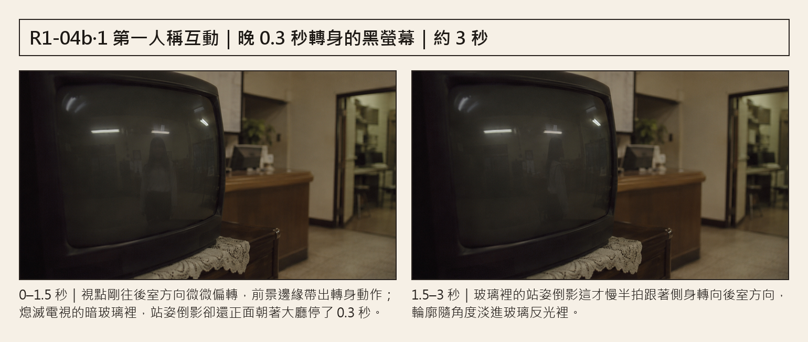

```prompt
【影片】R1-04b·1｜第一人稱互動｜第一幕 R1-04b 熄滅的螢幕裡慢半拍
【生成方式】圖生影片：首格直接用 R1-C06（近看：熄滅的電視表面） 的寫實定稿圖；構圖、光線、人物與物件造型保持不變，只加入下列動作。
【長度】剪用約 3 秒；生成 5 秒後裁切。
【情緒節奏】電視已經關了，螢幕裡那個模糊的自己卻慢了一瞬才轉開——像有人隔著玻璃多看了大廳一眼才肯走。
【分鏡】
0–1.5 秒｜視點剛往後室方向微微偏轉，前景邊緣帶出轉身動作；熄滅電視的暗玻璃裡，站姿倒影卻還正面朝著大廳停了 0.3 秒。
1.5–3 秒｜玻璃裡的站姿倒影這才慢半拍跟著側身轉向後室方向，輪廓隨角度淡進玻璃反光裡。
【鏡頭】約 28mm 第一人稱視線，鏡位鎖定不動，要疊回原圖（R1-C06）；焦點落在熄滅電視暗玻璃面上的模糊站姿輪廓，櫃檯與後室門框在旁微失焦。
【人物】反光中的人影照首格的造型與位置，亮度壓低、臉被反光吃掉，不給清楚五官。
【光線色調】大廳日光燈在熄滅的曲面玻璃上留下一道偏冷反光，站姿倒影沉在暗玻璃裡，看不清五官。整體維持大廳廉價暖白日光燈色調，不加恐怖暗角、不偏冷青。
【影片風格】寫實、極致逼真的真人實景拍攝質感：真實攝影機與自然光學，輕微景深、自然底片顆粒與真實曝光；皮膚、布料、金屬、水漬與灰塵都有真實細節。動作自然流暢，有重量與慣性，符合真實人體動作。不是遊戲 CG、不是 3D 算圖、不是插畫。
【後製（不進 AI 生成）】
聲音與後製對點：
・0–1.5 秒：只有大廳日光燈均勻的電流嗡聲，不加額外嚇點音。
・1.5–3 秒：電流嗡聲維持原音量，沒有任何回響。
【不要出現】清楚可辨識的人臉五官；任何可讀的文字、號碼、標誌、國旗或國名（畫面上的字留白或模糊，後製再合成）；配樂；第三人稱或看見主角全身；鏡頭晃動、推移或換景；血腥特寫、裸露；手指數量或手部結構錯誤；分鏡沒寫的人物、物件突然出現、消失或變形；遊戲 CG 感、3D 算圖感、插畫、動漫或卡通畫風、塑膠般光滑的皮膚與材質；動作僵硬、機械、卡頓、漂浮感或不自然的慢動作。
```

**素材提示詞**　人物：[她・反光裡（含鏡像者）](10-23_製作規格_影片素材設定.md#va-her-reflection)｜場景：R1 入口大廳｜物品：無

```asset
【素材】人物｜她・反光裡（含鏡像者）｜R1-04b·1
【內容】只出現在積水、玻璃、熄滅的螢幕或金屬上的反光人影。26 歲成年女性，身高 164 公分，消瘦；黑色直髮約到肩，綁成低馬尾，略鬆、有少量碎髮與油濕感。白色長袖襯衫有撕裂、水漬與乾泥，寬鬆褪色牛仔褲膝部磨破、左膝纏著舊布，髒白休閒鞋；背著一只偏扁、沾泥、幾乎用空的灰色舊軍用背包。反光比實景暗，臉被反光吃掉，看不清五官。
【構圖】人物參考圖：中性灰背景的正面、側面、背面全身三視角，臉部背光或失焦；另出一張同一姿勢的反光版本（玻璃或積水的反光質感），亮度壓低、邊緣略糊。
【風格】寫實、極致逼真的真人實景攝影質感：真實相機與自然光學，輕微景深與自然底片顆粒；皮膚、布料、金屬、水漬與灰塵都有真實細節。不是遊戲 CG、不是 3D 算圖、不是插畫。
【不要出現】黑色分身、腐爛或額外受傷的版本；清楚的正臉；槍械、刀具或軍階標誌；名牌或品牌標誌；手指數量或手部結構錯誤；清楚可辨識的人臉五官；任何可讀的文字、號碼、標誌、國旗或國名（字留白或模糊，後製再合成）；血腥特寫、裸露；遊戲 CG 感、3D 算圖感、插畫、動漫或卡通畫風、塑膠般光滑的皮膚與材質。
```

```asset
【素材】場景｜R1 入口大廳｜R1-04b·1
【內容】寫實實景的空景，不含任何人物與手；畫面中所有牌面、告示、標籤與紙件上的文字、數字一律留白或模糊。
空間：R1-V01（主場景）：燈箱（字留白）、三張空等候椅、櫃檯、待發號牌、叫號機、內門與封住的樓外出口。櫃檯外側矮牆凹位露出固定網櫃與待發灰布袋。地下梯段門無把手背面與斜舌。前景散著接收登記表。第一次全景裡，三張等候椅仍是空的。椅背與櫃檯夾成唯一可繞往後室的窄口。櫃檯後的庫房門可以看見。舊門鎖控制鈕在櫃檯內側，候坐側沒有開門鈕。庫房門的鎖舌已損壞。
本段畫面：R1-C06（近看）：熄滅的電視表面。
【構圖】空景參考兩張：一張照「空間」的全景，第一人稱站立視線高度、約 28mm 人眼視角、平視、地平線水平；一張照「本段畫面」的近看構圖，與本段首格一致。都不含人物、手與人影。
【光線色調】R1 大廳：廉價、均勻的暖白日光燈，乾淨得不自然；不加恐怖暗角，也不偏冷青。
【風格】寫實、極致逼真的真人實景攝影質感：真實相機與自然光學，輕微景深與自然底片顆粒；皮膚、布料、金屬、水漬與灰塵都有真實細節。不是遊戲 CG、不是 3D 算圖、不是插畫。
【不要出現】任何人物、手、人影或異變者；清楚可辨識的人臉五官；任何可讀的文字、號碼、標誌、國旗或國名（字留白或模糊，後製再合成）；血腥特寫、裸露；遊戲 CG 感、3D 算圖感、插畫、動漫或卡通畫風、塑膠般光滑的皮膚與材質。
```

## R1-04 再回大廳（章內回訪）（1 段）

<a id="v-r1-04-1"></a>

### R1-04·1　設備內影片（中）

- **重要級別：**<span class="importance-mid">中</span>　設備裡的劇情影片
- **類型：**<span class="video-device">設備內影片</span>　**畫面：**本場次主圖　**剪用：**約 5 秒
- **劇本：**[R1-04 再回大廳（章內回訪）](../09_劇本/09-04_正式劇本_第一幕.md#h-0904-147)
- **交付：**成片合成進設備螢幕遮罩；近看保留設備邊框，字幕與畫面文字後製加上。
- **導演註記：**[R1-04·1 接上同一張嘴的聲線](10-22_製作規格_影片導演註記.md#vd-r1-04-1)

**劇本描述**　原電視在管制宣導影片與一段短內控叫號紀錄間跳切。接待員嘴型照舊，聲音卻換成主角的聲線。

**對白／配音**　匿名人聲（設備舊檔）「下一位。」

**分鏡板**　接上同一張嘴的聲線

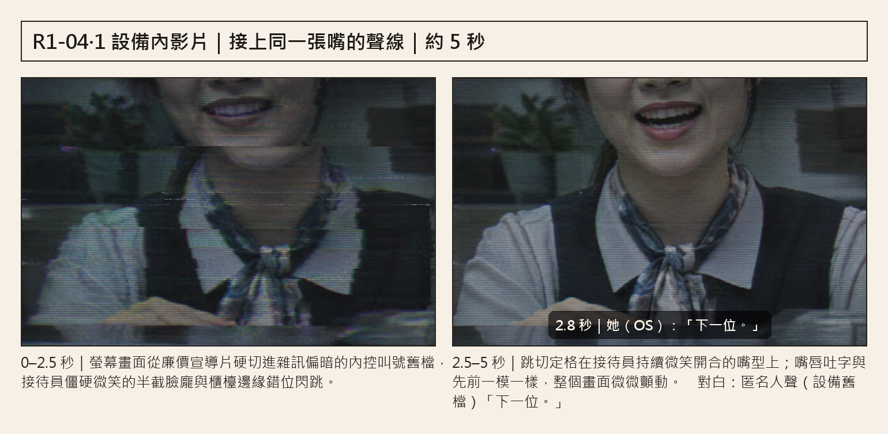

```prompt
【影片】R1-04·1｜設備內影片｜第一幕 R1-04 再回大廳（章內回訪）
【生成方式】圖生影片：首格是設備螢幕裡播放的畫面，做成真人實拍的錄影畫面，不含設備外框。
【長度】剪用約 5 秒；生成 5 秒後裁切。
【情緒節奏】原本滑稽制式的宣導笑容，在聲音換成她自己那一刻瞬間反胃——嘴型沒變，裡頭換了人。
【分鏡】
0–2.5 秒｜螢幕畫面從廉價宣導片硬切進雜訊偏暗的內控叫號舊檔，接待員僵硬微笑的半截臉龐與櫃檯邊緣錯位閃跳。
2.5–5 秒｜跳切定格在接待員持續微笑開合的嘴型上；嘴唇吐字與先前一模一樣，整個畫面微微顫動。　對白：匿名人聲（設備舊檔）「下一位。」
【鏡頭】只生成螢幕裡跳切的舊錄影（全幅、不含設備外框）；約 35mm 固定機位對準櫃檯後接待員的下半張臉與肩膀，焦點咬住那道不散的制式嘴角。
【人物】片中人物的臉要被裁切、壓縮或模糊，只看得清嘴形、肩膀與手；不做清晰肖像。
【光線色調】先是過度明亮的廉價宣導片打光，跳切後混入暗沉的內控機房舊影雜訊與掃描線閃動。舊螢幕畫質：略低解析、輕微掃描線與色偏，亮度只在螢幕範圍內。
【影片風格】寫實、極致逼真的真人實拍錄影畫面，再疊上舊螢幕的質感；人物動作自然、不僵硬。不是遊戲 CG、不是 3D 算圖、不是動畫。
【後製（不進 AI 生成）】
聲音與後製對點：
・0–2.5 秒：宣導片輕快底噪被類比跳切雜訊截斷。
・2.8 秒：本該是接待員的口型，換成主角聲線平穩地念出——匿名人聲（設備舊檔）「下一位。」。
【不要出現】清楚可辨識的人臉五官；任何可讀的文字、號碼、標誌、國旗或國名（畫面上的字留白或模糊，後製再合成）；配樂；血腥特寫、裸露；手指數量或手部結構錯誤；分鏡沒寫的人物、物件突然出現、消失或變形；遊戲 CG 感、3D 算圖感、插畫、動漫或卡通畫風、塑膠般光滑的皮膚與材質；動作僵硬、機械、卡頓、漂浮感或不自然的慢動作。
```

**素材提示詞**　人物：[宣導片裡的接待員（R1）](10-23_製作規格_影片素材設定.md#va-receptionist)｜場景：[宣導片與叫號紀錄跳切（R1-04 電視）](10-23_製作規格_影片素材設定.md#va-scene-jumpcut)｜物品：無

```asset
【素材】人物｜宣導片裡的接待員（R1）｜R1-04·1
【內容】管制宣導片裡的成年接待員，坐在乾淨得不自然的櫃檯後，穿整齊但廉價的淺色襯衫，沒有名牌與公司標誌；一直保持固定、過度標準的笑容，嘴型照著稿子動。舊錄影畫質：略低解析、輕微掃描線與色偏；臉被壓縮與裁切，只看得清嘴形、肩膀與手。
【構圖】錄影畫面參考：16:9 全幅、不含電視外框；胸上景一張、嘴形近景一張。
【風格】寫實、極致逼真的真人實景攝影質感：真實相機與自然光學，輕微景深與自然底片顆粒；皮膚、布料、金屬、水漬與灰塵都有真實細節。不是遊戲 CG、不是 3D 算圖、不是插畫。
【不要出現】清楚的正臉；公司標誌、名牌或制服；名牌或品牌標誌；手指數量或手部結構錯誤；清楚可辨識的人臉五官；任何可讀的文字、號碼、標誌、國旗或國名（字留白或模糊，後製再合成）；血腥特寫、裸露；遊戲 CG 感、3D 算圖感、插畫、動漫或卡通畫風、塑膠般光滑的皮膚與材質。
```

```asset
【素材】場景｜宣導片與叫號紀錄跳切（R1-04 電視）｜R1-04·1
【內容】老舊電視裡兩段畫面：一段是輕快的管制宣導片，接待員在乾淨的櫃檯後保持固定笑容；另一段是極短的內控叫號紀錄，固定監視機位俯拍大廳的等候椅與叫號機，畫面黑白偏綠，時間碼的位置留白。
【構圖】錄影畫面參考：16:9 全幅、不含電視外框；兩段各一張。
【光線色調】舊螢幕畫質：略低解析、輕微掃描線與色偏，亮度只在螢幕範圍內。
【風格】寫實、極致逼真的真人實景攝影質感：真實相機與自然光學，輕微景深與自然底片顆粒；皮膚、布料、金屬、水漬與灰塵都有真實細節。不是遊戲 CG、不是 3D 算圖、不是插畫。
【不要出現】任何人物、手、人影或異變者；清楚可辨識的人臉五官；任何可讀的文字、號碼、標誌、國旗或國名（字留白或模糊，後製再合成）；血腥特寫、裸露；遊戲 CG 感、3D 算圖感、插畫、動漫或卡通畫風、塑膠般光滑的皮膚與材質。
```

## R2-01a 配給與收存（非必要附頁）（2 段）

<a id="v-r2-01a-1"></a>

### R2-01a·1　動作回饋（中）

- **重要級別：**<span class="importance-mid">中</span>　接主觀記憶的觸碰
- **類型：**<span class="video-feedback">第一人稱動作回饋</span>　**畫面：**`R2-D05`　**剪用：**約 1.5 秒
- **劇本：**[R2-01a 配給與收存（非必要附頁）](../09_劇本/09-04_正式劇本_第一幕.md#h-0904-224)
- **交付：**AI 生成稿只作動態參考或底稿；正式交付為疊在原主圖或近看上的短手部／物件動態圖層。

**劇本描述**　她的指甲沿著稿文那一行底下按過去，按到句尾，停住。

**對白／配音**　無對白（純畫面／環境音）

**分鏡板**　配給與收存

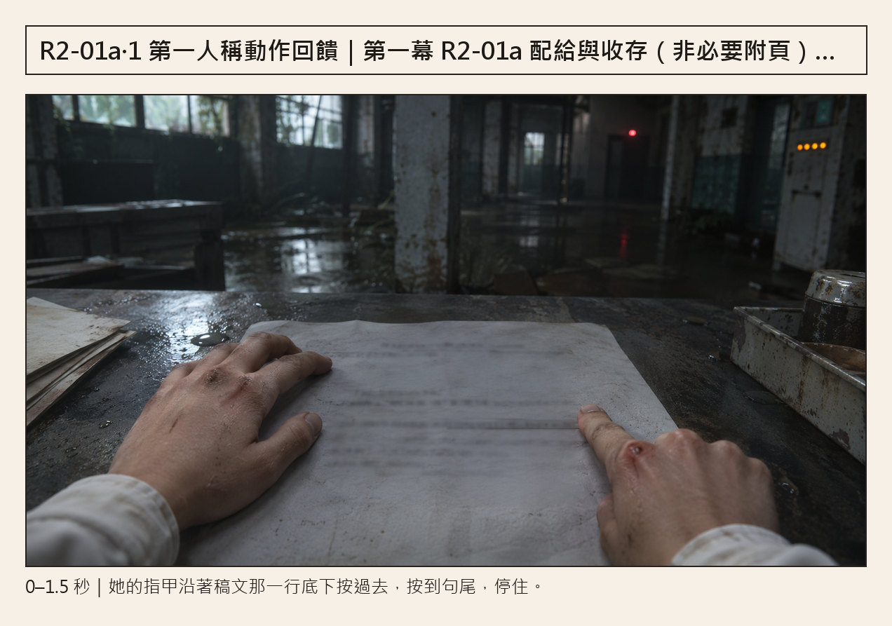

```prompt
【影片】R2-01a·1｜第一人稱動作回饋｜第一幕 R2-01a 配給與收存（非必要附頁）
【生成方式】圖生影片：首格直接用 R2-D05（文件：配給宣傳、收存登記與背面家屬聯繫頁） 的寫實定稿圖；構圖、光線、人物與物件造型保持不變，只加入下列動作。
【長度】剪用約 1.5 秒；生成 5 秒後裁切。
【分鏡】
0–1.5 秒｜她的指甲沿著稿文那一行底下按過去，按到句尾，停住。
【鏡頭】約 28mm 第一人稱主觀視線，鏡位鎖定不動，要疊回原主圖，景深照首格。焦點先在她的手，手碰到的物件跟著收清；動作有重量，做完就停住，不加分鏡以外的動作。
【人物】她的手只露出手與白襯衫袖口，手背乾裂、有擦傷，從畫面下緣入鏡；五指比例正確。
【光線色調】現在的現場光：低飽和、潮濕、廢棄；只有漏進樓內的天光與只亮了一部分的設備燈、消防燈照亮局部，亮處不過曝，暗處仍看得出層次；光向與首格一致。整段光源與明暗都不變。
【影片風格】寫實、極致逼真的真人實景拍攝質感：真實攝影機與自然光學，輕微景深、自然底片顆粒與真實曝光；皮膚、布料、金屬、水漬與灰塵都有真實細節。動作自然流暢，有重量與慣性，符合真實人體動作。不是遊戲 CG、不是 3D 算圖、不是插畫。
【不要出現】清楚可辨識的人臉五官；任何可讀的文字、號碼、標誌、國旗或國名（畫面上的字留白或模糊，後製再合成）；配樂；第三人稱或看見主角全身；鏡頭晃動、推移或換景；血腥特寫、裸露；手指數量或手部結構錯誤；分鏡沒寫的人物、物件突然出現、消失或變形；遊戲 CG 感、3D 算圖感、插畫、動漫或卡通畫風、塑膠般光滑的皮膚與材質；動作僵硬、機械、卡頓、漂浮感或不自然的慢動作。
```

**素材提示詞**　人物：[她・現在（第一人稱的手）](10-23_製作規格_影片素材設定.md#va-her-hands)｜場景：R2 接待櫃檯後室｜物品：無

```asset
【素材】人物｜她・現在（第一人稱的手）｜R2-01a·1
【內容】26 歲成年女性的雙手與前臂，體態消瘦，手腕偏細。手背與指節乾裂，有零散的表淺擦傷與乾掉的泥灰，指甲短、邊緣不齊。白色普通長袖襯衫的袖口有局部撕裂、水漬與乾泥，不是制服剪裁，可隨手捲到前臂。動作時手肘靠近身體，起手前常先停一下。
【構圖】手部參考圖：中性灰背景、柔和均勻光；雙手與前臂的正面、側面、握物三個角度，只拍到手肘以下，五指比例正確。
【風格】寫實、極致逼真的真人實景攝影質感：真實相機與自然光學，輕微景深與自然底片顆粒；皮膚、布料、金屬、水漬與灰塵都有真實細節。不是遊戲 CG、不是 3D 算圖、不是插畫。
【不要出現】戒指、手錶、指甲油或任何飾品；新鮮流血或傷口剖面；名牌或品牌標誌；手指數量或手部結構錯誤；清楚可辨識的人臉五官；任何可讀的文字、號碼、標誌、國旗或國名（字留白或模糊，後製再合成）；血腥特寫、裸露；遊戲 CG 感、3D 算圖感、插畫、動漫或卡通畫風、塑膠般光滑的皮膚與材質。
```

```asset
【素材】場景｜R2 接待櫃檯後室｜R2-01a·1
【內容】寫實實景的空景，不含任何人物與手；畫面中所有牌面、告示、標籤與紙件上的文字、數字一律留白或模糊。
空間：R2-V01（主場景）：名冊桌、文件櫃、通電接待電腦、封閉交貨窗、出餐小窗及卡在梯口的餐車。宣傳冊疊在桌角，邊上是接收名冊。櫃後原出餐小窗下半被背板封住，上緣仍留一道能看向梯口的窄縫。舊湯鍋圓印壓在新管理標籤下面。
本段畫面：R2-D05（文件）：配給宣傳、收存登記與背面家屬聯繫頁。
【構圖】空景參考兩張：一張照「空間」的全景，第一人稱站立視線高度、約 28mm 人眼視角、平視、地平線水平；一張照「本段畫面」的近看構圖，與本段首格一致。都不含人物、手與人影。
【光線色調】現在的現場光：低飽和、潮濕、廢棄；只有漏進樓內的天光與只亮了一部分的設備燈、消防燈照亮局部，亮處不過曝，暗處仍看得出層次；光向與首格一致。
【風格】寫實、極致逼真的真人實景攝影質感：真實相機與自然光學，輕微景深與自然底片顆粒；皮膚、布料、金屬、水漬與灰塵都有真實細節。不是遊戲 CG、不是 3D 算圖、不是插畫。
【不要出現】任何人物、手、人影或異變者；清楚可辨識的人臉五官；任何可讀的文字、號碼、標誌、國旗或國名（字留白或模糊，後製再合成）；血腥特寫、裸露；遊戲 CG 感、3D 算圖感、插畫、動漫或卡通畫風、塑膠般光滑的皮膚與材質。
```

<a id="v-r2-01a-2"></a>

### R2-01a·2　主觀記憶動畫（高）

- **重要級別：**<span class="importance-high">高</span>　主觀記憶
- **類型：**<span class="video-memory">主觀記憶動畫</span>　**畫面：**`R2-D05`　**剪用：**約 3–6 秒
- **劇本：**[R2-01a 配給與收存（非必要附頁）](../09_劇本/09-04_正式劇本_第一幕.md#h-0904-224)
- **交付：**併入觸碰物件的原近看或主圖素材項，另交記憶動畫分層與二至三張低動態記憶靜格。
- **規則：**[主觀記憶動畫](../09_劇本/09-15_正式劇本_共用附錄.md#memory-animation-contract)：只到肩膀以下、不給臉與名字，任何輸入立即結束。
- **導演註記：**[R2-01a·2 照著形狀描字](10-22_製作規格_影片導演註記.md#vd-r2-01a-2)

**劇本描述**　記憶裡是一張下鋪的床沿。膝上攤著一張泡過水的紙，字都暈開了，看不出是哪一種文字，只剩筆畫的形狀。她的指甲一行一行按著看，再拿一張乾淨的紙，照著形狀一筆一筆描：描完一筆，抬頭看一下原來那張，再描下一筆。有一行她描了很久。旁邊那隻粉紅棕格紋、袖口過長的手一直壓著濕紙的角，不讓它捲起來；描好以後，那隻手把乾淨的那張對折，收進一本小冊子的封底。畫面只到膝蓋與手，看不見臉。

**對白／配音**　主角聲線（主觀記憶回聲）「這行糊掉了……」 ／ 小花聲線（主觀記憶回聲）「先照著描。等紙乾了，字就沒了。」

**分鏡板**　照著形狀描字

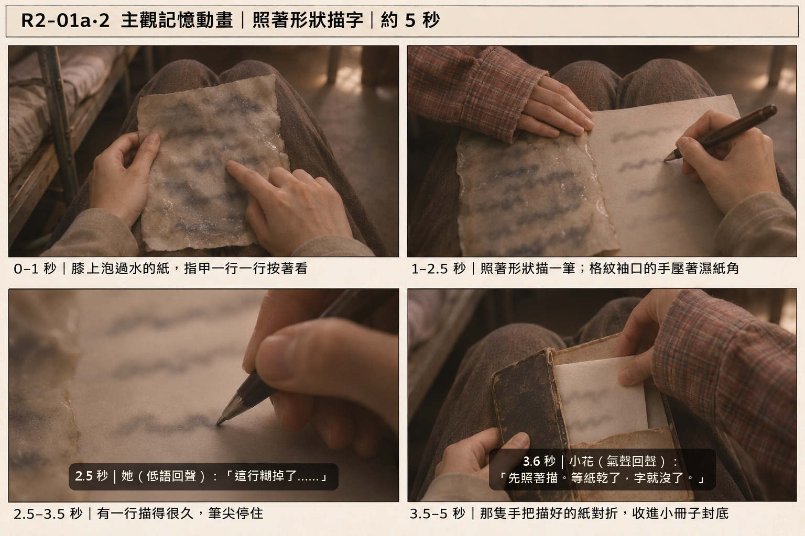

```prompt
【影片】R2-01a·2｜主觀記憶動畫｜第一幕 R2-01a 配給與收存（非必要附頁）
【生成方式】先依分鏡第一格生成一張寫實實拍的記憶首格（併入 R2-D05 素材項的記憶分層），再用圖生影片。
【長度】剪用約 5 秒（可在 3–6 秒間）；生成 5 秒後裁切。
【情緒節奏】很慢、很專心的一件小事。描很久的那一行是重點，兩句壓低的回聲把怕弄丟回家線索的屏息留在紙面上，旁邊那隻手一直沒有離開。
【分鏡】
0–1 秒｜膝上一張泡過水的紙，字都暈開，只剩筆畫的形狀；她用指甲一行一行按著看。
1–2.5 秒｜她在一張乾淨的紙上照著形狀描下一筆，停住，視線回到濕紙，再描下一筆；旁邊一隻粉紅棕格紋、袖口過長的手一直壓著濕紙的角。
2.5–3.5 秒｜有一行描得很久，筆尖停在紙上好一會才再動。　對白：主角聲線（主觀記憶回聲）「這行糊掉了……」
3.5–5 秒｜描好以後，那隻手把乾淨的那張對折，收進一本小冊子的封底。　對白：小花聲線（主觀記憶回聲）「先照著描。等紙乾了，字就沒了。」
【鏡頭】她坐在下鋪床沿低頭看膝上的紙；約 35mm，幾乎不動，只有極輕微的呼吸起伏。焦點從濕紙移到乾淨的紙，再回到濕紙。構圖只到膝蓋與手。
【人物】她的手與前臂可入鏡，衣袖素色、無圖案。另一個人只以粉紅棕格紋、過長、蓋到指節的袖口辨認；構圖只到膝蓋與手，看不見任何人的臉。
【光線色調】一側低低照來的室內光，濕紙上的水漬反出柔和的亮面，乾淨的紙比較白。記憶色調：柔和低對比的暖褐微光，帶輕微顆粒與四周微暈，像隔著一層舊塑膠片看；不用凝固層的單色冷青，也不加訊號雜訊。光源只用分鏡裡原有的。
【影片風格】寫實、極致逼真的真人實景拍攝質感：真實攝影機與自然光學，輕微景深、自然底片顆粒與真實曝光；皮膚、布料、金屬、水漬與灰塵都有真實細節。動作自然流暢，有重量與慣性，符合真實人體動作。不是遊戲 CG、不是 3D 算圖、不是插畫。
【後製（不進 AI 生成）】
聲音與後製對點：
・0–1 秒：很靜。
・1–2.5 秒：筆尖在紙上描一下、停一下的細響。
・2.5–3.5 秒：筆聲停了很久，才又響一下；2.5 秒：主角聲線的極輕低語回聲「這行糊掉了……」（字幕不標姓名）。
・3.6 秒：小花聲線輕而發緊的氣聲回聲「先照著描。等紙乾了，字就沒了。」（字幕不標姓名）；5 秒畫面結束時接回後室的安靜。
【不要出現】清楚可辨識的人臉五官；任何可讀的文字、號碼、標誌、國旗或國名（畫面上的字留白或模糊，後製再合成）；配樂；第三人稱或看見主角全身；鏡頭晃動、推移或換景；血腥特寫、裸露；手指數量或手部結構錯誤；分鏡沒寫的人物、物件突然出現、消失或變形；遊戲 CG 感、3D 算圖感、插畫、動漫或卡通畫風、塑膠般光滑的皮膚與材質；動作僵硬、機械、卡頓、漂浮感或不自然的慢動作；冷青色調或訊號雜訊；對方的臉、名牌或可讀的名字。
```

**素材提示詞**　人物：[她・記憶裡（園區前期）](10-23_製作規格_影片素材設定.md#va-her-memory)、[小花・記憶裡（粉紅棕格紋袖口）](10-23_製作規格_影片素材設定.md#va-xiaohua-memory)｜場景：[下鋪床沿・泡過水的紙（R2 記憶）](10-23_製作規格_影片素材設定.md#va-scene-lower-bunk)｜物品：[雙欄小帳](10-23_製作規格_影片素材設定.md#va-ledger)

```asset
【素材】人物｜她・記憶裡（園區前期）｜R2-01a·2
【內容】園區前期的她：二十多歲成年女性的雙手與前臂，手指乾淨、指甲剪短，還沒有現在的乾裂、泥灰與擦挫傷。衣袖是素色、無圖案、低飽和的普通長袖，略不合身。
【構圖】手部參考圖：中性灰背景、柔和暖光；雙手與前臂的正面、側面、握物三個角度，只拍到手肘以下。
【風格】寫實、極致逼真的真人實景攝影質感：真實相機與自然光學，輕微景深與自然底片顆粒；皮膚、布料、金屬、水漬與灰塵都有真實細節。不是遊戲 CG、不是 3D 算圖、不是插畫。
【不要出現】白襯衫；現在的乾裂、泥灰與擦挫傷；戒指、手錶或任何飾品；名牌或品牌標誌；手指數量或手部結構錯誤；清楚可辨識的人臉五官；任何可讀的文字、號碼、標誌、國旗或國名（字留白或模糊，後製再合成）；血腥特寫、裸露；遊戲 CG 感、3D 算圖感、插畫、動漫或卡通畫風、塑膠般光滑的皮膚與材質。
```

```asset
【素材】人物｜小花・記憶裡（粉紅棕格紋袖口）｜R2-01a·2
【內容】19 歲年輕女性肩膀以下的上半身、雙手與前臂。小個、肩窄，手指靈活，指腹有修手機、貼保護貼與摺紙留下的薄繭。洗得褪色的粉紅棕色格紋襯衫大一號，袖口過長、蓋到指節；襯衫裡露出一點米色內襯；下身是灰褐色及膝裙。動作安靜，習慣把紙邊對齊、壓住或折好。
【構圖】人物參考圖：中性灰背景、柔和暖光；肩膀以下的上半身與雙手，正面、側面各一張，加一張袖口蓋到指節的手部特寫。頭髮與臉都不入鏡。
【風格】寫實、極致逼真的真人實景攝影質感：真實相機與自然光學，輕微景深與自然底片顆粒；皮膚、布料、金屬、水漬與灰塵都有真實細節。不是遊戲 CG、不是 3D 算圖、不是插畫。
【不要出現】首飾或指甲彩繪；辮子與臉入鏡；名牌或品牌標誌；手指數量或手部結構錯誤；清楚可辨識的人臉五官；任何可讀的文字、號碼、標誌、國旗或國名（字留白或模糊，後製再合成）；血腥特寫、裸露；遊戲 CG 感、3D 算圖感、插畫、動漫或卡通畫風、塑膠般光滑的皮膚與材質。
```

```asset
【素材】場景｜下鋪床沿・泡過水的紙（R2 記憶）｜R2-01a·2
【內容】宿舍下鋪的床沿，夜裡只開一盞小燈。床沿上攤著一張泡過水、字跡暈開成筆畫形狀的紙，旁邊一張乾淨的白紙和一枝筆，一本巴掌大的小冊子放在手邊。
【構圖】空景參考：約 35mm，坐在下鋪的人往下看膝上的視角；不含人物與手，膝上的紙可先單獨平放在床沿拍。
【光線色調】記憶色調：柔和低對比的暖褐微光，帶輕微顆粒與四周微暈；不用凝固層的單色冷青，也不加訊號雜訊。
【風格】寫實、極致逼真的真人實景攝影質感：真實相機與自然光學，輕微景深與自然底片顆粒；皮膚、布料、金屬、水漬與灰塵都有真實細節。不是遊戲 CG、不是 3D 算圖、不是插畫。
【不要出現】任何人物、手、人影或異變者；清楚可辨識的人臉五官；任何可讀的文字、號碼、標誌、國旗或國名（字留白或模糊，後製再合成）；血腥特寫、裸露；遊戲 CG 感、3D 算圖感、插畫、動漫或卡通畫風、塑膠般光滑的皮膚與材質。
```

```asset
【素材】物品｜雙欄小帳｜R2-01a·2
【內容】一本巴掌大的手工小冊子，用舊紙對折後釘起，內頁用筆畫成雙欄，邊上有手寫字跡，字留白或模糊；封底內側可以夾進一張對折的紙。
【構圖】物品參考圖：單一物件置中，中性深灰背景、柔和側光；正面、背面與局部特寫三個角度，比例照實物。
【風格】寫實、極致逼真的真人實景攝影質感：真實相機與自然光學，輕微景深與自然底片顆粒；皮膚、布料、金屬、水漬與灰塵都有真實細節。不是遊戲 CG、不是 3D 算圖、不是插畫。
【不要出現】人物與手；清楚可辨識的人臉五官；任何可讀的文字、號碼、標誌、國旗或國名（字留白或模糊，後製再合成）；血腥特寫、裸露；遊戲 CG 感、3D 算圖感、插畫、動漫或卡通畫風、塑膠般光滑的皮膚與材質。
```

## T-R2-R3-01 後廚服務巷（2 段）

<a id="v-t-r2-r3-01-1"></a>

### T-R2-R3-01·1　場景局部動畫（中）

- **重要級別：**<span class="importance-mid">中</span>　逼近或異常的前兆
- **類型：**<span class="video-scene">場景局部動畫</span>　**畫面：**`T-R2-R3-01`　**剪用：**約 6 秒
- **劇本：**[T-R2-R3-01 後廚服務巷](../09_劇本/09-04_正式劇本_第一幕.md#subscene-t-r2-r3-01-script)
- **交付：**只取會動的局部，做成疊在原主圖或近看上的獨立動態圖層，其餘畫面沿用原圖。

**劇本描述**　往梯腳靠近時，亮縫從遠端先暗下一小段；這時可操作的全景已交還。玩家不操作時，下一小段才跟著暗，每段之間隔得一樣久，共 6–8 段，一段一段往梯腳挪，最後停在與主角並排的位置。玩家一移動、點擊或開近看，暗段就停在當下那一格，不再前進。門扣仍壓在原處。

**對白／配音**　無對白（純畫面／環境音）

**分鏡板**　後廚服務巷

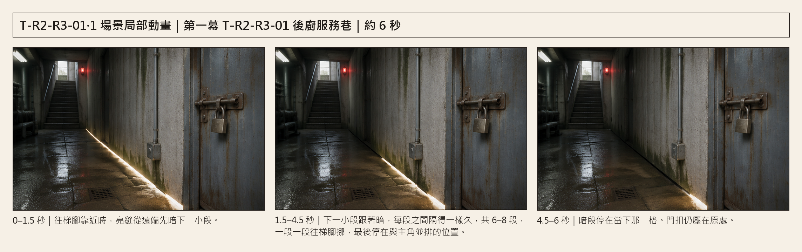

```prompt
【影片】T-R2-R3-01·1｜場景局部動畫｜第一幕 T-R2-R3-01 後廚服務巷
【生成方式】圖生影片：首格直接用 T-R2-R3-01（過渡場景：後廚服務巷：R2 出餐小窗、碗架、磨刀石、封住的後門與紅扶手） 的寫實定稿圖；構圖、光線、人物與物件造型保持不變，只加入下列動作。
【長度】剪用約 6 秒；生成 10 秒後裁切。
【分鏡】
0–1.5 秒｜往梯腳靠近時，亮縫從遠端先暗下一小段。
1.5–4.5 秒｜下一小段跟著暗，每段之間隔得一樣久，共 6–8 段，一段一段往梯腳挪，最後停在與主角並排的位置。
4.5–6 秒｜暗段停在當下那一格。門扣仍壓在原處。
【鏡頭】約 28mm，鏡頭鎖定不動，要疊回原主圖，景深照首格。焦點落在門框與扣件，其餘畫面保持靜止；不新增人物或物件。
【光線色調】現在的現場光：低飽和、潮濕、廢棄；只有漏進樓內的天光與只亮了一部分的設備燈、消防燈照亮局部，亮處不過曝，暗處仍看得出層次；光向與首格一致。光的變化只來自首格既有的亮縫，照分鏡的時間點亮暗，其餘的光不動。
【影片風格】寫實、極致逼真的真人實景拍攝質感：真實攝影機與自然光學，輕微景深、自然底片顆粒與真實曝光；皮膚、布料、金屬、水漬與灰塵都有真實細節。動作自然流暢，有重量與慣性，符合真實人體動作。不是遊戲 CG、不是 3D 算圖、不是插畫。
【後製（不進 AI 生成）】
聲音與後製對點：
・整段：暗段停到梯腳旁，門後一道粗布拖地聲，很短。後廚的電流聲接著退掉約 3 秒，只剩樓上水管聲；第二下拖聲沒有來。電流聲回來時，亮縫仍暗著。
【不要出現】清楚可辨識的人臉五官；任何可讀的文字、號碼、標誌、國旗或國名（畫面上的字留白或模糊，後製再合成）；配樂；第三人稱或看見主角全身；鏡頭晃動、推移或換景；血腥特寫、裸露；手指數量或手部結構錯誤；分鏡沒寫的人物、物件突然出現、消失或變形；遊戲 CG 感、3D 算圖感、插畫、動漫或卡通畫風、塑膠般光滑的皮膚與材質；動作僵硬、機械、卡頓、漂浮感或不自然的慢動作。
```

**素材提示詞**　人物：無｜場景：T-R2-R3-01 後廚服務巷｜物品：無

```asset
【素材】場景｜T-R2-R3-01 後廚服務巷｜T-R2-R3-01·1
【內容】寫實實景的空景，不含任何人物與手；畫面中所有牌面、告示、標籤與紙件上的文字、數字一律留白或模糊。
空間：T-R2-R3-01（過渡場景）：後廚服務巷：R2 出餐小窗、碗架、磨刀石、封住的後門與紅扶手。前景地面一層發黃冷油嵌著乾飯粒。封死後門下方原有一條狹窄亮縫，橫在紅鐵梯旁。
【構圖】空景參考：第一人稱站立視線高度、約 28mm 人眼視角、平視、地平線水平；構圖與本段首格一致，不含人物、手與人影。
【光線色調】現在的現場光：低飽和、潮濕、廢棄；只有漏進樓內的天光與只亮了一部分的設備燈、消防燈照亮局部，亮處不過曝，暗處仍看得出層次；光向與首格一致。
【風格】寫實、極致逼真的真人實景攝影質感：真實相機與自然光學，輕微景深與自然底片顆粒；皮膚、布料、金屬、水漬與灰塵都有真實細節。不是遊戲 CG、不是 3D 算圖、不是插畫。
【不要出現】任何人物、手、人影或異變者；清楚可辨識的人臉五官；任何可讀的文字、號碼、標誌、國旗或國名（字留白或模糊，後製再合成）；血腥特寫、裸露；遊戲 CG 感、3D 算圖感、插畫、動漫或卡通畫風、塑膠般光滑的皮膚與材質。
```

<a id="v-t-r2-r3-01-2"></a>

### T-R2-R3-01·2　場景局部動畫（中）

- **重要級別：**<span class="importance-mid">中</span>　逼近或異常的前兆
- **類型：**<span class="video-scene">場景局部動畫</span>　**畫面：**`T-R2-R3-01`　**剪用：**約 4 秒
- **劇本：**[T-R2-R3-01 後廚服務巷](../09_劇本/09-04_正式劇本_第一幕.md#subscene-t-r2-r3-01-script)
- **交付：**只取會動的局部，做成疊在原主圖或近看上的獨立動態圖層，其餘畫面沿用原圖。

**劇本描述**　電流聲一回來，門縫下的冷油膜就皺起一道，沿排水溝朝梯腳拉過來，壓過她剛踩出的鞋印，一個接一個。每拉一段，油面上便有一聲拖鞋腳跟擦過。看不到腳踝以上。

**對白／配音**　無對白（純畫面／環境音）

**分鏡板**　後廚服務巷

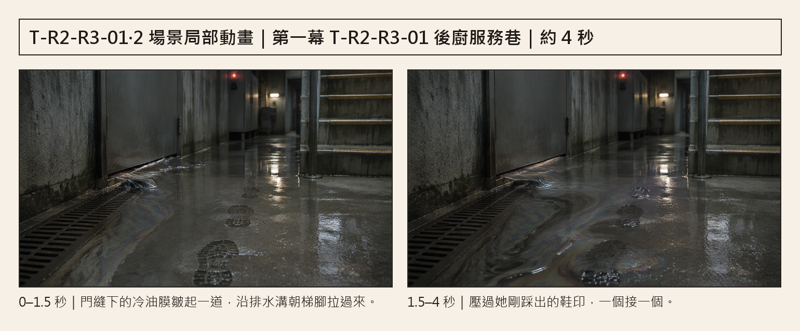

```prompt
【影片】T-R2-R3-01·2｜場景局部動畫｜第一幕 T-R2-R3-01 後廚服務巷
【生成方式】圖生影片：首格用上一段 T-R2-R3-01·1 的最後一格，保持構圖、光線、色調、人物與物件造型不變，只加入下列動作。
【長度】剪用約 4 秒；生成 5 秒後裁切。
【分鏡】
0–1.5 秒｜門縫下的冷油膜皺起一道，沿排水溝朝梯腳拉過來。
1.5–4 秒｜壓過她剛踩出的鞋印，一個接一個。
【鏡頭】約 28mm，鏡頭鎖定不動，要疊回原主圖，景深照首格。焦點落在水面細紋，其餘畫面保持靜止；不新增人物或物件。
【構圖限制】看不到腳踝以上。
【光線色調】現在的現場光：低飽和、潮濕、廢棄；只有漏進樓內的天光與只亮了一部分的設備燈、消防燈照亮局部，亮處不過曝，暗處仍看得出層次；光向與首格一致。整段光源與明暗都不變。
【影片風格】寫實、極致逼真的真人實景拍攝質感：真實攝影機與自然光學，輕微景深、自然底片顆粒與真實曝光；皮膚、布料、金屬、水漬與灰塵都有真實細節。動作自然流暢，有重量與慣性，符合真實人體動作。不是遊戲 CG、不是 3D 算圖、不是插畫。
【後製（不進 AI 生成）】
聲音與後製對點：
・0–1.5 秒：日光燈電流聲重新接上。
・1.5–4 秒：每拉一段，油面上便有一聲拖鞋腳跟擦過。
【不要出現】清楚可辨識的人臉五官；任何可讀的文字、號碼、標誌、國旗或國名（畫面上的字留白或模糊，後製再合成）；配樂；第三人稱或看見主角全身；鏡頭晃動、推移或換景；血腥特寫、裸露；手指數量或手部結構錯誤；分鏡沒寫的人物、物件突然出現、消失或變形；遊戲 CG 感、3D 算圖感、插畫、動漫或卡通畫風、塑膠般光滑的皮膚與材質；動作僵硬、機械、卡頓、漂浮感或不自然的慢動作。
```

**素材提示詞**　人物：無｜場景：T-R2-R3-01 後廚服務巷｜物品：無

```asset
【素材】場景｜T-R2-R3-01 後廚服務巷｜T-R2-R3-01·2
【內容】寫實實景的空景，不含任何人物與手；畫面中所有牌面、告示、標籤與紙件上的文字、數字一律留白或模糊。
空間：T-R2-R3-01（過渡場景）：後廚服務巷：R2 出餐小窗、碗架、磨刀石、封住的後門與紅扶手。前景地面一層發黃冷油嵌著乾飯粒。封死後門下方原有一條狹窄亮縫，橫在紅鐵梯旁。
【構圖】空景參考：第一人稱站立視線高度、約 28mm 人眼視角、平視、地平線水平；構圖與本段首格一致，不含人物、手與人影。
【光線色調】現在的現場光：低飽和、潮濕、廢棄；只有漏進樓內的天光與只亮了一部分的設備燈、消防燈照亮局部，亮處不過曝，暗處仍看得出層次；光向與首格一致。
【風格】寫實、極致逼真的真人實景攝影質感：真實相機與自然光學，輕微景深與自然底片顆粒；皮膚、布料、金屬、水漬與灰塵都有真實細節。不是遊戲 CG、不是 3D 算圖、不是插畫。
【不要出現】任何人物、手、人影或異變者；清楚可辨識的人臉五官；任何可讀的文字、號碼、標誌、國旗或國名（字留白或模糊，後製再合成）；血腥特寫、裸露；遊戲 CG 感、3D 算圖感、插畫、動漫或卡通畫風、塑膠般光滑的皮膚與材質。
```

## R3-00 住過人的地方（2 段）

<a id="v-r3-00-1"></a>

### R3-00·1　動作回饋（高）

- **重要級別：**<span class="importance-high">高</span>　重點橋段：R3 上鋪紙花
- **類型：**<span class="video-feedback">第一人稱動作回饋</span>　**畫面：**`R3-V01`　**剪用：**約 1.5 秒
- **劇本：**[R3-00 住過人的地方](../09_劇本/09-04_正式劇本_第一幕.md#node-r3-access-script)
- **交付：**AI 生成稿只作動態參考或底稿；正式交付為疊在原主圖或近看上的短手部／物件動態圖層。
- **重點 ★ R3 上鋪紙花：**她現時取出、轉看紙花的手之後，接約 4–6 秒主觀記憶動畫，任何輸入立即回近看；搭配主觀記憶回聲配音，字幕不標姓名。非必要，低動態版用手部兩張靜格加三張記憶靜格。
- **導演註記：**[R3-00·1 取出紙花](10-22_製作規格_影片導演註記.md#vd-r3-00-1)

**劇本描述**　她的手把紙花從窄縫裡拿出來，轉過來看花瓣背面。

**對白／配音**　無對白（純畫面／環境音）

**分鏡板**　取出紙花

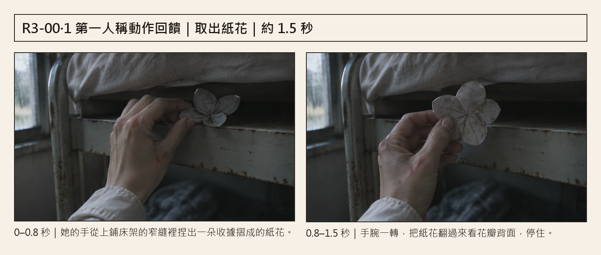

```prompt
【影片】R3-00·1｜第一人稱動作回饋｜第一幕 R3-00 住過人的地方
【生成方式】圖生影片：首格直接用 R3-V01（主場景：住宅隔間、上下鋪、整理過度的空床、窗邊斷布、門邊取衣牌與外側洗衣路） 的寫實定稿圖；構圖、光線、人物與物件造型保持不變，只加入下列動作。
【長度】剪用約 1.5 秒；生成 5 秒後裁切。
【情緒節奏】小心翼翼，像拿起別人的東西。翻過來看的那一下是進入記憶前的停頓。
【分鏡】
0–0.8 秒｜她的手從上鋪床架的窄縫裡捏出一朵收據摺成的紙花。
0.8–1.5 秒｜手腕一轉，把紙花翻過來看花瓣背面，停住。
【鏡頭】鏡頭鎖定不動，要疊回原圖；焦點在上鋪床架的窄縫與她的手。
【人物】她的手只露出手與白襯衫袖口，手背乾裂、有擦傷，從畫面下緣入鏡；五指比例正確。
【光線色調】窗邊漏進來的微光落在紙花的白邊上，床架縫裡是暗的。整體色調沿用現在的現場光：低飽和、潮濕，亮處不過曝，暗處有層次。
【影片風格】寫實、極致逼真的真人實景拍攝質感：真實攝影機與自然光學，輕微景深、自然底片顆粒與真實曝光；皮膚、布料、金屬、水漬與灰塵都有真實細節。動作自然流暢，有重量與慣性，符合真實人體動作。不是遊戲 CG、不是 3D 算圖、不是插畫。
【後製（不進 AI 生成）】
聲音與後製對點：
・0–0.8 秒：紙擦過鐵架的細響。
【不要出現】清楚可辨識的人臉五官；任何可讀的文字、號碼、標誌、國旗或國名（畫面上的字留白或模糊，後製再合成）；配樂；第三人稱或看見主角全身；鏡頭晃動、推移或換景；血腥特寫、裸露；手指數量或手部結構錯誤；分鏡沒寫的人物、物件突然出現、消失或變形；遊戲 CG 感、3D 算圖感、插畫、動漫或卡通畫風、塑膠般光滑的皮膚與材質；動作僵硬、機械、卡頓、漂浮感或不自然的慢動作。
```

**素材提示詞**　人物：[她・現在（第一人稱的手）](10-23_製作規格_影片素材設定.md#va-her-hands)｜場景：R3 宿舍主間｜物品：[收據紙花](10-23_製作規格_影片素材設定.md#va-paper-flower)

```asset
【素材】人物｜她・現在（第一人稱的手）｜R3-00·1
【內容】26 歲成年女性的雙手與前臂，體態消瘦，手腕偏細。手背與指節乾裂，有零散的表淺擦傷與乾掉的泥灰，指甲短、邊緣不齊。白色普通長袖襯衫的袖口有局部撕裂、水漬與乾泥，不是制服剪裁，可隨手捲到前臂。動作時手肘靠近身體，起手前常先停一下。
【構圖】手部參考圖：中性灰背景、柔和均勻光；雙手與前臂的正面、側面、握物三個角度，只拍到手肘以下，五指比例正確。
【風格】寫實、極致逼真的真人實景攝影質感：真實相機與自然光學，輕微景深與自然底片顆粒；皮膚、布料、金屬、水漬與灰塵都有真實細節。不是遊戲 CG、不是 3D 算圖、不是插畫。
【不要出現】戒指、手錶、指甲油或任何飾品；新鮮流血或傷口剖面；名牌或品牌標誌；手指數量或手部結構錯誤；清楚可辨識的人臉五官；任何可讀的文字、號碼、標誌、國旗或國名（字留白或模糊，後製再合成）；血腥特寫、裸露；遊戲 CG 感、3D 算圖感、插畫、動漫或卡通畫風、塑膠般光滑的皮膚與材質。
```

```asset
【素材】場景｜R3 宿舍主間｜R3-00·1
【內容】寫實實景的空景，不含任何人物與手；畫面中所有牌面、告示、標籤與紙件上的文字、數字一律留白或模糊。
空間：R3-V01（主場景）：住宅隔間、上下鋪、整理過度的空床、窗邊斷布、門邊取衣牌與外側洗衣路。綠磁磚折角可見的盥洗所門邊人工刻痕。數戶住宅被打通。舊門框還留在牆上，不同花色壁紙的接縫被床架截住。上下鋪之間掛著薄簾，晾衣處只剩安靜的布料。床邊舊信件與食譜夾在同一處乾燥窄縫。紙邊翻磨與油漬先在物件局部可見。綠磁磚折角上留著舊字（字留白），另一側粗管旁寫著指示字（字留白），箭頭朝向頭頂的維修缺口。
【構圖】空景參考：第一人稱站立視線高度、約 28mm 人眼視角、平視、地平線水平；構圖與本段首格一致，不含人物、手與人影。
【光線色調】現在的現場光：低飽和、潮濕、廢棄；只有漏進樓內的天光與只亮了一部分的設備燈、消防燈照亮局部，亮處不過曝，暗處仍看得出層次；光向與首格一致。
【風格】寫實、極致逼真的真人實景攝影質感：真實相機與自然光學，輕微景深與自然底片顆粒；皮膚、布料、金屬、水漬與灰塵都有真實細節。不是遊戲 CG、不是 3D 算圖、不是插畫。
【不要出現】任何人物、手、人影或異變者；清楚可辨識的人臉五官；任何可讀的文字、號碼、標誌、國旗或國名（字留白或模糊，後製再合成）；血腥特寫、裸露；遊戲 CG 感、3D 算圖感、插畫、動漫或卡通畫風、塑膠般光滑的皮膚與材質。
```

```asset
【素材】物品｜收據紙花｜R3-00·1
【內容】用一張熱感紙收據折成的四瓣小花：對折再對折，用指甲沿摺痕壓出四瓣，再翻開成花，約掌心一半大。紙色白中帶黃，背面有褪色、讀不出來的列印字跡；摺痕清楚，邊緣被拿得發軟。
【構圖】物品參考圖：單一物件置中，中性深灰背景、柔和側光；正面、背面與局部特寫三個角度，比例照實物。
【風格】寫實、極致逼真的真人實景攝影質感：真實相機與自然光學，輕微景深與自然底片顆粒；皮膚、布料、金屬、水漬與灰塵都有真實細節。不是遊戲 CG、不是 3D 算圖、不是插畫。
【不要出現】髮飾、徽章或花紋化的紙花；人物與手；清楚可辨識的人臉五官；任何可讀的文字、號碼、標誌、國旗或國名（字留白或模糊，後製再合成）；血腥特寫、裸露；遊戲 CG 感、3D 算圖感、插畫、動漫或卡通畫風、塑膠般光滑的皮膚與材質。
```

<a id="v-r3-00-2"></a>

### R3-00·2　主觀記憶動畫（高）

- **重要級別：**<span class="importance-high">高</span>　重點橋段：R3 上鋪紙花
- **類型：**<span class="video-memory">主觀記憶動畫</span>　**畫面：**`R3-V01`　**剪用：**約 3–6 秒
- **劇本：**[R3-00 住過人的地方](../09_劇本/09-04_正式劇本_第一幕.md#node-r3-access-script)
- **交付：**併入觸碰物件的原近看或主圖素材項，另交記憶動畫分層與二至三張低動態記憶靜格。
- **規則：**[主觀記憶動畫](../09_劇本/09-15_正式劇本_共用附錄.md#memory-animation-contract)：只到肩膀以下、不給臉與名字，任何輸入立即結束。
- **重點 ★ R3 上鋪紙花：**她現時取出、轉看紙花的手之後，接約 4–6 秒主觀記憶動畫，任何輸入立即回近看；搭配主觀記憶回聲配音，字幕不標姓名。非必要，低動態版用手部兩張靜格加三張記憶靜格。
- **導演註記：**[R3-00·2 收據摺的花](10-22_製作規格_影片導演註記.md#vd-r3-00-2)

**劇本描述**　記憶裡是另一張下鋪。一隻粉紅棕格紋、袖口過長的手把一張收據對折，再對折，指甲沿摺痕壓出四瓣，翻開成一朵花，放進她攤開的掌心，指尖在她掌心按了一下才收回。畫面只到手腕，看不見臉。

**對白／配音**　小花聲線（主觀記憶回聲）「真的花太快壞了。」 ／ 小花聲線（主觀記憶回聲）「這個壓扁了沒關係，掰一掰又好了。」

**分鏡板**　收據摺的花

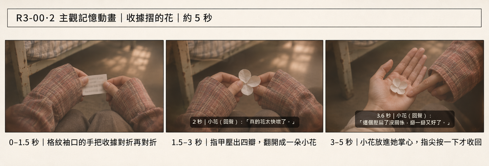

```prompt
【影片】R3-00·2｜主觀記憶動畫｜第一幕 R3-00 住過人的地方
【生成方式】先依分鏡第一格生成一張寫實實拍的記憶首格（併入 R3-V01 素材項的記憶分層），再用圖生影片。
【長度】剪用約 5 秒（可在 3–6 秒間）；生成 5 秒後裁切。
【情緒節奏】被送一份很小的禮物。壓出四瓣與最後指尖在掌心按的那一下，把「就算被壓扁也想再打開」的微弱盼望留在掌心裡。
【分鏡】
0–1.5 秒｜一隻粉紅棕格紋、袖口過長的手把一張收據對折，再對折。
1.5–3 秒｜指甲沿摺痕壓出四瓣，翻開成一朵小花。　對白：小花聲線（主觀記憶回聲）「真的花太快壞了。」
3–5 秒｜小花放進她攤開的掌心，那隻手的指尖在她掌心按了一下，才收回。　對白：小花聲線（主觀記憶回聲）「這個壓扁了沒關係，掰一掰又好了。」
【鏡頭】她攤著手掌、低頭看的視線；約 35mm，幾乎不動。焦點跟著摺紙的手，最後停在掌心的紙花。構圖只到手腕。
【人物】她的手與前臂可入鏡，衣袖素色、無圖案。另一個人只以粉紅棕格紋、過長、蓋到指節的袖口辨認；構圖只到手腕，看不見任何人的臉。
【光線色調】宿舍床邊的室內光從一側照來，摺痕的稜線一道一道亮起。記憶色調：柔和低對比的暖褐微光，帶輕微顆粒與四周微暈，像隔著一層舊塑膠片看；不用凝固層的單色冷青，也不加訊號雜訊。光源只用分鏡裡原有的。
【影片風格】寫實、極致逼真的真人實景拍攝質感：真實攝影機與自然光學，輕微景深、自然底片顆粒與真實曝光；皮膚、布料、金屬、水漬與灰塵都有真實細節。動作自然流暢，有重量與慣性，符合真實人體動作。不是遊戲 CG、不是 3D 算圖、不是插畫。
【後製（不進 AI 生成）】
聲音與後製對點：
・0–1.5 秒：紙張摺壓的細響。
・1.5–3 秒：指甲壓過摺痕的細響；2 秒：小花聲線帶著一點安靜笑意的輕聲回聲「真的花太快壞了。」（字幕不標姓名）。
・3.6 秒：小花聲線壓得更輕的回聲「這個壓扁了沒關係，掰一掰又好了。」（字幕不標姓名），收在指尖收回那一下；5 秒畫面結束時接回宿舍的滴水。
【不要出現】清楚可辨識的人臉五官；任何可讀的文字、號碼、標誌、國旗或國名（畫面上的字留白或模糊，後製再合成）；配樂；第三人稱或看見主角全身；鏡頭晃動、推移或換景；血腥特寫、裸露；手指數量或手部結構錯誤；分鏡沒寫的人物、物件突然出現、消失或變形；遊戲 CG 感、3D 算圖感、插畫、動漫或卡通畫風、塑膠般光滑的皮膚與材質；動作僵硬、機械、卡頓、漂浮感或不自然的慢動作；冷青色調或訊號雜訊；對方的臉、名牌或可讀的名字。
```

**素材提示詞**　人物：[她・記憶裡（園區前期）](10-23_製作規格_影片素材設定.md#va-her-memory)、[小花・記憶裡（粉紅棕格紋袖口）](10-23_製作規格_影片素材設定.md#va-xiaohua-memory)｜場景：[另一張下鋪（R3 記憶）](10-23_製作規格_影片素材設定.md#va-scene-other-bunk)｜物品：[收據紙花](10-23_製作規格_影片素材設定.md#va-paper-flower)

```asset
【素材】人物｜她・記憶裡（園區前期）｜R3-00·2
【內容】園區前期的她：二十多歲成年女性的雙手與前臂，手指乾淨、指甲剪短，還沒有現在的乾裂、泥灰與擦挫傷。衣袖是素色、無圖案、低飽和的普通長袖，略不合身。
【構圖】手部參考圖：中性灰背景、柔和暖光；雙手與前臂的正面、側面、握物三個角度，只拍到手肘以下。
【風格】寫實、極致逼真的真人實景攝影質感：真實相機與自然光學，輕微景深與自然底片顆粒；皮膚、布料、金屬、水漬與灰塵都有真實細節。不是遊戲 CG、不是 3D 算圖、不是插畫。
【不要出現】白襯衫；現在的乾裂、泥灰與擦挫傷；戒指、手錶或任何飾品；名牌或品牌標誌；手指數量或手部結構錯誤；清楚可辨識的人臉五官；任何可讀的文字、號碼、標誌、國旗或國名（字留白或模糊，後製再合成）；血腥特寫、裸露；遊戲 CG 感、3D 算圖感、插畫、動漫或卡通畫風、塑膠般光滑的皮膚與材質。
```

```asset
【素材】人物｜小花・記憶裡（粉紅棕格紋袖口）｜R3-00·2
【內容】19 歲年輕女性肩膀以下的上半身、雙手與前臂。小個、肩窄，手指靈活，指腹有修手機、貼保護貼與摺紙留下的薄繭。洗得褪色的粉紅棕色格紋襯衫大一號，袖口過長、蓋到指節；襯衫裡露出一點米色內襯；下身是灰褐色及膝裙。動作安靜，習慣把紙邊對齊、壓住或折好。
【構圖】人物參考圖：中性灰背景、柔和暖光；肩膀以下的上半身與雙手，正面、側面各一張，加一張袖口蓋到指節的手部特寫。頭髮與臉都不入鏡。
【風格】寫實、極致逼真的真人實景攝影質感：真實相機與自然光學，輕微景深與自然底片顆粒；皮膚、布料、金屬、水漬與灰塵都有真實細節。不是遊戲 CG、不是 3D 算圖、不是插畫。
【不要出現】首飾或指甲彩繪；辮子與臉入鏡；名牌或品牌標誌；手指數量或手部結構錯誤；清楚可辨識的人臉五官；任何可讀的文字、號碼、標誌、國旗或國名（字留白或模糊，後製再合成）；血腥特寫、裸露；遊戲 CG 感、3D 算圖感、插畫、動漫或卡通畫風、塑膠般光滑的皮膚與材質。
```

```asset
【素材】場景｜另一張下鋪（R3 記憶）｜R3-00·2
【內容】另一張宿舍下鋪，床單洗舊、起毛球，床沿貼著牆。光線柔和偏暗，從房間另一頭的燈照過來，床沿與膝蓋的位置在前景。
【構圖】空景參考：約 35mm，坐在床上的人往下看攤開掌心的位置；不含人物與手。
【光線色調】記憶色調：柔和低對比的暖褐微光，帶輕微顆粒與四周微暈；不用凝固層的單色冷青，也不加訊號雜訊。
【風格】寫實、極致逼真的真人實景攝影質感：真實相機與自然光學，輕微景深與自然底片顆粒；皮膚、布料、金屬、水漬與灰塵都有真實細節。不是遊戲 CG、不是 3D 算圖、不是插畫。
【不要出現】任何人物、手、人影或異變者；清楚可辨識的人臉五官；任何可讀的文字、號碼、標誌、國旗或國名（字留白或模糊，後製再合成）；血腥特寫、裸露；遊戲 CG 感、3D 算圖感、插畫、動漫或卡通畫風、塑膠般光滑的皮膚與材質。
```

```asset
【素材】物品｜收據紙花｜R3-00·2
【內容】用一張熱感紙收據折成的四瓣小花：對折再對折，用指甲沿摺痕壓出四瓣，再翻開成花，約掌心一半大。紙色白中帶黃，背面有褪色、讀不出來的列印字跡；摺痕清楚，邊緣被拿得發軟。
【構圖】物品參考圖：單一物件置中，中性深灰背景、柔和側光；正面、背面與局部特寫三個角度，比例照實物。
【風格】寫實、極致逼真的真人實景攝影質感：真實相機與自然光學，輕微景深與自然底片顆粒；皮膚、布料、金屬、水漬與灰塵都有真實細節。不是遊戲 CG、不是 3D 算圖、不是插畫。
【不要出現】髮飾、徽章或花紋化的紙花；人物與手；清楚可辨識的人臉五官；任何可讀的文字、號碼、標誌、國旗或國名（字留白或模糊，後製再合成）；血腥特寫、裸露；遊戲 CG 感、3D 算圖感、插畫、動漫或卡通畫風、塑膠般光滑的皮膚與材質。
```

## R3-01 枕頭下的照片（1 段）

<a id="v-r3-01-1"></a>

### R3-01·1　場景局部動畫（低）

- **重要級別：**<span class="importance-low">低</span>　環境氣氛
- **類型：**<span class="video-scene">場景局部動畫</span>　**畫面：**`R3-C02`　**剪用：**約 3 秒
- **劇本：**[R3-01 枕頭下的照片](../09_劇本/09-04_正式劇本_第一幕.md#h-0904-258)
- **交付：**只取會動的局部，做成疊在原主圖或近看上的獨立動態圖層，其餘畫面沿用原圖。
- **導演註記：**[R3-01·1 無聲攤平的凹痕](10-22_製作規格_影片導演註記.md#vd-r3-01-1)

**劇本描述**　空下鋪現時的床單上，留著一個蜷起來的凹痕。凹痕在約 3 秒內慢慢攤平，床架一點聲音也沒有。凹痕將平未平時，走廊微光閃過半拍，窗面暗影裡極短地浮出墜落者（F0.5 瞬閃殘影，約 0.25 秒）腕繫斷布條、濕髮黑眼的靜立遠影，光穩即散。

**對白／配音**　無對白（純畫面／環境音）

**分鏡板**　無聲攤平的凹痕

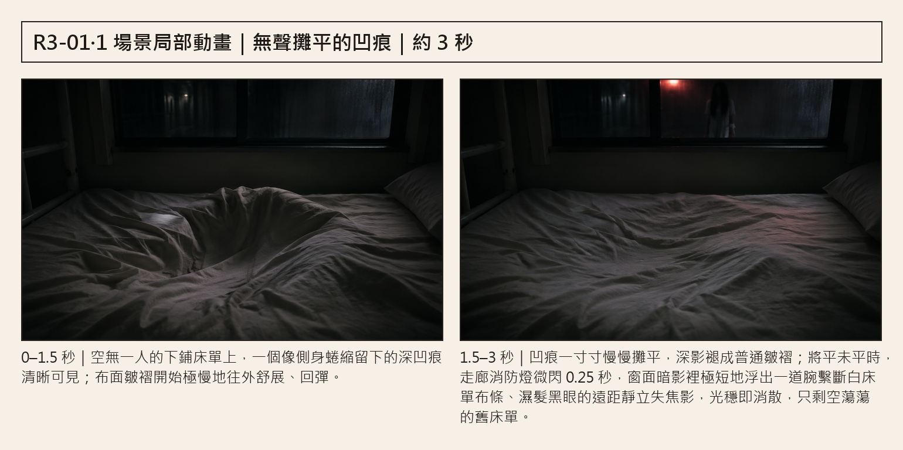

```prompt
【影片】R3-01·1｜場景局部動畫｜第一幕 R3-01 枕頭下的照片
【生成方式】圖生影片：首格直接用 R3-C02（近看：枕頭下全家福） 的寫實定稿圖；構圖、光線、人物與物件造型保持不變，只加入下列動作。
【長度】剪用約 3 秒（劇本指定）；生成 5 秒後裁切。
【情緒節奏】像剛剛還有人蜷在這裡，只是你一低頭，它就靜靜把自己抹平。全程死靜，沒有半點床架聲，越安靜越發毛。
【分鏡】
0–1.5 秒｜空無一人的下鋪床單上，一個像側身蜷縮留下的深凹痕清晰可見；布面皺褶開始極慢地往外舒展、回彈。
1.5–3 秒｜凹痕一寸寸慢慢攤平，深影褪成普通皺褶；將平未平時，走廊消防燈微閃 0.25 秒，窗面暗影裡極短地浮出墜落者（F0.5 瞬閃殘影）腕繫斷白床單布條、濕髮黑眼的遠距靜立失焦影，光穩即消散，只剩空蕩蕩的舊床單。
【鏡頭】約 28mm 第一人稱低頭看著空下鋪，鏡位鎖定不動，要疊回原圖（R3-C02）；焦點咬在發皺床單中央那處人影蜷縮的深凹痕與折線。
【人物】人物與異變者照首格的造型與位置，臉不給清楚五官（無臉、背光或被遮住），動作緩慢但連貫自然。
【光線色調】走廊消防燈的暗微光斜掠過灰白舊床單，起初把凹痕邊緣切出明顯深影，隨床單攤平陰影一點點變淺。整體色調沿用現在的現場光：低飽和、潮濕，亮處不過曝，暗處有層次。
【影片風格】寫實、極致逼真的真人實景拍攝質感：真實攝影機與自然光學，輕微景深、自然底片顆粒與真實曝光；皮膚、布料、金屬、水漬與灰塵都有真實細節。動作自然流暢，有重量與慣性，符合真實人體動作。不是遊戲 CG、不是 3D 算圖、不是插畫。
【後製（不進 AI 生成）】
聲音與後製對點：
・0–1.5 秒：一片死靜，床架與布料沒有半點聲響，只剩極遠的宿舍滴水。
・1.5–3 秒：直到攤平與遠影散去仍聽不見任何床架響聲。
【不要出現】清楚可辨識的人臉五官；任何可讀的文字、號碼、標誌、國旗或國名（畫面上的字留白或模糊，後製再合成）；配樂；第三人稱或看見主角全身；鏡頭晃動、推移或換景；血腥特寫、裸露；手指數量或手部結構錯誤；分鏡沒寫的人物、物件突然出現、消失或變形；遊戲 CG 感、3D 算圖感、插畫、動漫或卡通畫風、塑膠般光滑的皮膚與材質；動作僵硬、機械、卡頓、漂浮感或不自然的慢動作。
```

**素材提示詞**　人物：[墜落者（R3 瞬閃殘影）](10-23_製作規格_影片素材設定.md#va-faller)｜場景：R3 宿舍主間｜物品：無

```asset
【素材】人物｜墜落者（R3 瞬閃殘影）｜R3-01·1
【內容】瘦小年輕女性的死後怨靈形體：濕亂微塌的黑長髮貼在兩頰，毫無血色與表情、雙眼整顆全黑且眼眶發黑；穿沾滿泥灰水漬的寬大灰開襟衫、舊灰白長 T 與寬鬆褪色灰棉褲，穿舊塑膠拖鞋。雙手直垂身側，左手腕緊緊綁著一條撕裂沾汙、長垂拖地的舊白床單布條。僅於 R3-01·1 尾拍微光閃動 0.25 秒時在窗面暗影裡極短浮出遠距失焦靜立輪廓，光穩即散。
【構圖】人物參考圖：中性深灰背景、微弱頂側光；濕髮黑眼直立全身正面與腕繫斷床單布條局部參考，呈現遠距暗部失焦質感。
【風格】寫實、極致逼真的真人實景攝影質感：真實相機與自然光學，輕微景深與自然底片顆粒；皮膚、布料、金屬、水漬與灰塵都有真實細節。不是遊戲 CG、不是 3D 算圖、不是插畫。
【不要出現】墜落或撞擊動作；鮮血、骨折或傷口剖面；正面打亮清晰五官特寫；名牌或品牌標誌；手指數量或手部結構錯誤；清楚可辨識的人臉五官；任何可讀的文字、號碼、標誌、國旗或國名（字留白或模糊，後製再合成）；血腥特寫、裸露；遊戲 CG 感、3D 算圖感、插畫、動漫或卡通畫風、塑膠般光滑的皮膚與材質。
```

```asset
【素材】場景｜R3 宿舍主間｜R3-01·1
【內容】寫實實景的空景，不含任何人物與手；畫面中所有牌面、告示、標籤與紙件上的文字、數字一律留白或模糊。
空間：R3-V01（主場景）：住宅隔間、上下鋪、整理過度的空床、窗邊斷布、門邊取衣牌與外側洗衣路。綠磁磚折角可見的盥洗所門邊人工刻痕。數戶住宅被打通。舊門框還留在牆上，不同花色壁紙的接縫被床架截住。上下鋪之間掛著薄簾，晾衣處只剩安靜的布料。床邊舊信件與食譜夾在同一處乾燥窄縫。紙邊翻磨與油漬先在物件局部可見。綠磁磚折角上留著舊字（字留白），另一側粗管旁寫著指示字（字留白），箭頭朝向頭頂的維修缺口。
本段畫面：R3-C02（近看）：枕頭下全家福。
【構圖】空景參考兩張：一張照「空間」的全景，第一人稱站立視線高度、約 28mm 人眼視角、平視、地平線水平；一張照「本段畫面」的近看構圖，與本段首格一致。都不含人物、手與人影。
【光線色調】現在的現場光：低飽和、潮濕、廢棄；只有漏進樓內的天光與只亮了一部分的設備燈、消防燈照亮局部，亮處不過曝，暗處仍看得出層次；光向與首格一致。
【風格】寫實、極致逼真的真人實景攝影質感：真實相機與自然光學，輕微景深與自然底片顆粒；皮膚、布料、金屬、水漬與灰塵都有真實細節。不是遊戲 CG、不是 3D 算圖、不是插畫。
【不要出現】任何人物、手、人影或異變者；清楚可辨識的人臉五官；任何可讀的文字、號碼、標誌、國旗或國名（字留白或模糊，後製再合成）；血腥特寫、裸露；遊戲 CG 感、3D 算圖感、插畫、動漫或卡通畫風、塑膠般光滑的皮膚與材質。
```

## R4-V02 2F 共用盥洗間（2 段）

<a id="v-r4-v02-1"></a>

### R4-V02·1　動作回饋（中）

- **重要級別：**<span class="importance-mid">中</span>　接主觀記憶的觸碰
- **類型：**<span class="video-feedback">第一人稱動作回饋</span>　**畫面：**`R4-C06`　**剪用：**約 1.5 秒
- **劇本：**[R4-V02 2F 共用盥洗間](../09_劇本/09-04_正式劇本_第一幕.md#wash-r4-v02-script)
- **交付：**AI 生成稿只作動態參考或底稿；正式交付為疊在原主圖或近看上的短手部／物件動態圖層。

**劇本描述**　她的手指勾起一個毛巾袋的提帶，袋子在掛鉤上晃了半下，停住。

**對白／配音**　無對白（純畫面／環境音）

**分鏡板**　2F共用盥洗間

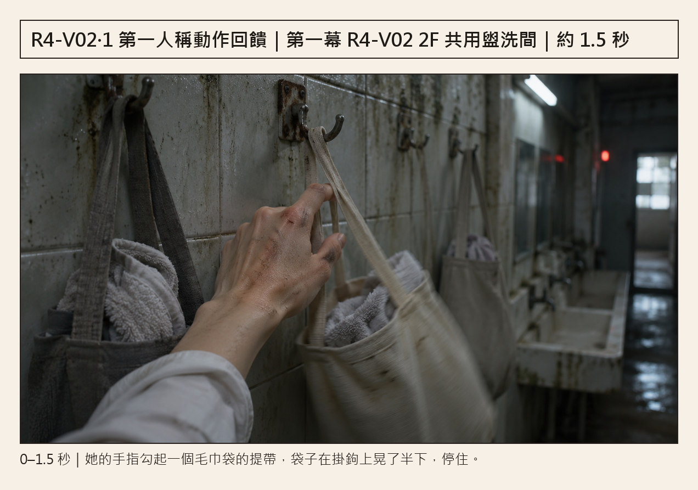

```prompt
【影片】R4-V02·1｜第一人稱動作回饋｜第一幕 R4-V02 2F 共用盥洗間
【生成方式】圖生影片：首格直接用 R4-C06（近看：編號掛鉤、補過的毛巾袋、插銷空孔與截短簾布） 的寫實定稿圖；構圖、光線、人物與物件造型保持不變，只加入下列動作。
【長度】剪用約 1.5 秒；生成 5 秒後裁切。
【分鏡】
0–1.5 秒｜她的手指勾起一個毛巾袋的提帶，袋子在掛鉤上晃了半下，停住。
【鏡頭】約 28mm 第一人稱主觀視線，鏡位鎖定不動，要疊回原主圖，景深照首格。焦點先在她的手，手碰到的毛巾袋跟著收清；動作有重量，做完就停住，不加分鏡以外的動作。
【人物】她的手只露出手與白襯衫袖口，手背乾裂、有擦傷，從畫面下緣入鏡；五指比例正確。
【光線色調】現在的現場光：低飽和、潮濕、廢棄；只有漏進樓內的天光與只亮了一部分的設備燈、消防燈照亮局部，亮處不過曝，暗處仍看得出層次；光向與首格一致。整段光源與明暗都不變。
【影片風格】寫實、極致逼真的真人實景拍攝質感：真實攝影機與自然光學，輕微景深、自然底片顆粒與真實曝光；皮膚、布料、金屬、水漬與灰塵都有真實細節。動作自然流暢，有重量與慣性，符合真實人體動作。不是遊戲 CG、不是 3D 算圖、不是插畫。
【不要出現】清楚可辨識的人臉五官；任何可讀的文字、號碼、標誌、國旗或國名（畫面上的字留白或模糊，後製再合成）；配樂；第三人稱或看見主角全身；鏡頭晃動、推移或換景；血腥特寫、裸露；手指數量或手部結構錯誤；分鏡沒寫的人物、物件突然出現、消失或變形；遊戲 CG 感、3D 算圖感、插畫、動漫或卡通畫風、塑膠般光滑的皮膚與材質；動作僵硬、機械、卡頓、漂浮感或不自然的慢動作。
```

**素材提示詞**　人物：[她・現在（第一人稱的手）](10-23_製作規格_影片素材設定.md#va-her-hands)｜場景：R4 刻痕牆廁所｜物品：[毛巾袋（R4）](10-23_製作規格_影片素材設定.md#va-towel-bag)

```asset
【素材】人物｜她・現在（第一人稱的手）｜R4-V02·1
【內容】26 歲成年女性的雙手與前臂，體態消瘦，手腕偏細。手背與指節乾裂，有零散的表淺擦傷與乾掉的泥灰，指甲短、邊緣不齊。白色普通長袖襯衫的袖口有局部撕裂、水漬與乾泥，不是制服剪裁，可隨手捲到前臂。動作時手肘靠近身體，起手前常先停一下。
【構圖】手部參考圖：中性灰背景、柔和均勻光；雙手與前臂的正面、側面、握物三個角度，只拍到手肘以下，五指比例正確。
【風格】寫實、極致逼真的真人實景攝影質感：真實相機與自然光學，輕微景深與自然底片顆粒；皮膚、布料、金屬、水漬與灰塵都有真實細節。不是遊戲 CG、不是 3D 算圖、不是插畫。
【不要出現】戒指、手錶、指甲油或任何飾品；新鮮流血或傷口剖面；名牌或品牌標誌；手指數量或手部結構錯誤；清楚可辨識的人臉五官；任何可讀的文字、號碼、標誌、國旗或國名（字留白或模糊，後製再合成）；血腥特寫、裸露；遊戲 CG 感、3D 算圖感、插畫、動漫或卡通畫風、塑膠般光滑的皮膚與材質。
```

```asset
【素材】場景｜R4 刻痕牆廁所｜R4-V02·1
【內容】寫實實景的空景，不含任何人物與手；畫面中所有牌面、告示、標籤與紙件上的文字、數字一律留白或模糊。
空間：R4-V01（主場景）：濕綠磁磚、可橫移的刻字牆、牆角符號、清潔時段牌、盥洗側門與轉角出口。同一條排水槽接到廁所門邊。洗衣槽旁的取餐小窗已被封住，內井頂部不透天。仍找得到剛才離開的住宅門。
本段畫面：R4-C06（近看）：編號掛鉤、補過的毛巾袋、插銷空孔與截短簾布。
【構圖】空景參考兩張：一張照「空間」的全景，第一人稱站立視線高度、約 28mm 人眼視角、平視、地平線水平；一張照「本段畫面」的近看構圖，與本段首格一致。都不含人物、手與人影。
【光線色調】現在的現場光：低飽和、潮濕、廢棄；只有漏進樓內的天光與只亮了一部分的設備燈、消防燈照亮局部，亮處不過曝，暗處仍看得出層次；光向與首格一致。
【風格】寫實、極致逼真的真人實景攝影質感：真實相機與自然光學，輕微景深與自然底片顆粒；皮膚、布料、金屬、水漬與灰塵都有真實細節。不是遊戲 CG、不是 3D 算圖、不是插畫。
【不要出現】任何人物、手、人影或異變者；清楚可辨識的人臉五官；任何可讀的文字、號碼、標誌、國旗或國名（字留白或模糊，後製再合成）；血腥特寫、裸露；遊戲 CG 感、3D 算圖感、插畫、動漫或卡通畫風、塑膠般光滑的皮膚與材質。
```

```asset
【素材】物品｜毛巾袋（R4）｜R4-V02·1
【內容】掛在編號掛鉤上的舊毛巾袋：棉布束口袋，一條提帶，袋身有補丁與粗針腳；每個人的顏色都不同，也都已褪色。
【構圖】物品參考圖：單一物件置中，中性深灰背景、柔和側光；正面、背面與局部特寫三個角度，比例照實物。
【風格】寫實、極致逼真的真人實景攝影質感：真實相機與自然光學，輕微景深與自然底片顆粒；皮膚、布料、金屬、水漬與灰塵都有真實細節。不是遊戲 CG、不是 3D 算圖、不是插畫。
【不要出現】人物與手；清楚可辨識的人臉五官；任何可讀的文字、號碼、標誌、國旗或國名（字留白或模糊，後製再合成）；血腥特寫、裸露；遊戲 CG 感、3D 算圖感、插畫、動漫或卡通畫風、塑膠般光滑的皮膚與材質。
```

<a id="v-r4-v02-2"></a>

### R4-V02·2　主觀記憶動畫（高）

- **重要級別：**<span class="importance-high">高</span>　主觀記憶
- **類型：**<span class="video-memory">主觀記憶動畫</span>　**畫面：**`R4-C06`　**剪用：**約 3–6 秒
- **劇本：**[R4-V02 2F 共用盥洗間](../09_劇本/09-04_正式劇本_第一幕.md#wash-r4-v02-script)
- **交付：**併入觸碰物件的原近看或主圖素材項，另交記憶動畫分層與二至三張低動態記憶靜格。
- **規則：**[主觀記憶動畫](../09_劇本/09-15_正式劇本_共用附錄.md#memory-animation-contract)：只到肩膀以下、不給臉與名字，任何輸入立即結束。
- **導演註記：**[R4-V02·2 排隊時忍不住的笑](10-22_製作規格_影片導演註記.md#vd-r4-v02-2)

**劇本描述**　記憶裡是同樣一排淋浴位，隊伍排到門外，每個人都穿著衣服、抱著自己的毛巾袋。她笑出來，笑到一半趕快用手摀住嘴，肩膀一直抖，停不下來；旁邊那隻粉紅棕格紋、袖口過長的手也摀著嘴，另一邊的手肘輕輕撞她一下，兩個人抖得更厲害。畫面只到肩膀以下，看不見臉。

**對白／配音**　無對白（純畫面／環境音）

**分鏡板**　排隊時忍不住的笑

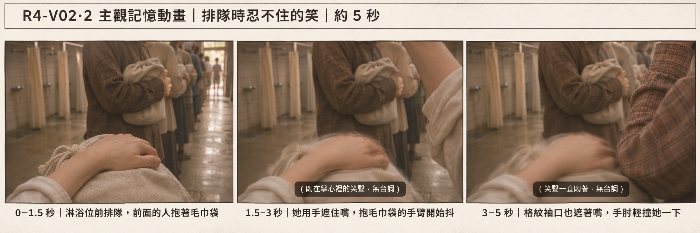

```prompt
【影片】R4-V02·2｜主觀記憶動畫｜第一幕 R4-V02 2F 共用盥洗間
【生成方式】先依分鏡第一格生成一張寫實實拍的記憶首格（併入 R4-C06 素材項的記憶分層），再用圖生影片。
【長度】剪用約 5 秒（可在 3–6 秒間）；生成 5 秒後裁切。
【情緒節奏】不該笑的地方偏偏笑出來。忍住、發抖、被撞一下更忍不住，整段是全作少數輕鬆的時刻。
【分鏡】
0–1.5 秒｜一排淋浴位前，隊伍排到門外；前面的人都穿著衣服、抱著自己的毛巾袋，只看得到肩膀以下。
1.5–3 秒｜她的手忽然往上摀住嘴，出了畫面上緣；畫面下方抱著毛巾袋的手臂開始抖。
3–5 秒｜旁邊那人的手臂也抬起摀住嘴，粉紅棕格紋、過長的袖口在畫面上緣；另一邊的手肘輕輕撞她一下，兩個人抖得更厲害。
【鏡頭】她站在隊伍裡、略低頭的視線；約 35mm，幾乎不動，笑得發抖時只有極輕微的起伏，不晃。構圖只到肩膀以下。
【人物】她的手與前臂可入鏡，衣袖素色、無圖案。另一個人只以粉紅棕格紋、過長、蓋到指節的袖口辨認；構圖只到肩膀以下，看不見任何人的臉。
【光線色調】盥洗間的室內燈混著水氣，光線柔、略帶霧感。記憶色調：柔和低對比的暖褐微光，帶輕微顆粒與四周微暈，像隔著一層舊塑膠片看；不用凝固層的單色冷青，也不加訊號雜訊。光源只用分鏡裡原有的。
【影片風格】寫實、極致逼真的真人實景拍攝質感：真實攝影機與自然光學，輕微景深、自然底片顆粒與真實曝光；皮膚、布料、金屬、水漬與灰塵都有真實細節。動作自然流暢，有重量與慣性，符合真實人體動作。不是遊戲 CG、不是 3D 算圖、不是插畫。
【後製（不進 AI 生成）】
聲音與後製對點：
・0–1.5 秒：遠處的水聲。
・1.5–3 秒：悶在掌心裡的笑聲。
・3–5 秒：笑聲一直悶著；5 秒畫面結束時接回盥洗間慢慢退去的滴水。
【不要出現】清楚可辨識的人臉五官；任何可讀的文字、號碼、標誌、國旗或國名（畫面上的字留白或模糊，後製再合成）；配樂；第三人稱或看見主角全身；鏡頭晃動、推移或換景；血腥特寫、裸露；手指數量或手部結構錯誤；分鏡沒寫的人物、物件突然出現、消失或變形；遊戲 CG 感、3D 算圖感、插畫、動漫或卡通畫風、塑膠般光滑的皮膚與材質；動作僵硬、機械、卡頓、漂浮感或不自然的慢動作；冷青色調或訊號雜訊；對方的臉、名牌或可讀的名字。
```

**素材提示詞**　人物：[她・記憶裡（園區前期）](10-23_製作規格_影片素材設定.md#va-her-memory)、[小花・記憶裡（粉紅棕格紋袖口）](10-23_製作規格_影片素材設定.md#va-xiaohua-memory)｜場景：[淋浴間外的隊伍（R4 記憶）](10-23_製作規格_影片素材設定.md#va-scene-shower)｜物品：[毛巾袋（R4）](10-23_製作規格_影片素材設定.md#va-towel-bag)

```asset
【素材】人物｜她・記憶裡（園區前期）｜R4-V02·2
【內容】園區前期的她：二十多歲成年女性的雙手與前臂，手指乾淨、指甲剪短，還沒有現在的乾裂、泥灰與擦挫傷。衣袖是素色、無圖案、低飽和的普通長袖，略不合身。
【構圖】手部參考圖：中性灰背景、柔和暖光；雙手與前臂的正面、側面、握物三個角度，只拍到手肘以下。
【風格】寫實、極致逼真的真人實景攝影質感：真實相機與自然光學，輕微景深與自然底片顆粒；皮膚、布料、金屬、水漬與灰塵都有真實細節。不是遊戲 CG、不是 3D 算圖、不是插畫。
【不要出現】白襯衫；現在的乾裂、泥灰與擦挫傷；戒指、手錶或任何飾品；名牌或品牌標誌；手指數量或手部結構錯誤；清楚可辨識的人臉五官；任何可讀的文字、號碼、標誌、國旗或國名（字留白或模糊，後製再合成）；血腥特寫、裸露；遊戲 CG 感、3D 算圖感、插畫、動漫或卡通畫風、塑膠般光滑的皮膚與材質。
```

```asset
【素材】人物｜小花・記憶裡（粉紅棕格紋袖口）｜R4-V02·2
【內容】19 歲年輕女性肩膀以下的上半身、雙手與前臂。小個、肩窄，手指靈活，指腹有修手機、貼保護貼與摺紙留下的薄繭。洗得褪色的粉紅棕色格紋襯衫大一號，袖口過長、蓋到指節；襯衫裡露出一點米色內襯；下身是灰褐色及膝裙。動作安靜，習慣把紙邊對齊、壓住或折好。
【構圖】人物參考圖：中性灰背景、柔和暖光；肩膀以下的上半身與雙手，正面、側面各一張，加一張袖口蓋到指節的手部特寫。頭髮與臉都不入鏡。
【風格】寫實、極致逼真的真人實景攝影質感：真實相機與自然光學，輕微景深與自然底片顆粒；皮膚、布料、金屬、水漬與灰塵都有真實細節。不是遊戲 CG、不是 3D 算圖、不是插畫。
【不要出現】首飾或指甲彩繪；辮子與臉入鏡；名牌或品牌標誌；手指數量或手部結構錯誤；清楚可辨識的人臉五官；任何可讀的文字、號碼、標誌、國旗或國名（字留白或模糊，後製再合成）；血腥特寫、裸露；遊戲 CG 感、3D 算圖感、插畫、動漫或卡通畫風、塑膠般光滑的皮膚與材質。
```

```asset
【素材】場景｜淋浴間外的隊伍（R4 記憶）｜R4-V02·2
【內容】同一排公用淋浴位的門外走道空景，磁磚牆、編號留白的掛鉤與截短的塑膠簾，地上濕亮，走道一路向門外延伸並預留排隊動線的縱深；畫面沒有人也沒有手。日光燈偏暖、低對比。
【構圖】空景參考：約 35mm，站在門外走道肩膀高度往前看的無人走道空景；人員與手另以後製背景層合成，空景本身不含人物。
【光線色調】記憶色調：柔和低對比的暖褐微光，帶輕微顆粒與四周微暈；不用凝固層的單色冷青，也不加訊號雜訊。
【風格】寫實、極致逼真的真人實景攝影質感：真實相機與自然光學，輕微景深與自然底片顆粒；皮膚、布料、金屬、水漬與灰塵都有真實細節。不是遊戲 CG、不是 3D 算圖、不是插畫。
【不要出現】任何人物、手、人影或異變者；清楚可辨識的人臉五官；任何可讀的文字、號碼、標誌、國旗或國名（字留白或模糊，後製再合成）；血腥特寫、裸露；遊戲 CG 感、3D 算圖感、插畫、動漫或卡通畫風、塑膠般光滑的皮膚與材質。
```

```asset
【素材】物品｜毛巾袋（R4）｜R4-V02·2
【內容】掛在編號掛鉤上的舊毛巾袋：棉布束口袋，一條提帶，袋身有補丁與粗針腳；每個人的顏色都不同，也都已褪色。
【構圖】物品參考圖：單一物件置中，中性深灰背景、柔和側光；正面、背面與局部特寫三個角度，比例照實物。
【風格】寫實、極致逼真的真人實景攝影質感：真實相機與自然光學，輕微景深與自然底片顆粒；皮膚、布料、金屬、水漬與灰塵都有真實細節。不是遊戲 CG、不是 3D 算圖、不是插畫。
【不要出現】人物與手；清楚可辨識的人臉五官；任何可讀的文字、號碼、標誌、國旗或國名（字留白或模糊，後製再合成）；血腥特寫、裸露；遊戲 CG 感、3D 算圖感、插畫、動漫或卡通畫風、塑膠般光滑的皮膚與材質。
```

## R4-01c 門外的摩擦聲（2 段）

<a id="v-r4-01c-1"></a>

### R4-01c·1　場景局部動畫（中）

- **重要級別：**<span class="importance-mid">中</span>　逼近或異常的前兆
- **類型：**<span class="video-scene">場景局部動畫</span>　**畫面：**`R4-C05`　**剪用：**約 8 秒
- **劇本：**[R4-01c 門外的摩擦聲](../09_劇本/09-04_正式劇本_第一幕.md#h-0904-404)
- **交付：**只取會動的局部，做成疊在原主圖或近看上的獨立動態圖層，其餘畫面沿用原圖。

**劇本描述**　門底陰影停在門縫下，玩家不操作，它就不走；玩家下一次操作時才退去，最長約 8 秒。門把始終靜止。

**對白／配音**　無對白（純畫面／環境音）

**分鏡板**　門外的摩擦聲

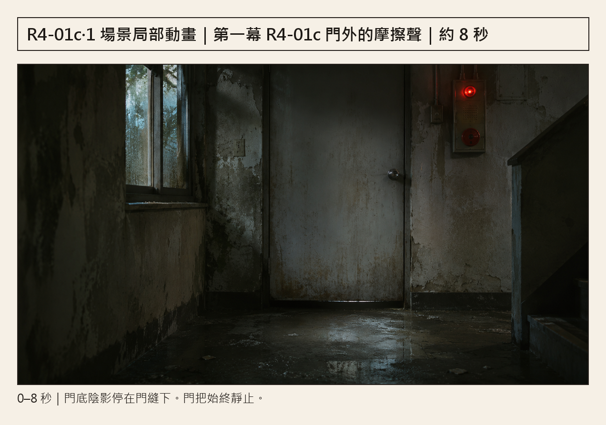

```prompt
【影片】R4-01c·1｜場景局部動畫｜第一幕 R4-01c 門外的摩擦聲
【生成方式】圖生影片：首格直接用 R4-C05（近看：門外下緣與摩擦痕） 的寫實定稿圖；構圖、光線、人物與物件造型保持不變，只加入下列動作。
【長度】剪用約 8 秒（劇本指定）；生成 10 秒後裁切。
【分鏡】
0–8 秒｜門底陰影停在門縫下。門把始終靜止。
【鏡頭】約 28mm，鏡頭鎖定不動，要疊回原主圖，景深照首格。焦點落在分鏡點名會變化的局部，其餘畫面保持靜止；不新增人物或物件。
【光線色調】現在的現場光：低飽和、潮濕、廢棄；只有漏進樓內的天光與只亮了一部分的設備燈、消防燈照亮局部，亮處不過曝，暗處仍看得出層次；光向與首格一致。整段光源與明暗都不變。
【影片風格】寫實、極致逼真的真人實景拍攝質感：真實攝影機與自然光學，輕微景深、自然底片顆粒與真實曝光；皮膚、布料、金屬、水漬與灰塵都有真實細節。動作自然流暢，有重量與慣性，符合真實人體動作。不是遊戲 CG、不是 3D 算圖、不是插畫。
【不要出現】清楚可辨識的人臉五官；任何可讀的文字、號碼、標誌、國旗或國名（畫面上的字留白或模糊，後製再合成）；配樂；第三人稱或看見主角全身；鏡頭晃動、推移或換景；血腥特寫、裸露；手指數量或手部結構錯誤；分鏡沒寫的人物、物件突然出現、消失或變形；遊戲 CG 感、3D 算圖感、插畫、動漫或卡通畫風、塑膠般光滑的皮膚與材質；動作僵硬、機械、卡頓、漂浮感或不自然的慢動作。
```

**素材提示詞**　人物：無｜場景：R4 刻痕牆廁所｜物品：無

```asset
【素材】場景｜R4 刻痕牆廁所｜R4-01c·1
【內容】寫實實景的空景，不含任何人物與手；畫面中所有牌面、告示、標籤與紙件上的文字、數字一律留白或模糊。
空間：R4-V01（主場景）：濕綠磁磚、可橫移的刻字牆、牆角符號、清潔時段牌、盥洗側門與轉角出口。同一條排水槽接到廁所門邊。洗衣槽旁的取餐小窗已被封住，內井頂部不透天。仍找得到剛才離開的住宅門。
本段畫面：R4-C05（近看）：門外下緣與摩擦痕。
【構圖】空景參考兩張：一張照「空間」的全景，第一人稱站立視線高度、約 28mm 人眼視角、平視、地平線水平；一張照「本段畫面」的近看構圖，與本段首格一致。都不含人物、手與人影。
【光線色調】現在的現場光：低飽和、潮濕、廢棄；只有漏進樓內的天光與只亮了一部分的設備燈、消防燈照亮局部，亮處不過曝，暗處仍看得出層次；光向與首格一致。
【風格】寫實、極致逼真的真人實景攝影質感：真實相機與自然光學，輕微景深與自然底片顆粒；皮膚、布料、金屬、水漬與灰塵都有真實細節。不是遊戲 CG、不是 3D 算圖、不是插畫。
【不要出現】任何人物、手、人影或異變者；清楚可辨識的人臉五官；任何可讀的文字、號碼、標誌、國旗或國名（字留白或模糊，後製再合成）；血腥特寫、裸露；遊戲 CG 感、3D 算圖感、插畫、動漫或卡通畫風、塑膠般光滑的皮膚與材質。
```

<a id="v-r4-01c-2"></a>

### R4-01c·2　場景局部動畫（中）

- **重要級別：**<span class="importance-mid">中</span>　逼近或異常的前兆
- **類型：**<span class="video-scene">場景局部動畫</span>　**畫面：**`R4-C05`　**剪用：**約 2 秒
- **劇本：**[R4-01c 門外的摩擦聲](../09_劇本/09-04_正式劇本_第一幕.md#h-0904-404)
- **交付：**只取會動的局部，做成疊在原主圖或近看上的獨立動態圖層，其餘畫面沿用原圖。

**劇本描述**　側門下先暗一截，排水溝的水面起細紋，紋路順著溝往淋浴位這邊推。看不到腳踝以上。

**對白／配音**　無對白（純畫面／環境音）

**分鏡板**　門外的摩擦聲

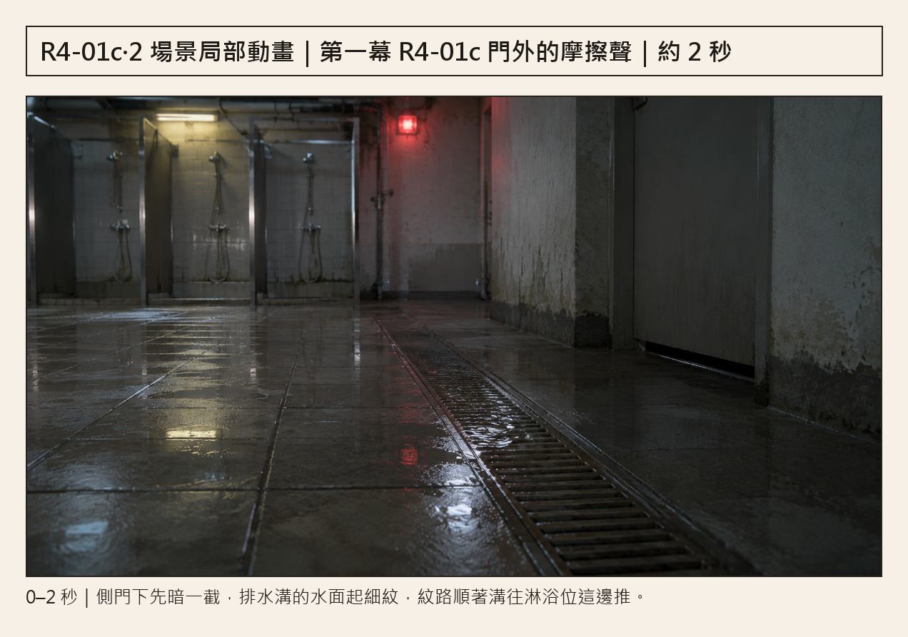

```prompt
【影片】R4-01c·2｜場景局部動畫｜第一幕 R4-01c 門外的摩擦聲
【生成方式】圖生影片：首格用上一段 R4-01c·1 的最後一格，保持構圖、光線、色調、人物與物件造型不變，只加入下列動作。
【長度】剪用約 2 秒；生成 5 秒後裁切。
【分鏡】
0–2 秒｜側門下先暗一截，排水溝的水面起細紋，紋路順著溝往淋浴位這邊推。
【鏡頭】約 28mm，鏡頭鎖定不動，要疊回原主圖，景深照首格。焦點落在分鏡點名會變化的局部，其餘畫面保持靜止；不新增人物或物件。
【構圖限制】看不到腳踝以上。
【光線色調】現在的現場光：低飽和、潮濕、廢棄；只有漏進樓內的天光與只亮了一部分的設備燈、消防燈照亮局部，亮處不過曝，暗處仍看得出層次；光向與首格一致。分鏡寫的明暗變化只發生在點名的局部，其餘的光不動。
【影片風格】寫實、極致逼真的真人實景拍攝質感：真實攝影機與自然光學，輕微景深、自然底片顆粒與真實曝光；皮膚、布料、金屬、水漬與灰塵都有真實細節。動作自然流暢，有重量與慣性，符合真實人體動作。不是遊戲 CG、不是 3D 算圖、不是插畫。
【不要出現】清楚可辨識的人臉五官；任何可讀的文字、號碼、標誌、國旗或國名（畫面上的字留白或模糊，後製再合成）；配樂；第三人稱或看見主角全身；鏡頭晃動、推移或換景；血腥特寫、裸露；手指數量或手部結構錯誤；分鏡沒寫的人物、物件突然出現、消失或變形；遊戲 CG 感、3D 算圖感、插畫、動漫或卡通畫風、塑膠般光滑的皮膚與材質；動作僵硬、機械、卡頓、漂浮感或不自然的慢動作。
```

**素材提示詞**　人物：無｜場景：R4 刻痕牆廁所｜物品：無

```asset
【素材】場景｜R4 刻痕牆廁所｜R4-01c·2
【內容】寫實實景的空景，不含任何人物與手；畫面中所有牌面、告示、標籤與紙件上的文字、數字一律留白或模糊。
空間：R4-V01（主場景）：濕綠磁磚、可橫移的刻字牆、牆角符號、清潔時段牌、盥洗側門與轉角出口。同一條排水槽接到廁所門邊。洗衣槽旁的取餐小窗已被封住，內井頂部不透天。仍找得到剛才離開的住宅門。
本段畫面：R4-C05（近看）：門外下緣與摩擦痕。
【構圖】空景參考兩張：一張照「空間」的全景，第一人稱站立視線高度、約 28mm 人眼視角、平視、地平線水平；一張照「本段畫面」的近看構圖，與本段首格一致。都不含人物、手與人影。
【光線色調】現在的現場光：低飽和、潮濕、廢棄；只有漏進樓內的天光與只亮了一部分的設備燈、消防燈照亮局部，亮處不過曝，暗處仍看得出層次；光向與首格一致。
【風格】寫實、極致逼真的真人實景攝影質感：真實相機與自然光學，輕微景深與自然底片顆粒；皮膚、布料、金屬、水漬與灰塵都有真實細節。不是遊戲 CG、不是 3D 算圖、不是插畫。
【不要出現】任何人物、手、人影或異變者；清楚可辨識的人臉五官；任何可讀的文字、號碼、標誌、國旗或國名（字留白或模糊，後製再合成）；血腥特寫、裸露；遊戲 CG 感、3D 算圖感、插畫、動漫或卡通畫風、塑膠般光滑的皮膚與材質。
```

## R4b-02 同一本簿子（1 段）

<a id="v-r4b-02-1"></a>

### R4b-02·1　動作回饋（高）

- **重要級別：**<span class="importance-high">高</span>　重點橋段：R4b 收回香火簿
- **類型：**<span class="video-feedback">第一人稱動作回饋</span>　**畫面：**`R4b-D01`　**剪用：**約 1.5 秒
- **劇本：**[R4b-02 同一本簿子](../09_劇本/09-04_正式劇本_第一幕.md#h-0904-446)
- **交付：**AI 生成稿只作動態參考或底稿；正式交付為疊在原主圖或近看上的短手部／物件動態圖層。
- **重點 ★ R4b 收回香火簿：**收起香火簿近看時，右手放回木架原處並推齊灰上的淺印，不超過 1.5 秒，任何輸入立即收手；在 R4b-02 原 OS 的 3 秒間距內結束；低動態一張靜格。
- **導演註記：**[R4b-02·1 放回香火簿](10-22_製作規格_影片導演註記.md#vd-r4b-02-1)

**劇本描述**　收起香火簿時，前景的右手把簿子放回木架原處，又推了一下，讓書邊對齊它在灰上壓出的淺色印子，才鬆手。整段不超過 1.5 秒，任何操作都讓手立刻收回。

**對白／配音**　主角（OS）「供桌都還在。」 ／ 主角（OS）「可後面寫的……全是房號跟出勤。」

**分鏡板**　放回香火簿

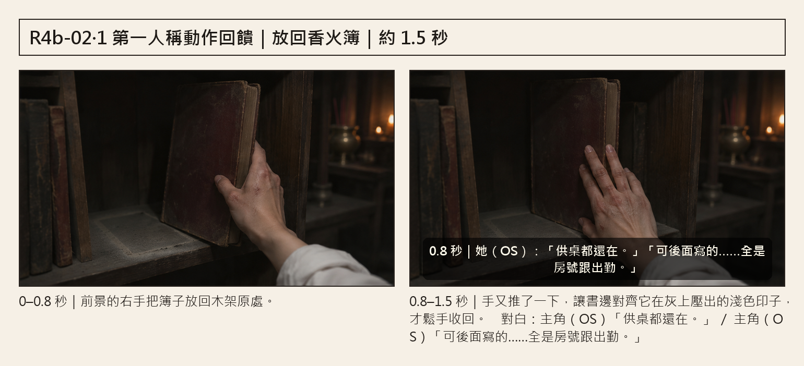

```prompt
【影片】R4b-02·1｜第一人稱動作回饋｜第一幕 R4b-02 同一本簿子
【生成方式】圖生影片：首格直接用 R4b-D01（文件：香火簿） 的寫實定稿圖；構圖、光線、人物與物件造型保持不變，只加入下列動作。
【長度】剪用約 1.5 秒；生成 5 秒後裁切。
【情緒節奏】對別人的東西保持尊重。動作很小，但要對齊灰上的印子，才放手。
【分鏡】
0–0.8 秒｜前景的右手把簿子放回木架原處。
0.8–1.5 秒｜手又推了一下，讓書邊對齊它在灰上壓出的淺色印子，才鬆手收回。　對白：主角（OS）「供桌都還在。」 ／ 主角（OS）「可後面寫的……全是房號跟出勤。」
【鏡頭】鏡頭鎖定不動，要疊回原圖；焦點在木架與灰上的淺印。
【人物】她的手只露出手與白襯衫袖口，手背乾裂、有擦傷，從畫面下緣入鏡；五指比例正確。
【光線色調】現在的現場光很暗，供桌一帶的微弱暖光落在木架與簿子邊緣。
【影片風格】寫實、極致逼真的真人實景拍攝質感：真實攝影機與自然光學，輕微景深、自然底片顆粒與真實曝光；皮膚、布料、金屬、水漬與灰塵都有真實細節。動作自然流暢，有重量與慣性，符合真實人體動作。不是遊戲 CG、不是 3D 算圖、不是插畫。
【後製（不進 AI 生成）】
聲音與後製對點：
・0–0.8 秒：簿子落在木架上的輕響。
・0.8–1.5 秒：動作結束後才進 OS「供桌都還在。」，隔約 3 秒再接「可後面寫的……全是房號跟出勤。」，都不壓在動作上。
【不要出現】清楚可辨識的人臉五官；任何可讀的文字、號碼、標誌、國旗或國名（畫面上的字留白或模糊，後製再合成）；配樂；第三人稱或看見主角全身；鏡頭晃動、推移或換景；血腥特寫、裸露；手指數量或手部結構錯誤；分鏡沒寫的人物、物件突然出現、消失或變形；遊戲 CG 感、3D 算圖感、插畫、動漫或卡通畫風、塑膠般光滑的皮膚與材質；動作僵硬、機械、卡頓、漂浮感或不自然的慢動作。
```

**素材提示詞**　人物：[她・現在（第一人稱的手）](10-23_製作規格_影片素材設定.md#va-her-hands)｜場景：R4b 樓梯轉角無主神壇｜物品：[香火簿（R4b）](10-23_製作規格_影片素材設定.md#va-incense-book)

```asset
【素材】人物｜她・現在（第一人稱的手）｜R4b-02·1
【內容】26 歲成年女性的雙手與前臂，體態消瘦，手腕偏細。手背與指節乾裂，有零散的表淺擦傷與乾掉的泥灰，指甲短、邊緣不齊。白色普通長袖襯衫的袖口有局部撕裂、水漬與乾泥，不是制服剪裁，可隨手捲到前臂。動作時手肘靠近身體，起手前常先停一下。
【構圖】手部參考圖：中性灰背景、柔和均勻光；雙手與前臂的正面、側面、握物三個角度，只拍到手肘以下，五指比例正確。
【風格】寫實、極致逼真的真人實景攝影質感：真實相機與自然光學，輕微景深與自然底片顆粒；皮膚、布料、金屬、水漬與灰塵都有真實細節。不是遊戲 CG、不是 3D 算圖、不是插畫。
【不要出現】戒指、手錶、指甲油或任何飾品；新鮮流血或傷口剖面；名牌或品牌標誌；手指數量或手部結構錯誤；清楚可辨識的人臉五官；任何可讀的文字、號碼、標誌、國旗或國名（字留白或模糊，後製再合成）；血腥特寫、裸露；遊戲 CG 感、3D 算圖感、插畫、動漫或卡通畫風、塑膠般光滑的皮膚與材質。
```

```asset
【素材】場景｜R4b 樓梯轉角無主神壇｜R4b-02·1
【內容】寫實實景的空景，不含任何人物與手；畫面中所有牌面、告示、標籤與紙件上的文字、數字一律留白或模糊。
空間：R4b-V01（主場景）：R4 樓梯轉角的供桌、水杯、餐盒、祈禱卡、香火簿與十二盞燈。褪色紅布、小供桌、不同來歷的信仰物件與祖先照片。桌腳有修補，擺設讓出通路。上方樓梯被鐵皮封住。
本段畫面：R4b-D01（文件）：香火簿。
【構圖】空景參考兩張：一張照「空間」的全景，第一人稱站立視線高度、約 28mm 人眼視角、平視、地平線水平；一張照「本段畫面」的近看構圖，與本段首格一致。都不含人物、手與人影。
【光線色調】現在的現場光：低飽和、潮濕、廢棄；只有漏進樓內的天光與只亮了一部分的設備燈、消防燈照亮局部，亮處不過曝，暗處仍看得出層次；光向與首格一致。
【風格】寫實、極致逼真的真人實景攝影質感：真實相機與自然光學，輕微景深與自然底片顆粒；皮膚、布料、金屬、水漬與灰塵都有真實細節。不是遊戲 CG、不是 3D 算圖、不是插畫。
【不要出現】任何人物、手、人影或異變者；清楚可辨識的人臉五官；任何可讀的文字、號碼、標誌、國旗或國名（字留白或模糊，後製再合成）；血腥特寫、裸露；遊戲 CG 感、3D 算圖感、插畫、動漫或卡通畫風、塑膠般光滑的皮膚與材質。
```

```asset
【素材】物品｜香火簿（R4b）｜R4b-02·1
【內容】一本手寫登記用的舊香火簿：硬紙封面褪色、書脊磨損，內頁泛黃受潮；平放在木架上，書邊在積灰上壓出一塊淺色的印子。
【構圖】物品參考圖：單一物件置中，中性深灰背景、柔和側光；正面、背面與局部特寫三個角度，比例照實物。
【風格】寫實、極致逼真的真人實景攝影質感：真實相機與自然光學，輕微景深與自然底片顆粒；皮膚、布料、金屬、水漬與灰塵都有真實細節。不是遊戲 CG、不是 3D 算圖、不是插畫。
【不要出現】人物與手；清楚可辨識的人臉五官；任何可讀的文字、號碼、標誌、國旗或國名（字留白或模糊，後製再合成）；血腥特寫、裸露；遊戲 CG 感、3D 算圖感、插畫、動漫或卡通畫風、塑膠般光滑的皮膚與材質。
```

## R4b-03 同一個節拍（非必要回訪）（1 段）

<a id="v-r4b-03-1"></a>

### R4b-03·1　場景局部動畫（低）

- **重要級別：**<span class="importance-low">低</span>　環境氣氛
- **類型：**<span class="video-scene">場景局部動畫</span>　**畫面：**`R4b-C04`　**剪用：**約 4 秒
- **劇本：**[R4b-03 同一個節拍（非必要回訪）](../09_劇本/09-04_正式劇本_第一幕.md#h-0904-472)
- **交付：**只取會動的局部，做成疊在原主圖或近看上的獨立動態圖層，其餘畫面沿用原圖。
- **導演註記：**[R4b-03·1 十二盞電子燈與門角瞬影](10-22_製作規格_影片導演註記.md#vd-r4b-03-1)

**劇本描述**　R4b-C04 既有低壓排程驅動十二盞電子燈依序亮起。亮起節奏與 R1 原叫號機相同。末盞亮起前燈影閃暗一瞬，門框暗角短暫浮出封鎖後者（F0.5 瞬閃殘影，約 0.2 秒）穿厚灰舊外套、黑眼直立的失焦靜影，燈定後只剩空門與空位。

**對白／配音**　無對白（純畫面／環境音）

**分鏡板**　十二盞電子燈與門角瞬影

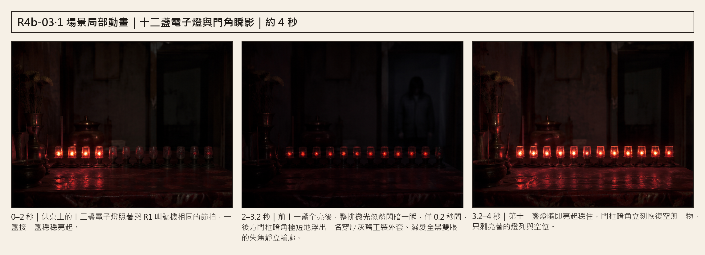

```prompt
【影片】R4b-03·1｜場景局部動畫｜第一幕 R4b-03 同一個節拍（非必要回訪）
【生成方式】圖生影片：首格直接用 R4b-C04（近看：既有節拍聲源與供桌邊緣） 的寫實定稿圖；構圖、光線、人物與物件造型保持不變，只加入下列動作。
【長度】剪用約 4 秒；生成 5 秒後裁切。
【情緒節奏】供桌上的電子燈與 R1 叫號機共用同一拍，像把拜神也算進號次；最後一盞還沒穩前，門角閃過那個留在屋裡的人。
【分鏡】
0–2 秒｜供桌上的十二盞電子燈照著與 R1 叫號機相同的節拍，一盞接一盞穩穩亮起。
2–3.2 秒｜前十一盞全亮後，整排微光忽然閃暗一瞬，僅 0.2 秒間，後方門框暗角極短地浮出封鎖後者（F0.5 瞬閃殘影）穿厚灰舊工裝外套、濕髮全黑雙眼的失焦靜立輪廓。
3.2–4 秒｜第十二盞燈隨即亮起穩住，門框暗角立刻恢復空無一物，只剩亮著的燈列與空位。
【鏡頭】約 28mm 第一人稱視線，鏡位鎖定不動，要疊回原圖（R4b-C04）；焦點先在供桌十二盞電子燈與邊緣陰影，門框暗角留在景深後方。
【人物】人物與異變者照首格的造型與位置，臉不給清楚五官（無臉、背光或被遮住），動作緩慢但連貫自然。
【光線色調】現在的現場光極暗，只剩十二盞電子燈依序亮起的微弱紅光；第十二盞亮起前全場閃暗 0.2 秒。
【影片風格】寫實、極致逼真的真人實景拍攝質感：真實攝影機與自然光學，輕微景深、自然底片顆粒與真實曝光；皮膚、布料、金屬、水漬與灰塵都有真實細節。動作自然流暢，有重量與慣性，符合真實人體動作。不是遊戲 CG、不是 3D 算圖、不是插畫。
【後製（不進 AI 生成）】
聲音與後製對點：
・0–2 秒：氣流與遠處極淡的滴水聲持續，每亮一盞只有極微的電流微響。
・2–3.2 秒：閃暗那一拍一切底噪像頓了一瞬。
・3.2–4 秒：氣流與滴水接回原本的平靜節奏。
【不要出現】清楚可辨識的人臉五官；任何可讀的文字、號碼、標誌、國旗或國名（畫面上的字留白或模糊，後製再合成）；配樂；第三人稱或看見主角全身；鏡頭晃動、推移或換景；血腥特寫、裸露；手指數量或手部結構錯誤；分鏡沒寫的人物、物件突然出現、消失或變形；遊戲 CG 感、3D 算圖感、插畫、動漫或卡通畫風、塑膠般光滑的皮膚與材質；動作僵硬、機械、卡頓、漂浮感或不自然的慢動作。
```

**素材提示詞**　人物：[封鎖後者（R4b 瞬閃殘影）](10-23_製作規格_影片素材設定.md#va-lockdown)｜場景：R4b 樓梯轉角無主神壇｜物品：無

```asset
【素材】人物｜封鎖後者（R4b 瞬閃殘影）｜R4b-03·1
【內容】微胖偏壯碩的中年男性死後怨靈形體：頭頂髮量稀疏、濕亂黑髮貼額，毫無血色與表情、雙眼整顆全黑、眼眶重度發黑且皮膚發白；穿褪色開襟沾汙灰舊工裝夾克、裡面是被泥漬汗漬弄髒的泛黃白圓領汗衫、寬鬆沾汙舊工作褲與舊塑膠拖鞋。雙臂直垂身側不動。僅於 R4b-03·1 末盞電子燈閃暗 0.2 秒時在門框暗角極短浮出靜立失焦輪廓，燈定即散。
【構圖】人物參考圖：中性深灰背景、暗側光；靜立正面全身與局部手部參考，呈現門角暗影裡失焦輪廓。
【風格】寫實、極致逼真的真人實景攝影質感：真實相機與自然光學，輕微景深與自然底片顆粒；皮膚、布料、金屬、水漬與灰塵都有真實細節。不是遊戲 CG、不是 3D 算圖、不是插畫。
【不要出現】正面打亮清晰五官特寫；群體或撲擊動作；鮮血與傷口；名牌或品牌標誌；手指數量或手部結構錯誤；清楚可辨識的人臉五官；任何可讀的文字、號碼、標誌、國旗或國名（字留白或模糊，後製再合成）；血腥特寫、裸露；遊戲 CG 感、3D 算圖感、插畫、動漫或卡通畫風、塑膠般光滑的皮膚與材質。
```

```asset
【素材】場景｜R4b 樓梯轉角無主神壇｜R4b-03·1
【內容】寫實實景的空景，不含任何人物與手；畫面中所有牌面、告示、標籤與紙件上的文字、數字一律留白或模糊。
空間：R4b-V01（主場景）：R4 樓梯轉角的供桌、水杯、餐盒、祈禱卡、香火簿與十二盞燈。褪色紅布、小供桌、不同來歷的信仰物件與祖先照片。桌腳有修補，擺設讓出通路。上方樓梯被鐵皮封住。
本段畫面：R4b-C04（近看）：既有節拍聲源與供桌邊緣。
【構圖】空景參考兩張：一張照「空間」的全景，第一人稱站立視線高度、約 28mm 人眼視角、平視、地平線水平；一張照「本段畫面」的近看構圖，與本段首格一致。都不含人物、手與人影。
【光線色調】現在的現場光：低飽和、潮濕、廢棄；只有漏進樓內的天光與只亮了一部分的設備燈、消防燈照亮局部，亮處不過曝，暗處仍看得出層次；光向與首格一致。
【風格】寫實、極致逼真的真人實景攝影質感：真實相機與自然光學，輕微景深與自然底片顆粒；皮膚、布料、金屬、水漬與灰塵都有真實細節。不是遊戲 CG、不是 3D 算圖、不是插畫。
【不要出現】任何人物、手、人影或異變者；清楚可辨識的人臉五官；任何可讀的文字、號碼、標誌、國旗或國名（字留白或模糊，後製再合成）；血腥特寫、裸露；遊戲 CG 感、3D 算圖感、插畫、動漫或卡通畫風、塑膠般光滑的皮膚與材質。
```

## T-R3-R5-02 封門早餐攤（1 段）

<a id="v-t-r3-r5-02-1"></a>

### T-R3-R5-02·1　場景局部動畫（中）

- **重要級別：**<span class="importance-mid">中</span>　逼近或異常的前兆
- **類型：**<span class="video-scene">場景局部動畫</span>　**畫面：**`T-R3-R5-02-C01`　**剪用：**約 3.5 秒
- **劇本：**[T-R3-R5-02 封門早餐攤](../09_劇本/09-04_正式劇本_第一幕.md#ascent-t-r3-r5-02-script)
- **交付：**只取會動的局部，做成疊在原主圖或近看上的獨立動態圖層，其餘畫面沿用原圖。

**劇本描述**　嗶到哪一格，那格門框上的綠點就亮，門框下投出一道窄窄的綠光，掃過地面再熄。綠點朝這一層亮過來以前，離讀頭最近的那盞燈先安靜下來、暗一階；半秒後才是梯口那一格，再是本層門框，前後約 3.5 秒。

**對白／配音**　無對白（純畫面／環境音）

**分鏡板**　封門早餐攤

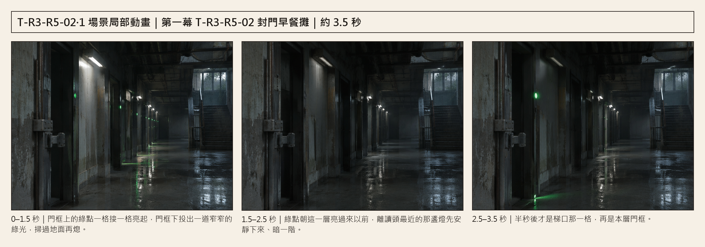

```prompt
【影片】T-R3-R5-02·1｜場景局部動畫｜第一幕 T-R3-R5-02 封門早餐攤
【生成方式】圖生影片：首格直接用 T-R3-R5-02-C01（過渡近看：焊縫、桌腳插銷與乾燥拖痕） 的寫實定稿圖；構圖、光線、人物與物件造型保持不變，只加入下列動作。
【長度】剪用約 3.5 秒（劇本指定）；生成 5 秒後裁切。
【分鏡】
0–1.5 秒｜門框上的綠點一格接一格亮起，門框下投出一道窄窄的綠光，掃過地面再熄。
1.5–2.5 秒｜綠點朝這一層亮過來以前，離讀頭最近的那盞燈先安靜下來、暗一階。
2.5–3.5 秒｜半秒後才是梯口那一格，再是本層門框。
【鏡頭】約 28mm，鏡頭鎖定不動，要疊回原主圖，景深照首格。焦點落在門框與扣件，其餘畫面保持靜止；不新增人物或物件。
【光線色調】現在的現場光：低飽和、潮濕、廢棄；只有漏進樓內的天光與只亮了一部分的設備燈、消防燈照亮局部，亮處不過曝，暗處仍看得出層次；光向與首格一致。光的變化只來自首格既有的綠點、綠光、燈，照分鏡的時間點亮暗，其餘的光不動。
【影片風格】寫實、極致逼真的真人實景拍攝質感：真實攝影機與自然光學，輕微景深、自然底片顆粒與真實曝光；皮膚、布料、金屬、水漬與灰塵都有真實細節。動作自然流暢，有重量與慣性，符合真實人體動作。不是遊戲 CG、不是 3D 算圖、不是插畫。
【後製（不進 AI 生成）】
聲音與後製對點：
・0–1.5 秒：讀頭短「嗶」聲沿門框一格一格響過。
【不要出現】清楚可辨識的人臉五官；任何可讀的文字、號碼、標誌、國旗或國名（畫面上的字留白或模糊，後製再合成）；配樂；第三人稱或看見主角全身；鏡頭晃動、推移或換景；血腥特寫、裸露；手指數量或手部結構錯誤；分鏡沒寫的人物、物件突然出現、消失或變形；遊戲 CG 感、3D 算圖感、插畫、動漫或卡通畫風、塑膠般光滑的皮膚與材質；動作僵硬、機械、卡頓、漂浮感或不自然的慢動作。
```

**素材提示詞**　人物：無｜場景：T-R3-R5-02 封門早餐攤｜物品：無

```asset
【素材】場景｜T-R3-R5-02 封門早餐攤｜T-R3-R5-02·1
【內容】寫實實景的空景，不含任何人物與手；畫面中所有牌面、告示、標籤與紙件上的文字、數字一律留白或模糊。
空間：T-R3-R5-02（過渡場景）：封門早餐攤：一張摺桌卡在兩戶門框間，蒸籠已乾。前方紅漆箭頭被新焊鐵片截斷，桌下舊排水溝穿過牆腳。
本段畫面：T-R3-R5-02-C01（過渡近看）：焊縫、桌腳插銷與乾燥拖痕。紅箭頭指的是封死的舊樓梯。桌下拖痕接到透風的服務缺口。
【構圖】空景參考兩張：一張照「空間」的全景，第一人稱站立視線高度、約 28mm 人眼視角、平視、地平線水平；一張照「本段畫面」的近看構圖，與本段首格一致。都不含人物、手與人影。
【光線色調】現在的現場光：低飽和、潮濕、廢棄；只有漏進樓內的天光與只亮了一部分的設備燈、消防燈照亮局部，亮處不過曝，暗處仍看得出層次；光向與首格一致。
【風格】寫實、極致逼真的真人實景攝影質感：真實相機與自然光學，輕微景深與自然底片顆粒；皮膚、布料、金屬、水漬與灰塵都有真實細節。不是遊戲 CG、不是 3D 算圖、不是插畫。
【不要出現】任何人物、手、人影或異變者；清楚可辨識的人臉五官；任何可讀的文字、號碼、標誌、國旗或國名（字留白或模糊，後製再合成）；血腥特寫、裸露；遊戲 CG 感、3D 算圖感、插畫、動漫或卡通畫風、塑膠般光滑的皮膚與材質。
```

## R5-01 她還在縫（1 段）

<a id="v-r5-01-1"></a>

### R5-01·1　互動（高）

- **重要級別：**<span class="importance-high">高</span>　重點橋段：R5 縫紉者
- **類型：**<span class="video-interact">第一人稱互動</span>　**畫面：**`R5-C02`　**剪用：**約 8 秒
- **劇本：**[R5-01 她還在縫](../09_劇本/09-04_正式劇本_第一幕.md#h-0904-495)
- **交付：**AI 生成稿只作動態參考或底稿；正式交付拆成手部、前景遮擋與物件動態圖層，疊回原主圖，不以整支影片取代可點的場景。
- **重點 ★ R5 縫紉者：**現時指節、線與空袖沿原感知循環；進繡字特寫時針線停在字外，由玩家查清才收錄來源，不以觀看一輪代讀。
- **導演註記：**[R5-01·1 她還在縫](10-22_製作規格_影片導演註記.md#vd-r5-01-1)

**劇本描述**　依原感知顯出伏在桌面的縫紉者。現時手指停、縫、收線，細足般的指節跨在布邊；線牽起一截衣袖，裡頭卻沒有手臂。收線時袖筒從肘彎一路塌平，下一針又把它撐起。視線留在桌外，衣架立柱與桌沿仍在兩側。尾拍桌燈微暗一瞬，她停針半拍，斜影裡極短地掠過縫紉者（F0.5 瞬閃殘影，約 0.25 秒）半張濕髮黑眼的失焦側臉輪廓，隨即恢復低頭續縫。

**對白／配音**　無對白（純畫面／環境音）

**分鏡板**　她還在縫

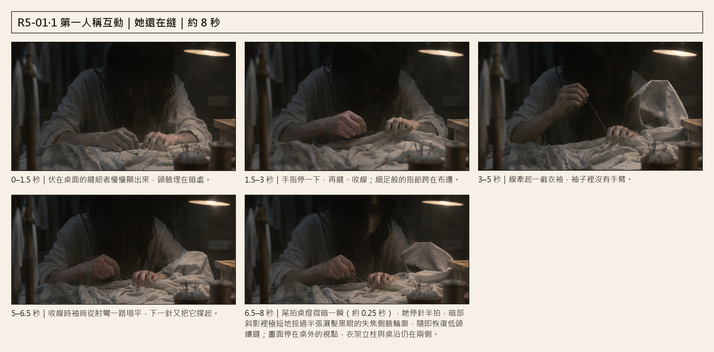

```prompt
【影片】R5-01·1｜第一人稱互動｜第一幕 R5-01 她還在縫
【生成方式】圖生影片：首格直接用 R5-C02（近看：繡布與縫紉位置） 的寫實定稿圖；構圖、光線、人物與物件造型保持不變，只加入下列動作。
【長度】剪用約 8 秒；生成 10 秒後裁切。
【情緒節奏】一個人還在做完不了的工作。節奏規律而安靜，空袖塌下又撐起的那一下最讓人發冷。
【分鏡】
0–1.5 秒｜伏在桌面的縫紉者慢慢顯出來，頭臉埋在暗處。
1.5–3 秒｜手指停一下，再縫、收線；細足般的指節跨在布邊。
3–5 秒｜線牽起一截衣袖，袖子裡沒有手臂。
5–6.5 秒｜收線時袖筒從肘彎一路塌平，下一針又把它撐起。
6.5–8 秒｜尾拍桌燈微暗一瞬（約 0.25 秒），她停針半拍，暗部斜影裡極短地掠過縫紉者（F0.5 瞬閃殘影）半張濕髮黑眼的失焦側臉輪廓，隨即恢復低頭續縫；畫面停在桌外的視點，衣架立柱與桌沿仍在兩側。
【鏡頭】桌外的固定視點，鏡頭鎖定不動，要疊回原圖；焦點在布邊與指節，衣架立柱與桌沿在兩側失焦。
【人物】人物與異變者照首格的造型與位置，臉不給清楚五官（無臉、背光或被遮住），動作緩慢但連貫自然。
【光線色調】桌面被一處局部的光照亮，布面與線反著光；伏著的縫紉者頭臉沉在暗部，看不見五官。整體色調沿用現在的現場光：低飽和、潮濕，亮處不過曝，暗處有層次。
【影片風格】寫實、極致逼真的真人實景拍攝質感：真實攝影機與自然光學，輕微景深、自然底片顆粒與真實曝光；皮膚、布料、金屬、水漬與灰塵都有真實細節。動作自然流暢，有重量與慣性，符合真實人體動作。不是遊戲 CG、不是 3D 算圖、不是插畫。
【後製（不進 AI 生成）】
聲音與後製對點：
・0–1.5 秒：工坊的低鳴，整段不斷。
・1.5–3 秒：針穿過布的細響，一下一下很規律。
・3–5 秒：收線時線拉過布面的長長一聲。
・5–6.5 秒：袖筒塌下時布料輕輕一軟。
・6.5–8 秒：停針半拍時針聲微斷一下，隨即照原本節奏繼續。
【不要出現】清楚可辨識的人臉五官；任何可讀的文字、號碼、標誌、國旗或國名（畫面上的字留白或模糊，後製再合成）；配樂；第三人稱或看見主角全身；鏡頭晃動、推移或換景；血腥特寫、裸露；手指數量或手部結構錯誤；分鏡沒寫的人物、物件突然出現、消失或變形；遊戲 CG 感、3D 算圖感、插畫、動漫或卡通畫風、塑膠般光滑的皮膚與材質；動作僵硬、機械、卡頓、漂浮感或不自然的慢動作。
```

**素材提示詞**　人物：[縫紉者（R5）](10-23_製作規格_影片素材設定.md#va-seamstress)｜場景：R5 工坊角｜物品：無

```asset
【素材】人物｜縫紉者（R5）｜R5-01·1
【內容】伏在工坊桌面上縫補的成年人形，頭始終低著，臉藏在陰影裡，穿褪色、尺寸不合的芥末黃舊開襟衫。異變在手：指節細長分節，呈細足狀跨在布邊上縫；縫線牽起一截空的衣袖，袖子裡沒有手臂，收線時袖筒從肘彎一路塌平，下一針又把它撐起。R5-01·1 尾拍桌燈微暗 0.25 秒瞬閃時，她停針半拍，斜影裡極短掠過半張無表情、整顆全黑眼球、眼眶重度發黑與濕亂塌髮的失焦側臉輪廓，隨即恢復低頭。
【構圖】人物參考圖：中性深灰背景、桌燈單側光；伏桌坐姿的側面與正面兩張，加一張指節跨在布邊與空袖的手部特寫。
【風格】寫實、極致逼真的真人實景攝影質感：真實相機與自然光學，輕微景深與自然底片顆粒；皮膚、布料、金屬、水漬與灰塵都有真實細節。不是遊戲 CG、不是 3D 算圖、不是插畫。
【不要出現】抬頭露臉；正面打亮清晰五官；攻擊姿勢；名牌或品牌標誌；手指數量或手部結構錯誤；清楚可辨識的人臉五官；任何可讀的文字、號碼、標誌、國旗或國名（字留白或模糊，後製再合成）；血腥特寫、裸露；遊戲 CG 感、3D 算圖感、插畫、動漫或卡通畫風、塑膠般光滑的皮膚與材質。
```

```asset
【素材】場景｜R5 工坊角｜R5-01·1
【內容】寫實實景的空景，不含任何人物與手；畫面中所有牌面、告示、標籤與紙件上的文字、數字一律留白或模糊。
空間：R5-V01（主場景）：改衣桌、繡布、滑軌衣架、袖口餘料、冷飯與上行低壓門。前排衣架遮住桌面一角，安全角與上行入口仍可見。原低壓門端的工坊側放行面板只掛著一張沒放行的返修單（字留白）。插銷保持封閉。
本段畫面：R5-C02（近看）：繡布與縫紉位置。
【構圖】空景參考兩張：一張照「空間」的全景，第一人稱站立視線高度、約 28mm 人眼視角、平視、地平線水平；一張照「本段畫面」的近看構圖，與本段首格一致。都不含人物、手與人影。
【光線色調】現在的現場光：低飽和、潮濕、廢棄；只有漏進樓內的天光與只亮了一部分的設備燈、消防燈照亮局部，亮處不過曝，暗處仍看得出層次；光向與首格一致。
【風格】寫實、極致逼真的真人實景攝影質感：真實相機與自然光學，輕微景深與自然底片顆粒；皮膚、布料、金屬、水漬與灰塵都有真實細節。不是遊戲 CG、不是 3D 算圖、不是插畫。
【不要出現】任何人物、手、人影或異變者；清楚可辨識的人臉五官；任何可讀的文字、號碼、標誌、國旗或國名（字留白或模糊，後製再合成）；血腥特寫、裸露；遊戲 CG 感、3D 算圖感、插畫、動漫或卡通畫風、塑膠般光滑的皮膚與材質。
```

## R5-03 安定角落（選用）（1 段）

<a id="v-r5-03-1"></a>

### R5-03·1　動作回饋（低）

- **重要級別：**<span class="importance-low">低</span>　短動作回饋
- **類型：**<span class="video-feedback">第一人稱動作回饋</span>　**畫面：**`R5-C05`　**剪用：**約 1.5 秒
- **劇本：**[R5-03 安定角落（選用）](../09_劇本/09-04_正式劇本_第一幕.md#h-0904-542)
- **交付：**AI 生成稿只作動態參考或底稿；正式交付為疊在原主圖或近看上的短手部／物件動態圖層。

**劇本描述**　R5-C05 線軸旁既有指示燈亮起。縫紉者停手一拍，再繼續縫，頭始終低著。

**對白／配音**　無對白（純畫面／環境音）

**分鏡板**　安定角落

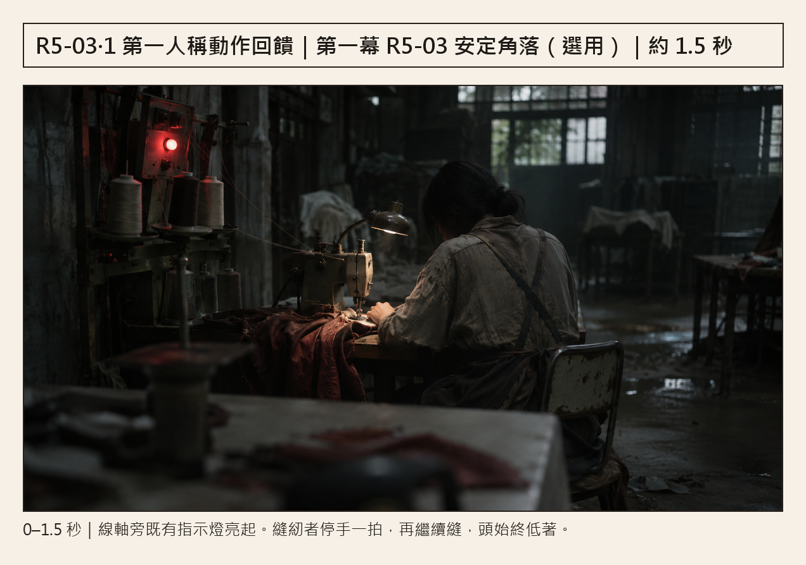

```prompt
【影片】R5-03·1｜第一人稱動作回饋｜第一幕 R5-03 安定角落（選用）
【生成方式】圖生影片：首格直接用 R5-C05（近看：安定角落） 的寫實定稿圖；構圖、光線、人物與物件造型保持不變，只加入下列動作。
【長度】剪用約 1.5 秒；生成 5 秒後裁切。
【分鏡】
0–1.5 秒｜線軸旁既有指示燈亮起。縫紉者停手一拍，再繼續縫，頭始終低著。
【鏡頭】約 28mm 第一人稱主觀視線，鏡位鎖定不動，要疊回原主圖，景深照首格。焦點在分鏡點名的人物、倒影或異變者，前景與背景略微失焦；動作有重量，做完就停住，不加分鏡以外的動作。
【人物】人物與異變者照首格的造型與位置，臉不給清楚五官（無臉、背光或被遮住），動作緩慢但連貫自然。
【光線色調】現在的現場光：低飽和、潮濕、廢棄；只有漏進樓內的天光與只亮了一部分的設備燈、消防燈照亮局部，亮處不過曝，暗處仍看得出層次；光向與首格一致。光的變化只來自首格既有的指示燈，照分鏡的時間點亮暗，其餘的光不動。
【影片風格】寫實、極致逼真的真人實景拍攝質感：真實攝影機與自然光學，輕微景深、自然底片顆粒與真實曝光；皮膚、布料、金屬、水漬與灰塵都有真實細節。動作自然流暢，有重量與慣性，符合真實人體動作。不是遊戲 CG、不是 3D 算圖、不是插畫。
【不要出現】清楚可辨識的人臉五官；任何可讀的文字、號碼、標誌、國旗或國名（畫面上的字留白或模糊，後製再合成）；配樂；第三人稱或看見主角全身；鏡頭晃動、推移或換景；血腥特寫、裸露；手指數量或手部結構錯誤；分鏡沒寫的人物、物件突然出現、消失或變形；遊戲 CG 感、3D 算圖感、插畫、動漫或卡通畫風、塑膠般光滑的皮膚與材質；動作僵硬、機械、卡頓、漂浮感或不自然的慢動作。
```

**素材提示詞**　人物：[縫紉者（R5）](10-23_製作規格_影片素材設定.md#va-seamstress)｜場景：R5 工坊角｜物品：無

```asset
【素材】人物｜縫紉者（R5）｜R5-03·1
【內容】伏在工坊桌面上縫補的成年人形，頭始終低著，臉藏在陰影裡，穿褪色、尺寸不合的芥末黃舊開襟衫。異變在手：指節細長分節，呈細足狀跨在布邊上縫；縫線牽起一截空的衣袖，袖子裡沒有手臂，收線時袖筒從肘彎一路塌平，下一針又把它撐起。R5-01·1 尾拍桌燈微暗 0.25 秒瞬閃時，她停針半拍，斜影裡極短掠過半張無表情、整顆全黑眼球、眼眶重度發黑與濕亂塌髮的失焦側臉輪廓，隨即恢復低頭。
【構圖】人物參考圖：中性深灰背景、桌燈單側光；伏桌坐姿的側面與正面兩張，加一張指節跨在布邊與空袖的手部特寫。
【風格】寫實、極致逼真的真人實景攝影質感：真實相機與自然光學，輕微景深與自然底片顆粒；皮膚、布料、金屬、水漬與灰塵都有真實細節。不是遊戲 CG、不是 3D 算圖、不是插畫。
【不要出現】抬頭露臉；正面打亮清晰五官；攻擊姿勢；名牌或品牌標誌；手指數量或手部結構錯誤；清楚可辨識的人臉五官；任何可讀的文字、號碼、標誌、國旗或國名（字留白或模糊，後製再合成）；血腥特寫、裸露；遊戲 CG 感、3D 算圖感、插畫、動漫或卡通畫風、塑膠般光滑的皮膚與材質。
```

```asset
【素材】場景｜R5 工坊角｜R5-03·1
【內容】寫實實景的空景，不含任何人物與手；畫面中所有牌面、告示、標籤與紙件上的文字、數字一律留白或模糊。
空間：R5-V01（主場景）：改衣桌、繡布、滑軌衣架、袖口餘料、冷飯與上行低壓門。前排衣架遮住桌面一角，安全角與上行入口仍可見。原低壓門端的工坊側放行面板只掛著一張沒放行的返修單（字留白）。插銷保持封閉。
本段畫面：R5-C05（近看）：安定角落。
【構圖】空景參考兩張：一張照「空間」的全景，第一人稱站立視線高度、約 28mm 人眼視角、平視、地平線水平；一張照「本段畫面」的近看構圖，與本段首格一致。都不含人物、手與人影。
【光線色調】現在的現場光：低飽和、潮濕、廢棄；只有漏進樓內的天光與只亮了一部分的設備燈、消防燈照亮局部，亮處不過曝，暗處仍看得出層次；光向與首格一致。
【風格】寫實、極致逼真的真人實景攝影質感：真實相機與自然光學，輕微景深與自然底片顆粒；皮膚、布料、金屬、水漬與灰塵都有真實細節。不是遊戲 CG、不是 3D 算圖、不是插畫。
【不要出現】任何人物、手、人影或異變者；清楚可辨識的人臉五官；任何可讀的文字、號碼、標誌、國旗或國名（字留白或模糊，後製再合成）；血腥特寫、裸露；遊戲 CG 感、3D 算圖感、插畫、動漫或卡通畫風、塑膠般光滑的皮膚與材質。
```

## R5-02a 插銷退開（1 段）

<a id="v-r5-02a-1"></a>

### R5-02a·1　動作回饋（低）

- **重要級別：**<span class="importance-low">低</span>　短動作回饋
- **類型：**<span class="video-feedback">第一人稱動作回饋</span>　**畫面：**`R5-C04`　**剪用：**約 2.5 秒
- **劇本：**[R5-02a 插銷退開](../09_劇本/09-04_正式劇本_第一幕.md#h-0904-552)
- **交付：**AI 生成稿只作動態參考或底稿；正式交付為疊在原主圖或近看上的短手部／物件動態圖層。
- **導演註記：**[R5-02a·1 0388 林佩君 已放行](10-22_製作規格_影片導演註記.md#vd-r5-02a-1)

**劇本描述**　在現場設備條件成立後，面板上那張返修單改為「0388 林佩君 已放行」，原插銷退開。門框與通路仍是進房時看過的位置。

**對白／配音**　無對白（純畫面／環境音）

**分鏡板**　0388林佩君已放行

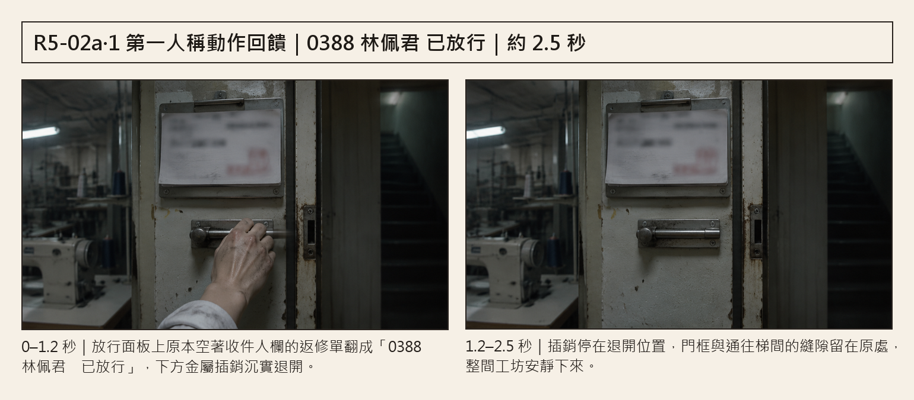

```prompt
【影片】R5-02a·1｜第一人稱動作回饋｜第一幕 R5-02a 插銷退開
【生成方式】圖生影片：首格直接用 R5-C04（操作近看：低壓門端與插銷 「僅工坊側放行」舊牌、閉門接點、工坊側把手及梯間側平鐵護板） 的寫實定稿圖；構圖、光線、人物與物件造型保持不變，只加入下列動作。
【長度】剪用約 2.5 秒；生成 5 秒後裁切。
【情緒節奏】第一次替一個號碼還回名字的瞬間。重點不在門鎖開了，而在整間屋子一直沒停過的那道針線聲，在這一拍突然靜下來。
【分鏡】
0–1.2 秒｜放行面板上原本空著收件人欄的返修單翻成「0388　林佩君　已放行」，下方金屬插銷沉實退開。
1.2–2.5 秒｜插銷停在退開位置，門框與通往梯間的縫隙留在原處，整間工坊安靜下來。
【鏡頭】固定低壓門端操作近景，鏡頭鎖定不動，要疊回原主圖；焦點落在放行面板與下方金屬插銷。
【光線色調】現在的現場光：工坊角老舊吸頂冷白微光斜落在面板與門框邊緣，梯間一側仍暗著。
【影片風格】寫實、極致逼真的真人實景拍攝質感：真實攝影機與自然光學，輕微景深、自然底片顆粒與真實曝光；皮膚、布料、金屬、水漬與灰塵都有真實細節。動作自然流暢，有重量與慣性，符合真實人體動作。不是遊戲 CG、不是 3D 算圖、不是插畫。
【後製（不進 AI 生成）】
畫面文字：「0388 林佩君 已放行」
聲音與後製對點：
・0.6 秒：金屬插銷退開一響，低壓列印頭短促吐出半格紙響；同一拍，背景裡一直規律穿布的細密針線聲戛然而止。後製：畫面文字「0388　林佩君　已放行」；聲音字幕「［插銷退開；針線聲停了］」。
・1.2–2.5 秒：背景只剩低沉安靜的工坊底噪。
【不要出現】清楚可辨識的人臉五官；任何可讀的文字、號碼、標誌、國旗或國名（畫面上的字留白或模糊，後製再合成）；配樂；第三人稱或看見主角全身；鏡頭晃動、推移或換景；血腥特寫、裸露；手指數量或手部結構錯誤；分鏡沒寫的人物、物件突然出現、消失或變形；遊戲 CG 感、3D 算圖感、插畫、動漫或卡通畫風、塑膠般光滑的皮膚與材質；動作僵硬、機械、卡頓、漂浮感或不自然的慢動作。
```

**素材提示詞**　人物：無｜場景：R5 工坊角｜物品：無

```asset
【素材】場景｜R5 工坊角｜R5-02a·1
【內容】寫實實景的空景，不含任何人物與手；畫面中所有牌面、告示、標籤與紙件上的文字、數字一律留白或模糊。
空間：R5-V01（主場景）：改衣桌、繡布、滑軌衣架、袖口餘料、冷飯與上行低壓門。前排衣架遮住桌面一角，安全角與上行入口仍可見。原低壓門端的工坊側放行面板只掛著一張沒放行的返修單（字留白）。插銷保持封閉。
本段畫面：R5-C04（操作近看）：低壓門端與插銷 舊牌（字留白）、閉門接點、工坊側把手及梯間側平鐵護板。
【構圖】空景參考兩張：一張照「空間」的全景，第一人稱站立視線高度、約 28mm 人眼視角、平視、地平線水平；一張照「本段畫面」的近看構圖，與本段首格一致。都不含人物、手與人影。
【光線色調】現在的現場光：低飽和、潮濕、廢棄；只有漏進樓內的天光與只亮了一部分的設備燈、消防燈照亮局部，亮處不過曝，暗處仍看得出層次；光向與首格一致。
【風格】寫實、極致逼真的真人實景攝影質感：真實相機與自然光學，輕微景深與自然底片顆粒；皮膚、布料、金屬、水漬與灰塵都有真實細節。不是遊戲 CG、不是 3D 算圖、不是插畫。
【不要出現】任何人物、手、人影或異變者；清楚可辨識的人臉五官；任何可讀的文字、號碼、標誌、國旗或國名（字留白或模糊，後製再合成）；血腥特寫、裸露；遊戲 CG 感、3D 算圖感、插畫、動漫或卡通畫風、塑膠般光滑的皮膚與材質。
```
