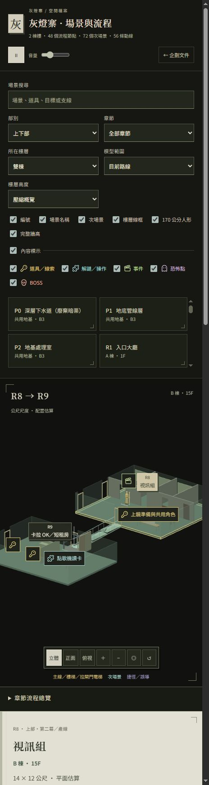
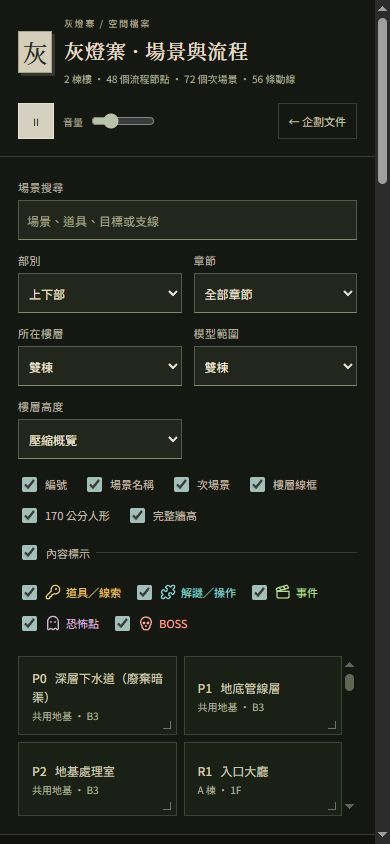

# 文件與場景切換：背景音樂持續播放驗證

日期：2026-10-20

文件首頁保留唯一的 audio 元素，場景與流程以同源 iframe 顯示。切換、返回與上一頁不重新載入持有播放器的頁面，場景頁的播放、暫停與音量控制共用首頁播放器。音樂沿用原本的循環設定與播放偏好。

## 瀏覽器驗證

- 首頁開始播放後，切至場景與流程，播放時間持續增加，沒有歸零，audio 為播放狀態；父頁僅一個 audio 元素。
- 最終建置測得：首頁 0.310 秒，切換後 9.885 秒，持續播放。先前完整往返測得 9.528 → 68.268 → 77.102 秒。
- 場景頁暫停會同步首頁按鈕；續播正常，音量 25% → 26% → 返回首頁仍為 26%，測試結束恢復 25%。
- 暫停後返回文件、再次進場景，均維持暫停及相同播放位置 151.902 秒。
- 選取 R8 後，父網址同步 scene/route；返回及上一頁／下一頁保留 R8，未新增另一個場景 iframe。
- 直接開啟 building/#scene=R8&route=R8-R9-12 會進入共用播放器的文件外框，保留指定場景與路線。
- 390px 手機寬度下，播放／暫停、音量與返回按鈕均正常呈現；測試後已還原 viewport。

## 自動檢查

- `node --test --test-isolation=none tools/test-archive-navigation.mjs building/scene-workspace.test.mjs building/current-spatial.test.mjs`：24/24 通過，其中新增 7 個導覽行為回歸測試。
- 製作規格閱讀、劇本標示及場景總覽既有測試通過。
- JavaScript 語法檢查、場景頁建置、模型標示生成檢查、docs.json 時效檢查及 Git diff 空白檢查通過。

## 畫面

