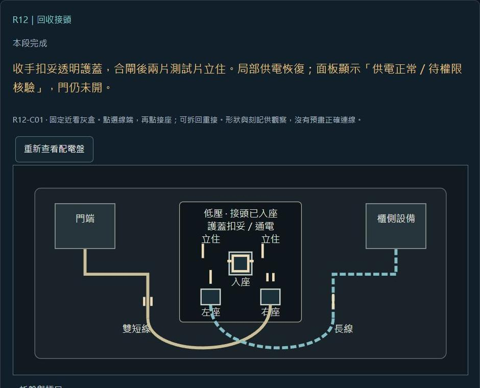

# 2026-10-21 玩法差異與查證節奏精修

依本輪 2D 第一人稱點擊玩法檢視，修訂正式場次、同幕製作規格與查表。目的為區分玩家的判斷、減少查證過程中的介面往返，並讓操作成果可見。這是設計修訂及局部網頁灰盒，不代表完整遊戲已完成或已證實好玩。

## 第五幕的操作差異

| 場景 | 本輪具體調整 | 原條件 |
| --- | --- | --- |
| R23 | 自選原版本欄與後補欄並置，印章可疊合；跨入境／面試／建檔日期比較合法，缺來源時保留待查欄 | A／B／C 逐項親查與原一次整組確認，不加差異分類題 |
| R24 | 四人平行列接起接收號、轉任人事號、日期與續管；橫看可固定一欄，錯接留來源值 | 本人新見撤號及其他三人仍實讀；H03 原旗標時機與 H02 原確認不變 |
| R25 | 移動三帶，以共用游標看同刻電力、驗證／開門、實際通過原值；錯位顯示狀態矛盾 | 七分鐘、十一秒、另日四十八小時及原一次提交分開，游標不自動對齊 |
| R26 | B02 具體指出缺原單引用、原命令／自主追加混淆、待遇範圍誤讀；已選原欄直接接原因果卡 | 四來源、三卡、原防禦及兩種處置保留，不追加舉證題 |

正式來源：[第五幕正文](../docs/09_劇本/09-08_正式劇本_第五幕.md#node-r23-script)、[第五幕規格](../docs/10_製作規格/10-06_製作規格_第五幕.md#node-r23-spec)。

## 高潮查證的接續

- R30 原件近看可直接取來源籤放在旁邊剖面，省去關頁、另開筆記、找同件再回剖面；五點仍手動判斷，原不可逆警示保留。
- R31 五列、備份區及末格使用同一工作面。設備近看回原列，掛載結果原位顯示，E5-03 從剛核驗的來源直接放末格；核驗、掛載與末格仍是各自原判定。
- R32 肉身三來源可邊實讀邊留手動關聯草稿，D09 在原位補齊後提交；讀完三源再開始接亦可。四熱點仍各自實讀，不加簽到。
- R32 收手後在出口旁接續封鎖三源，省去另開筆記找三源。現時提出／收手與原一次確認保留；草稿不能提前完成揭露或顯形。
- R29 至少二十秒責任停頓、R31 十二秒歷史解凍與等價摘要、R8／C 手部情感操作維持原節奏；U6 保留兩次移水的短喘息。

正式來源：[第八幕](../docs/09_劇本/09-17_正式劇本_第八幕.md#node-r30-script)、[終幕](../docs/09_劇本/09-10_正式劇本_終幕.md#node-r32-script)。

## 機構與固定鏡位

第二幕 17F／18F／21F／22F 的排水、推架、扣橋與止轉，以原鏡位的水位、位置與扣位差分呈現；扣妥或止轉直接作原動作結果，不增成功確認。U3 保持光角、固定線／動栓肩與橋端的共同參照；後廊與 U4b 退閂／抽銷時看扣位解除，再推門並自行跨門。回訪沿已完成狀態，不重解；所有畫面沿原圖號交付，新增差分仍需正式美術製作。

R12 原型從「裝接頭後一鍵接上回路」改為固定近看灰盒：三件試裝、可追看的兩條線槽、逐線配座、占座阻擋、拆回重接、手動合閘與兩片測試片。缺線、錯件或互換均不完成，局部復電不代權限或開門。沿原 R12-C01 解法，沒有加入新題或遊戲存檔。

原型入口：[操作因果試玩](../playtest.html)。原型只涵蓋 R12 局部配電；其餘四切片仍為文字與逐拍邏輯推演。聲音、正式材質、威脅秒數、完整關卡及長時間節奏尚未驗收。

## 同步與驗證

共用附錄的閱讀節奏、核心循環與試測項目，玩法總表、收集物總表、分類副本、網站資料、圖像工單及場景流程同步更新。場景與流程頁面依正式來源重建；沒有增加房間、來源、收藏或結局門檻。

檢查結果：

- `node --test --test-isolation=none` 跑全部 `tools/test-*.mjs`：327 項通過，零失敗，見[文件與原型紀錄](2026-10-21-gameplay-refinement-tests.log)。R12 包含雙線不可略過、占座不覆寫、錯接可修復、任意合法配接次序與可達完成路徑。
- 全部 `building/*.test.mjs`：49 項通過，零失敗，見[場景資料紀錄](2026-10-21-gameplay-refinement-building-tests.log)。場景與流程頁面已重建，仍為製作查閱介面。
- 圖像工單、分類副本、故事盤點、示意圖、目錄與網站資料的六項重建檢查通過；逐幕圖序及 `git diff --check` 通過。
- 瀏覽器實際操作確認裂榫拒接、兩線互換不能通過、正確配接需手動測試、完成仍待權限核驗，以及重新試玩清空原型狀態。未使用此結果推定正式時長、恐怖或首次玩家理解度。

灰盒首次玩家試測仍未執行。優先連玩 R23–R26、測 U3／U5 固定視野，再連玩 R30–R33；分別記推論形成、取得依據、可行動時點與被介面中斷的位置，不把文件測試計為玩家測試。

## 邏輯複核修正

- 共用附錄與 Godot 製作包摘要改為 R25_H04 三軌核對並確認只取得 E4-04；R25_H05 另頁完成四十八小時日期與因果對帳才取得 E4-05。兩項不互相代發，與第五幕正式規格及玩法總表一致。
- 第三幕規格、共用附錄與技術 Spike 文件更新 R12 原型進度：已提供固定近看、逐線配接與手動合閘灰盒；其餘四片仍為文字推演，正式引擎、存讀檔及後續權限未由本原型驗收。
- 已重新同步分類文件及文件瀏覽器資料。既有 canonical 檢查 73 項及相關模型／劇本檢查全數通過，來源同步、網站資料同步及差異格式檢查通過；本次沒有進行新的玩家試玩。
